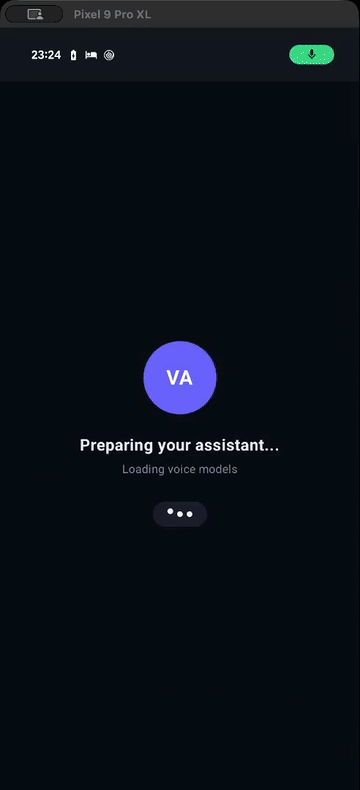
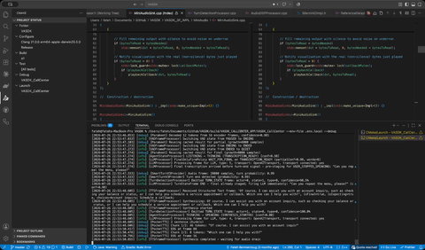
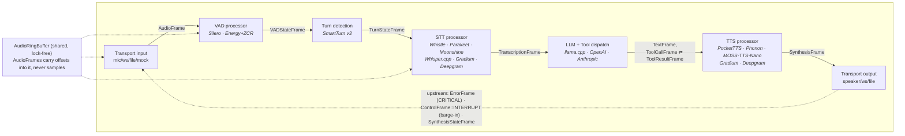

<p align="center">
    <picture>
        <source media="(prefers-color-scheme: dark)" srcset="docs/assets/vasdk-logo-wordmark.svg">
        
    </picture>
</p>

A C++17 framework for building voice assistants that listen, think, and talk back, running anywhere from a desktop, an Android device, a car head unit, etc... VASDK is not a wrapper around a single vendor's API. It's a pipeline runtime plus a set of interchangeable provider implementations for VAD, speech-to-text, turn-detection, LLM reasoning, tool calling and text-to-speech, and it can run the whole loop fully offline on ONNX models if you need it to.

## Demo

### Android app



[Full video](https://github.com/fatehmtd/VASDK/raw/master/assets/videos/vasdk-android-demo.mp4)

### Call center pipeline



[Full video](https://github.com/fatehmtd/VASDK/raw/master/assets/videos/vasdk-callcenter-demo.mp4)

### Browser calls over WebRTC

Build with `-DVASDK_BUILD_LIBDATACHANNEL_WEBRTC=ON`, then talk to an agent with an LLM behind it from your browser:

```bash
./build/VASDK_APP/VASDK_Pipeline --config VASDK_APP/config/engine.txtpb \
  --agent VASDK_APP/agents/garage-menu/agent.txtpb --env-file .env --webrtc-port 8080
```

Open `http://127.0.0.1:8080`: the browser becomes the mic and speaker, and the page shows the agent's state, the conversation and per-turn latency live. The agent answers what it understands (booking, prices, opening hours) and the LLM chats about everything else. See [VASDK_Pipeline](docs/apps/pipeline.md#an-agent-and-the-llm-together) and [WebRtcTransport](docs/reference/transports.md#webrtctransport).

## Why this exists

VASDK took shape while I was designing a production in-vehicle voice assistant. Strong voice-agent SDKs like Pipecat and LiveKit Agents exist, but they are Python-first and cloud-friendly, and an in-vehicle product has unreliable connectivity, strict latency budgets, ARM targets and no room for a Python interpreter in the critical path. VASDK keeps the idea that makes those frameworks pleasant to use (a pipeline of typed frames flowing through composable processors) and reimplements it natively in C++, assuming from day one that any stage might be a local ONNX or GGUF model instead of an HTTP call. Every backend is a separate CMake target: you link the ones you need and the rest never touch your binary.

The project is young and moving fast, with no tagged releases yet; see [what's mature and what's moving](docs/overview.md#whats-mature-and-whats-moving). Treat headers as the source of truth over the docs.

## Quick start

You need CMake 3.16+, a C++17 compiler, git and a network connection. Everything else (C++ dependencies, libcurl and protobuf if they aren't installed, model files) is fetched at configure time. Details: [Building VASDK](docs/building.md).

```bash
git clone https://github.com/fatehmtd/VASDK.git
cd VASDK
cmake -B build -S .
cmake --build build --config Release
```

Phonon, the default voice, is gated on HuggingFace: before you configure, export `HF_TOKEN` after accepting the [model terms](https://huggingface.co/gradium/phonon-40m-multilingual), or pass `-DPHONON_TTS_HF_REPO=gradium/phonon-31m-en` for the public English-only model.

Then give it an LLM to talk to and run it:

```bash
cp .env.example .env   # fill in LLM_API_KEY (or OPENROUTER_API_KEY / OPENAI_API_KEY) and LLM_MODEL
./build/VASDK_APP/VASDK_Pipeline
```

Set `LLM_MODEL` too, not only the key: the default endpoint is OpenRouter, which expects `provider/model` names (`openai/gpt-4o`, `anthropic/claude-sonnet-4-5`, …). Without it the app starts but fails on the first LLM request. To stay fully offline, build llama.cpp instead and pass `--llm-model-path` ([VASDK_Pipeline guide](docs/apps/pipeline.md)).

That's a full voice loop: mic in, VAD, speaker tracking, transcription, LLM turn with tool calling, synthesis, speaker out. The repository has five apps to run and copy from:

| App | What it is | Run |
| --- | --- | --- |
| [VASDK_Pipeline](docs/apps/pipeline.md) | General-purpose desktop assistant: barge-in, tools, metrics, browser calls | `./build/VASDK_APP/VASDK_Pipeline` |
| [VASDK_CallCenter](docs/apps/callcenter.md) | A phone call answered by agent files: caller lookup, forms with read-backs, handoff to a person; runs with no LLM | `./build/VASDK_CALLCENTER_APP/VASDK_CallCenter` |
| [VASDK_Car](docs/apps/car.md) | In-car assistant built from ten verticals, with a live dashboard and proactive alerts | `./build/VASDK_CAR_APP/VASDK_Car` |
| [VASDK_PYTHON_APP](docs/apps/python.md) | Kitchen assistant on the [Python binding](bindings/python/README.md) | `python VASDK_PYTHON_APP/app.py --demo` |
| [Android](docs/apps/android.md) | The full stack on a phone, in Kotlin over JNI, with device tools | see the guide |

With Visual Studio or Xcode, binaries land under an extra `Release/` folder (e.g. `./build/VASDK_APP/Release/VASDK_Pipeline`).

## Architecture at a glance

Frames carry data, processors act on frames, a pipeline chains processors, and providers are the swappable backends a processor wraps. A voice turn flows left to right as typed frames; interrupts and errors race back right to left:



Swapping a provider never touches processor or pipeline code. Read the reference in order: [frames](docs/reference/frames.md) (including [the audio ring buffer](docs/reference/frames.md#the-audio-ring-buffer)), [processors](docs/reference/processors.md), [pipeline](docs/reference/pipeline.md), [providers](docs/reference/providers.md).

## Natural turn-taking

- **Early end of turn, without cutting people off.** SmartTurn v3 scores the audio while the user pauses: a clearly finished turn ends at the pause, an uncertain one waits for real silence. [Details](docs/reference/processors.md#turndetectionprocessor)
- **Back-channels don't interrupt.** "Mm-hmm", "yeah" and "right" said over the agent duck its voice instead of stopping it; real interruptions still cut in. [Details](docs/reference/processors.md#back-channels-speech-over-the-agent-that-isnt-an-interruption)
- **Follow-ups are one message.** If a pause ends the turn and the user keeps talking, the in-flight request is cancelled and both utterances go to the LLM together. [Details](docs/reference/llm.md#follow-ups)

## Providers

| Stage | Local / offline | Cloud |
| --- | --- | --- |
| Audio I/O | MiniAudio, SDL3 | - |
| VAD | Silero (ONNX), Energy+ZCR | - |
| Turn detection | SmartTurn v3 | - |
| Speaker identification | pyannote (WeSpeaker ResNet34-LM, ONNX) | - |
| Noise suppression | RNNoise | - |
| Intent understanding | all-MiniLM-L6-v2 sentence encoder (ONNX) | - |
| Entity finding | GLiNER (ONNX, opt-in), a tagger on MiniLM's word vectors | the agent's LLM |
| STT | Whistle, Parakeet, Moonshine, Whisper.cpp (WIP), Voz (Android) | Gladia (WIP), Gradium, Soniox, Deepgram, Cartesia, Fish Audio |
| TTS | PocketTTS, Phonon, MOSS-TTS-Nano, Supertonic 3 | Gradium, Soniox, Deepgram, Cartesia, Fish Audio |
| LLM | llama.cpp, or any OpenAI-compatible local server | OpenAI, Anthropic |
| File / batch audio | FFmpeg-backed file transport | - |
| WebRTC (browser calls) | libdatachannel + Opus | - |

On by default: MiniAudio, Silero VAD, SmartTurn v3, pyannote, MiniLM, Whistle, PocketTTS, Phonon, RNNoise and VizAnim. The [provider catalog](docs/provider-catalog.md) covers how apps pick between them, each provider's options and models, and every source and license. To write one, follow the [provider checklist](docs/reference/providers.md#writing-a-new-provider-the-checklist).

## Documentation

- [Documentation index](docs/README.md): where to start, by role (evaluating, building an app, writing a provider, extending the core).
- [Example apps](docs/apps/README.md) and [worked examples](docs/README.md#worked-examples).
- [Plain-language overview](docs/overview.md) for product and project people.
- [AGENTS.md](AGENTS.md) and [skills](skills/README.md) for coding agents and contributors: one skill per stage (VAD, STT, TTS, LLM, …), for new providers, core components, agents and apps, with the definition of done.

## License

Apache License 2.0. See [LICENSE](LICENSE).

The model weights the build downloads (and the two bundled in the Android app) carry their own upstream licenses, ranging from MIT to CC BY 4.0 to OpenRAIL. [THIRD_PARTY_NOTICES.md](THIRD_PARTY_NOTICES.md) lists every model, its source, and its license.
