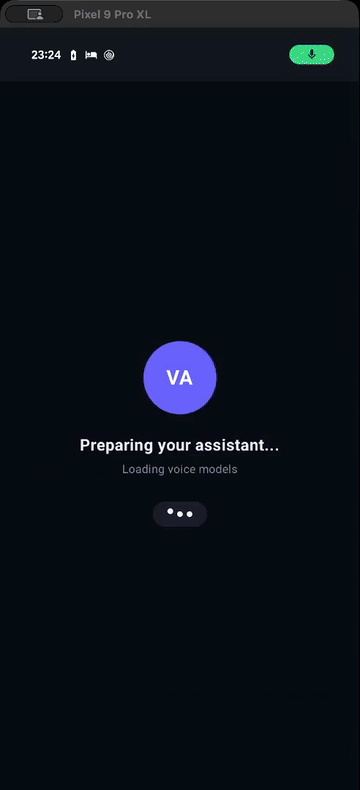
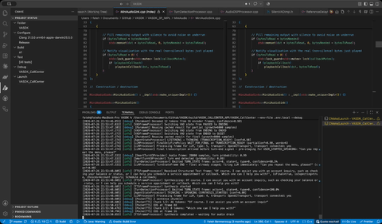
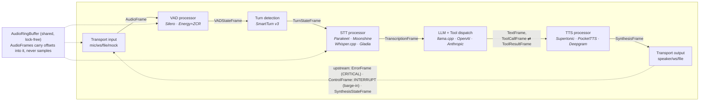
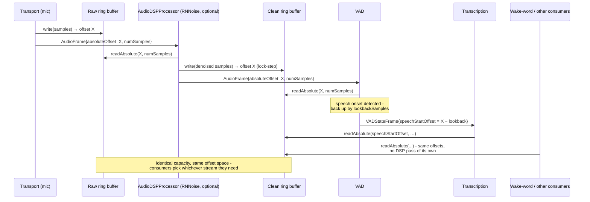
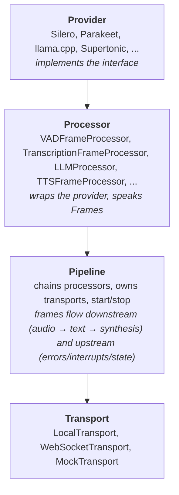

# VASDK

A C++17 framework for building voice assistants that listen, think, and talk back, running anywhere from a desktop, an Android device, a car head unit, etc... VASDK is not a wrapper around a single vendor's API. It's a pipeline runtime plus a set of interchangeable provider implementations for VAD, speech-to-text, turn-detection, LLM reasoning, tool calling and text-to-speech, and it can run the whole loop fully offline on ONNX models if you need it to.

## Demo

### Android app



[Full video](https://github.com/fatehmtd/VASDK/raw/master/assets/videos/vasdk-android-demo.mp4)

### Call center pipeline



[Full video](https://github.com/fatehmtd/VASDK/raw/master/assets/videos/vasdk-callcenter-demo.mp4)

## Why this exists

The idea for VASDK took shape while I was designing a production in-vehicle voice assistant. That work made the gap obvious: there are strong voice-agent SDKs like Pipecat and LiveKit Agents, but they are primarily built around Python-first, cloud-friendly assumptions that do not map cleanly to embedded and automotive systems.

That kind of product has constraints that many general-purpose voice frameworks are not designed around: unreliable connectivity, strict latency budgets, ARM deployment targets, and no room for a Python interpreter in the critical path. VASDK is my attempt to bring the same high-level developer experience those frameworks offer into a C++ runtime that fits in-vehicle systems: modular, pipeline-based, cross-compilable, and able to run fully offline when the product demands it.

So VASDK keeps the idea that makes those frameworks pleasant to use (a pipeline of typed frames flowing through composable processors) and reimplements it natively, with the assumption baked in from day one that any given stage might be a local ONNX or GGUF model instead of an HTTP call. Every VAD, STT, TTS, and LLM backend is a separate CMake target. You link the ones you need and the rest never touch your binary. Providers swap without touching pipeline logic, you only use what you actually need.

The project is still young and moving fast. There are no tagged releases yet, and the API surface shifts fastest wherever the newest work is landing: the goal-oriented call center layer (`goal/`) as its slot-filling, escalation, and CRM-integration isn't mature yet and will continue to change. The Android app as it grows from a thin JNI wrapper into a genuinely capable on-device assistant - spoken confirmation before sensitive actions like calls or texts, a model-info overlay for inspecting the live prompt and tool set, waveform-driven UI feedback for mic and TTS output, and a widening set of Android-native tools spanning calls, SMS, contacts, calendar, location, camera, notifications, alarms/timers, media, and web. Treat headers as the source of truth over this document.

## Quick start

### Prerequisites

- CMake 3.16+ and a C++17 compiler.
- Git on your `PATH` - needed both to clone the repo and by CMake's `FetchContent` to pull every C++ dependency at configure time.
- libcurl development files. VASDK links against system libcurl for every HTTP-based transport (OpenAI/Anthropic/OpenRouter LLM calls, Gladia/Deepgram cloud STT/TTS) via `find_package(CURL REQUIRED)`, so configure fails without it unless you pass `-DVASDK_ENABLE_HTTP_TRANSPORT=OFF` (which also disables every cloud provider, leaving only local/offline ones). Usually already present on Linux/macOS (`apt install libcurl4-openssl-dev` / `brew install curl` if not); on Windows, the simplest path is `vcpkg install curl` plus `-DCMAKE_TOOLCHAIN_FILE=<vcpkg>/scripts/buildsystems/vcpkg.cmake` on the configure line below.
- A network connection and ~1.5 GB free disk for the first configure - everything else (C++ deps and model files) is fetched for you, and re-configures skip anything already downloaded.

```bash
git clone https://github.com/fatehmtd/VASDK.git
cd VASDK
cmake -B build -S .
cmake --build build --config Release
```

The first configure downloads all C++ dependencies via `FetchContent` (spdlog, nlohmann/json, CLI11, Highway, ctrack, each provider's SDK) and the model files for every enabled local provider (Silero VAD, Parakeet, Moonshine, PocketTTS, Supertonic, SmartTurn, a default GGUF for llama.cpp). If you want to skip a model, every download is behind its own `VASDK_DOWNLOAD_*` option (see [Model files](#model-files)).

Then give it an LLM to talk to and run it:

```bash
cp .env.example .env   # fill in LLM_API_KEY (or OPENROUTER_API_KEY / OPENAI_API_KEY) and LLM_MODEL
./build/VASDK_APP/VASDK_Pipeline
```

Two values in `.env` matter, not just the key: `LLM_MODEL` is required too - the default `LLM_ENDPOINT` is OpenRouter, which expects its `provider/model` naming (`openai/gpt-4o`, `anthropic/claude-sonnet-4-5`, `qwen/qwen3-30b-a3b-instruct`, …; see the comments in `.env.example`). Leaving `LLM_MODEL` unset doesn't fail fast - the app starts, logs the model as `(not set)`, and only errors once the first LLM request goes out - so set it up front. If you point `LLM_ENDPOINT` at OpenAI or Anthropic directly instead, use that provider's own model names.

That's a full voice loop: mic in, VAD, transcription, LLM turn with tool calling, synthesis, speaker out. Talk to it. If you'd rather stay fully offline, skip the `.env` and pass `--llm-model-path` pointing at a GGUF file instead (the default one is already in `build/VASDK_3P_IMPL/models/`). The [VASDK_Pipeline guide](VASDK_APP/README.md) covers every flag and feature.

The second showcase app is the goal-oriented call center pipeline:

```bash
./build/VASDK_CALLCENTER_APP/VASDK_CallCenter
```

It classifies caller intent on the first utterance, fills required slots over multiple turns, confirms before acting, escalates on request or after too many failed reprompts, and resumes a dropped session via `FileGoalStatePersistence`. It's the closest thing in this repo to an IVR replacement, and it's what most of the `goal/` namespace exists to support. The [VASDK_CallCenter guide](VASDK_CALLCENTER_APP/README.md) walks through the call flow, the demo goals, and the CRM integration seams. It reads the same `.env` (`LLM_API_KEY`/`LLM_MODEL`) as `VASDK_Pipeline`.

With multi-config generators (Visual Studio, Xcode) the binaries land one level deeper, under a `Release/` subdirectory (e.g. `./build/VASDK_APP/Release/VASDK_Pipeline`). Both apps print an error and exit if they can't find the models directory or a required provider wasn't built; check the CMake configure output, which lists exactly which providers were enabled.

## Core architecture

Four concepts do all the work in this codebase. Frames carry data, processors act on frames, a pipeline chains processors together, and providers are the swappable backends a processor wraps. Everything else in the core library (the goal engine, context aggregation, metrics, networking) is built on top of these four, not a replacement for them. This section is the tour; the per-interface contracts (every method, every state machine, extension checklists) live in the [reference docs](docs/README.md#core-concepts-reference).

Here's the whole thing at a glance. A voice turn flows left to right as typed frames; interrupts and errors race back right to left; and every stage is a provider you can swap without touching the rest:



Providers are picked one per stage at build time - the same shape above, with `MiniAudio`/`SDL3`/`FFmpeg` behind Transport, `Silero`/`Energy+ZCR` behind VAD, `SmartTurn v3` behind Turn detection, `Parakeet`/`Moonshine`/`Whisper.cpp`/`Gladia` behind STT, `llama.cpp`/`OpenAI`/`Anthropic` behind LLM, and `Supertonic`/`PocketTTS`/`Deepgram` behind TTS.

### Frames

A `Frame` (`Frame.h`) is the unit of data flowing through the system. It's an abstract base carrying shared metadata (timestamp, sequence ID, `sourceId`, processing/acquisition duration for profiling), and each concrete subclass adds its own payload:

| Frame | Carries |
| --- | --- |
| `AudioFrame` | not samples, but an offset and length into a shared ring buffer |
| `TranscriptionFrame` | STT result (text, word timing, alternatives, `isFinal`) |
| `TextFrame` | text for TTS input or LLM output, with optional UI `choices` |
| `SynthesisFrame` / `SynthesisStateFrame` | TTS audio output, and TTS lifecycle (started, completed, interrupted) |
| `VADStateFrame` / `TurnStateFrame` | speech-activity state, and whose turn it is |
| `ToolCallFrame` / `ToolResultFrame` | an LLM-requested function call and its result |
| `AgentStateFrame` | the conversation state machine's current state (IDLE/LISTENING/THINKING/SPEAKING/INTERRUPTED) |
| `ErrorFrame` / `ControlFrame` | failures and pipeline commands (start/stop/interrupt) |

Every frame has a `FramePriority` (`ErrorFrame` and `ControlFrame::INTERRUPT` are `CRITICAL`), and frames travel in both directions: `DOWNSTREAM` for the normal audio-to-text-to-synthesis flow, `UPSTREAM` for errors, interrupts, and state changes racing back toward the input side. That's what makes barge-in and error recovery possible without bespoke wiring at every stage. When the caller talks over the assistant mid-response, that's an upstream `ControlFrame::INTERRUPT` racing an `ErrorFrame` past the TTS stage, and `AgentStateProcessor` decides what happens to the in-flight response. It's also how `RecoveryProcessor` catches STT/LLM/TTS failures from a single insertion point anywhere in the chain, since errors travel upstream regardless of where they originated.

`AudioFrame` is worth a closer look on its own: it doesn't carry samples, only an offset and length into a shared `AudioRingBuffer`. See [The audio ring buffer](#the-audio-ring-buffer) below for why that design choice earns its complexity.

### The audio ring buffer

The single biggest reason `AudioFrame` doesn't carry samples is `AudioRingBuffer` (`AudioRingBuffer.h`): a fixed-capacity circular buffer, shared via `shared_ptr` across the transport and every processor that touches raw mic-side audio. Instead of pushing PCM through a chain of stage-to-stage copies, only two integers move downstream: `absoluteOffset` and `numSamples`. Whoever actually needs the bytes calls `readAbsolute()` against the shared buffer, however many frames behind the write cursor they've fallen.

That shared-buffer design pays for itself in three concrete ways, beyond just "fewer memcpys":

- **Raw and clean streams, kept separate.** `LocalTransport` writes mic audio into one ring buffer and never touches it again - the raw signal stays raw. `AudioDSPProcessor` reads from that raw buffer, runs it through a `GenericAudioDSPProvider` (e.g. RNNoise), and writes the result into a second, identically-sized "clean" ring buffer, advanced in lock-step so the same `AudioFrame::ringbufferOffset` addresses the same instant in both. VAD and STT are pointed at whichever buffer they need - the clean one when denoising is enabled, the raw one directly when it isn't - and neither buffer is ever mutated in place. That clean stream is just as available to anything else that wants processed audio without paying for its own DSP pass: a wake-word detector, a voice-cloning reference recorder for TTS, a debug logger, or whatever gets added next - they all read the same offsets, no extra plumbing required. (`AudioRingBuffer` does expose a lower-level `overwrite()` for in-place mutation of a single buffer, but the shipped `AudioDSPProcessor` doesn't use it; keeping raw and clean as two buffers means nothing downstream ever loses access to the untouched signal.)
- **Free lookback.** `VADFrameProcessor` doesn't keep its own pre-roll window to avoid clipping the start of an utterance. When it detects speech onset, it computes an earlier `absoluteOffset` (`lookbackMultiplier` samples before the detected boundary) and emits *that* offset in the `VADStateFrame`. `TranscriptionProcessor` reads from it directly - the "extra" audio was already sitting in the ring buffer the whole time, so pre-roll costs nothing extra to capture.
- **No backpressure stalls.** Nothing blocks waiting for a slow reader, so a burst of audio never backs up the capture thread. The trade-off is explicit rather than hidden: each buffer has to be sized generously enough (in samples/duration) that the slowest consumer reading from it can't fall behind by more than its capacity before the write cursor wraps and overwrites data that hasn't been read yet. There's no locking and no queueing of raw audio - only bounded staleness, and that bound is a constructor argument you control per buffer.

This only covers the inbound, near-continuous mic path. Outbound audio doesn't need it: `SynthesisFrame` (TTS output) carries its `audioData` directly, since synthesized speech is bursty and short-lived rather than a firehose the whole pipeline needs to share cheaply.



If DSP is disabled at runtime, there's no processor sitting between `Transport` and `Clean` in that diagram - VAD/STT are simply pointed at the raw buffer directly instead, so the "clean" concept costs nothing when you don't need it.

### Processors

`FrameProcessor` (`FrameProcessor.h`) is the base class for every pipeline stage: `VADFrameProcessor`, `TranscriptionFrameProcessor`, `LLMProcessor`, `TTSFrameProcessor`, `ToolDispatchProcessor`, `AgentStateProcessor`, `TurnDetectionProcessor`, `RecoveryProcessor`, and so on. Each one:

- runs on its own thread, pulling frames off a priority queue ordered by `FramePriority` then FIFO, so a critical `ErrorFrame` jumps ahead of queued audio;
- links to a `_downstream` and `_upstream` neighbor and forwards frames via `pushDownstream`/`pushUpstream`;
- overrides `processFrame(frame, direction)` to react to the frame types it cares about and silently passes the rest through (`shouldProcess()` lets it filter cheaply before doing real work);
- reports latency, queue-wait, and frame-count metrics automatically, since instrumentation is wired into the base constructor rather than added per subclass.

A processor stays deliberately ignorant of anything upstream or downstream of it. `TTSFrameProcessor` doesn't know a `RecoveryProcessor` exists three stages away. It just emits `SynthesisStateFrame`s and lets whoever's listening react.

### Pipeline

`Pipeline` (`Pipeline.h`) is intentionally thin. It holds an ordered list of processors plus optional input/output transports, and does three things: `build()` wires each processor's upstream/downstream links to its neighbors, `start()` starts every processor's thread, `stop()` tears them all down. It is not a scheduler or a state machine. All the actual behavior (VAD triggering STT, STT triggering the LLM, tool calls looping back into the conversation) happens because each processor knows which frame types to watch for, not because `Pipeline` orchestrates it.

### Providers

A provider is a concrete implementation of one of the small interfaces the core library declares but never implements: `VADProvider`, `GenericTranscriptionProvider`, `GenericVoiceSynthesisProvider`, `GenericAudioSource`/`Sink`, `TurnDetectionProvider`, `LLMTransport`. The core library only knows the interface. The actual Silero ONNX graph, the Parakeet model, or the HTTP call to Gladia lives in `VASDK_3P_IMPL/` as its own CMake target (`vasdk_silero_vad`, `vasdk_parakeet`, `vasdk_gladiapp_transcription`, and so on).

The corresponding `*FrameProcessor` is the bridge: `VADFrameProcessor` owns a `shared_ptr<VADProvider>` and translates provider calls into frames. That split is why swapping Silero for Energy+ZCR VAD, or Supertonic TTS for Deepgram, never touches processor or pipeline code. You construct a different provider, hand it to the same processor type, and the rest of the chain doesn't notice anything changed.

### How they compose



`main_pipeline.cpp` picks one provider per stage based on which `VASDK_HAS_*` macro is defined at build time, wraps each in its processor, and chains them with `Pipeline::addProcessor`. None of `Frame`, `FrameProcessor`, or `Pipeline` changes no matter which providers were picked. That decoupling is the point of the architecture.

## Repository layout

```text
VASDK/                Core shared library: the pipeline runtime, all interfaces
VASDK_3P_IMPL/         Provider implementations, one CMake target each (see table below)
VASDK_APP/             General-purpose voice assistant showcase (VASDK_Pipeline)
VASDK_CALLCENTER_APP/  Goal-oriented call center showcase (VASDK_CallCenter)
VASDK_ANDROID/         Android app + JNI bindings around the core library
docs/examples/         Worked examples (pipelines, tools, goals, testing)
prometheus/, grafana/  docker-compose stack for local metrics visualization
```

Each application directory has its own guide: [VASDK_APP](VASDK_APP/README.md), [VASDK_CALLCENTER_APP](VASDK_CALLCENTER_APP/README.md), [VASDK_ANDROID](VASDK_ANDROID/README.md).

### The rest of the core library

Beyond frames, processors, pipeline, and providers, `VASDK/include/VASDK` has a few more subsystems worth knowing about:

- **`Transport.h`, `LocalTransport.h`, `WebSocketTransport.h`, `MockTransport.h`**: how audio/text gets in and out. `MockTransport` exists specifically so pipelines can be driven from a test harness without real audio hardware.
- **`llm/`**: `LLMTransport` is the abstract base; `OpenAITransport` and `AnthropicTransport` are the concrete ones, both streaming-capable. `PromptTemplate` is not a single class with a format switch inside it. It's an abstract base with one concrete subclass per chat format (`ApiPromptTemplates.h` for OpenAI/Anthropic/Google-style JSON APIs, `LocalPromptTemplates.h` for ChatML/Llama2/Llama3/Mistral/Gemma/Phi3/LFM2 token formats), built through `PromptTemplate::create(ChatFormat)`. `ToolDispatchProcessor` turns `ToolCallFrame`s into actual function calls and pushes the results back as `ToolResultFrame`s.
- **`goal/`**: the call center engine. `GoalSlot` describes one piece of information you need from the caller (phone number, date, an arbitrary JSON object, or a composite of sub-slots), `GoalState` tracks what's been collected, `GoalManager` drives the LLM toward completion via `update_slot`/`update_object_slot`/`complete_goal` tool calls, and `IntentRouter` figures out which goal applies from the caller's first utterance and swaps the system prompt accordingly, with no pipeline restart required. Goals can be defined in JSON via `GoalDefinitionLoader` instead of C++, and `GoalConversationSimulator` lets you script a fake caller through a goal for regression testing without a live LLM.
- **`context/`**: small providers (`SystemContextProvider`, `NetworkContextProvider`, `LocationContextProvider`, `AppContextProvider`) that get aggregated by `ContextAggregator` into prompt-injectable facts about the running system. Useful for grounding responses in what the device, network, and app state actually look like right now, without wiring that by hand into every prompt.
- **`metrics/`**: `MetricsCollector` plus per-call KPIs in `CallMetrics.h` (useful for the call center scenario specifically: escalation rate, slot-fill time, reprompt counts). Exporters live under `metrics/exporters/`. Every processor reports to this whether you asked for it or not; only the exporters are opt-in at build time. Treat it as a solid base for basic visibility rather than a hardened observability stack: the collection and export path hasn't been thoroughly tested yet, so double-check numbers before wiring alerts to them.
- **`network/`**: thin interfaces (`HttpInterface`, `WebSocketInterface`) with `CurlHttpProvider` and a `cpp-httplib`-based WebSocket provider behind them, so the LLM/STT/TTS providers that need HTTP don't each reinvent connection handling.
- **`RecoveryProcessor.h`, `SessionManager.h`**: error recovery (retry prompts, escalation on repeated failure) and a `ResourcePool`-backed session manager for running several concurrent call pipelines against a fixed pool of pre-loaded model instances. That matters a lot when "model instance" means a multi-hundred-MB ONNX graph you don't want to reload per call.

## Available providers

Every row is an independent target under `VASDK_3P_IMPL/`. Enable only what you need; each one guards its own CMake option and compiles out cleanly if disabled.

| Stage | Local / offline | Cloud |
| --- | --- | --- |
| Audio I/O | MiniAudio, SDL3 | - |
| VAD | Silero (ONNX), Energy+ZCR | - |
| Turn detection | SmartTurn v3 | - |
| Noise suppression | RNNoise | - |
| STT | Parakeet, Moonshine (WIP), Whisper.cpp (WIP) (all ONNX/GGUF) | Gladia (WIP), Soniox, Deepgram |
| TTS | Supertonic (WIP), PocketTTS (ONNX) | Deepgram, Soniox |
| LLM | llama.cpp, or any OpenAI-compatible local server | OpenAI, Anthropic |
| File / batch audio | FFmpeg-backed file transport | - |
| Visualization | VizAnim (audio feature extraction for UI animation) | - |

Mix and match freely. The call center showcase, for example, defaults to Moonshine, llama.cpp, and PocketTTS for a fully local stack, but falls back to Parakeet/Whisper.cpp and Supertonic/Deepgram if those aren't built.

**WIP:** Gladia, Moonshine, Supertonic, and Whisper.cpp are still work in progress - expect rough edges, incomplete feature coverage, or breaking changes before they stabilize.

The cloud STT/TTS providers (Gladia, Soniox, Deepgram) integrate against third-party APIs that change on their own schedule, and this project is still under heavy, frequent development. Don't be surprised if one of those integrations lags behind an upstream API change; the local/offline providers are the more stable path if you need something that keeps working without maintenance. More generally, the STT/TTS provider set as a whole is still evolving - parameter surfaces and generation controls on the local providers shift release to release too (PocketTTS's chunking and generation-control options, for one), so pin a commit if you need a stable target.

### Provider sources and licenses

Where each provider's underlying code or API actually comes from, and under what license. Model-weight licenses (downloaded separately at build time) are covered in full in [THIRD_PARTY_NOTICES.md](THIRD_PARTY_NOTICES.md); this table is about the implementation - the SDK, inference code, or API a provider target wraps.

| | Provider | Website / API docs | GitHub | License |
| --- | --- | --- | --- | --- |
| <a href="https://github.com/snakers4/silero-vad"></a> | Silero VAD | - | [snakers4/silero-vad](https://github.com/snakers4/silero-vad) | MIT |
| | Energy+ZCR VAD | - | custom, in-repo | Apache 2.0 (VASDK) |
| <a href="https://www.pipecat.ai"></a> | SmartTurn v3 | - | [pipecat-ai/smart-turn-v3](https://huggingface.co/pipecat-ai/smart-turn-v3) (model) · [marton78/pffft](https://github.com/marton78/pffft) (FFT dependency) | BSD 2-Clause (model) · permissive NCAR/UCAR license (pffft) |
| <a href="https://github.com/xiph/rnnoise"></a> | RNNoise | - | [xiph/rnnoise](https://github.com/xiph/rnnoise) | BSD 3-Clause |
| <a href="https://huggingface.co/nvidia/parakeet-tdt-0.6b-v3"></a> | Parakeet TDT | - | [istupakov/parakeet-tdt-0.6b-v3-onnx](https://huggingface.co/istupakov/parakeet-tdt-0.6b-v3-onnx) (model) · [microsoft/onnxruntime](https://github.com/microsoft/onnxruntime) (runtime) | CC BY 4.0 (model) · MIT (ONNX Runtime) |
| <a href="https://github.com/moonshine-ai/moonshine"></a> | Moonshine | - | [moonshine-ai/moonshine](https://github.com/moonshine-ai/moonshine) | MIT (English models; other languages ship under the non-commercial Moonshine Community License) |
| <a href="https://github.com/ggml-org/whisper.cpp"></a> | Whisper.cpp | - | [ggml-org/whisper.cpp](https://github.com/ggml-org/whisper.cpp) | MIT |
| <a href="https://www.gladia.io"></a> | Gladia (cloud STT) | [gladia.io](https://www.gladia.io) · [API docs](https://docs.gladia.io) | [fatehmtd/gladiapp](https://github.com/fatehmtd/gladiapp) (VASDK's own client, not Gladia's official SDK) | MIT (gladiapp) |
| <a href="https://soniox.com"></a> | Soniox (cloud STT/TTS) | [soniox.com](https://soniox.com) · [API docs](https://soniox.com/docs) | [fatehmtd/SonioxPP](https://github.com/fatehmtd/SonioxPP) (VASDK's own client, not Soniox's official SDK) | Apache 2.0 (SonioxPP) |
| <a href="https://github.com/supertone-inc/supertonic"></a> | Supertonic | - | [supertone-inc/supertonic](https://github.com/supertone-inc/supertonic) (inference code) | MIT (code) · OpenRAIL (model weights) |
| <a href="https://kyutai.org"></a> | PocketTTS | - | [kyutai/pocket-tts](https://huggingface.co/kyutai/pocket-tts) (model) · [google/sentencepiece](https://github.com/google/sentencepiece) (tokenizer) | CC BY 4.0 (model) · Apache 2.0 (sentencepiece) |
| <a href="https://deepgram.com"></a> | Deepgram (cloud STT/TTS) | [deepgram.com](https://deepgram.com) · [API docs](https://developers.deepgram.com) | [fatehmtd/deepgrampp](https://github.com/fatehmtd/deepgrampp) (VASDK's own client, not Deepgram's official SDK) | Apache 2.0 (deepgrampp) |
| <a href="https://github.com/ggml-org/llama.cpp"></a> | llama.cpp | - | [ggml-org/llama.cpp](https://github.com/ggml-org/llama.cpp) | MIT |
| <a href="https://openai.com"></a> | OpenAI (cloud LLM) | [openai.com](https://openai.com) · [API docs](https://platform.openai.com/docs) | - (direct HTTP via libcurl, no vendor SDK) | - |
| <a href="https://www.anthropic.com"></a> | Anthropic (cloud LLM) | [anthropic.com](https://www.anthropic.com) · [API docs](https://platform.claude.com/docs) | - (direct HTTP via libcurl, no vendor SDK) | - |
| <a href="https://github.com/mackron/miniaudio"></a> | MiniAudio | - | [mackron/miniaudio](https://github.com/mackron/miniaudio) | Public domain (Unlicense) / MIT-0, your choice |
| <a href="https://github.com/libsdl-org/SDL"></a> | SDL3 | - | [libsdl-org/SDL](https://github.com/libsdl-org/SDL) | zlib |
| <a href="https://ffmpeg.org"></a> | FFmpeg | [ffmpeg.org](https://ffmpeg.org) | [FFmpeg/FFmpeg](https://github.com/FFmpeg/FFmpeg) | LGPL or GPL, depending on how your system build was configured |
| | VizAnim | - | custom, in-repo · [marton78/pffft](https://github.com/marton78/pffft) (FFT dependency) | Apache 2.0 (VASDK) · permissive NCAR/UCAR license (pffft) |

`gladiapp`, `SonioxPP`, and `deepgrampp` are VASDK's own thin WebSocket clients for those APIs, not an SDK published by Gladia, Soniox, or Deepgram themselves - the license listed is for that wrapper code, not the underlying service.

## Configuration

### Build options

```bash
# Core library only, no provider implementations
cmake -B build -S . -DVASDK_BUILD_THIRDPARTY_IMPL=OFF

# Providers as shared libs instead of static
cmake -B build -S . -DVASDK_THIRDPARTY_SHARED_LIBS=ON

# Terminal UI for VASDK_Pipeline (FTXUI)
cmake -B build -S . -DVASDK_BUILD_TUI=ON

# Metrics exporters (all default OFF, pick what your monitoring stack speaks)
cmake -B build -S . -DVASDK_METRICS_PROMETHEUS=ON -DVASDK_METRICS_STATSD=ON
```

### Model files

Model files are downloaded automatically during CMake configure, into `build/VASDK_3P_IMPL/models/`. Each enabled provider pulls its own files from the model's upstream release (HuggingFace for most) and skips anything already on disk, so re-configuring is cheap. At runtime, both showcase apps locate that directory by searching for `VASDK_3P_IMPL/models` upward from the executable's location, so the default build layout just works.

Every download has its own switch and source URL, all defaulting to on:

```bash
# Skip a model download (per provider)
cmake -B build -S . -DVASDK_DOWNLOAD_PARAKEET_MODEL=OFF

# Swap the default llama.cpp model (default: LFM2.5 1.2B Instruct Q4_K_M, ~731 MB)
cmake -B build -S . -DVASDK_LLAMACPP_MODEL_URL=https://huggingface.co/.../model.gguf
```

For air-gapped builds, turn the downloads off and place the files in `build/VASDK_3P_IMPL/models/` yourself; each `VASDK_3P_IMPL/cmake/Download*.cmake` script documents the exact filenames its provider expects.

### Runtime flags

Each app documents its own flag set (`--help` is always authoritative): the [VASDK_Pipeline flags](VASDK_APP/README.md#cli-flags) cover LLM selection, prompt overrides, session recording, and metrics tuning; the [VASDK_CallCenter flags](VASDK_CALLCENTER_APP/README.md#cli-flags) add `--ani` and `--persist-dir` for the CRM prefill and resume-on-redial features. Both load LLM credentials from `.env` (`--env-file` to point elsewhere), with CLI flags taking precedence over the environment.

### Metrics

Good enough today for basic visibility (latency, queue wait, per-call KPIs) - not yet thoroughly tested as a production observability path, so validate the numbers you care about before relying on them for alerting.

```bash
cmake -B build -S . -DVASDK_METRICS_PROMETHEUS=ON
cmake --build build --config Release
./build/VASDK_APP/VASDK_Pipeline --prometheus --prometheus-port 9099
# curl http://127.0.0.1:9099/metrics
```

Or bring up the full local stack (Prometheus scraping the app, Grafana pointed at Prometheus):

```bash
docker compose up -d
# Grafana at http://localhost:3000 (admin/admin)
```

## Android

`VASDK_ANDROID/` wraps the core library and provider set behind a JNI boundary for a Kotlin app built with Jetpack Compose: same CMake tree, cross-compiled per ABI, with on-device GGUF inference through llama.cpp and a set of Android-native tools (camera, location, notifications, and more) the LLM can call. The [Android guide](VASDK_ANDROID/README.md) covers the layering, the `VasdkEngine` API, model downloading, and build setup.

## Documentation

Everything beyond this README lives under [`docs/`](docs/README.md), organized by audience - a [plain-language overview](docs/overview.md) for product/project people evaluating VASDK, and a [reference section](docs/README.md#core-concepts-reference) documenting every core interface and abstract class (frames, processors, pipeline, providers, transports, the LLM stack, the goal layer) with diagrams, contracts, and extension guides. The [docs index](docs/README.md) routes you to the right starting point.

## Examples

Each example is a worked, self-contained document under [`docs/examples/`](docs/examples/):

- [A minimal pipeline](docs/examples/minimal-pipeline.md): chain six processors between two transports and get a talking assistant; the shortest path from providers to a running loop.
- [Giving the LLM a tool](docs/examples/llm-tools.md): define a `Tool` with typed parameters and a JSON handler, and follow the `ToolCallFrame`/`ToolResultFrame` round trip, including how tools reach local GGUF models.
- [Defining a goal in JSON](docs/examples/goal-definitions.md): drive multi-turn slot filling from a JSON file, with the full slot type table, conditional slots, and validation behavior.
- [Testing without a microphone](docs/examples/testing-with-mock-transport.md): inject frames through `MockTransport`, assert on what the pipeline sent, and script whole conversations with `GoalConversationSimulator`.

Beyond those, [`VASDK_APP/main_pipeline.cpp`](VASDK_APP/main_pipeline.cpp) and [`VASDK_CALLCENTER_APP/callcenter_pipeline.cpp`](VASDK_CALLCENTER_APP/callcenter_pipeline.cpp) are the two real-world references for wiring everything together. The call center one in particular shows how `GoalManager`, `IntentRouter`, and `RecoveryProcessor` attach to an otherwise ordinary pipeline via a handful of `attachToLLMTransport`/`attachToToolDispatcher` calls, without the processor chain itself needing to know goals exist.

## Adding a provider

Copy the shape of an existing `VASDK_3P_IMPL/<Name>/CMakeLists.txt`: declare the option, `FetchContent` the upstream SDK if there is one, implement the relevant interface (`GenericAudioSource`/`Sink`, `VADProvider`, `GenericTranscriptionProvider`, `GenericVoiceSynthesisProvider`, `TurnDetectionProvider`, or `LLMTransport`), and wire the new target into both showcase apps' CMakeLists behind an `ifdef` following the pattern already there. If the provider needs model files, add a `Download<Name>Model.cmake` script under `VASDK_3P_IMPL/cmake/` following the existing ones. Nothing in the core library needs to change. The [provider interfaces reference](docs/reference/providers.md) documents each interface's exact contract and ends with a step-by-step checklist.

## License

Apache License 2.0. See [LICENSE](LICENSE).

The model weights the build downloads (and the two bundled in the Android app) carry their own upstream licenses, ranging from MIT to CC BY 4.0 to OpenRAIL. [THIRD_PARTY_NOTICES.md](THIRD_PARTY_NOTICES.md) lists every model, its source, and its license.
