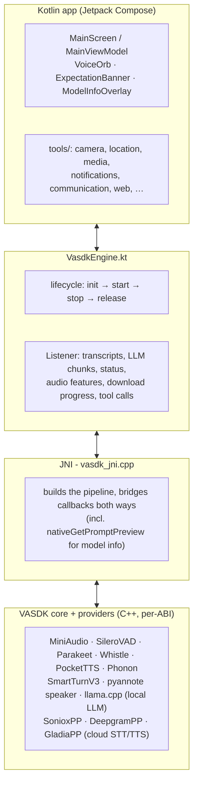
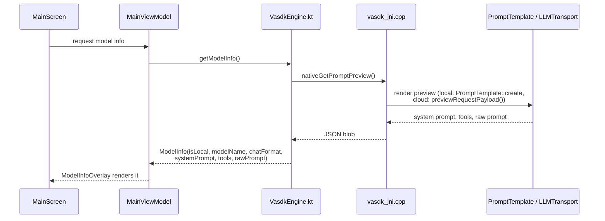
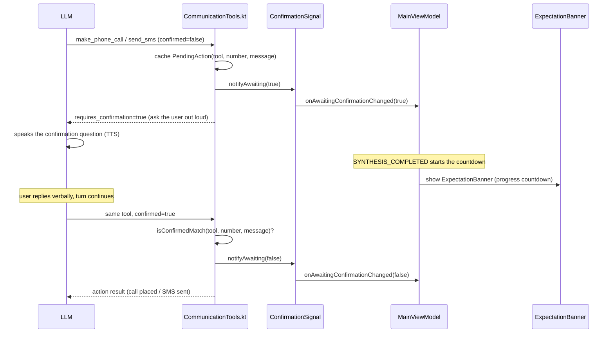
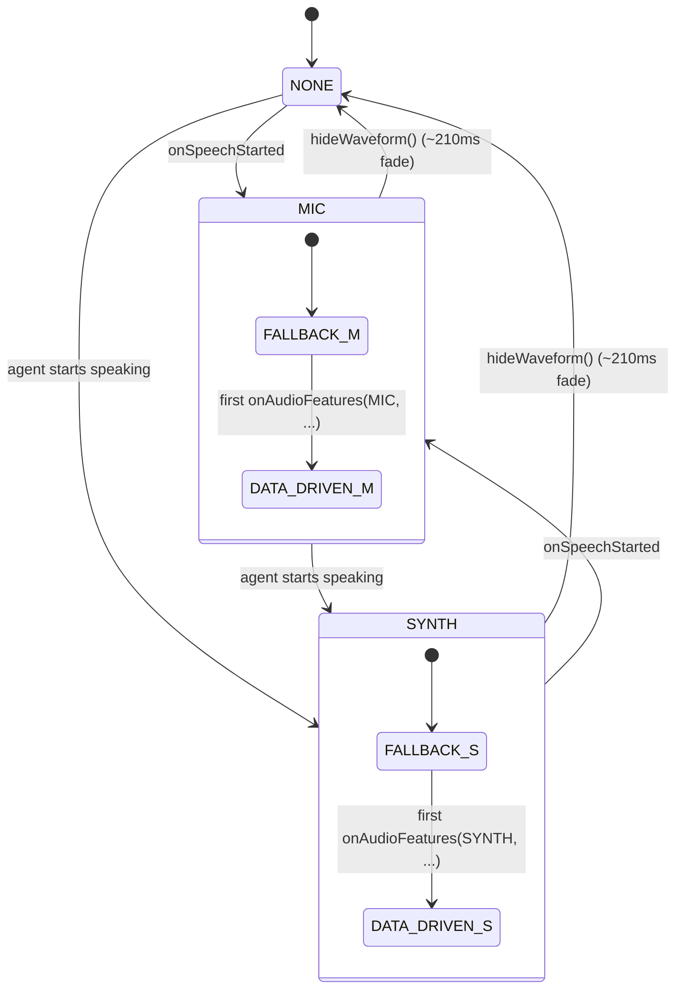

# VASDK on Android

`VASDK_ANDROID/` is a Kotlin app (Jetpack Compose) running the full VASDK pipeline natively on-device through a JNI boundary. The same core library and providers that power the desktop apps are cross-compiled per ABI by the Android Gradle Plugin's CMake integration; nothing is reimplemented in Java or Kotlin.

## How it's layered



The native side is the same CMake tree as the desktop build (`externalNativeBuild` points at [`CMakeLists.txt`](CMakeLists.txt), with `-DVASDK_BUILD_APP=OFF` so only the library and providers are compiled). ABIs are `arm64-v8a` and `x86_64`; `armeabi-v7a` was dropped because llama.cpp's NEON fallback collides with the NDK's `arm_neon.h` on the 32-bit target, and no realistic test device is armv7-only.

## The Kotlin API surface

`VasdkEngine` is the single entry point: a thin singleton wrapper over the native pipeline with an `init / start / stop / release` lifecycle and a `Listener` interface for everything coming back up: transcripts (partial and final), streamed LLM response chunks (with an `isExpecting` flag when the LLM's reply is itself a question awaiting a spoken answer), agent status changes, pipeline errors, VizAnim audio feature vectors for UI animation, and model download progress.

`getModelInfo()` returns a `ModelInfo` snapshot (which model is loaded, its chat format, the current system prompt, every tool currently registered with its parameters, and a raw preview of the actual prompt/request payload) for the in-app "model info" screen:



## Tools and tool confirmation

Tool calls cross the JNI boundary too: when the LLM requests a tool, the native side calls `VasdkEngine.onToolCall` synchronously from a native worker thread, which dispatches into [`tools/`](app/src/main/kotlin/com/vasdk/android/tools/) against real Android APIs. This is the piece that turns the assistant from a chatbot into something that can act on the device.

| Kotlin file | Native bridge header | Tools |
| --- | --- | --- |
| - | `android_tools.h` | `get_current_datetime`, `generate_random_number`, `convert_units` (pure C++, no JNI round trip) |
| `SystemTools.kt` | `system_tools.h` | `get_battery_status`, `get_device_info`, `get_wifi_info`, `get_network_status`, `get_storage_info`, `get_screen_brightness` |
| `MediaTools.kt` | `media_tools.h` | `get_volume`, `set_volume`, `set_flashlight`, `media_play`, `media_pause`, `media_play_pause` |
| `NotificationTools.kt` | `notification_tools.h` | `send_notification`, `set_alarm_or_timer` |
| `CommunicationTools.kt` | `communication_tools.h` | `get_contacts`, `get_call_logs`, `make_phone_call`\*, `get_calendar_events`, `add_calendar_event`, `send_sms`\* |
| `LocationTools.kt` | `location_tools.h` | `get_location`, `navigate_to` |
| `WebTools.kt` | `web_tools.h` | `web_search`, `fetch_url` |
| `CameraTools.kt` | `camera_tools.h` | `capture_photo`, `scan_qr_code` |

\* confirmation-gated, see below. `set_alarm_or_timer` used to be two separate tools (`set_alarm`/`set_timer`); they were merged because a small on-device model reliably mishandled the arithmetic ("an alarm in five seconds" became hour=5, minute=0). The merged tool forwards the time expression close to verbatim and does the classification/parsing deterministically in Kotlin instead of asking the model to do it.

Sensitive actions (`make_phone_call`, `send_sms`) aren't blocked behind a UI dialog - there's no one to tap it in a voice-only flow. Instead the tool itself asks the LLM to get a *spoken* confirmation, and re-validates that the confirmed call matches what was actually offered before it fires:



If `confirmed=true` doesn't match the cached `PendingAction` (a small model can emit `confirmed=true` without ever actually asking), the tool re-issues a fresh confirmation request instead of trusting the flag. The same `ExpectationBanner` also fires for the LLM's own `isExpecting` flag on ordinary spoken questions, not just tool confirmations - `awaitingResponse` in `MainViewModel`'s UI state is the single source of truth either way.

## Voice orb and waveform visualization

`VoiceOrb.kt` renders a ChatGPT-style animated orb - five per-band blobs (bass through treble) plus three additively-blended combination blobs - driven by `level` (overall loudness) and `bars` (per-band magnitudes), with a `thinking` mode that swaps the audio-driven energy for a metronome pulse while the LLM is still generating. It uses a blue palette while the mic is live and a red palette while the assistant is speaking. The older five-bar `WaveformIndicator` is still in the codebase but disabled (`USE_WAVEFORM_BARS = false`) in favor of the orb.

`MainViewModel` tracks *which* stream currently owns the waveform, since mic and TTS-output magnitudes differ by orders of magnitude and can't share smoothing state:



`showWaveform(source)` resets to `FALLBACK` (an idle animation) whenever the owning source changes, and `onAudioFeatures(source, features)` only applies incoming native audio features - promoting the mode to `DATA_DRIVEN` - when the frame's source still matches the current owner, so a late frame from the stream that just lost ownership can't corrupt the other one's display.

## Settings and provider switching

`Header.kt` exposes four actions beyond the status pill: animation test (`GraphicEq`), model info (`Info`), new conversation (`RestartAlt`), and settings (`Settings`) - the LLM mode toggle that used to live directly in the header was folded into the settings overlay instead. `SettingsOverlay.kt` lets you swap STT/TTS/LLM providers at runtime, no rebuild required:

- **Speech-to-Text** - `SttProvider`: `PARAKEET` · `WHISTLE` (on-device, arm64 only) · `SONIOX` · `DEEPGRAM` · `GLADIA` (cloud), plus a streaming/one-shot toggle.
- **Text-to-Speech** - `TtsProvider`: `POCKET` · `PHONON` (on-device, `gradium/phonon-31m-en`, CC BY-NC 4.0) · `SONIOX` · `DEEPGRAM` (cloud).
- **Language Model** - on-device/cloud toggle; on-device exposes the same presets as `VasdkEngine.LOCAL_LLM_MODELS`.

"Apply Config" tears down and re-initializes the native pipeline with the newly selected providers. `sttModelDir`/`ttsModelDir` (`parakeet/` or `whistle/`, `pocket_tts/` or `phonon_tts/` under `cacheDir`) are only meaningful for the currently selected on-device provider - the native side ignores them when a cloud provider is active instead. Choices persist across restarts via `ProviderPreferences`.

## Local LLM on-device

The app runs GGUF models on-device through llama.cpp. Models aren't bundled in the APK; `ModelDownloadService` (a foreground service with notification progress) downloads them on first run, driven by `VasdkEngine`'s download callbacks, alongside the on-device STT (Parakeet/Whistle) and TTS (PocketTTS/Phonon) model files and the pyannote speaker-embedding model (`pyannote/`, always on: `SpeakerIdentificationProcessor` logs SAME/NEW speaker per utterance) - VAD (Silero) and turn detection (SmartTurn v3) ship embedded as raw resources instead and are extracted to disk at `init()`. The default model is `LFM2_5Meta` (LFM2.5 230M, chat format `"lfm2.5"`); `Llama-3.2-1B-Instruct` (`"llama3"`), `Qwen2.5-1.5B-Instruct` (`"chatml"`), and `google_gemma-3-1b-it` (`"gemma"`) are also declared as presets in `VasdkEngine.Companion`. The engine needs to know the model's chat format so the native side renders prompts and tool descriptions correctly for that model; cloud mode (`useLocalLLM = false`) always reports `"openai"` regardless of the actual backing model.

## Building

Open `VASDK_ANDROID/` in Android Studio, or:

```bash
cd VASDK_ANDROID
./gradlew assembleRelease
```

Requirements: compileSdk 35, minSdk 33, NDK 26.1, CMake 3.22+. The first build downloads the native dependency graph (ONNX Runtime, llama.cpp, sentencepiece, curl, and the rest) per ABI, so expect it to take a while.

For a cloud LLM instead of (or alongside) the local one, provide credentials at build time; they're injected into `BuildConfig`:

- `.env.local` at the repository root (`LLM_API_KEY`, `LLM_ENDPOINT`, `LLM_MODEL`), or
- `local.properties` in `VASDK_ANDROID/` (`llm.apiKey`, `llm.endpoint`, `llm.model`).

For the cloud STT/TTS providers (Soniox, Deepgram, Gladia) selectable from the in-app Settings overlay, add their keys the same way:

- `.env.local` (`SONIOX_API_KEY`, `DEEPGRAM_API_KEY`, `GLADIA_API_KEY`), or
- `local.properties` (`soniox.apiKey`, `deepgram.apiKey`, `gladia.apiKey`).

All of these are optional at build time - the providers are compiled in regardless, and a missing key only matters if that provider is actually selected at runtime. `.env.local` wins when both are present. Neither file is committed.
