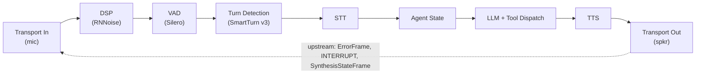

# VASDK_Pipeline: the general-purpose voice assistant showcase

`VASDK_Pipeline` is the reference application for the SDK: a complete, push-to-talk-free voice assistant that captures microphone audio, detects speech, transcribes it, runs an LLM turn with tool calling, synthesizes the reply, and plays it back. [`main_pipeline.cpp`](main_pipeline.cpp) is the file to read when you want to see every wiring decision in one place.

## Pipeline shape



(Exact `addProcessor` order, including the debug/animation observers elided here, is in `buildAndStartPipeline()` in [`main_pipeline.cpp`](main_pipeline.cpp) - note agent state sits *before* the LLM, where it gates stale transcriptions.)

Every stage is selected at build time. The app is a chain of `#ifdef VASDK_HAS_*` blocks: whichever providers were enabled at configure time get constructed, and the first available one per stage wins (for example, MiniAudio is preferred over SDL for audio I/O, and a local GGUF model via llama.cpp takes over from the OpenAI-compatible HTTP transport when `--llm-model-path` is set).

## What it demonstrates

- **Barge-in**: talk over the assistant and `AgentStateProcessor` cancels the in-flight TTS via upstream interrupt frames.
- **Turn detection**: SmartTurn v3 (when built) decides whether you're done talking, rather than a fixed silence timeout.
- **Tool calling**: two demo tools, `get_weather` and `get_time`, registered on a `ToolDispatchProcessor`. The LLM calls them mid-conversation and speaks the result.
- **Prompts as files**: the system prompt and response-format instruction live in [`prompts/`](prompts/) and can be overridden per run with `--system-prompt` and `--format-instruction`.
- **Session recording**: `--session-dir` writes per-session recordings for later analysis.
- **Metrics everywhere**: console reporting by default, plus Prometheus/StatsD/InfluxDB/WebSocket exporters when built in, and per-stage latency alert thresholds.
- **Terminal UI**: build with `-DVASDK_BUILD_TUI=ON` for an FTXUI dashboard showing live audio features (RMS, band energies, pitch, chroma from VizAnim), agent state, and the transcript.

## Running

```bash
# Cloud LLM: put a key in .env (LLM_API_KEY / OPENROUTER_API_KEY / OPENAI_API_KEY)
./build/VASDK_APP/VASDK_Pipeline

# Fully local LLM
./build/VASDK_APP/VASDK_Pipeline --llm-model-path build/VASDK_3P_IMPL/models/<model>.gguf
```

Model files are found automatically: the app searches for a `VASDK_3P_IMPL/models` directory upward from the executable, which matches where the CMake configure step downloads them.

## CLI flags

`--help` prints the authoritative list; flags guarded by a build option only appear when that option was compiled in.

| Flag | Purpose |
| --- | --- |
| `--llm-model-path <path>` | GGUF model for llama.cpp local inference (only with `VASDK_HAS_LLAMACPP`); overrides the OpenAI-compatible transport when set |
| `--llm-endpoint <url>` | OpenAI-compatible endpoint (falls back to `LLM_ENDPOINT`/`OPENAI_BASE_URL`) |
| `--llm-api-key <key>` | LLM API key (falls back to `LLM_API_KEY`/`OPENROUTER_API_KEY`/`OPENAI_API_KEY`) |
| `--llm-model <name>` | LLM model name (falls back to `LLM_MODEL`) |
| `--metrics` / `--no-metrics` | Toggle all metrics collection (default: on) |
| `--metrics-interval <sec>` | Console metrics report interval (default: 10) |
| `--metrics-config <path>` | JSON file with full metrics configuration, overrides the flags above |
| `--vad-alert-ms`, `--llm-ttft-alert-ms`, `--tts-alert-ms` | Latency alert thresholds in ms (0 disables each) |
| `--session-dir <path>` | Write session recordings here; omit to disable recording |
| `--system-prompt <path>` | Text file with the LLM system prompt, overrides the built-in default |
| `--format-instruction <path>` | Text file with the response format instruction, overrides the built-in default |
| `--env-file <path>` | `.env`-style file to load (default: `.env`) |
| `--statsd-host`, `--statsd-port` | StatsD UDP target (only with `VASDK_METRICS_STATSD`) |
| `--prometheus` / `--no-prometheus`, `--prometheus-port` | Prometheus HTTP exporter toggle and port (only with `VASDK_METRICS_PROMETHEUS`) |
