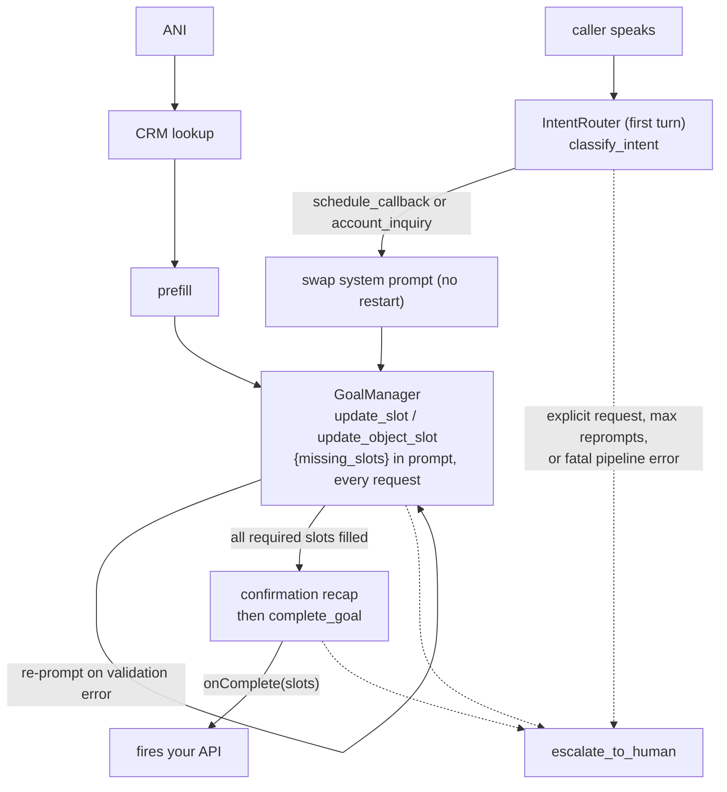

# VASDK_CallCenter: the goal-oriented call center showcase

`VASDK_CallCenter` demonstrates the `goal/` layer of VASDK: a voice agent that doesn't just chat, but works toward completing a concrete task with the caller. It reuses the same audio/VAD/STT/TTS wiring as [`VASDK_Pipeline`](../VASDK_APP/README.md) and layers the goal engine on top. [`callcenter_pipeline.cpp`](callcenter_pipeline.cpp) is the full source.

## Call flow



## What it demonstrates

- **Intent routing**: `IntentRouter` classifies the first utterance against two registered intents (`schedule_callback`, `account_inquiry`, confidence threshold 0.65) and swaps the prompt template mid-session.
- **Slot filling across types**: the scheduling goal collects a `STRING` name, a `PHONE` number, an `ENUM` service type, an `OBJECT` vehicle (make/model/year, set in one `update_object_slot` call), and a future-only `DATE`.
- **Conditional slots**: `vehicle_info` is only required when `service_type` is `repair`; the requirement re-evaluates against live state on every turn.
- **Confirmation**: the agent recaps collected slots and asks for confirmation before `complete_goal` fires the external action.
- **Escalation**: `escalate_to_human` triggers on explicit request or after the reprompt limit; the escalation callback receives the reason and everything collected so far.
- **Error recovery**: a `RecoveryProcessor` catches STT/LLM/TTS `ErrorFrame`s, plays a retry prompt, and escalates on repeated failure.
- **Resume on redial**: with `--persist-dir` set, partial goal state is saved per caller; call again with the same `--ani` and the agent picks up where it left off.
- **CRM integration points**: the caller's ANI pre-fills slots via a simulated CRM lookup, and the LLM can call a `lookup_account` tool mid-conversation. Both are marked in the source where a real HTTP call to your CRM belongs.

## Running

```bash
./build/VASDK_CALLCENTER_APP/VASDK_CallCenter \
    --ani 555-0142 \
    --persist-dir ./call_state
```

Say something like "I need to schedule a repair for my car" and let it walk you through the slots; hang up (Ctrl-C) mid-call and rerun with the same `--ani` to see the resume path.

## CLI flags

| Flag | Purpose |
| --- | --- |
| `--ani <phone>` | Caller ANI, used for the CRM prefill lookup and as the persistence key |
| `--persist-dir <path>` | Directory for partial goal state; enables resume on redial |
| `--llm-endpoint <url>` | OpenAI-compatible LLM endpoint |
| `--llm-api-key <key>` | LLM API key (falls back to `LLM_API_KEY`/`OPENROUTER_API_KEY`/`OPENAI_API_KEY`) |
| `--llm-model <name>` | LLM model name (falls back to `LLM_MODEL`) |
| `--system-prompt <path>` | Override the system prompt template file |
| `--format-instruction <path>` | Override the response format instruction file |
| `--env-file <path>` | `.env`-style file to load (default: `.env`) |
| `--debug` | Enable debug logging |

## Production notes

Persistence ships with `FileGoalStatePersistence` only (one JSON file per session under `--persist-dir`). It's a dev/test-grade implementation of the `GoalStatePersistence` interface; a Redis- or database-backed version is a three-method implementation (`save`/`load`/`clear`) away, but doesn't exist here yet. The CRM in this app is a hardcoded in-memory table for the same reason: it marks the seam where your real system plugs in.
