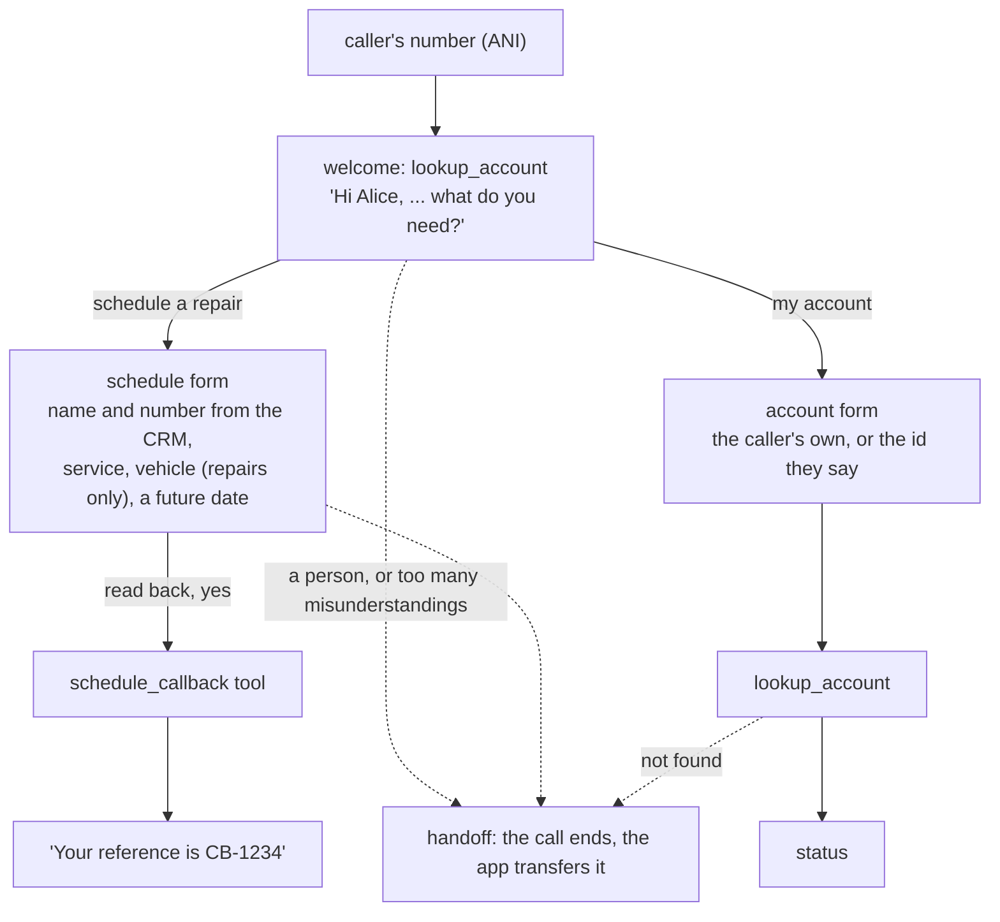

# VASDK_CallCenter: a call center in agent files

`VASDK_CallCenter` answers a phone call from an [agent file](../../VASDK_CALLCENTER_APP/agents/callcenter/agent.txtpb): a routing page, two forms, CRM tools and a handoff to a person, with no LLM needed. The call runs as an [engine session](../reference/engine.md#many-conversations-at-once), the same engine as [`VASDK_Pipeline`](pipeline.md), with phone-call turn-taking. [`callcenter_pipeline.cpp`](../../VASDK_CALLCENTER_APP/callcenter_pipeline.cpp) is the app; [`agents/callcenter/`](../../VASDK_CALLCENTER_APP/agents/callcenter/) is the call flow; [`crm/`](../../VASDK_CALLCENTER_APP/crm/) holds the tools.

## Call flow



## What it demonstrates

- **Routing page**: the caller's first words go to a form by their intents' examples ("I need to schedule a repair", "what's my account balance"). Words that also fill a slot fill it on the way in ("repair").
- **Forms**: a free-text name, a `PHONE` number, an `ENUM` service, a vehicle asked only when the service is a repair (a slot `condition`), and a future-only `DATE` ("next Tuesday"). The values are read back, and a "yes" schedules the callback. "No" asks what to change.
- **CRM tools**: `lookup_account` and `schedule_callback` are written in C++ ([`crm/CallCenterTools.cpp`](../../VASDK_CALLCENTER_APP/crm/CallCenterTools.cpp)), with a fixed table where your CRM plugs in. The caller's number fills their name, number and account before they're asked.
- **Handoff**: "talk to a person" works on every page, also while a free-text answer is expected. Too many misunderstandings in a row, or a tool that fails, hand off too.
- **An agent per DNIS**: `--dnis 8005550100` answers with `agents/8005550100/agent.txtpb` when there is one, else the default agent. A server compiles each once and shares it between the calls to that number.
- **Online and offline**: with no LLM the agent answers on its own. With one (`--llm-endpoint`, or `LLM_ENDPOINT` in `.env`) it also understands what its examples miss and reads answers its forms can't, and anything it doesn't cover goes to the LLM. If the network drops, the agent keeps the call going ([network fallback](../reference/engine.md#when-the-network-drops)).
- **Error recovery**: a `RecoveryProcessor` catches STT/LLM/TTS `ErrorFrame`s, plays a retry prompt, and ends the call on repeated failure.

## Choosing the LLMs

A call center pays per request, and most of a call needs no LLM at all: the routing page, the forms and the handoff are rules. Where one helps, it can be a small one:

- **The intent check and form answers** (what the rules aren't sure of, a slot the caller answered in their own words) need a quick, cheap model: `understanding { llm_profile: "fast" }` with `llm_profiles { name: "fast" model: "..." }` in the engine config.
- **Open questions** the agent doesn't cover go to the conversation's LLM, `llm`. A route can hand a topic to a profile of its own: `routes { intent: "billing_dispute" target: "LLM" llm_profile: "smart" }`.
- **A failed request** is answered with `llm.failure_replies`, not silence.

See [Different LLMs for different tasks](../reference/engine-config.md#different-llms-for-different-tasks).

## Testing the call flow

The calls in [`agents/callcenter/tests/`](../../VASDK_CALLCENTER_APP/agents/callcenter/tests/) run by text, with no audio and no LLM, in `ctest`. They run twice: offline (`vasdk_agent_callcenter`), and with an LLM after the rules (`vasdk_agent_callcenter_with_llm`). The same suite passes both ways.

```bash
cmake -B build -S . -DVASDK_BUILD_CALLCENTER=ON && cmake --build build --config Release   # the sample apps are off by default
./build/VASDK_CALLCENTER_APP/callcenter_agentc test VASDK_CALLCENTER_APP/agents/callcenter/agent.txtpb VASDK_CALLCENTER_APP/agents/callcenter/tests/*.txtpb
./build/VASDK_CALLCENTER_APP/callcenter_agentc chat VASDK_CALLCENTER_APP/agents/callcenter/agent.txtpb --session caller=555-1234
# the same calls with your LLM after the rules (LLM_ENDPOINT, LLM_MODEL, LLM_API_KEY)
./build/VASDK_CALLCENTER_APP/callcenter_agentc test VASDK_CALLCENTER_APP/agents/callcenter/agent.txtpb VASDK_CALLCENTER_APP/agents/callcenter/tests/*.txtpb --llm
```

## Running

```bash
./build/VASDK_CALLCENTER_APP/VASDK_CallCenter --ani 555-1234
```

Say something like "I need to schedule a repair for my car" and let it walk you through the form. The CRM knows `555-1234` (Alice Johnson) and `555-5678` (Bob Smith); any other number is a new caller.

## CLI flags

| Flag | Purpose |
| --- | --- |
| `--ani <phone>` | Caller ANI: the agent looks the caller up in the CRM |
| `--dnis <number>` | The number called: answered with `agents/<number>/agent.txtpb` when there is one |
| `--persist-dir <dir>` | A caller who hangs up mid-form is kept here, by their number (`--ani`). Their next call picks up on that form: "Welcome back", with only what's missing asked. Sensitive answers, such as the callback number, aren't kept. |
| `--call-log <file>` | Each call's record is appended as a JSON line: handle time, completed, escalated (handed to a person), resumed, the intent, turns, reprompts, where it ended, and whether it was left mid-task. The caller's number is masked. The same record is logged at the end of the call. |
| `--agent <path>` | An agent file to answer with, instead of the DNIS's |
| `--llm-endpoint <url>` | OpenAI-compatible LLM endpoint; unset (and no `LLM_ENDPOINT`): no LLM |
| `--llm-api-key <key>` | LLM API key (falls back to `LLM_API_KEY`/`OPENROUTER_API_KEY`/`OPENAI_API_KEY`) |
| `--llm-model <name>` | LLM model name (falls back to `LLM_MODEL`) |
| `--system-prompt <path>` | The LLM's instructions for what the agent doesn't cover ([`prompts/system_prompt.txt`](../../VASDK_CALLCENTER_APP/prompts/system_prompt.txt) is an example) |
| `--format-instruction <path>` | Override the response format instruction file |
| `--env-file <path>` | `.env`-style file to load (default: `.env`) |
| `--no-backchannel` | Back-channel handling off: any speech over the assistant interrupts it (default: on, "mm-hmm" and "yeah" don't interrupt) |
| `--backchannel-playback <mode>` | Playback while speech over the assistant is classified: `duck` (default, −12 dB), `pause` (resume in place) or `continue` |
| `--duck-gain-db <dB>` | Assistant level while ducked, −60 to 0 (default −12) |
| `--duck-duration-ms <ms>` | Minimum time the assistant stays ducked once speech over it starts (default 2500) |
| `--backchannel-history <mode>` | Dismissed back-channels: `drop` (default) or `append` them to the front of the user's next message |
| `--tail-overlap <mode>` | Speech over the last ~0.7 s of a reply: `turn` (default, answered after the reply) or `classify` (back-channels dismissed) |
| `--webrtc-port <port>` | Talk from a browser over WebRTC instead of the local mic/speaker: serves signaling and the demo page on `http://127.0.0.1:<port>` (only with `VASDK_BUILD_LIBDATACHANNEL_WEBRTC`) |
| `--webrtc-page <path>` | Page served at `/` in WebRTC mode (default: [`assets/webrtc/index.html`](../../assets/webrtc/index.html)) |
| `--debug` | Enable debug logging |

## Production notes

The CRM here is a hardcoded in-memory table, and scheduled callbacks are kept in memory: both mark the seam where your real systems plug in ([`crm/CallCenterTools.cpp`](../../VASDK_CALLCENTER_APP/crm/CallCenterTools.cpp)). The handoff ends the call with a `session_ended` event; a telephony app transfers it there.

The earlier version of this app drove the call with the LLM goal layer (`IntentRouter` and `GoalManager`), and could resume a dropped call from saved goal state (`--persist-dir`). The agent version does too, with `--persist-dir`: it keeps where the call was (`Session::conversationSnapshot()`), not the goal state. The goal layer is still in VASDK for apps built on it.
