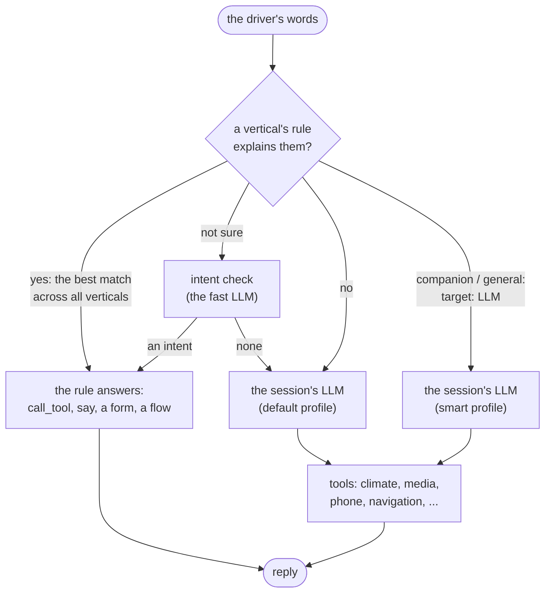

# VASDK_Car: an in-car assistant

`VASDK_Car` is a car's voice assistant and its screen. It shows how to build a large assistant from small, self-contained parts, and how to combine fast, predictable rules with an LLM's open conversation. The code is in [`VASDK_CAR_APP/`](../../VASDK_CAR_APP/).

- **Ten verticals:** each feature (climate, media, phone, navigation, ...) is a folder that holds its code, its part of the conversation, its tests and its dashboard panel.
- **Commands are rules:** "I'm cold" or "next song" is understood on the device, with no LLM, offline, in milliseconds.
- **The LLM does the rest:** questions, chat, stories, games, and requests no rule foresaw ("set things up for a relaxing night drive"). It sees the car's state and drives the car through the same tools.
- **It speaks first:** an incoming call cuts in, a text is offered after the current exchange, and low fuel, a hot cabin, arrival or a driver getting in each start a conversation.
- **Each task can use a different LLM:** a tiny model for the intent check, the default for chat, a capable one for stories and questions.

## Contents

- [Running it](#running-it)
- [The verticals](#the-verticals)
- [How a turn is answered](#how-a-turn-is-answered)
- [Rules and the LLM, together](#rules-and-the-llm-together)
- [Which LLM answers](#which-llm-answers)
- [Speaking first: triggers](#speaking-first-triggers)
- [A vertical's code](#a-verticals-code)
- [A vertical's part of the agent](#a-verticals-part-of-the-agent)
- [The dashboard](#the-dashboard)
- [Adding a vertical](#adding-a-vertical)
- [Testing](#testing)
- [Making it a real car](#making-it-a-real-car)
- [CLI flags](#cli-flags)
- [Known limits](#known-limits)

## Running it

```bash
cmake --build build --config Release --target VASDK_Car
./build/VASDK_CAR_APP/Release/VASDK_Car                                  # this machine's mic and speaker
./build/VASDK_CAR_APP/Release/VASDK_Car --webrtc --env-file .env.local   # talk from the browser, with an LLM
```

Open **http://127.0.0.1:8090**. Talk to it, press **Talk** (with `--webrtc`), or type in the Assistant panel. The **Simulator** stands in for the car and the world: gear, speed, fuel and the outside temperature; the cabin temperature; an incoming call; a text arriving; "almost there" and "arrive"; a driver's key fob.

Without `LLM_ENDPOINT` in the env file there is no LLM: the commands, forms, triggers and the owner's manual all work, and stories and general questions say they need the internet.

Things to try:

| Say | Vertical |
| --- | --- |
| "set the passenger side to 24", "I'm cold", "make it a bit cooler in here", "heat my seat" | climate |
| "play some jazz", "I'm in the mood for some chill music", "tune to 104.7", "louder", "play a movie" (move the speed slider first) | media |
| "call Sam", then "hang up"; the simulator's **Incoming call** | phone |
| "text mom", then "on my way", then "yes"; the simulator's **Message arrives** | messages |
| "take me to the airport", then "the second one"; then set the fuel slider to 2% | navigation |
| The **Jordan** key fob, then "remember this temperature" | profiles |
| "how do I pair my phone", "the check engine light is on" | manual |
| "tell me a story about a lighthouse", then "it's getting warm in here", "next song", "go on" | companion |
| "quiz me", then "Paris", "next question"; "tell me a joke" | companion |
| "why is the sky blue"; "take me somewhere", then "how far is the moon", then "the airport" | general |
| "set things up for a relaxing night drive" | the LLM, with the car's tools |

## The verticals

| Vertical | What it does | What it shows |
| --- | --- | --- |
| [drive](../../VASDK_CAR_APP/verticals/drive/) | Speed, gear, fuel, the outside temperature; a low-fuel warning | `context_change` triggers on `$context.car` |
| [climate](../../VASDK_CAR_APP/verticals/climate/) | Temperature per side, AC, fan, defrost, recirculation, seat heating; cooling a hot cabin | Entities into tool arguments; a trigger that asks first |
| [media](../../VASDK_CAR_APP/verticals/media/) | Radio, Bluetooth, USB, genres and moods, artists, volume; video only while parked | A rule on another vertical's state (`$context.car.drive.moving`) |
| [phone](../../VASDK_CAR_APP/verticals/phone/) | Incoming calls that cut in, calls to contacts | A **code entity** (`@contact`, found by `Phone.cpp`); an `IMMEDIATE` trigger; signals to media; "answer" is a command only while it rings |
| [messages](../../VASDK_CAR_APP/verticals/messages/) | Texts sent from a form, incoming ones read aloud and answered | A **form** with a read-back, filled on the way in ("text Sam"); `AFTER_FLOW` delivery |
| [navigation](../../VASDK_CAR_APP/verticals/navigation/) | Places, three routes to choose from, guidance, arrival, an out-of-range warning | **Choices** picked by voice, tap or "the second one"; a `ui` card; a trigger on two verticals' state |
| [profiles](../../VASDK_CAR_APP/verticals/profiles/) | A key fob says who's driving; their settings are applied; "remember this temperature" | `Session::setSessionParam` from the app; a flow that uses other verticals' tools |
| [manual](../../VASDK_CAR_APP/verticals/manual/) | Answers from the owner's manual | `knowledge`; a vertical with no code |
| [companion](../../VASDK_CAR_APP/verticals/companion/) | Stories, trivia, riddles and jokes | Routes with `target: "LLM"` and `llm_profile`; its part of the LLM's instructions |
| [general](../../VASDK_CAR_APP/verticals/general/) | Questions about the world: "why is the sky blue" | An intent for what's outside every vertical, handed to the LLM |

## How a turn is answered



1. **The rules first.** Every vertical's commands apply on every page, and they compete: the one that explains most of the words wins ("some chill music" is media's, not climate's "chilly"). Include order only breaks ties. A page's own routes come before them all (on the "Where to?" page, the place you name is its answer).
2. **The intent check**, when the rules aren't sure: a small LLM picks one of the agent's intents, or none ([Understanding](../reference/flows.md#with-an-llm)).
3. **A route can hand the turn to the LLM** (`target: "LLM"`): the companion's and general's do, for stories, games and questions. The agent decides whose words they are; the LLM answers them.
4. **What nothing understood** goes to the session's LLM too, with the car's tools.

Offline, steps 2 to 4 don't happen: a route that hands its turn on says its own offline answer, and what nothing understood gets the "not understood" reply.

## Rules and the LLM, together

The rules make the car quick and predictable; the LLM makes it flexible. Getting both depends on keeping each out of the other's way:

| Problem | What prevents it |
| --- | --- |
| The LLM doesn't know the car | `{context}` in [prompts/system_prompt.txt](../../VASDK_CAR_APP/prompts/system_prompt.txt) is replaced by `$context.car`, as it is at each request: the speed, the destination, who's driving. |
| One file of instructions for every feature | Each vertical can add its part: its `prompt.txt` is appended while the agent includes it ([companion](../../VASDK_CAR_APP/verticals/companion/prompt.txt), [general](../../VASDK_CAR_APP/verticals/general/prompt.txt)). |
| "Let's play trivia" taken for the radio's "play" | The companion's intents are longer matches ("play trivia"), and the best match wins. |
| A story stuck in a mode, deaf to commands | There is no story mode. A story is the LLM conversation; "next song" or "I'm cold" are the rules' at any time, and "go on" goes back to the story. |
| The LLM narrates instead of acting ("I'll put on some music") | Everything that isn't a rule goes to one LLM, the one with the tools and the conversation's history. Its instructions forbid claiming an action it didn't call a tool for. |
| A word in a sentence taken as a command ("what happens **next**") | After the LLM answers a turn, only the rules are asked, and a match must explain at least a quarter of the words (`understanding.chat_min_share`). "what happens next" is the companion's (`go_on`), not the radio's. |
| A question about the world forced into a car command ("Paris" → navigate) | The general vertical's `general_question` intent gives the intent check a better choice than the nearest command. |
| A command out of its moment ("the answer is a whale" answering the phone) | Phone's "answer" route has `condition: "$context.car.phone.state = 'ringing'"`; otherwise the words go on. |
| The LLM getting a command's direction wrong ("cooler" → +2) | Common sentences are the rules': "make it a bit cooler in here", "it's getting warm in here". |
| Tool arguments in an LLM's own shape | The tools accept the shorthand `{"adjust_temperature": -1}` and other names for the value (`car::actionOf`). |
| Safety | Stays in the rules: a video while moving is refused by media's rule before any LLM sees it. The LLM's instructions keep it brief at speed and away from anything to look at. |
| Silence when the LLM fails | A request that fails or times out with nothing said is answered with `llm.failure_replies` ("Sorry, I couldn't get an answer just now..."). |

## Which LLM answers

A car command is a rule and asks no LLM. The rest goes to one of three LLMs, set in [config/engine.txtpb](../../VASDK_CAR_APP/config/engine.txtpb):

| Profile | Answers | Set with |
| --- | --- | --- |
| `fast` | The intent check, when the rules aren't sure | `LLM_FAST_MODEL`, `LLM_FAST_ENDPOINT`, `LLM_FAST_API_KEY`, `LLM_FAST_REASONING_EFFORT` |
| default (`llm`) | Chat, and requests no vertical understands, with the tools | `LLM_MODEL`, `LLM_ENDPOINT`, `LLM_API_KEY`, `LLM_REASONING_EFFORT` |
| `smart` | Stories, games and questions about the world (routes with `llm_profile: "smart"`), and the turns after them that nothing understood, such as a quiz's answers | `LLM_SMART_MODEL`, `LLM_SMART_ENDPOINT`, `LLM_SMART_API_KEY`, `LLM_SMART_REASONING_EFFORT` |

```bash
# .env.local
LLM_ENDPOINT=http://127.0.0.1:1234/v1/chat/completions
LLM_MODEL=google/gemma-4-e4b
LLM_FAST_MODEL=liquid/lfm2.5-1.2b                 # the same LM Studio, a 1.2B model
LLM_SMART_ENDPOINT=https://openrouter.ai/api/v1/chat/completions
LLM_SMART_MODEL=anthropic/claude-opus-5-5
LLM_SMART_API_KEY=...
```

- **Unset variables are the default's.** With none of them set, one LLM does everything.
- **One conversation.** Whichever profile answers a turn, the history is the same, so "smart" tells the story and the default handles "I'm cold" in the middle of it.
- **A profile sticks.** After "quiz me", your answers go to the profile that asked, until the agent answers a turn itself.
- **Keep every profile loaded.** A model loaded on demand makes the first requests time out, and LM Studio unloads one model to load another.

How the routing works inside the SDK: [Different LLMs for different tasks](../reference/engine-config.md#different-llms-for-different-tasks).

## Speaking first: triggers

| Trigger | Fires when | Does |
| --- | --- | --- |
| `incoming_call` (phone) | `Phone::simulate` rings (`incoming-call`) | Cuts in on whatever is being said (`IMMEDIATE`, `CRITICAL`): "Mom is calling. Answer it?"; media pauses for the call |
| `message_received` (messages) | A text arrives (`message-received`) | Waits for the current exchange (`AFTER_FLOW`), then asks: "New message from Sam. Want to hear it?" |
| `low_fuel` (drive) | `$context.car.drive.fuel_percent < 15` | Warns once, as the fuel drops below 15% |
| `hot_cabin` (climate) | Cabin at 28 °C or more with the AC off | Offers to cool it down |
| `arrived` (navigation) | Navigation reaches the destination | "You've arrived at City Airport." |
| `out_of_range` (navigation) | Guiding, with more distance left than the fuel's range | Offers a gas stop on the way |
| `driver_changed` (profiles) | A key fob (`driver-changed`) | Welcomes the driver and applies their temperature, music and seat heat |

`context_change` triggers read `$context.car`, which the app updates whenever a vertical changes. `app_event` triggers are fired by a vertical's code through `car().conversation().fireTrigger(...)`. See [Triggers](../reference/flows.md#triggers).

## A vertical's code

A vertical is a [`car::Vertical`](../../VASDK_CAR_APP/core/Vertical.h):

```cpp
class Navigation : public Vertical {
    std::string name() const override { return "navigation"; }   // $context.car.navigation, the panel, /control
    nlohmann::json state() const override;                         // what the panel draws and the agent reads
    std::vector<va::llm::Tool> tools() override;                   // call_tool's and the LLM's
    void registerExtensions(va::flow::FlowRegistry&) override;     // the @place extractor
    nlohmann::json simulate(const nlohmann::json&) override;       // the simulator's controls
    void tick(double seconds) override;                            // drives on at the car's speed
};
```

[`car::Car`](../../VASDK_CAR_APP/core/Car.h) holds the verticals, and [`core/Verticals.cpp`](../../VASDK_CAR_APP/core/Verticals.cpp) lists them. **Verticals don't include each other's headers.** They cooperate in three ways:

- **Signals:** the phone calls `car().emit("call.started")`; media subscribes with `car.on("call.started", ...)` and pauses itself.
- **Reading state:** `car().read("drive", "speed_kmh")` returns JSON, null when the car has no such vertical. Navigation advances with it, and climate warms the cabin toward the outside temperature.
- **The conversation:** `car().conversation()` fires a trigger (a call rang) or sets a session param (`$session.driver`). The app wires it to its session; in text tests nothing is wired, and the vertical does without.

Each vertical's `tools()` serve both the agent's `call_tool` steps and the LLM. The helpers in `Vertical.h` read tool arguments in any shape an LLM or the dashboard sends: `text`, `number`, `truthy`, `actionOf`.

## A vertical's part of the agent

[`agents/car/agent.txtpb`](../../VASDK_CAR_APP/agents/car/agent.txtpb) has the start page and lists the parts:

```textproto
include_files: [
  "../../verticals/drive/drive.txtpb",
  "../../verticals/climate/climate.txtpb",
  "../../verticals/companion/companion.txtpb",
  "../../verticals/media/media.txtpb",
  ...
  "../../verticals/general/general.txtpb",   # after every vertical
  "shared.txtpb"                             # last: help, thanks, never mind
]
```

- **Each part is a partial agent**, merged in order, with its goal and entity files relative to itself ([An agent in several files](../reference/flows.md#entities)).
- **Each part's commands apply on every page** through an envelope of its own (`envelopes: ["navigation"]`).
- **The best match wins across parts;** order only breaks ties. So generic single words belong in `shared.txtpb`, included last, and `general` comes after every vertical, so a vertical's own question wins a tie with a general one.
- **Parts may use each other's names,** and their comments say so: messages uses phone's `@contact`; profiles calls climate's and media's tools; media's video rule reads drive's state.

A part that hands its turns to the LLM:

```textproto
routes { intent: "story"
         steps { say { text: "I need the internet to make up a story. I can still play your music." } }   # offline
         target: "LLM" llm_profile: "smart" }
```

## The dashboard

[`dashboard/DashboardServer.cpp`](../../VASDK_CAR_APP/dashboard/DashboardServer.cpp) serves the page on 127.0.0.1 only, from a fixed list of files:

| Endpoint | |
| --- | --- |
| `GET /`, `/app.js`, `/style.css`, `/verticals/<name>/panel.js` | The shell and each vertical's panel, read from disk on each request |
| `GET /state` | The car's state, by vertical |
| `GET /events` | Server-sent events: the state on each change, transcripts, replies with their `ui` cards |
| `GET /info` | The verticals, and whether WebRTC is on |
| `POST /control` | `{"vertical": "climate", "action": "ac", "value": "on"}`: a tap on a panel |
| `POST /simulate` | `{"vertical": "phone", "event": "incoming_call", "caller": "Mom"}`: the simulator |
| `POST /say` | `{"text": "..."}`: typed, as if said |
| `POST /stop` | Stops what's being said |
| `POST /offer` | WebRTC signaling, for the Talk button |

A panel is an ES module, `verticals/<name>/panel.js`:

```js
export default {
  slot: 'left',                        // 'left', 'center', 'right' or 'header'
  mount(el, car) { ... },              // car: control(action, value, extra), simulate(body), say(text), state
  render(state, all) { ... },          // its vertical's state, and the whole car's
  simulator(el, car) { ... },          // optional: controls in the Simulator
  onReply(reply, el) { ... },          // optional: the agent's replies, with their ui card
};
```

A panel that acts through the conversation (`car.say("take me to the airport")`) keeps the agent and the screen in step. A direct control (`car.control(...)`) changes the car without a word.

## Adding a vertical

1. **Code:** `verticals/<name>/<Name>.h/.cpp`, a `car::Vertical`.
2. **Register it:** add its name to `CAR_VERTICALS` in [CMakeLists.txt](../../VASDK_CAR_APP/CMakeLists.txt) and `car->add<Name>()` in [core/Verticals.cpp](../../VASDK_CAR_APP/core/Verticals.cpp).
3. **Conversation:** `verticals/<name>/<name>.txtpb`, with its intents, entities, envelope, flows and triggers; add it to `include_files`.
4. **Tests:** `tests/*.txtpb` and `<name>_test.cpp`, picked up by ctest as `vasdk_car_<name>` and `vasdk_car_<name>_code`.
5. **The LLM (optional):** `prompt.txt`, appended to the LLM's instructions while the agent includes the vertical.
6. **Dashboard (optional):** `panel.js`, loaded by the vertical's name.

A vertical with only an agent file, like `manual`, `companion` or `general`, needs steps 3 and 4 (and 5 if it wants).

## Testing

```bash
ctest -R vasdk_car                                                         # every vertical: conversations and code
car_agentc test VASDK_CAR_APP/agents/car/agent.txtpb VASDK_CAR_APP/verticals/navigation/tests/*.txtpb
car_agentc chat VASDK_CAR_APP/agents/car/agent.txtpb                       # type to it; !incoming-call rings
car_agentc try  VASDK_CAR_APP/agents/car/agent.txtpb "take me to the airport"   # what the words are understood as
```

- **Conversations by text** (`tests/*.txtpb`) run the whole agent with no audio and no LLM. They check replies, pages, form values, triggers, and whether a turn is handed to an LLM (`to_llm`, `llm_profile`) ([test cases](../reference/flows.md#checking-and-testing-vasdk_agentc)).
- **Code tests** (`<name>_test.cpp`) use [core/CarTest.h](../../VASDK_CAR_APP/core/CarTest.h), which wires the car and a conversation the way the app does: `$context.car` is the car's state, and the verticals' triggers reach the conversation. The companion's test runs the conversation mid-chat, as the app does after the LLM answers.

## Making it a real car

- **The car's network:** each vertical's fields stand for the car's own state. Replace them with calls to the vehicle's API (Android Automotive's VHAL, SOME/IP, a CAN gateway) and call `changed()` from its callbacks. The agent, the tests and the panels stay as they are.
- **Listening:** the config listens all the time (`activation { mode: ALWAYS_ON }`). A car would use `WAKE_WORD`, or the steering wheel button (`PUSH_TO_TALK`, `Session::pushToTalk`).
- **Real data behind the entities:** `@contact` from the paired phone's address book, `@place` from the map's geocoder, `@artist` from the phone's library through a dynamic entity (`Session::setEntityValues`).
- **During a call,** the assistant here keeps listening; a head unit would mute its mic while the call is active.
- **The LLM tiers** would be a small on-board model for `fast`, and a cloud model for `smart` while there's signal. Offline, the rules and the manual keep working.

## CLI flags

| Flag | Default |
| --- | --- |
| `--config` | `config/engine.txtpb`: Whistle STT (Parakeet, Moonshine as fallbacks), Phonon TTS (Pocket), snappy turn-taking, the LLM profiles |
| `--agent` | `agents/car/agent.txtpb` |
| `--env-file` | `.env` |
| `--webrtc` | Off: the local mic and speaker. On: the dashboard's Talk button, over WebRTC |
| `--dashboard-port` | `8090`, on 127.0.0.1 only |
| `--dashboard-dir` | `dashboard/`, read on each request; the panels come from `verticals/` |
| `--debug` | Off |

## Known limits

- **Speech recognition errors** ("it's getting working here") reach the rules and the LLM as they were heard.
- **A long, indirect request** ("could you maybe make it a bit warmer in here") may not be a rule; it goes to the LLM, which can usually do it with the tools but may get it wrong.
- **A topic gets a better model only if a route names one.** A hard request no route matches goes to the default.
- **Small local models** miscount quiz scores and sometimes call tools with odd arguments; the tools accept common shapes.
