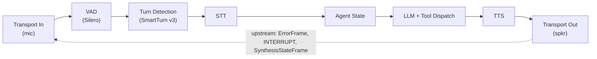

# VASDK_Pipeline: the general-purpose voice assistant showcase

`VASDK_Pipeline` is the reference application for the SDK: a complete, push-to-talk-free voice assistant that captures microphone audio, detects speech, transcribes it, runs an LLM turn with tool calling, synthesizes the reply, and plays it back. The pipeline itself is built by [`VAEngine`](../reference/engine.md); [`main_pipeline.cpp`](../../VASDK_APP/main_pipeline.cpp) adds the app's own parts: audio I/O, demo tools, recording, visualisers and the terminal UI.

## Pipeline shape



(The exact order is printed at startup as `[VAEngine] Started: ...`, including the debug and animation processors elided here; [`addAppProcessors()`](../../VASDK_APP/main_pipeline.cpp) shows where the app adds them. Agent state sits *before* the LLM, where it gates stale transcriptions.)

VAD, STT, TTS and turn detection are chosen at run time: `--config` names a provider id per stage (see [Engine config files](../reference/engine-config.md)), and without it the first provider built in wins. Audio I/O is chosen at build time (MiniAudio is preferred over SDL), and a local GGUF model via llama.cpp replaces the OpenAI-compatible HTTP transport when `--llm-model-path` is set.

## What it demonstrates

- **Barge-in, not back-channels**: talk over the assistant and `AgentStateProcessor` cancels the in-flight TTS. A short "mm-hmm" or "yeah" only ducks it for a moment, and the assistant keeps going without answering it ([back-channels](../reference/processors.md#back-channels-speech-over-the-agent-that-isnt-an-interruption)).
- **Turn detection**: SmartTurn v3 (when built) decides whether you're done talking, rather than a fixed silence timeout. It scores each pause as it happens, so a clearly finished sentence ends the turn at the pause; an unfinished one waits for the VAD's silence timers. A noise blip shorter than 250 ms never counts as you starting to speak, so it can't cut the assistant off.
- **Browser calls**: `--webrtc-port` swaps the local mic and speaker for a WebRTC peer and serves a demo page with live state, VizAnim visuals, speaker tags and per-turn latency.
- **Tool calling**: two demo tools, `get_weather` and `get_time`, registered on a `ToolDispatchProcessor`. The LLM calls them mid-conversation and speaks the result.
- **Prompts as files**: the system prompt and response-format instruction live in [`prompts/`](../../VASDK_APP/prompts/) and can be overridden per run with `--system-prompt` and `--format-instruction`.
- **Session recording**: `--session-dir` writes per-session recordings for later analysis.
- **Metrics everywhere**: console reporting by default, plus Prometheus/StatsD/InfluxDB/WebSocket exporters when built in, and per-stage latency alert thresholds.
- **Terminal UI**: build with `-DVASDK_BUILD_TUI=ON` for an FTXUI dashboard showing live audio features (RMS, band energies, pitch, chroma from VizAnim), agent state, and the transcript.

## An agent and the LLM together

With `--agent`, the agent's pages answer what they understand (booking, prices, opening hours, a person), and the LLM chats about everything else. [`agents/garage-menu/`](../../VASDK_APP/agents/garage-menu/) is the example: its forms, menus and C++ steps are covered in [Agents](../reference/flows.md). Features to use from there:

- **Handing a topic to the LLM.** A route with `target: "LLM"` says the words are the LLM's though the agent understood them ("tell me a story" isn't the booking page's "book"). Its steps are the answer offline ([With an LLM](../reference/flows.md#with-an-llm)).
- **A keyword doesn't take the chat.** Once the LLM answers a turn, a route takes the conversation back only when it explains enough of the words.
- **The app's state in the LLM's instructions.** `{context}` in the system prompt file is replaced, on each request, by what `Options::context` holds ([VAEngine](../reference/engine.md)).
- **A model per task.** `llm_profiles` in the config names more LLMs: a small one for the agent's intent check (`understanding.llm_profile`), a capable one for the routes that name it (`llm_profile`). The commented lines in [`config/engine.txtpb`](../../VASDK_APP/config/engine.txtpb) show how ([Different LLMs for different tasks](../reference/engine-config.md#different-llms-for-different-tasks)).
- **No silence on failure.** A request that fails or times out is answered with `llm.failure_replies`.
- **Models for understanding.** `providers { sentence_encoder { id: "minilm" } }` finds intents by meaning, and `entity_model` (`gliner`, `tagger` or `llm`) finds where entities are said, so a misspelling counts only there. The garage agent labels its entity types for them (`matching { label: "car repair" }`), and the commented lines in [`config/engine.txtpb`](../../VASDK_APP/config/engine.txtpb) turn them on. Which to choose, and how each scores on the garage agent: [Entity models](../reference/flows.md#entity-models). `garage_agentc eval … --engine-config <file>` measures them before you run the app.

[VASDK_Car](car.md) uses all of these at a larger scale.

## Running

```bash
# Cloud LLM: put a key in .env (LLM_API_KEY / OPENROUTER_API_KEY / OPENAI_API_KEY)
./build/VASDK_APP/VASDK_Pipeline

# Fully local LLM
./build/VASDK_APP/VASDK_Pipeline --llm-model-path build/VASDK_3P_IMPL/models/<model>.gguf
```

Model files are found automatically: the app searches for a `VASDK_3P_IMPL/models` directory upward from the executable, which matches where the CMake configure step downloads them.

## CLI flags

`--help` prints the authoritative list; flags guarded by a build option only appear when that option was compiled in.

| Flag | Purpose |
| --- | --- |
| `--config <path>` | Engine config (`.txtpb`, `.json` or `.pb`): VAD/STT/TTS provider ids and options, models dir, LLM endpoint/model/key. `--llm-*` flags override it. See [Engine config files](../reference/engine-config.md) and the example in [`config/engine.txtpb`](../../VASDK_APP/config/engine.txtpb) |
| `--agent <path>` | Agent file: its pages answer each turn before any LLM, e.g. [`agents/garage-menu/agent.txtpb`](../../VASDK_APP/agents/garage-menu/agent.txtpb). See [Agents](../reference/flows.md) |
| `--llm-model-path <path>` | GGUF model for llama.cpp local inference (only with `VASDK_HAS_LLAMACPP`); overrides the OpenAI-compatible transport when set |
| `--llm-endpoint <url>` | OpenAI-compatible endpoint (falls back to `LLM_ENDPOINT`/`OPENAI_BASE_URL`) |
| `--llm-api-key <key>` | LLM API key (falls back to `LLM_API_KEY`/`OPENROUTER_API_KEY`/`OPENAI_API_KEY`) |
| `--llm-model <name>` | LLM model name (falls back to `LLM_MODEL`) |
| `--metrics` / `--no-metrics` | Toggle all metrics collection (default: on) |
| `--metrics-interval <sec>` | Console metrics report interval (default: 10) |
| `--metrics-config <path>` | JSON file with full metrics configuration, overrides the flags above |
| `--vad-alert-ms`, `--llm-ttft-alert-ms`, `--tts-alert-ms` | Latency alert thresholds in ms (0 disables each) |
| `--session-dir <path>` | Write session recordings here; omit to disable recording |
| `--system-prompt <path>` | Text file with the LLM system prompt, overrides the built-in default |
| `--format-instruction <path>` | Text file with the response format instruction, overrides the built-in default |
| `--env-file <path>` | `.env`-style file to load (default: `.env`) |
| `--no-backchannel` | Back-channel handling off: any speech over the assistant interrupts it (default: on, "mm-hmm" and "yeah" don't interrupt) |
| `--backchannel-playback <mode>` | Playback while speech over the assistant is classified: `duck` (default, −12 dB), `pause` (resume in place) or `continue` |
| `--duck-gain-db <dB>` | Assistant level while ducked, −60 to 0 (default −12) |
| `--duck-duration-ms <ms>` | Minimum time the assistant stays ducked once speech over it starts (default 2500) |
| `--backchannel-history <mode>` | Dismissed back-channels: `drop` (default) or `append` them to the front of the user's next message |
| `--tail-overlap <mode>` | Speech over the last ~0.7 s of a reply: `turn` (default, answered after the reply) or `classify` (back-channels dismissed) |
| `--webrtc-port <port>` | Talk from a browser over WebRTC instead of the local mic/speaker: serves signaling and the demo page on `http://127.0.0.1:<port>` (only with `VASDK_BUILD_LIBDATACHANNEL_WEBRTC`) |
| `--webrtc-page <path>` | Page served at `/` in WebRTC mode (default: [`assets/webrtc/index.html`](../../assets/webrtc/index.html)) |
| `--statsd-host`, `--statsd-port` | StatsD UDP target (only with `VASDK_METRICS_STATSD`) |
| `--prometheus` / `--no-prometheus`, `--prometheus-port` | Prometheus HTTP exporter toggle and port (only with `VASDK_METRICS_PROMETHEUS`) |
