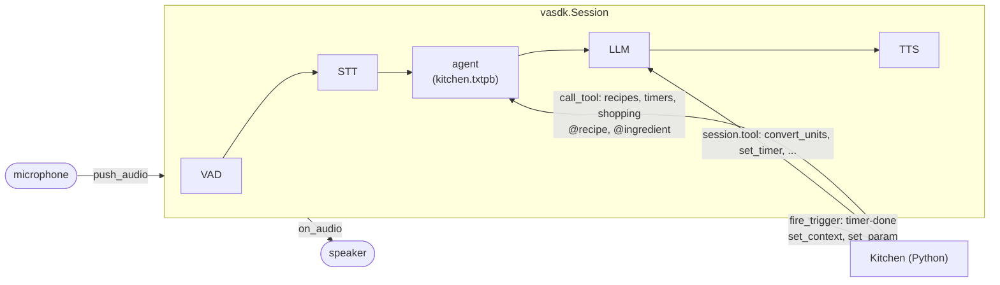

# VASDK_PYTHON_APP: a kitchen assistant in Python

A voice assistant for the kitchen, written in Python on VASDK's [Python binding](../../bindings/python/README.md). It walks you through a recipe step by step, offers a timer when a step needs one, keeps the shopping list, and answers cooking questions. The code is in [`VASDK_PYTHON_APP/`](../../VASDK_PYTHON_APP/).

It shows what an app gets from VASDK when it's written in Python:

- **On-device speech:** voice detection, speech recognition and a voice, from Python, with no cloud service.
- **An agent with Python inside:** the conversation is an agent file; its tools and its entities (recipes, ingredients) are Python functions.
- **An LLM with Python tools:** cooking questions go to the LLM, which converts units, sets timers and adds to the list with tools written in Python.
- **The app speaks first:** a timer that ends fires the agent's trigger from Python, and it's said at once, over anything else.
- **Tested without a microphone:** every conversation runs by text in `ctest`, and a second session's voice drives a spoken test.

## Contents

- [Running it](#running-it)
- [How it's put together](#how-its-put-together)
- [Python and VASDK, side by side](#python-and-vasdk-side-by-side)
- [The agent](#the-agent)
- [The demo: one session talking to another](#the-demo-one-session-talking-to-another)
- [Testing](#testing)
- [Making it yours](#making-it-yours)
- [Known limits](#known-limits)

## Running it

VASDK must be built as a shared library (the default on Windows; elsewhere `-DBUILD_SHARED_LIBS=ON`), which also builds `vasdk_providers`, the speech providers for Python, and VASDK's messages for Python. CMake downloads the speech models into `build/VASDK_3P_IMPL/models`.

The Python packages are listed twice, once for each tool: [`pyproject.toml`](../../VASDK_PYTHON_APP/pyproject.toml) and its `uv.lock` for uv, [`requirements.txt`](../../VASDK_PYTHON_APP/requirements.txt) for pip. Both install the binding from `bindings/python` (editable, so it finds the build tree), which brings `protobuf`; voice mode adds `sounddevice`. The other modes run without it.

| Package | Needed for | License |
| --- | --- | --- |
| `vasdk` (`bindings/python`) | everything | Apache 2.0 |
| `protobuf` >= 5.29.5 | everything: VASDK's messages | BSD 3-Clause |
| `sounddevice` >= 0.4 (PortAudio) | voice mode: the microphone and speaker | MIT |

```bash
uv sync --project VASDK_PYTHON_APP --extra voice           # or: pip install -r VASDK_PYTHON_APP/requirements.txt
uv run --project VASDK_PYTHON_APP VASDK_PYTHON_APP/app.py --text   # or: python VASDK_PYTHON_APP/app.py --text
```

```bash
python VASDK_PYTHON_APP/app.py --text      # the agent alone, by text: no models, no audio, no LLM
python VASDK_PYTHON_APP/app.py --type      # type to it; it answers aloud, with the LLM
python VASDK_PYTHON_APP/app.py --demo      # a scripted cook talks to it: the whole spoken loop, no microphone
python VASDK_PYTHON_APP/app.py             # talk to it: the microphone and speaker (sounddevice)
```

With uv, either run these through `uv run --project VASDK_PYTHON_APP`, or first activate `VASDK_PYTHON_APP/.venv`.

From the source tree, the app finds the binding beside it, VASDK in `build/VASDK`, and the providers in `build/VASDK_3P_IMPL/ProviderCatalog`; `VASDK_LIBRARY`, `VASDK_PROVIDERS_LIBRARY` and `--models` point elsewhere. The voice engine prints its loading lines on stderr (`2>/dev/null` hides them).

With an LLM, cooking questions and what the agent doesn't understand go to it. Put its settings in `.env.local` (here, or at the repository root, or `--env-file`):

```bash
LLM_ENDPOINT=http://127.0.0.1:1234/v1/chat/completions
LLM_MODEL=google/gemma-4-e4b
LLM_SMART_MODEL=...          # optional: a more capable model for cooking questions
```

Things to try:

| Say | |
| --- | --- |
| "what can I make", "let's make the garlic pasta", "next", "yes" (to the timer), "say that again", "go back" | a recipe step by step |
| "set a timer for 10 minutes", "set a timer" then "an hour and a half", "how long is left", "cancel all timers" | timers |
| "add eggs to the list", "add the ingredients to the shopping list", "add paper towels" (the LLM), "read the list" | the shopping list |
| "what can I make with tomatoes" | recipes by ingredient |
| "what can I use instead of parsley", "how many grams is a cup of flour" | the LLM, with the kitchen's tools |

| Flag | |
| --- | --- |
| `--text`, `--type`, `--demo` | The mode; none: voice |
| `--config` | `config/engine.txtpb`: Silero VAD, Whistle STT, Phonon voice, the LLM and its profiles |
| `--env-file` | The `KEY=VALUE` file the config's `${...}` read |
| `--models` | The speech models folder |
| `--list-file` | Keep the shopping list in a JSON file |
| `--barge-in` | Keep the mic open while it speaks (headphones); by default it's muted then, against the speakers' echo |
| `--mute`, `--verbose` | Don't play its voice; show tool results and errors |

## How it's put together

```text
VASDK_PYTHON_APP/
  app.py                  the app: the modes, the session, the microphone and speaker, the demo
  kitchen/                the kitchen, plain Python
    recipes.py            the recipe book, cooking step by step, the @recipe and @ingredient extractors
    timers.py             timers on threads of their own; durations as said and as @sys.duration gives them
    pantry.py             the shopping list, kitchen unit conversions
    assistant.py          Kitchen: the above, wired to VASDK (agent tools, LLM tools, context)
    audio.py              the microphone and speaker (sounddevice), half duplex
  agent/                  the conversation: kitchen.txtpb and its parts (include_files)
  config/                 the engine config, and the demo cook's voice
  prompts/                the LLM's instructions ({context}: the kitchen's state) and reply format
  data/recipes.json       the recipes
  tests/                  conversations by text (*.txtpb), test_kitchen.py, test_session.py
```



## Python and VASDK, side by side

| What | In VASDK | In Python |
| --- | --- | --- |
| Speech in and out | the session's VAD, STT and TTS, on this machine | `session.push_audio(pcm)`, `session.on_audio(play)` |
| What happens | `vasdk.engine.Event`s: a transcript, a reply, a tool call | `session.on_event(fn)`: `event.agent_reply.text`, the same message C++ gets |
| The conversation | the agent: pages, intents, forms, flows | nothing: [`agent/`](../../VASDK_PYTHON_APP/agent/) |
| The kitchen's actions in the conversation | `call_tool { name: "timers" ... }` | `registry.tool("timers")(kitchen.timers_tool)` |
| Words the agent can't know (the recipes) | `code { extractor: "recipes" }` entities | `registry.entity_extractor("recipes")` |
| Another language | `locale`, `languages` and `language_files` in the agent | `registry.add_language("fr-FR.txtpb")`, or a `vasdk.Language` built from `vasdk.builtin_language()` |
| The LLM's actions | tool calls | `session.tool("convert_units", ...)(convert)` |
| The app speaks first | a trigger, `interrupt: IMMEDIATE` | `session.fire_trigger("timer-done", {"label": "pasta"})` |
| What the LLM knows | `{context}` in its instructions | `session.set_context(kitchen.context())` |
| What the LLM changed, for the agent | `$session.cooking` | `session.set_param("cooking", state)` |

[`kitchen/assistant.py`](../../VASDK_PYTHON_APP/kitchen/assistant.py) holds all the wiring. The same Python function often serves both sides: the agent's `timers` tool and the LLM's `set_timer` are one timer.

## The agent

[`agent/kitchen.txtpb`](../../VASDK_PYTHON_APP/agent/kitchen.txtpb) has the start page and includes the parts, each with its own commands ([An agent in several files](../reference/flows.md#entities)):

| Part | What it does | What it shows |
| --- | --- | --- |
| [recipes](../../VASDK_PYTHON_APP/agent/recipes.txtpb) | The book, cooking with "next", "repeat", "go back"; a recipe asked for when none is named | Python entities; route `condition`s ("next" only while cooking); a flow that offers a timer when the step has one; an `inactivity` trigger ("Still with me?") |
| [timers](../../VASDK_PYTHON_APP/agent/timers.txtpb) | Set, check, cancel; the one that rings | A form filled on the way in ("set a timer for 10 minutes", `@sys.duration`); an `IMMEDIATE` trigger fired from Python |
| [shopping](../../VASDK_PYTHON_APP/agent/shopping.txtpb) | Add, remove, read, clear; a recipe's ingredients | An item the rules don't know handed to the LLM (`target: "LLM"`), which has a tool for it |
| [questions](../../VASDK_PYTHON_APP/agent/questions.txtpb) | Cooking questions, conversions | `target: "LLM"` with `llm_profile: "smart"` for questions; the default LLM, with the `convert_units` tool, for conversions |
| [shared](../../VASDK_PYTHON_APP/agent/shared.txtpb) | Help, thanks, never mind, what nothing understood | Included last |

Offline, the agent still does everything but the questions, and those say they need the internet.

## The demo: one session talking to another

`--demo` needs no microphone. A second `vasdk.Session`, with no agent, speaks a cook's lines in another voice ([`config/demo_cook.txtpb`](../../VASDK_PYTHON_APP/config/demo_cook.txtpb)). Its audio is pushed into the kitchen's session at a microphone's pace, so every line goes through speech detection, recognition, the agent or the LLM, and a spoken reply:

```text
cook: Let's make the garlic pasta.
  heard: Let's make the garlic pasta.
  - recipes {"action":"start","recipe":"aglio_olio"}
kitchen: Let's make spaghetti aglio e olio. It serves 2 and takes about 20 minutes. ...
cook: How many grams is a cup of flour?
  heard: How many grams is a cup of flour?
  - convert_units {"amount":1,"from_unit":"cup","ingredient":"flour","to_unit":"grams"}
kitchen: A cup of flour is about 127 grams.
```

"heard" is what the speech recognizer heard. With `sounddevice` installed, both voices play.

## Testing

The Python binding is optional: its tests and this app's are registered only with `-DVASDK_BUILD_PYTHON_BINDING=ON` (off by default). `ctest` then runs them with the interpreter CMake found. If that interpreter has no `protobuf`, configure warns and the tests fail. Give CMake the app's environment instead:

```bash
uv sync --project VASDK_PYTHON_APP
cmake -B build -S . -DVASDK_BUILD_PYTHON_BINDING=ON -DPython3_EXECUTABLE=$PWD/VASDK_PYTHON_APP/.venv/bin/python   # Windows: .venv/Scripts/python.exe
```

```bash
ctest -R vasdk_python                                      # with VASDK built as a shared library
VASDK_LIBRARY=build/VASDK/Release/VASDK.dll python VASDK_PYTHON_APP/tests/test_kitchen.py
```

- **[`test_kitchen.py`](../../VASDK_PYTHON_APP/tests/test_kitchen.py)** (`vasdk_python_kitchen`) tests the kitchen's code (durations, conversions, entities, timers that ring), then plays every `tests/*.txtpb` conversation against the agent with its Python tools. A turn an LLM would answer is checked as handed to it (`to_llm`, `llm_profile`). No models, no LLM.
- **[`test_session.py`](../../VASDK_PYTHON_APP/tests/test_session.py)** (`vasdk_python_session`) runs a spoken session from Python with the speech models. It covers Python tools, a trigger fired from Python, the context and a session param, the assistant's audio, a timer that rings over a reply and is still heard, and a second session's voice pushed in and recognized. It's skipped without the models.

## Making it yours

- **Recipes:** [`data/recipes.json`](../../VASDK_PYTHON_APP/data/recipes.json). A step with `timer_minutes` offers a timer. The `@recipe` entity knows names and `aliases`.
- **A new feature:** a part in `agent/` (intents, an envelope, flows), its tool in `Kitchen.register`, and, for the LLM, a `session.tool` in `register_llm_tools`.
- **Another device:** anything that gives and takes 16-bit mono PCM can replace `kitchen/audio.py`: a Raspberry Pi's sound card, a phone line, a WebSocket.
- **Another voice or recognizer:** [`config/engine.txtpb`](../../VASDK_PYTHON_APP/config/engine.txtpb) names them; every provider in `vasdk_providers` can be used ([Engine config files](../reference/engine-config.md)).

## Known limits

- **Echo:** by default the microphone is muted while the assistant speaks, so laptop speakers don't make it hear itself. With headphones, `--barge-in` keeps it open, and talking over it interrupts it.
- **The voice mode's audio** uses `sounddevice`, which isn't a dependency of the binding; the other modes don't need it.
- **The voice engine's loading lines** go to stderr, outside VASDK's log level.
