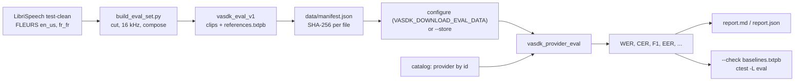

# Evaluation

*How well the local providers do on real speech: speech-to-text against what was said, text-to-speech as a recognizer hears it, voice activity and end of turn against where the speech is, speaker embeddings, noise suppression. Harness [`VASDK_3P_IMPL/Evaluation/`](../VASDK_3P_IMPL/Evaluation/) (`vasdk_provider_eval`); scores [`VASDK/include/VASDK/metrics/TranscriptScore.h`](../VASDK/include/VASDK/metrics/TranscriptScore.h); data schema [`eval_set.proto`](../VASDK_3P_IMPL/Evaluation/proto/vasdk/eval/eval_set.proto); data builder [`tools/eval-data/build_eval_set.py`](../tools/eval-data/build_eval_set.py).*

The provider tests check that a model loads and answers. The evaluation checks how well it answers, on recordings of people reading, and keeps each provider at least as good as it was:

- **A pinned evaluation set:** 133 clips (about 37 MB) cut from LibriSpeech and FLEURS, both CC BY 4.0, with what each says, who says it, and where the speech is. It downloads like a model, with each file's SHA-256 checked.
- **One harness:** `vasdk_provider_eval` creates each provider through the catalog by id, as a session does, and feeds it the way the pipeline does: 16 kHz 16-bit mono in 100 ms frames.
- **A gate:** each provider's ctest runs the smoke tier and fails when a score is worse than its baseline in [`baselines.txtpb`](../VASDK_3P_IMPL/Evaluation/baselines.txtpb) by more than its margin. A provider that isn't built, a model that's missing or a set that isn't downloaded skips the test (77).
- **A report:** `--report <dir>` writes `report.md`, `report.json` and the synthesized speech, to compare providers or to read what each one got wrong.

Cloud providers aren't measured: their scores would need keys in CI and would change without a change in VASDK.



## Running it

```bash
cmake --preset dev -DVASDK_DOWNLOAD_EVAL_DATA=ON          # the set lands in build/dev/VASDK_3P_IMPL/eval
cmake --build build/dev --config Release
ctest --test-dir build/dev -L eval --output-on-failure     # every local provider built, smoke tier, against baselines

# The whole set, every stage, a report
./build/dev/VASDK_3P_IMPL/Evaluation/vasdk_provider_eval all --data build/dev/VASDK_3P_IMPL/eval/vasdk_eval_v1 \
    --models build/dev/VASDK_3P_IMPL/models --report eval-report
```

Turn on the providers that are off by default to measure them too: `-DVASDK_BUILD_PARAKEET=ON -DVASDK_BUILD_MOONSHINE=ON -DVASDK_BUILD_SUPERTONIC=ON -DVASDK_BUILD_MOSS_TTS=ON`.

| Option | Default | What |
| --- | --- | --- |
| `<stage>` | | `stt`, `tts`, `vad`, `turn`, `speaker`, `denoise` or `all` |
| `--provider <id>` | every local one built | One provider of the stage, by its catalog id |
| `--mode` | `both` | STT: `oneshot`, `streaming` or `both` |
| `--tier` | `full` | `smoke` (43 clips, what ctest runs) or `full` (all 133) |
| `--models <dir>` | `VASDK_MODELS_DIR`, else the model store's | The models folder |
| `--data <dir>` | | The set: the folder of `references.txtpb` |
| `--store <dir>` | | Without `--data`: download the set into this folder first (`--manifest` names another manifest) |
| `--judge <stt id>` | parakeet, else whistle, else moonshine | The recognizer that transcribes synthesized and denoised speech |
| `--report <dir>` | | Write `report.md`, `report.json` and `tts/<provider>/*.wav` |
| `--check <file>` | | Fail (1) when a gated score is worse than its baseline by more than its margin |
| `--write-baselines <file>` | | Put this run's gated scores in the file, keeping margins edited by hand |
| `--realtime` | off | Feed streaming STT at the pace of speech, so its latencies mean something |
| `--verbose` | off | A line per clip |
| `--log-level <level>` | `warn` | The providers' logs: `trace`, `debug` (Smart Turn's probabilities, for one), `info`, `warn`, `error`, `off` |

Exit codes: 0 when everything measured stays within its baselines, 1 when a score is worse or something fails, 77 when nothing ran.

## The evaluation set

| Kind | Clips (smoke) | From | Used by |
| --- | --- | --- | --- |
| `SPEECH` | 40 English from LibriSpeech test-clean: 10 speakers, 5 female and 5 male, 4 utterances each (15) | LibriSpeech | STT, speaker, denoise |
| `SPEECH` | 20 English and 20 French FLEURS sentences without digits, one reading each (5 + 5) | FLEURS | STT, TTS (as text), denoise |
| `TURN` | 20 finished sentences and 20 stopped mid-phrase (at a short dip between words in running speech, faded out over 20 ms), each followed by 1.5 s of silence (5 + 5) | FLEURS English | turn |
| `VAD` | 8: two utterances with silence, white, pink, brown noise, hum or babble before, between and after (3) | LibriSpeech | VAD |
| `NOISE` | 5 of 6 s: white, pink, brown, mains hum, babble of six talkers not among the speakers (5) | generated, LibriSpeech | VAD false alarms, denoise |

- Every clip is 16 kHz mono 16-bit WAV. `references.txtpb` (a `vasdk.eval.EvalSet`) gives each one's text, language, speaker, gender, source utterance, tier, and, for `VAD` and `TURN` clips, where the speech is.
- Speech segments come from each utterance's energy: 10 ms frames within 35 dB of its loudest, joined across pauses under 300 ms, padded by 20 ms.
- Numbers are spelled in every reference (FLEURS sentences with digits are left out), so a recognizer that writes "21" for "twenty one" isn't scored on a convention.

**Where it lives.** The files are the assets of the prerelease [`eval-data-v1`](https://github.com/fatehmtd/VASDK/releases/tag/eval-data-v1) of this repository; the manifest pins each one's SHA-256, so a replaced asset fails the download instead of changing the scores.

**Rebuilding it.** A maintainer rebuilds the set when it changes, never CI. The builder needs ffmpeg, numpy and huggingface_hub; it downloads the corpora (about 1 GB) once into `--cache`, and the output is the same for the same inputs.

```bash
python -I tools/eval-data/build_eval_set.py --cache ~/eval-cache --out ~/eval-out --github-release fatehmtd/VASDK:eval-data-v1
cp ~/eval-out/manifest.json VASDK_3P_IMPL/Evaluation/data/manifest.json
```

A set that changes is a new set: bump `vasdk_eval_v1` and the model id `eval_audio_v1`, and write the baselines again.

## What each stage measures

| Stage | How it runs | Scores (gated in bold) |
| --- | --- | --- |
| **STT one-shot** | `writeFullAudioData` on each speech clip, as the pipeline does when the VAD ends an utterance | **wer**, **cer** per language; rtf |
| **STT streaming** | `writeAudioData` in 100 ms frames, then 0.5 s of silence and `commitEndOfSpeech`; the finals joined | **wer**, **cer**; rtf; with `--realtime`, first_partial and finalize (median seconds) |
| **TTS** | `synthesizeSpeech` on each FLEURS sentence, then the judge's one-shot transcription | **judge_wer**, **judge_cer**, **bad_clips** (silent, no audio, a pace outside 0.15-1.2 s per word, more than 1 s of silence first), **clipped** samples; first_audio, rtf |
| **VAD** | `detectVoiceActivity` per 100 ms frame; the regions against the labels on a 10 ms grid, with a 100 ms collar | **f1**, **false_alarm** (share of noise-only audio taken for speech, babble left out); precision, recall, onset and offset delay |
| **Turn** | Audio frames through the ring buffer, with the VAD's states where `VADFrameProcessor` puts them for the labelled speech: PAUSED on the first quiet frame, ENDING after `maxSpeechPauseDurationMs`, ENDED after `maxSpeechEndDurationMs` more. The model's call is whether to end the turn in that silence, before the VAD's end | **accuracy** (finished sentences end it, stopped ones don't), **false_end_500ms** (stopped sentences ended within half a second: a hesitation cut off); recall, false_end, precision, end_latency (median seconds from the speech's end to the turn's) |
| **Speaker** | `computeEmbedding` per clip of speakers with two clips or more; cosine over every pair | **eer**; eer_threshold, same_accepted and different_rejected at `SpeakerIdentificationProcessor`'s 0.3 |
| **Denoise** | English speech clean and mixed with pink noise or babble at 0, 5 and 10 dB SNR, through `processAudio` in 100 ms frames, then the judge, before and after | **wer_denoised_clean**, **wer_denoised_*db**, **noise_attenuation_db**; wer_clean, wer_noisy_*db; three denoised clean clips in `denoise/<provider>/` |

- **Word error rate** is (substitutions + deletions + insertions) / reference words, summed over the clips before dividing. Both texts are normalized first: lower case, punctuation as spaces, apostrophes kept inside words, accents kept (`va::metrics::normalizeTranscript`).
- **The judge** decides TTS and denoise scores, so its own WER on real speech (its STT row) is their floor, and a baseline names the judge it was measured with (`mode: "judge parakeet"`).
- **Timings aren't gated:** they measure the machine. RTF is processing time over audio time; below 1 is faster than real time.
- **Turn and VAD are measured apart:** the turn stage takes the speech's place from the labels, not from a VAD, so a VAD's mistakes don't count against the turn model, and the VAD stage scores the provider's own regions, before `VADFrameProcessor`'s pause and end timers.

Scoring a transcript from an app (C, Python, Kotlin): `vasdk_score_transcript(reference, hypothesis)` returns the word and character counts as JSON, `vasdk.score_transcript` and `Vasdk.scoreTranscript` the same ([the C API](reference/c-api.md)).

## Results

The full tier on Windows x64, every local provider built (`-DVASDK_BUILD_PARAKEET=ON -DVASDK_BUILD_MOONSHINE_STT=ON -DVASDK_BUILD_SUPERTONIC_TTS=ON -DVASDK_BUILD_MOSS_TTS=ON`), Parakeet as the judge. `baselines.txtpb` has every gated score, for both judges (Whistle is the judge of a default build).

| Stage | Provider | Result |
| --- | --- | --- |
| STT | parakeet | WER 3.0% English, 7.1% French one-shot; 3.3% and 8.8% streaming; 28x faster than real time |
| STT | moonshine | WER 3.9% English (one-shot and streaming); English only |
| STT | whistle | WER 7.4% English, 20.6% French one-shot; 7.2% and 22.5% streaming |
| TTS | moss, phonon, pocket, supertonic | Parakeet mishears 0.5% (MOSS) and 1.2% (the others) of the words; no silent, clipped or badly paced clip. First audio after 0.11 s (Phonon), 0.21 s (MOSS), 0.27 s (Pocket), 1.26 s (Supertonic, which synthesizes a sentence whole) |
| VAD | silero | F1 91.7% (precision 94.0%, recall 89.5%), 0.8% of noise taken for speech, onset 40 ms late |
| Turn | smartturn-v3 | Every finished sentence ends the turn, a median 80 ms after the speech; 75% of sentences stopped mid-phrase end it too before the VAD would, 30% within half a second |
| Speaker | pyannote | EER 0% on 10 LibriSpeech speakers; at the processor's threshold of 0.3, 97.6% of different-speaker pairs are told apart |
| Denoise | rnnoise | 24 dB off noise alone, but recognition does worse on what it leaves: Parakeet's WER 10.1% → 32.3% at 10 dB SNR, 26.7% → 48.1% at 5 dB, 3.0% → 4.1% on clean speech (Whistle's likewise) |

Not measured: Whisper.cpp and the energy/ZCR VAD build but aren't in the provider catalog, so the harness can't create them by id; GLiNER, MiniLM and llama.cpp aren't speech providers (their own tests run).

What they say about the defaults:

- **RNNoise hurts recognition** with both Parakeet and Whistle: it removes the noise and some of the speech, and the recognizers cope better with the noise. Keep it for what people hear (a call's other side), not in front of an STT, unless a recognizer measures better with it.
- **Smart Turn's pause threshold (0.85) cuts off long hesitations:** its probability rises with the silence, so most unfinished sentences end the turn within a second. A higher `pause_threshold`, or a longer `maxSpeechPauseDurationMs`, trades that for a slower reply to finished ones; the turn stage measures both sides of it.

## Baselines

[`baselines.txtpb`](../VASDK_3P_IMPL/Evaluation/baselines.txtpb) holds, per stage, provider, mode, language, metric and tier, the value measured and how much worse it may get:

```
baselines { stage: "stt" provider: "whistle" mode: "oneshot" language: "en-US" metric: "wer" value: 0.057 margin: 0.03 tier: SMOKE }
```

- **The check is one-sided:** a better score passes. Rates are absolute: a WER margin of 0.03 is 3 points.
- **Default margins:** 3 points of WER for STT and 5 for TTS and denoising, 5 points of F1, false alarms and EER, 10 points of turn accuracy and early ends (a smoke tier of 10 turns moves in steps of 10), 3 dB of noise attenuation. Edit a margin in the file; `--write-baselines` keeps it.
- **Updating:** a change that makes a provider better, or a new model, runs the provider's stage with `--tier smoke --write-baselines VASDK_3P_IMPL/Evaluation/baselines.txtpb` (and `--tier full` for the full-tier rows), and the diff goes in the same pull request.
- **A new local provider** adds its id to the harness's local list (`Stages.cpp`), its languages (`SttEval.cpp`, `TtsEval.cpp`), its run to `Evaluation/CMakeLists.txt`, and its baselines ([vasdk-provider](../skills/vasdk-provider/SKILL.md)).
- The margins absorb small differences between machines (ONNX Runtime and ggml on another CPU); the baselines are written on Windows x64.

## Tests

- `vasdk_eval_metrics` (`Evaluation/tests/eval_metrics_test.cpp`): detection on a grid with a collar, delays, the equal error rate, mixing at a SNR, and the baseline check, on made-up numbers.
- `vasdk_transcript_score` and `vasdk_wav_file` (`VASDK/tests/`): normalization, word and character edits, the corpus total; WAV files in and out.
- `vasdk_c`, `vasdk_python_score` and the Kotlin `ScoreTest`: the score through the C API and the bindings.
- `vasdk_eval_<stage>_<provider>[_<mode>]` (label `eval`): each local provider built, on the smoke tier, against its baselines.

## Platforms

The harness and its tests build wherever the catalog does on desktop: Windows, Linux and macOS. It isn't built for Android (no ctest there); the transcript score and the WAV reader are in the core library on every platform.
