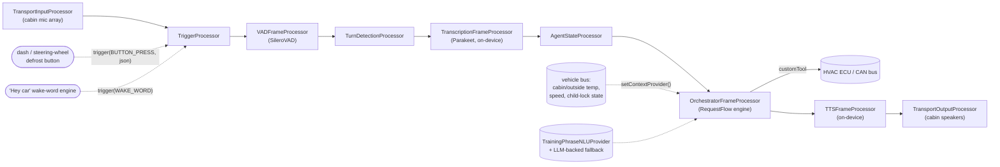
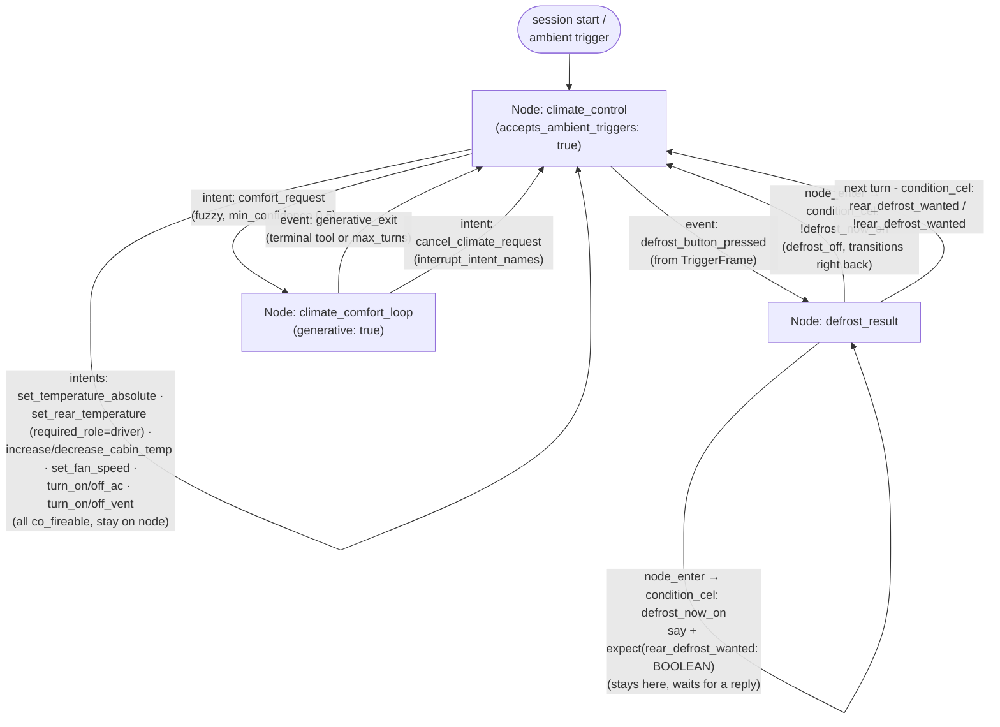

# Worked example: an in-vehicle HVAC assistant on RequestFlow

A complete, start-to-finish walkthrough of a voice- and button-driven climate control
assistant for a car head unit: the conversation graph, the entity/intent training data,
the C++ wiring, the physical-button trigger path, turn-by-turn traces, and a deterministic
test.

> **Status.** This walks through [RequestFlow](../reference/requestflow-spec.md) (Draft
> v2.8) applied end-to-end to one concrete vertical. RequestFlow is a **design spec**, not
> yet code in this repository - `va::orchestrator` (`OrchestratorEngine`,
> `OrchestratorFrameProcessor`, `OrchestratorConfigLoader`, ...) is the *proposed* C++
> surface from [requestflow-spec.md §13](../reference/requestflow-spec.md#13-public-api-surface-proposed-c),
> not a header you'll find under `VASDK/include` today. Everything **outside** that
> namespace in this document - `Pipeline`, `TriggerProcessor`, `VADFrameProcessor`,
> `AgentStateProcessor`, the STT/TTS providers - is real and compiles now; see
> [`VASDK_APP/main_pipeline.cpp`](../../VASDK_APP/main_pipeline.cpp) for the shipping
> version of that half. If you need something running today instead of the design this
> repo is converging on, the [goal layer](../reference/goal.md) (`GoalManager` +
> `IntentRouter`) is real and shipping - see the [call center
> app](../../VASDK_CALLCENTER_APP/README.md) - but it's LLM-driven every turn, which is a
> worse fit for a low-latency, often fully-offline command surface like cabin climate
> control than RequestFlow's deterministic, NLU-first model. That mismatch is exactly why
> RequestFlow exists - automotive HVAC is one of the three deployment targets that shaped
> [Draft v2.2](../reference/requestflow-spec.md#02-what-changed-in-draft-v22).

## Contents

1. [Why RequestFlow for this scenario](#1-why-requestflow-for-this-scenario)
2. [Architecture](#2-architecture)
3. [The conversation graph](#3-the-conversation-graph)
4. [Entities and NLU training data](#4-entities-and-nlu-training-data)
5. [The flow config](#5-the-flow-config-textproto)
6. [Wiring it in C++](#6-wiring-it-in-c)
7. [Triggering: buttons, wake word, and ambient events](#7-triggering-buttons-wake-word-and-ambient-events)
8. [Turn-by-turn walkthrough](#8-turn-by-turn-walkthrough)
9. [Testing without a car](#9-testing-without-a-car)
10. [Observability](#10-observability)

## 1. Why RequestFlow for this scenario

"Set the temperature to 22" is not a negotiation - it's a command with a fixed shape, and
the driver expects it to fire in well under a second, every time, whether or not the car
has a cell signal in a tunnel. That's [RequestFlow's design center](../reference/requestflow-spec.md#2-design-principles):
deterministic routing driven by a config graph, an `NLUProvider` doing bounded
classification (not free-form generation), and an LLM that's *optional infrastructure* -
present only where a request genuinely needs open-ended negotiation (below, that's "make
it comfortable in here", not "turn the fan up").

Concretely, this example ships:

- A **fully offline path** for every ordinary command: local VAD ([SileroVAD](../reference/providers.md)), local STT ([Parakeet](../../VASDK_3P_IMPL/Parakeet)), and `TrainingPhraseNLUProvider` (pattern matching, [§5](../reference/requestflow-spec.md#5-nluprovider-interface)/[§22](../reference/requestflow-spec.md#22-nlu-training-data)) - no network call, no cloud LLM, on the hot path.
- A **physical-button path** that reaches the exact same graph as speech, via the `TriggerProcessor` VASDK already ships ([§9.7](../reference/requestflow-spec.md#97-external-and-scheduled-triggers)).
- One **generative escape hatch** for the one genuinely open-ended request ("make it comfortable"), scoped to two tool calls and a hard turn budget, using an on-device model (`llama.cpp`) rather than a cloud dependency - matching VASDK's offline-first posture.
- A **permission check** on rear-zone climate changes, motivated by [§9.8](../reference/requestflow-spec.md#98-permission-gate)'s child-lock example.

## 2. Architecture

The orchestrator is one processor in an ordinary VASDK pipeline - it replaces
`LLMProcessor`/`ToolDispatchProcessor`, nothing else about the chain changes. Physical
buttons and the wake-word engine inject `TriggerFrame`s through `TriggerProcessor`, which
[VASDK already ships](../../VASDK/include/VASDK/TriggerProcessor.h) and positions "right
after the audio input processor" precisely so it can carry events alongside audio,
regardless of which drives a given turn.



## 3. The conversation graph

One `Agent`, one `Flow` (`climate`), three `Node`s. `climate_control` is the hub almost
everything routes through in a single turn; the other two nodes exist because their work
genuinely spans turns - see [§9.5](../reference/requestflow-spec.md#95-expect-and-inline-slot-elicitation)'s
"turn-spanning is enumerable" rule: a node change, an `expect`, or a generative loop are
the *only* three ways a conversation waits, and both non-hub nodes here are exactly one of
those.



Everything on `climate_control`'s self-loop is `co_fireable: true` and carries **no**
`Transition` - per [§6.1](../reference/requestflow-spec.md#61-multi-intent-co-firing)'s
conflict rule, a co-fired turn may have at most one transitioning route, and none of these
commands need to leave the hub. That's what makes *"turn on the AC and warm up the rear
seats"* a single turn instead of two: `NLUResult.co_intents` carries both, both routes
match, both fire, in order.

## 4. Entities and NLU training data

A shared vocabulary for cabin zones and fan levels, referenced from every intent phrase
that needs one ([§22](../reference/requestflow-spec.md#22-nlu-training-data)):

```textproto
# agents/car-assistant/entities.textproto
groups {
  name: "zone"
  values { canonical: "front_left"  synonyms: "front left"  synonyms: "driver's side" synonyms: "driver seat" }
  values { canonical: "front_right" synonyms: "front right" synonyms: "passenger side" synonyms: "passenger seat" }
  values { canonical: "rear_left"   synonyms: "rear left"   synonyms: "back left"  synonyms: "left back seat" }
  values { canonical: "rear_right"  synonyms: "rear right"  synonyms: "back right" synonyms: "right back seat" }
}
groups {
  name: "fan_level"
  values { canonical: "auto"   synonyms: "automatic" }
  values { canonical: "low"    synonyms: "one" synonyms: "level one" }
  values { canonical: "medium" synonyms: "two" synonyms: "level two" synonyms: "medium speed" }
  values { canonical: "high"   synonyms: "three" synonyms: "level three" }
  values { canonical: "max"    synonyms: "maximum" synonyms: "full blast" synonyms: "all the way up" }
}
groups {
  # Not used by any training phrase below - this group exists purely so §5/§6's route
  # config has a declared name for "cabin"/"front"/"rear" to reference via entity.*
  # (RequestFlow §25) instead of retyping those words as bare CEL string literals.
  name: "car_zone"
  values { canonical: "cabin" synonyms: "the whole cabin" synonyms: "everywhere" }
  values { canonical: "front" synonyms: "the front" synonyms: "windshield" }
  values { canonical: "rear"  synonyms: "the back" synonyms: "back seat" synonyms: "rear seats" }
}
```

Intent training phrases - the [phrase grammar](../reference/requestflow-spec.md#221-phrase-grammar)
covers every command with a handful of patterns each:

```textproto
# agents/car-assistant/training/climate.textproto
intents {
  intent_name: "set_temperature_absolute"
  phrases: "set the {zone:target_zone} temperature to <number:value>"
  phrases: "set the temperature to <number:value>"
  phrases: "make it <number:value> degrees in here"
}
intents {
  intent_name: "set_rear_temperature"
  phrases: "set the back seat temperature to <number:value>"
  phrases: "set the rear temperature to <number:value>"
  phrases: "make the back <number:value> degrees"
}
intents {
  intent_name: "increase_cabin_temp"
  phrases: "make it * warmer"
  phrases: "turn it * warmer"
  phrases: "warm * up (a little)?"
  phrases: "increase the temperature by <number:delta>"
  capture_defaults { name: "delta" default_value { number_value: 2.0 } }
}
intents {
  intent_name: "decrease_cabin_temp"
  phrases: "make it * cooler"
  phrases: "turn it * cooler"
  phrases: "cool * down (a little)?"
  phrases: "decrease the temperature by <number:delta>"
  capture_defaults { name: "delta" default_value { number_value: 2.0 } }
}
intents {
  intent_name: "set_fan_speed"
  phrases: "set the fan (speed)? to {fan_level:level}"
  phrases: "turn the fan to {fan_level:level}"
  phrases: "put the fan on {fan_level:level}"
}
intents {
  intent_name: "turn_on_ac"
  phrases: "turn (the)? a c on"
  phrases: "turn on the air conditioning"
  phrases: "switch on the a c"
}
intents {
  intent_name: "turn_off_ac"
  phrases: "turn (the)? a c off"
  phrases: "turn off the air conditioning"
}
intents {
  intent_name: "turn_on_vent"
  phrases: "turn on the {zone:target_zone} vent (and increase the temperature by <number:delta>)?"
  phrases: "{zone:target_zone} vent on"
  capture_defaults { name: "delta" default_value { number_value: 0 } }
}
intents {
  intent_name: "turn_off_vent"
  phrases: "turn off the {zone:target_zone} vent"
  phrases: "{zone:target_zone} vent off"
}
intents {
  intent_name: "comfort_request"
  phrases: "make it comfortable in here"
  phrases: "it feels * in here"
  phrases: "can you * make it nicer in here"
}
intents {
  intent_name: "cancel_climate_request"
  phrases: "cancel"
  phrases: "never mind"
  phrases: "forget it"
}
```

`turn_on_vent`'s optional `(and increase the temperature by <number:delta>)?` group is the
exact pattern [§22.4](../reference/requestflow-spec.md#224-worked-example) walks through:
one phrase, one intent, one `customTool` handler covers all four zones with or without a
temperature bump, because the group-capturing `{zone:target_zone}` and the optional clause
both generalize instead of needing a phrase - or an intent - per zone.

Three intents above declare `capture_defaults` ([RequestFlow §26](../reference/requestflow-spec.md#26-default-values-for-intent-captures),
Draft v2.7): `nlu.delta` is `2.0`/`2.0`/`0` respectively whenever `increase_cabin_temp`/
`decrease_cabin_temp`/`turn_on_vent` matches without that optional clause, instead of being
absent - see [§5](#5-the-flow-config-textproto) for what that lets those three routes' CEL
drop. `set_temperature_absolute`'s `{zone:target_zone}` capture deliberately does *not* get
one: its fallback (`entity.car_zone.cabin`, [§25](../reference/requestflow-spec.md#25-entity-backed-cel-constants))
has to stay a `has(nlu.target_zone) ? ... : entity.car_zone.cabin` CEL ternary in the route
itself, because `CaptureDefault.default_value` is a plain `google.protobuf.Value` baked
into the training file, not a CEL expression - it can't reference an `entity.*` constant
the way a route's own `value_cel` can. `capture_defaults` fits a bare number or boolean
fallback well; a fallback that needs to *be* a declared entity canonical still belongs in
CEL, next to `entity.*`, not in the training file.

## 5. The flow config (textproto)

```textproto
# agents/car-assistant/agent.textproto
id: "car-assistant"
default_locale: "en-US"
```

```textproto
# agents/car-assistant/flows/climate.textproto
id: "climate"
start_node_id: "climate_control"
interrupt_intent_names: "cancel_climate_request"

flow_handlers {
  no_match { actions { say { text: "I can help with temperature, fan speed, A/C, vents, or defrost." } } }
  no_input { actions { say { text: "Still there? Let me know what you'd like the climate control to do." } } }
  permission_denied { actions { say { text: "Only the driver can change the rear temperature while the child lock is on." } } }
}

nodes {
  id: "climate_control"
  accepts_ambient_triggers: true

  routes {
    id: "set_rear_temperature"
    priority: 5
    required_role: "driver"
    co_fireable: true
    trigger { intent { intent_name: "set_rear_temperature" min_confidence: 0.6 } }
    executor {
      actions { set_parameter { name: "target_temp_c" value_cel: "nlu.value" } }
      actions {
        custom_tool {
          tool: "apply_temperature"
          args_cel { key: "zone"  value: "entity.car_zone.rear" }
          args_cel { key: "value" value: "target_temp_c" }
        }
      }
      actions { say { text: "Setting the rear temperature to {target_temp_c} degrees." } }
    }
  }

  routes {
    id: "set_temperature_absolute"
    priority: 10
    co_fireable: true
    trigger { intent { intent_name: "set_temperature_absolute" min_confidence: 0.6 } }
    executor {
      actions { set_parameter { name: "target_temp_c" value_cel: "nlu.value" } }
      actions {
        custom_tool {
          tool: "apply_temperature"
          args_cel { key: "zone"  value: "has(nlu.target_zone) ? nlu.target_zone : entity.car_zone.cabin" }
          args_cel { key: "value" value: "target_temp_c" }
        }
      }
      actions {
        custom_tool {
          tool: "log_climate_event"
          execution_mode: FIRE_AND_FORGET
          args_cel { key: "event_name" value: "\"set_temperature\"" }
          args_cel { key: "zone"       value: "has(nlu.target_zone) ? nlu.target_zone : entity.car_zone.cabin" }
          args_cel { key: "value"      value: "target_temp_c" }
        }
      }
      actions {
        custom_tool {
          tool: "persist_climate_preference"
          execution_mode: BEST_EFFORT
          timeout_ms: 300
          args_cel { key: "zone"  value: "has(nlu.target_zone) ? nlu.target_zone : entity.car_zone.cabin" }
          args_cel { key: "value" value: "target_temp_c" }
        }
      }
      actions { say { text: "Setting the temperature to {target_temp_c} degrees." } }
    }
  }

  routes {
    id: "increase_cabin_temp"
    priority: 11
    co_fireable: true
    trigger { intent { intent_name: "increase_cabin_temp" min_confidence: 0.6 } }
    executor {
      actions { set_parameter { name: "target_temp_c" value_cel: "context.cabin_temp_c + nlu.delta" } }
      actions { custom_tool { tool: "apply_temperature" args_cel { key: "zone" value: "entity.car_zone.cabin" } args_cel { key: "value" value: "target_temp_c" } } }
      actions { say { text: "Warming it up to {target_temp_c} degrees." } }
    }
  }

  routes {
    id: "decrease_cabin_temp"
    priority: 12
    co_fireable: true
    trigger { intent { intent_name: "decrease_cabin_temp" min_confidence: 0.6 } }
    executor {
      actions { set_parameter { name: "target_temp_c" value_cel: "context.cabin_temp_c - nlu.delta" } }
      actions { custom_tool { tool: "apply_temperature" args_cel { key: "zone" value: "entity.car_zone.cabin" } args_cel { key: "value" value: "target_temp_c" } } }
      actions { say { text: "Cooling it down to {target_temp_c} degrees." } }
    }
  }

  routes {
    id: "set_fan_speed"
    priority: 13
    co_fireable: true
    trigger { intent { intent_name: "set_fan_speed" min_confidence: 0.6 } }
    executor {
      actions { set_parameter { name: "fan_level" value_cel: "nlu.level" } }
      actions { custom_tool { tool: "apply_fan_speed" args_cel { key: "level" value: "fan_level" } } }
      actions { say { text: "Fan set to {fan_level}." } }
    }
  }

  routes {
    id: "turn_on_ac"
    priority: 14
    co_fireable: true
    trigger { intent { intent_name: "turn_on_ac" min_confidence: 0.6 } }
    executor {
      actions { custom_tool { tool: "apply_ac_power" args_cel { key: "on" value: "true" } } }
      actions { say { text: "A/C on." } }
    }
  }
  routes {
    id: "turn_off_ac"
    priority: 15
    co_fireable: true
    trigger { intent { intent_name: "turn_off_ac" min_confidence: 0.6 } }
    executor {
      actions { custom_tool { tool: "apply_ac_power" args_cel { key: "on" value: "false" } } }
      actions { say { text: "A/C off." } }
    }
  }

  routes {
    id: "turn_on_vent"
    priority: 16
    co_fireable: true
    trigger { intent { intent_name: "turn_on_vent" min_confidence: 0.6 } }
    executor {
      actions { custom_tool { tool: "apply_vent_zone" args_cel { key: "zone" value: "nlu.target_zone" } args_cel { key: "on" value: "true" } } }
      actions {
        set_parameter { name: "target_temp_c" value_cel: "context.cabin_temp_c + nlu.delta" }
      }
      actions { say { text: "Vent on." } }
    }
  }
  routes {
    id: "turn_off_vent"
    priority: 17
    co_fireable: true
    trigger { intent { intent_name: "turn_off_vent" min_confidence: 0.6 } }
    executor {
      actions { custom_tool { tool: "apply_vent_zone" args_cel { key: "zone" value: "nlu.target_zone" } args_cel { key: "on" value: "false" } } }
      actions { say { text: "Vent off." } }
    }
  }

  routes {
    id: "defrost_button"
    priority: 1
    trigger { event { name: "defrost_button_pressed" } }
    executor {
      actions { custom_tool { tool: "toggle_defrost" args_cel { key: "zone" value: "has(event.target) ? event.target : entity.car_zone.front" } } }
    }
    transition { target_type: NODE target_id: "defrost_result" }
  }

  routes {
    id: "start_comfort_loop"
    priority: 20
    trigger { intent { intent_name: "comfort_request" min_confidence: 0.5 } }
    transition { target_type: NODE target_id: "climate_comfort_loop" }
  }
}

nodes {
  id: "defrost_result"
  # rear_defrost_yes/no are checked *before* defrost_on/defrost_off, deliberately: this
  # node is re-entered twice per defrost press - once via node_enter right after the
  # button toggles the relay, and once when the driver's answer to "want the rear
  # defroster too?" comes back. `rear_defrost_wanted` only exists during that second
  # pass (`expect` writes it, `transient: true` removes it once consumed), so ordering
  # these first is what keeps the second pass from re-matching `defrost_on` again on
  # `defrost_now_on`, which is still true both times.
  routes {
    id: "rear_defrost_yes"
    priority: 1
    trigger { condition_cel: "has(rear_defrost_wanted) && rear_defrost_wanted" }
    executor {
      actions { custom_tool { tool: "toggle_defrost" args_cel { key: "zone" value: "entity.car_zone.rear" } } }
      actions { say { text: "Rear defrost on too." } }
    }
    transition { target_type: NODE target_id: "climate_control" }
  }
  routes {
    id: "rear_defrost_no"
    priority: 2
    trigger { condition_cel: "has(rear_defrost_wanted) && !rear_defrost_wanted" }
    executor { actions { say { text: "Okay." } } }
    transition { target_type: NODE target_id: "climate_control" }
  }
  routes {
    id: "defrost_on"
    priority: 10
    trigger { condition_cel: "defrost_now_on" }
    executor {
      actions { say { text: "Front defrost on. Want the rear defroster too?" } }
      actions {
        expect {
          parameter { name: "rear_defrost_wanted" type: BOOLEAN prompts { initial: "Rear defroster too?" } }
          transient: true
        }
      }
    }
  }
  routes {
    id: "defrost_off"
    priority: 11
    trigger { condition_cel: "!defrost_now_on" }
    executor { actions { say { text: "Front defrost off." } } }
    transition { target_type: NODE target_id: "climate_control" }
  }
}

nodes {
  id: "climate_comfort_loop"
  generative: true
  entry_executor {
    actions { say { text: "Sure - tell me if you'd like it warmer or cooler, and I'll adjust." } }
  }
  generative_config {
    system_prompt_template: "You're adjusting cabin climate by feel, not by a target number. Current cabin temp: {context.cabin_temp_c}C. Call adjust_temperature in response to feedback like 'a bit warmer' or 'too cold'. Call confirm_comfort once the driver says it's good."
    tools { name: "adjust_temperature" }
    tools { name: "confirm_comfort" terminal: true }
    max_turns: 6
    exit_event: "generative_exit"
  }
  interrupt_intent_names: "cancel_climate_request"
  routes {
    id: "cancel_comfort_loop"
    priority: 1
    trigger { intent { intent_name: "cancel_climate_request" } }
    executor { actions { say { text: "No problem, cancelling." } } }
    transition { target_type: NODE target_id: "climate_control" }
  }
  routes {
    id: "exit_comfort_loop"
    priority: 2
    trigger { event { name: "generative_exit" } }
    executor { actions { say { text: "Glad that's more comfortable." } } }
    transition { target_type: NODE target_id: "climate_control" }
  }
}
```

A few things worth calling out about this config specifically:

- **`set_rear_temperature` (priority 5) evaluates before `set_temperature_absolute`
  (priority 10)**, and `required_role: "driver"` means a rear-seat passenger's "set the
  back seat temperature to 24" fails the [permission gate](../reference/requestflow-spec.md#98-permission-gate)
  while the driver's identical request succeeds - the route itself doesn't know or care
  who's talking; `OrchestratorEngine::setPermissionChecker` does (wired in [§6](#6-wiring-it-in-c)).
- **`set_temperature_absolute`'s last two `custom_tool` actions never delay the spoken
  confirmation** ([RequestFlow §9.10](../reference/requestflow-spec.md#910-action-execution-modes),
  Draft v2.8). `log_climate_event` is `FIRE_AND_FORGET` - a diagnostic-log append the driver
  will never notice succeeded or failed, so the executor doesn't even wait to find out.
  `persist_climate_preference` is `BEST_EFFORT` with `timeout_ms: 300` - a flash write is
  usually fast enough to just work, but 300ms of grace beats making "setting the
  temperature to 22 degrees" arrive late because of a slow write nobody's blocking on
  anyway. Neither mode existed before Draft v2.8; both would previously have had to be
  `BLOCKING` (holding up the `say`) or left off the config entirely. This same pattern
  would apply identically to `increase_cabin_temp`/`decrease_cabin_temp`/`set_rear_temperature`
  - only `set_temperature_absolute` is fully worked here to avoid repeating it six times.
- **`turn_on_vent` writes `target_temp_c` defensively** even though its own `say` doesn't
  use it, so a later co-fired route in the same turn (or a subsequent one) that reads
  `target_temp_c` sees a consistent value either way - this is the "two co-fired routes
  writing the same parameter is last-write-wins, the engine doesn't arbitrate it" caveat
  from [§6.1](../reference/requestflow-spec.md#61-multi-intent-co-firing) made concrete;
  in a real config you'd double check no two co-fireable routes actually collide like this.
- **`defrost_result` is reached only via the `event`-triggered `defrost_button` route**,
  never directly from a user utterance - it exists purely to let the runtime's synthetic
  `node_enter` event ([§6](../reference/requestflow-spec.md#6-route-evaluation-semantics)
  step 3's tail note) fall through immediately to whichever `condition_cel` route matches
  the state `toggle_defrost` just wrote, with zero user input in between. This is the exact
  mechanism [§21.3](../reference/requestflow-spec.md#213-worked-example-customtool-writing-to-sessionstate)
  demonstrates for appointment-slot availability, reused here for a hardware toggle instead
  of a webhook result.
- **`rear_defrost_yes`/`rear_defrost_no` are priority 1/2, ahead of `defrost_on`/`defrost_off`
  at 10/11** - this node is entered twice per defrost press (once from `node_enter` right
  after the toggle, once when the driver answers the rear-defroster question), and
  `defrost_now_on` is still `true` both times. Checking `has(rear_defrost_wanted)` first is
  what lets the second pass resolve the answer instead of `defrost_on` matching all over
  again and re-asking the same question forever.
- **`rear_defrost_wanted` is `transient: true`** - once `rear_defrost_yes`/`rear_defrost_no`
  consumes it, it's removed from session parameters again, so it doesn't linger into some
  unrelated later turn's CEL evaluation.
- **`entity.car_zone.rear`/`.cabin`/`.front` replace what would otherwise be bare string
  literals** (`"rear"`, `"cabin"`, `"front"`) in five different routes across this config.
  They're [§4](#4-entities-and-nlu-training-data)'s `car_zone` entity group ([RequestFlow
  §25](../reference/requestflow-spec.md#25-entity-backed-cel-constants), Draft v2.6) - typo
  `car_zone.rear` as `car_zone.raer` anywhere in this file and `validate()` rejects the
  config at load time with the exact route and reference at fault, instead of a driver
  discovering it the first time `set_rear_temperature` fires and does nothing.
- **`defrost_button`'s `has(event.target) ? event.target : entity.car_zone.front` keeps its
  `has()` ternary** rather than picking up a [§26](../reference/requestflow-spec.md#26-default-values-for-intent-captures)
  `capture_defaults` entry the way `increase_cabin_temp`/`decrease_cabin_temp`/`turn_on_vent`
  did in [§4](#4-entities-and-nlu-training-data) - `capture_defaults` only fills in `nlu.*`
  from a matched intent's own training data; `event.target` comes from a `TriggerFrame`'s
  JSON payload ([§7](#7-triggering-buttons-wake-word-and-ambient-events)), an entirely
  different namespace with no `IntentTrainingData` behind it to declare a default on.

## 6. Wiring it in C++

Everything under `va::orchestrator` here is the proposed surface from
[§13](../reference/requestflow-spec.md#13-public-api-surface-proposed-c); everything else
(`Pipeline`, `TriggerProcessor`, the providers) is real today.

```cpp
#include <VASDK/orchestrator/OrchestratorEngine.h>
#include <VASDK/orchestrator/OrchestratorFrameProcessor.h>
#include <VASDK/orchestrator/OrchestratorConfigLoader.h>
#include <VASDK/orchestrator/TrainingPhraseNLUProvider.h>
#include <VASDK/Pipeline.h>
#include <VASDK/TriggerProcessor.h>
#include <VASDK/AgentStateProcessor.h>
#include <VASDK/VADFrameProcessor.h>
#include <VASDK/TurnDetectionProcessor.h>
#include <VASDK/TranscriptionProcessor.h>
#include <VASDK/TTSFrameProcessor.h>
#include <VASDK/TransportInputProcessor.h>
#include <VASDK/TransportOutputProcessor.h>

#include "SileroVAD/SileroVAD.h"
#include "Parakeet/ParakeetTranscriptionProvider.hpp"
#include "SupertonicTTS/SupertonicVoiceSynthesisProvider.hpp"
#include "LlamaCpp/LlamaCppTransport.h"   // only the comfort-loop's generative node needs an LLM at all

#include "climate.tools.gen.h"             // generated - §6.1
#include "car_assistant.context.gen.h"     // generated - §6.3

using namespace va;
using namespace va::orchestrator;

// -- Your own vehicle integration, not part of VASDK -------------------------
// A thin wrapper around whatever CAN/SOME-IP/vendor SDK the head unit already
// uses to read cabin telemetry and command the HVAC ECU. VASDK doesn't ship a
// vehicle-bus provider; this is application code, the same way `calendarStore`
// is application code in the appointments example (§21.3).
class VehicleBusClient {
public:
    float cabinTempC() const;
    float outsideTempC() const;
    bool  childLockActive() const;
    void  setTargetTemp(const std::string& zone, float celsius);
    void  setFanLevel(const std::string& level);
    void  setAcPower(bool on);
    void  setVent(const std::string& zone, bool on);
    void  toggleDefrost(const std::string& zone, bool& outNowOn);

    // Head-unit-side, not the HVAC bus itself - a diagnostic log append and a flash
    // write. Both can occasionally stall (a full log buffer flushing, wear-leveling on
    // the flash write); neither is remotely urgent enough to justify a driver-facing delay.
    void  logClimateEvent(const std::string& eventName, const std::string& zone, float value);
    void  persistClimatePreference(const std::string& zone, float value);
};
```

### 6.1 Tool argument schemas and generated structs

This vertical registers nine `customTool` handlers; eight of them take arguments, and
without something like this every one of those eight would mean pulling values out of a
bare `args.fields().at("...")`. [RequestFlow §23](../reference/requestflow-spec.md#23-typed-customtool-argument-and-result-codegen)
(Draft v2.4) exists specifically so integrators don't write that by hand: declare each
tool's argument (and, for the two tools the comfort loop's generative node calls, result)
shape once, and get a generated C++ struct plus load-time validation that a route's
`args_cel` keys actually match.

```textproto
# agents/car-assistant/tools/climate.textproto
tools {
  name: "apply_temperature"
  description: "Command the HVAC ECU to a target temperature for one zone."
  args { name: "zone"  type: STRING required: true description: "one of the car_zone entity's canonical values (cabin | front | rear) - not the 4-way vent zone group apply_vent_zone below uses" }
  args { name: "value" type: NUMBER required: true }
}
tools {
  name: "apply_fan_speed"
  description: "Set cabin fan speed."
  args { name: "level" type: STRING required: true description: "one of the fan_level entity's canonical values" }
}
tools {
  name: "apply_ac_power"
  description: "Turn the compressor on or off."
  args { name: "on" type: BOOLEAN required: true }
}
tools {
  name: "apply_vent_zone"
  description: "Open or close one zone's vent."
  args { name: "zone" type: STRING required: true description: "one of the zone entity's four canonical values (front_left | front_right | rear_left | rear_right)" }
  args { name: "on"   type: BOOLEAN required: true }
}
tools {
  name: "toggle_defrost"
  description: "Flip a defrost relay; reports the resulting state via SessionState, not a return value."
  args { name: "zone" type: STRING required: true description: "car_zone.front or car_zone.rear" }
}
tools {
  name: "adjust_temperature"
  description: "Nudge cabin temperature by feel - climate_comfort_loop's non-terminal generative tool."
  args   { name: "delta_c" type: NUMBER required: true }
  result { name: "new_cabin_temp_c" type: NUMBER required: true }
}
tools {
  name: "confirm_comfort"
  description: "Ends the comfort loop - climate_comfort_loop's terminal generative tool."
}
tools {
  name: "log_climate_event"
  description: "Append a climate-command event to the on-vehicle diagnostic log. Purely a side effect - never worth delaying a driver's command for."
  args { name: "event_name" type: STRING required: true }
  args { name: "zone"       type: STRING required: true }
  args { name: "value"      type: NUMBER required: true }
}
tools {
  name: "persist_climate_preference"
  description: "Write the driver's latest temperature choice to on-board flash so it survives an ignition cycle. A slow flash write shouldn't delay the spoken confirmation, but it's worth a short grace period."
  args { name: "zone"  type: STRING required: true }
  args { name: "value" type: NUMBER required: true }
}
```

`requestflow-codegen tools` turns that into a header - shown here for `apply_temperature`,
`toggle_defrost`, `log_climate_event`, and the comfort loop's pair; `apply_fan_speed`,
`apply_ac_power`, `apply_vent_zone`, and `persist_climate_preference` follow the identical
single-struct, `FromStruct`-only shape and are omitted for space:

```cpp
// GENERATED FILE - agents/car-assistant/tools/climate.textproto -> climate.tools.gen.h
// Do not edit by hand; re-run `requestflow-codegen tools` after changing the .textproto.
#pragma once
#include <google/protobuf/struct.pb.h>
#include <string>

namespace agents::car_assistant::tools {

struct ApplyTemperatureArgs {
    std::string zone;
    double      value;
    static ApplyTemperatureArgs FromStruct(const google::protobuf::Struct& s) {
        return ApplyTemperatureArgs{ s.fields().at("zone").string_value(), s.fields().at("value").number_value() };
    }
};

struct ToggleDefrostArgs {
    std::string zone;
    static ToggleDefrostArgs FromStruct(const google::protobuf::Struct& s) {
        return ToggleDefrostArgs{ s.fields().at("zone").string_value() };
    }
};

struct AdjustTemperatureArgs {
    double delta_c;
    static AdjustTemperatureArgs FromStruct(const google::protobuf::Struct& s) {
        return AdjustTemperatureArgs{ s.fields().at("delta_c").number_value() };
    }
};

struct AdjustTemperatureResult {
    double new_cabin_temp_c;
    google::protobuf::Struct ToStruct() const {
        google::protobuf::Struct s;
        (*s.mutable_fields())["new_cabin_temp_c"].set_number_value(new_cabin_temp_c);
        return s;
    }
};

struct LogClimateEventArgs {
    std::string event_name;
    std::string zone;
    double      value;
    static LogClimateEventArgs FromStruct(const google::protobuf::Struct& s) {
        return LogClimateEventArgs{
            s.fields().at("event_name").string_value(),
            s.fields().at("zone").string_value(),
            s.fields().at("value").number_value(),
        };
    }
};

}  // namespace agents::car_assistant::tools
```

And `OrchestratorConfigLoader::validate(agent, toolSchemas)` ([§23.4](../reference/requestflow-spec.md#234-load-time-validation))
now catches, at load time, exactly the class of bug that used to be a runtime `.at()`
throw: rename `set_temperature_absolute`'s `args_cel { key: "value" ... }` to `key:
"target_value"` without updating `tools/climate.textproto` to match, and config loading
fails before the agent ever handles a call - not the first time a driver asks for a
temperature change in production.

`log_climate_event` and `persist_climate_preference` don't change what the temperature
route *does* - they're side effects a driver's spoken command should never wait on. Neither
declares an `execution_mode` in its `ToolSchema` (that field lives on the route's
`CustomToolAction`, not the tool definition - the same tool could in principle be called
`BLOCKING` from one route and `FIRE_AND_FORGET` from another); [§5](#5-the-flow-config-textproto)
is where each call actually picks one, using [RequestFlow §9.10](../reference/requestflow-spec.md#910-action-execution-modes)
(Draft v2.8).

### 6.2 `customTool` handlers

With the generated structs from [§6.1](#61-tool-argument-schemas-and-generated-structs) in
hand, every handler is `setTypedCustomToolHandler<Args>` instead of
`setCustomToolHandler` - no field-name string literals, no `.fields().at(...)`:

```cpp
#include "climate.tools.gen.h"
using namespace agents::car_assistant::tools;

void registerClimateTools(OrchestratorEngine& engine, std::shared_ptr<VehicleBusClient> bus) {

    engine.setTypedCustomToolHandler<ApplyTemperatureArgs>("apply_temperature",
        [bus](const ApplyTemperatureArgs& args, SessionState&) -> google::protobuf::Struct {
            double clamped = std::clamp(args.value, 16.0, 30.0);   // defend against a bad CEL result, not user input we trust
            bus->setTargetTemp(args.zone, static_cast<float>(clamped));
            return {};
        });

    engine.setTypedCustomToolHandler<ApplyFanSpeedArgs>("apply_fan_speed",
        [bus](const ApplyFanSpeedArgs& args, SessionState&) -> google::protobuf::Struct {
            bus->setFanLevel(args.level);
            return {};
        });

    engine.setTypedCustomToolHandler<ApplyAcPowerArgs>("apply_ac_power",
        [bus](const ApplyAcPowerArgs& args, SessionState&) -> google::protobuf::Struct {
            bus->setAcPower(args.on);
            return {};
        });

    engine.setTypedCustomToolHandler<ApplyVentZoneArgs>("apply_vent_zone",
        [bus](const ApplyVentZoneArgs& args, SessionState&) -> google::protobuf::Struct {
            bus->setVent(args.zone, args.on);
            return {};
        });

    // Writes defrost_now_on into SessionState - defrost_result's condition_cel routes
    // (§5 above) are the only reason this exists; the tool itself has no branching authority.
    engine.setTypedCustomToolHandler<ToggleDefrostArgs>("toggle_defrost",
        [bus](const ToggleDefrostArgs& args, SessionState& state) -> google::protobuf::Struct {
            bool nowOn = false;
            bus->toggleDefrost(args.zone, nowOn);
            google::protobuf::Value v; v.set_bool_value(nowOn);
            state.setParameter("defrost_now_on", v);
            return {};
        });

    // The comfort loop's two tools - see §6.3. `adjust_temperature` nudges by feel and
    // returns AdjustTemperatureResult (the generative loop's own LLM turn is the one
    // real reader of a customTool's return value, per §9.6); `confirm_comfort`
    // (terminal: true) is the only way the loop ends successfully and takes no arguments.
    engine.setTypedCustomToolHandler<AdjustTemperatureArgs>("adjust_temperature",
        [bus](const AdjustTemperatureArgs& args, SessionState&) -> google::protobuf::Struct {
            bus->setTargetTemp("cabin", static_cast<float>(bus->cabinTempC() + args.delta_c));
            return AdjustTemperatureResult{ bus->cabinTempC() }.ToStruct();
        });

    engine.setCustomToolHandler("confirm_comfort",
        [](const google::protobuf::Struct&, SessionState&) -> google::protobuf::Struct { return {}; });

    // Registered exactly like every BLOCKING handler above - a handler has no idea, and
    // doesn't need to know, which ExecutionMode the route that calls it picked (§9.10).
    // That choice lives entirely in §5's CustomToolAction.execution_mode.
    engine.setTypedCustomToolHandler<LogClimateEventArgs>("log_climate_event",
        [bus](const LogClimateEventArgs& args, SessionState&) -> google::protobuf::Struct {
            bus->logClimateEvent(args.event_name, args.zone, static_cast<float>(args.value));
            return {};
        });

    engine.setTypedCustomToolHandler<PersistClimatePreferenceArgs>("persist_climate_preference",
        [bus](const PersistClimatePreferenceArgs& args, SessionState&) -> google::protobuf::Struct {
            bus->persistClimatePreference(args.zone, static_cast<float>(args.value));
            return {};
        });
}
```

`confirm_comfort` stays on the untyped `setCustomToolHandler` - it declares no `args` in
its `ToolSchema`, so codegen has nothing to generate for it beyond registering the name for
[§6.1](#61-tool-argument-schemas-and-generated-structs)'s validation pass; there's no
struct a zero-argument tool would gain from wrapping. `log_climate_event` and
`persist_climate_preference`'s handlers, notably, are written with **no idea they'll be
called `FIRE_AND_FORGET`/`BEST_EFFORT`** - `ExecutionMode` changes when and whether the
engine waits on a handler, never the handler's own signature or body ([§9.10](../reference/requestflow-spec.md#910-action-execution-modes)).
The one thing worth double-checking for a handler that *might* run past its turn's
lifetime, per that same section: it shouldn't write anything to `SessionState` that a route
condition later depends on, since nothing guarantees which turn, if any, is still around to
read it. Neither handler above writes to `SessionState` at all, which is exactly why they're
safe candidates for these modes in the first place.

### 6.3 Context, permissions, and the engine

Vehicle telemetry this agent's config and C++ both need gets the identical
[§24](../reference/requestflow-spec.md#24-typed-context-codegen) (Draft v2.5) treatment as
[§6.1](#61-tool-argument-schemas-and-generated-structs)'s tool arguments - one schema,
composed per agent rather than per tool. `cabin_temp_c` is read from CEL directly
(`increase_cabin_temp`/`decrease_cabin_temp` in [§5](#5-the-flow-config-textproto));
`child_lock_active` is read by the permission checker below, in C++, from the same
`VehicleBusClient` the context provider itself reads - two different consumers of one
schema. `outside_temp_c` isn't consulted by any route yet; it's declared anyway because a
real vehicle context grows fields faster than the routes that end up using them, and a
schema is exactly the place to keep that list honest:

```textproto
# agents/car-assistant/context/climate.textproto
fields { name: "cabin_temp_c"      type: NUMBER  required: true description: "current cabin temperature, Celsius" }
fields { name: "outside_temp_c"    type: NUMBER  required: true }
fields { name: "child_lock_active" type: BOOLEAN required: true }
```

```cpp
// GENERATED FILE - agents/car-assistant/context/*.textproto -> car_assistant.context.gen.h
namespace agents::car_assistant {
struct Context {
    double cabin_temp_c;
    double outside_temp_c;
    bool   child_lock_active;
    google::protobuf::Struct ToStruct() const { /* one (*s.mutable_fields())[...] line per field - see §24.2 */ }
};
}  // namespace agents::car_assistant
```

With that in hand, `context.cabin_tmp_c` (a typo, dropped the 'e') anywhere in
[§5](#5-the-flow-config-textproto)'s flow config stops being a value that silently
resolves empty the first time `increase_cabin_temp` fires in a driver's car - it becomes a
CEL compile error `OrchestratorConfigLoader::validate()` catches before that config ever
ships, per [§24.3](../reference/requestflow-spec.md#243-typed-cel-environment):

```cpp
std::shared_ptr<OrchestratorFrameProcessor> buildClimateOrchestrator(
    std::shared_ptr<VehicleBusClient> bus,
    std::shared_ptr<llm::LLMTransport> localLlm)   // LlamaCppTransport - only the comfort loop uses it
{
    Agent agent = OrchestratorConfigLoader::fromDirectory("agents/car-assistant/");
    auto toolSchemas   = OrchestratorConfigLoader::loadToolSchemas("agents/car-assistant/");
    auto contextSchema = OrchestratorConfigLoader::loadContextSchema("agents/car-assistant/");
    // Loaded here (rather than down by setNLUProvider, where §4's narration puts it)
    // specifically so trainingSet.entities is on hand for validate() below - it's the
    // same EntityDictionary either way, just needed a turn earlier than the NLU wiring does.
    auto trainingSet = OrchestratorConfigLoader::loadTrainingSet("agents/car-assistant/");

    // Cross-checks §6.1's tool args_cel keys, every context.* reference in §5's flow
    // config, and (new in RequestFlow §25) every entity.* reference - like §5's
    // entity.car_zone.rear - against entities.textproto. validate(agent) alone still
    // works; each omitted argument just skips that one check (§23.4/§24.3/§25.2).
    auto report = OrchestratorConfigLoader::validate(agent, toolSchemas, contextSchema, trainingSet.entities);
    if (!report.ok()) {
        spdlog::error("climate agent config invalid: {}", report.summary());
        throw std::runtime_error("bad RequestFlow config");
    }

    OrchestratorConfig config;
    config.turnExternalCallBudget   = std::chrono::milliseconds(1500);   // tight - this is a car, not a call center
    config.defaultGenerativeMaxTurns = 6;

    auto engine = std::make_shared<OrchestratorEngine>(agent, config);

    // Fully local NLU: pattern-matched against §4's training data, sub-millisecond,
    // no network call - this is what makes the ordinary command path work in a tunnel.
    engine->setNLUProvider(std::make_shared<TrainingPhraseNLUProvider>(trainingSet));

    // Only wired for the one generative node - an on-device GGUF model, not a cloud
    // dependency, consistent with VASDK's offline-first default (docs/overview.md).
    engine->setLLMTransport(localLlm);

    registerClimateTools(*engine, bus);

    // context.* - read-only, refreshed every turn (§8.1). setTypedContextProvider (§24.4)
    // takes the generated Context struct directly - no field-name string literals here
    // either, and the fields above are exactly what condition_cel/value_cel see as
    // context.cabin_temp_c / context.outside_temp_c / context.child_lock_active.
    engine->setTypedContextProvider<agents::car_assistant::Context>([bus]() {
        return agents::car_assistant::Context{
            bus->cabinTempC(),
            bus->outsideTempC(),
            bus->childLockActive(),
        };
    });

    // §9.8's permission gate: `speaker_id` here is which cabin microphone zone picked
    // the utterance up (the multi-mic beamforming array a car already has), supplied
    // by the app - not voice biometrics. "driver" may always change any zone; anyone
    // else may only touch the rear zone while the child lock is off.
    engine->setPermissionChecker(
        [bus](const std::string& requiredRole, const std::string& speakerId) -> bool {
            if (requiredRole != "driver") return true;
            return speakerId == "driver" || !bus->childLockActive();
        });

    engine->setOnFlowComplete([](const std::string& flowId, const SessionState&) {
        spdlog::info("climate flow '{}' turn complete", flowId);
    });

    return std::make_shared<OrchestratorFrameProcessor>(engine);
}
```

### 6.4 The pipeline

Same shape as [the minimal pipeline example](minimal-pipeline.md) and
[`VASDK_APP/main_pipeline.cpp`](../../VASDK_APP/main_pipeline.cpp) - `TriggerProcessor`
goes right after the transport input, `OrchestratorFrameProcessor` takes the slot
`LLMProcessor`/`ToolDispatchProcessor` occupy in a `goal/`- or tool-calling-based build:

```cpp
auto triggerProcessor = std::make_shared<pipeline::TriggerProcessor>();
auto agentState       = std::make_shared<pipeline::AgentStateProcessor>();
agentState->setAlwaysOn(false);   // push-to-talk / wake-word gated, not always-listening

auto pipeline = std::make_shared<pipeline::Pipeline>();
pipeline->addProcessor(transportInput)
    .addProcessor(triggerProcessor)
    .addProcessor(vadProcessor)
    .addProcessor(turnDetection)
    .addProcessor(transcription)
    .addProcessor(agentState)
    .addProcessor(climateOrchestrator)   // the OrchestratorFrameProcessor from §6.3
    .addProcessor(tts)
    .addProcessor(transportOutput);

pipeline->build();
pipeline->start();
```

## 7. Triggering: buttons, wake word, and ambient events

Three distinct ways a turn starts, all converging on the same graph:

1. **Speech, gated by wake word.** A wake-word engine (running independently, on its own
   thread) calls `triggerProcessor->trigger(TriggerType::WAKE_WORD)`. `TriggerProcessor::trigger()`
   is explicitly documented as safe to call "from any thread - including a UI/JNI thread
   that is not this processor's own `processingLoop()` thread" ([`TriggerProcessor.h`](../../VASDK/include/VASDK/TriggerProcessor.h)),
   which is exactly the shape a wake-word engine or a hardware ISR callback has. Today this
   drives `AgentStateProcessor`'s `IDLE → LISTENING` transition ([processors.md](../reference/processors.md#triggerprocessor));
   RequestFlow doesn't need to see this trigger type at all - it just waits for the
   `TranscriptionFrame` that follows.

2. **A physical button, with no speech at all.** The dash/steering-wheel defrost button's
   firmware (or its GPIO interrupt handler) calls:

   ```cpp
   // Any thread - a GPIO ISR, a CAN-bus listener thread, whatever owns the physical button.
   triggerProcessor->trigger(transport::TriggerType::BUTTON_PRESS, R"({"event_name":"defrost_button_pressed"})");
   ```

   Per [§9.7](../reference/requestflow-spec.md#97-external-and-scheduled-triggers),
   `OrchestratorFrameProcessor` treats `TriggerFrame::data` that parses as JSON as a
   structured event payload - here just `event_name`, matching the `defrost_button` route's
   `EventTrigger` in [§5](#5-the-flow-config-textproto). Because `climate_control` sets
   `accepts_ambient_triggers: true`, this fires immediately against whatever node the
   session is already on instead of resetting to the flow's `start_node_id` - pressing
   defrost mid-conversation about the fan speed doesn't lose that conversation's place.

3. **A rear-seat button with a payload.** A rear-zone defrost/heat button could carry which
   seat pressed it:

   ```cpp
   triggerProcessor->trigger(transport::TriggerType::BUTTON_PRESS,
       R"({"event_name":"defrost_button_pressed","target":"rear"})");
   ```

   `defrost_button`'s `args_cel` (`"has(event.target) ? event.target : entity.car_zone.front"`) reads
   that `target` straight out of `event.*` ([§8.2](../reference/requestflow-spec.md#82-the-event-namespace)) -
   the same mechanism a `SCHEDULED` trigger's payload uses in the spec's own irrigation
   example ([§21.5](../reference/requestflow-spec.md#215-worked-example-event-params-and-a-bare-turn-wait)).

## 8. Turn-by-turn walkthrough

Tracing [§6](../reference/requestflow-spec.md#6-route-evaluation-semantics)'s six steps
against five concrete requests.

### 8.1 A plain command - "set the temperature to 22"

(`activeFlowId=climate`, `activeNodeId=climate_control`)

- Step 2: no pending parameter, no `pending_ask` - `NLUProvider.detect()` runs with
  `candidate_intent_names` drawn from `climate_control`'s routes. `TrainingPhraseNLUProvider`
  matches `"set the temperature to <number:value>"` → `top_intent=set_temperature_absolute,
  confidence=0.95, extracted_parameters={value: 22}`.
- Step 3: routes evaluate in priority order. `set_rear_temperature` (5) doesn't match this
  intent. `set_temperature_absolute` (10) matches; `stop_evaluation` (default true) stops
  evaluation there.
- Step 4: `target_temp_c` set to `nlu.value` (22) via CEL; `apply_temperature` fires with
  `zone="cabin"` (no `nlu.target_zone` was captured, so the CEL ternary falls back to
  `entity.car_zone.cabin`, which evaluates to the same string a literal would - just
  checked at compile time, [§25](../reference/requestflow-spec.md#25-entity-backed-cel-constants));
  `say` renders `"Setting the temperature to 22 degrees."`
- Step 5/6: no transition - stays on `climate_control`; checkpoint, `route_match_count=1`.

### 8.2 Co-firing - "turn on the AC and warm up the rear seats"

- Step 2: `detect()` returns `top_intent=turn_on_ac, confidence=0.9` and
  `co_intents=[{name: "set_rear_temperature", confidence: 0.78}]`.
- Step 3 ([§6.1](../reference/requestflow-spec.md#61-multi-intent-co-firing)): `turn_on_ac`
  matches against `top_intent` as usual. Separately, `set_rear_temperature` matches against
  the `co_intent` - **but only if `setPermissionChecker` allows it**: if the speaker's mic
  zone isn't `"driver"` and the child lock is active, this route doesn't fire at all, and
  `EventHandlers.permission_denied` runs instead, entirely independent of `turn_on_ac`
  succeeding in the same turn.
- Assuming the driver's zone: both routes fire, in `co_intents` order after `top_intent`'s
  own route - the A/C turns on and the rear temperature updates in one turn, two spoken
  confirmations, no back-and-forth.

### 8.3 The defrost button, mid-conversation

The driver is mid-sentence about fan speed (hypothetically, nothing in this config actually
spans turns on `climate_control` today, but the mechanism doesn't care) and presses defrost.

- No `TranscriptionFrame` is involved at all - a `TriggerFrame` synthesizes the equivalent
  of `EmitEventAction{name: "defrost_button_pressed"}` directly ([§9.7](../reference/requestflow-spec.md#97-external-and-scheduled-triggers)).
- Because `climate_control.accepts_ambient_triggers = true`, the event evaluates against
  the currently active node rather than resetting to `start_node_id`.
- Step 3: `defrost_button` (priority 1, `event` trigger) matches. Step 4: `toggle_defrost`
  runs, flips the relay, writes `defrost_now_on = true` into `SessionState`. Step 5:
  transition to `defrost_result`.
- The runtime's synthetic `node_enter` fires for `defrost_result` immediately, no route
  consumes it as an event, so evaluation falls through to `condition_cel` routes in the
  same turn: `defrost_on` (`defrost_now_on` is true) matches, says the line, and executes
  `expect{ parameter: rear_defrost_wanted (BOOLEAN) }` - which ends the turn and waits.
- **Next turn**, whatever the driver says ("yes" / "no thanks" / silence) is validated as a
  `BOOLEAN` the same way `goal/`'s `GoalSlot` normalizes yes/no/true/false ([§7](../reference/requestflow-spec.md#7-parameter-model-and-collection-policy)),
  stored transiently, and falls through to `rear_defrost_yes`/`rear_defrost_no` the same
  turn - either way, transition back to `climate_control`.

### 8.4 The open-ended request - "make it comfortable in here"

- Step 2: `detect()` matches `comfort_request` at a modest 0.55 confidence - clears its
  0.5 threshold, but wouldn't have beaten a more specific command if one also matched
  (specificity ranking, [§22.1](../reference/requestflow-spec.md#221-phrase-grammar)).
- Step 3: `start_comfort_loop` matches, transitions to `climate_comfort_loop`.
- `entry_executor` says the opening line. From here, [§9.4](../reference/requestflow-spec.md#94-generative-nodes)
  applies: every subsequent utterance goes straight to the local `LlamaCppTransport`,
  scoped to exactly two tools. "A little warmer" → the LLM calls `adjust_temperature`
  (ordinary `customTool`, deterministic C++, actually changes the HVAC state); "yeah
  that's good" → the LLM calls `confirm_comfort` (`terminal: true`), ending the loop.
  Either way, `generative_exit` fires, `exit_comfort_loop` catches it, and the session is
  back on `climate_control`.
- If the driver instead says "actually, cancel" at any point in that loop,
  `interrupt_intent_names` ([§6.2](../reference/requestflow-spec.md#62-interrupt-intents-and-mid-task-cancel))
  means a cheap classification check catches it *ahead of* the LLM call - the loop ends
  immediately via `cancel_comfort_loop`, without waiting on `maxTurns` or depending on the
  model itself recognizing the cancellation.

### 8.5 Permission denied - a rear passenger tries to override the child lock

- Step 2/3: `set_rear_temperature` matches normally at the NLU layer - the permission gate
  is not an NLU concern.
- Before executing the route's `executor`, the engine calls `setPermissionChecker("driver",
  speakerId)`. With `speakerId = "rear_left"` and `child_lock_active = true`, it returns
  `false`.
- The route's `executor` never runs (no `apply_temperature` call, no state change) and no
  `Transition` applies. Instead, `EventHandlers.permission_denied` fires -
  `"Only the driver can change the rear temperature while the child lock is on."` - and
  evaluation re-enters step 3, same as a `webhook_error` or `no_input` fallback would.

## 9. Testing without a car

[`OrchestratorConversationSimulator`](../reference/requestflow-spec.md#12-testing-strategy)
drives the real engine - real route evaluation, real CEL, real parameter validation -
against injected `NLUResult`s, so this is deterministic CI, not a live-model integration
test:

```cpp
#include <VASDK/orchestrator/OrchestratorConversationSimulator.h>

TEST(ClimateFlow, SetTemperatureUpdatesSessionState) {
    Agent agent = OrchestratorConfigLoader::fromDirectory("agents/car-assistant/");

    NLUResult setTemp;
    setTemp.set_top_intent("set_temperature_absolute");
    setTemp.set_confidence(0.95f);
    (*setTemp.mutable_extracted_parameters())["value"].set_number_value(22);

    OrchestratorConversationSimulator sim(agent);
    sim.setInjectedNLUResult("set the temperature to 22", setTemp);

    auto result = sim.run({ { "set the temperature to 22" } });

    ASSERT_TRUE(result.completed);
    ASSERT_EQ(result.finalState.active_node_id(), "climate_control");   // stayed on the hub, no transition
    ASSERT_DOUBLE_EQ(result.finalState.parameters().at("target_temp_c").number_value(), 22.0);
}
```

This mirrors [§20.2](../reference/requestflow-spec.md#202-deterministic-testing-via-the-simulator)'s
own pattern exactly: an injected `NLUResult` stands in for the model, and the assertion
reads `target_temp_c` back out of the persisted `SessionSnapshot` fields ([§4](../reference/requestflow-spec.md#4-domain-model))
rather than the `apply_temperature` call itself - real route evaluation and real CEL, no
live model, no hardware, no audio.

[§8.5](#85-permission-denied---a-rear-passenger-tries-to-override-the-child-lock)'s
permission-gate path is a case worth flagging rather than papering over: `setPermissionChecker`
and `speaker_id` live on `OrchestratorEngine` itself ([§9.8](../reference/requestflow-spec.md#98-permission-gate)),
and [§12](../reference/requestflow-spec.md#12-testing-strategy)'s coverage list doesn't say
whether `OrchestratorConversationSimulator` re-exposes engine-level hooks like that one
alongside `setInjectedNLUResult`, or whether permission-gate behavior is meant to be tested
by driving an `OrchestratorEngine` directly instead - `processTurn()` is public specifically
so tests can bypass the simulator when they need to ([§20.2](../reference/requestflow-spec.md#202-deterministic-testing-via-the-simulator)).
Treat that as an open question for whoever implements [§12](../reference/requestflow-spec.md#12-testing-strategy),
not something this example should paper over with an invented method name.

## 10. Observability

Every turn feeds the same [`MetricsCollector`](../reference/context-and-metrics.md) every
other VASDK processor does, with no separate wiring
([§11](../reference/requestflow-spec.md#11-observability)): `route_match_count`,
`nlu_confidence_avg`, `parameter_validation_failures` (the `rear_defrost_wanted` BOOLEAN
parse, mainly), and `turns_to_completion`. For a deployment that wants a durable record of
consequential actions specifically - "who asked to unlock the rear child lock override, and
when" - `setAuditSink` ([§11.1](../reference/requestflow-spec.md#111-audit-sink-for-consequential-actions))
records every `customTool` call and every `permission_denied` outcome; it's opt-in
precisely so the ordinary "turn the fan up" path (extremely high-volume, extremely
low-latency) never pays for logging nothing consequential is happening.

## Full reference

- [RequestFlow spec](../reference/requestflow-spec.md) - the full domain model, route
  semantics, CEL, generative nodes, triggers, permissions, and the public API surface used
  throughout this example, including [§23](../reference/requestflow-spec.md#23-typed-customtool-argument-and-result-codegen)'s
  typed `customTool` argument/result codegen ([§6.1](#61-tool-argument-schemas-and-generated-structs)/[§6.2](#62-customtool-handlers)
  above), [§24](../reference/requestflow-spec.md#24-typed-context-codegen)'s typed
  `context.*` codegen ([§6.3](#63-context-permissions-and-the-engine) above),
  [§25](../reference/requestflow-spec.md#25-entity-backed-cel-constants)'s `entity.*` CEL
  constants (the `entity.car_zone.*` references in [§5](#5-the-flow-config-textproto)), and
  [§26](../reference/requestflow-spec.md#26-default-values-for-intent-captures)'s
  `capture_defaults` (the `nlu.delta` fallbacks in [§4](#4-entities-and-nlu-training-data)),
  and [§9.10](../reference/requestflow-spec.md#910-action-execution-modes)'s per-action
  `ExecutionMode` (the `FIRE_AND_FORGET`/`BEST_EFFORT` calls in [§5](#5-the-flow-config-textproto)).
- [RequestFlow backend & webhook spec](../reference/requestflow-backend-spec.md) - relevant
  if a real deployment adds a `callWebhook` action (e.g. syncing climate preferences to a
  cloud profile service); this example is deliberately webhook-free since every HVAC action
  here is local to the vehicle.
- [The goal layer](../reference/goal.md) and [`VASDK_CALLCENTER_APP`](../../VASDK_CALLCENTER_APP/README.md) -
  the shipping, LLM-driven alternative for open-ended task completion, as opposed to
  RequestFlow's deterministic command routing.
- [`VASDK_APP/main_pipeline.cpp`](../../VASDK_APP/main_pipeline.cpp) - the real, compiling
  pipeline this example's [§6.4](#64-the-pipeline) is adapted from.
