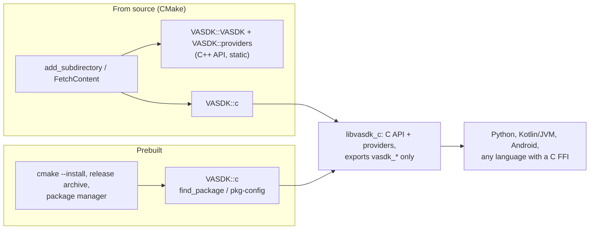

# Using VASDK in your project

*How another project gets VASDK: from source with CMake, or as the prebuilt C library through `find_package`, pkg-config or a package. The CMake side is [`cmake/`](../cmake/) and [`CMakePresets.json`](../CMakePresets.json); the C library's headers are [`VASDK/include/VASDK/c/`](../VASDK/include/VASDK/c/). [Building VASDK](building.md) covers building the repository itself.*

VASDK comes in two forms:

| Form | What you link | Interface | When |
| --- | --- | --- | --- |
| **The C library**, `vasdk_c` | `VASDK::c` | The [C API](reference/c-api.md): `vasdk.h`, `vasdk_providers.h`, and `vasdk.hpp`, its header-only C++ form. Stable across releases of one major version | Prebuilt packages, other languages, and any project that wants one shared library and no C++ ABI concerns |
| **The C++ libraries**, from source | `VASDK::VASDK`, `VASDK::providers`, `VASDK::<provider>` | Everything: frames, processors, pipelines, providers, the engine | A C++ app that builds VASDK alongside itself and writes its own processors or providers |

The C library is one shared library: the C API and every provider of its build, with their dependencies (protobuf, abseil, spdlog, curl) linked in and hidden. It exports the `vasdk_*` functions and nothing else, so it can't clash with another protobuf or spdlog in your program. This is what the Python and Kotlin bindings load, and what the release archives and packages ship. This is the pattern ONNX Runtime and sherpa-onnx follow too: a C ABI, with languages layered on top.

The C++ API depends on protobuf, spdlog and nlohmann/json in its public headers. That means your program must build against the same versions VASDK did, so it comes from source only.



## From source, with CMake

### FetchContent

```cmake
include(FetchContent)
FetchContent_Declare(VASDK
    GIT_REPOSITORY https://github.com/fatehmtd/VASDK.git
    GIT_TAG        v1.0.0)
set(VASDK_FLAVOR default)          # which providers: core, default or full (below)
FetchContent_MakeAvailable(VASDK)

target_link_libraries(my_app PRIVATE VASDK::VASDK VASDK::providers)   # the C++ API
# or
target_link_libraries(my_app PRIVATE VASDK::c)                         # the C library
vasdk_copy_runtime(my_app)                                             # Windows: vasdk_c.dll and its DLLs beside my_app
```

`add_subdirectory(third_party/VASDK)` does the same with a copy you vendor or keep as a git submodule. [CPM.cmake](https://github.com/cpm-cmake/CPM.cmake) works too: `CPMAddPackage("gh:fatehmtd/VASDK@1.0.0")`.

When VASDK is not the top-level project, it stays out of your way:

- **Build only:** it builds the libraries alone. No sample app, no test and no model download happen (`VASDK_BUILD_APPS`, `VASDK_BUILD_TESTS` and `VASDK_DOWNLOAD_MODELS` are off).
- **Your cache:** it never writes to your cache's `BUILD_SHARED_LIBS`.
- **Your targets:** it uses a target you already define (`spdlog::spdlog`, `nlohmann_json::nlohmann_json`, `hwy::hwy`) instead of fetching its own.

### Targets

| Target | What |
| --- | --- |
| `VASDK::c` | The C library (shared): the C API and the providers built in |
| `VASDK::VASDK` | The C++ core (static by default; `VASDK_SHARED=ON` for shared, with a shared protobuf) |
| `VASDK::providers` | The provider catalog: every provider built, registered by config id (`va::thirdparty::registerAllProviders`) |
| `VASDK::<provider>` | One provider: `VASDK::silero_vad`, `VASDK::whistle_stt`, `VASDK::pocket_tts`, `VASDK::llamacpp`, … (the catalog target names without `vasdk_`) |

## Prebuilt, with find_package or pkg-config

An install prefix holds the C library, its headers and the files that find it:

```bash
cmake --preset release                    # the default flavor, no models, any x86_64 CPU
cmake --build --preset release
cmake --install build/release --prefix /opt/vasdk
```

```text
/opt/vasdk/
├── include/VASDK/c/vasdk.h, vasdk_providers.h, vasdk_c_export.h
├── include/VASDK/version.h
├── lib/libvasdk_c.so.1.0.0 (+ libonnxruntime.so.1, when a provider runs ONNX)
│   (Windows: bin/vasdk_c.dll, bin/onnxruntime.dll, lib/vasdk_c.lib)
├── lib/cmake/VASDK/VASDKConfig.cmake, VASDKConfigVersion.cmake, VASDKTargets.cmake
├── lib/pkgconfig/vasdk.pc
└── share/doc/vasdk/LICENSE, THIRD_PARTY_NOTICES.md
```

```cmake
find_package(VASDK 1.0 REQUIRED)                                   # -DCMAKE_PREFIX_PATH=/opt/vasdk
target_link_libraries(my_app PRIVATE VASDK::c)
vasdk_copy_runtime(my_app)                                         # Windows: vasdk_c.dll and its DLLs beside my_app

find_package(VASDK REQUIRED COMPONENTS silero_vad whistle_stt)     # fails if they aren't built in
message(STATUS "VASDK ${VASDK_VERSION}, C API ${VASDK_C_API_VERSION}, providers: ${VASDK_PROVIDERS}")
```

```bash
cc main.c $(pkg-config --cflags --libs vasdk)                      # PKG_CONFIG_PATH=/opt/vasdk/lib/pkgconfig
```

You can also skip the install: `-DVASDK_DIR=<VASDK's build directory>` points `find_package` straight at a build tree.

Each installed library has a fixed location:

- **Linux and macOS:** the library finds ONNX Runtime beside itself (rpath `$ORIGIN`, `@loader_path`).
- **Windows:** there is no rpath, so `vasdk_copy_runtime(<target>)` copies `vasdk_c.dll` and the DLLs it loads beside your program after each build. It works from source, from a build tree and from an install. Keeping `bin/` on `PATH` is not enough: Windows 11 ships an older `onnxruntime.dll` in System32, and Windows looks there before `PATH`, so the library would load that one.

`bin/` also holds `vasdk`, the command that downloads models ([Models](#models)).

On Windows, `bin/` also holds the DLLs `vasdk_c.dll` imports directly. For example, protobuf, abseil and curl, when they came from a package manager as DLLs. It doesn't hold the DLLs those load in turn (such as curl's zlib and OpenSSL). The release archives have none: they link protobuf and curl in (`VASDK_DEPENDENCY_SOURCE=FETCH`, `VASDK_FETCH_CURL=ON`).

A plain install leaves out two components; install them by name:

- **`apps`:** the sample apps, for example `cmake --install build --component apps`.
- **`vasdk_cpp_development`:** the static C++ libraries and headers.

### A program

```c
#include <VASDK/c/vasdk.h>
#include <VASDK/c/vasdk_providers.h>

int main(void) {
    vasdk_providers* providers = vasdk_providers_create();
    vasdk_providers_add_all(providers);                 /* every provider built in */
    char* error = NULL;
    vasdk_session* session = vasdk_session_create("engine.txtpb", providers, /* ... */);
    /* ... */
}
```

The same from C++, through the header-only `vasdk.hpp` over the same library: handles that free themselves, `std::string`, `vasdk::Error` exceptions and `std::function` callbacks. It is the C API, so it keeps its stability. Build with C++17.

```cpp
#include <VASDK/c/vasdk.hpp>

int main() {
    vasdk::Registry registry;
    registry.addTool("create_booking", "Books a slot", [](std::string_view args) { return std::string(R"({"id": 42})"); });
    vasdk::Agent agent = vasdk::Agent::load("agent.txtpb", registry);
    vasdk::Providers providers = vasdk::Providers::builtIn();
    vasdk::Session session("engine.txtpb", providers, agent);
    session.onEvent([](std::string_view event) { /* a vasdk.engine.Event as JSON */ });
    session.start();
}
```

The [C API reference](reference/c-api.md) has the rest: agents, sessions, runtimes, models, and providers and processors written in C.

## Flavors

A flavor is a named set of providers. The release archives and packages each come in a flavor, and a source build picks one with `-DVASDK_FLAVOR=` ([`cmake/VASDKFlavors.cmake`](../cmake/VASDKFlavors.cmake)):

| Flavor | Providers | For |
| --- | --- | --- |
| `core` | None. The app adds its own with `vasdk_providers_add_*` | The smallest binary; your own backends |
| `default` | miniaudio, Silero VAD, energy/ZCR VAD, SmartTurn v3, Whistle STT, Pocket TTS, MiniLM, pyannote, RNNoise, VizAnim | On-device voice on every desktop platform, permissive licenses only |
| `full` | `default`, plus llama.cpp, whisper.cpp, Parakeet, Moonshine, Supertonic, MOSS-TTS, Phonon, GLiNER, and the Deepgram, Cartesia, Fish Audio, Gradium and Gladia clients | Local LLM, larger models, and cloud STT and TTS |

Some rules about flavors:

- **Refining a flavor:** the `VASDK_BUILD_<NAME>` switches refine a flavor. For example, `-DVASDK_FLAVOR=default -DVASDK_BUILD_LLAMACPP=ON`.
- **Changing flavor:** a flavor applies to a fresh build directory, so a new flavor needs a new one.
- **No flavor:** each switch keeps its own default (the repository's build: `default` plus Phonon).
- **Phonon is in `full` only:** its default checkpoint is CC BY-NC 4.0 ([THIRD_PARTY_NOTICES](../THIRD_PARTY_NOTICES.md)).

## Models

No package ships model files. They range from 2 MB to 1.5 GB and come under their own licenses. The model store fetches them when they're needed ([Models](models.md)):

```bash
vasdk models pull --config engine.txtpb     # what the config's providers load
vasdk models list                           # every model, its size, license and status
```

The same from a program: `vasdk_models_pull` in C, `vasdk::Models` in C++, `vasdk.Models` in Python, `Models` in Kotlin. They download into the user's cache (`VASDK_MODELS_DIR` moves it), which is where a session looks when its config sets no `models_dir`. So pulling is the only setup.

- **Source build:** the build also downloads the enabled providers' models at configure time ([Building VASDK, Model files](building.md#model-files)).
- **Embedding project or package:** VASDK doesn't download models at build time (`VASDK_DOWNLOAD_MODELS` is off). Pull them with the model store, or give the session a models directory laid out the same way through `models_dir`.

## Options that matter to an integrator

| Option | Default | What |
| --- | --- | --- |
| `VASDK_FLAVOR` | empty | `core`, `default` or `full`: see [Flavors](#flavors) |
| `VASDK_BUILD_C_LIBRARY` | `ON` | The C library, `VASDK::c` |
| `VASDK_SHARED` | `OFF` | The C++ core as a shared library (needs a shared protobuf). The C library is then not built: the shared core exports the C API itself |
| `VASDK_DEPENDENCY_SOURCE` | `FETCH` | `FETCH` downloads pinned versions. `SYSTEM` uses `find_package` only (Conan, distro packages) and never downloads. `AUTO` tries `find_package`, then downloads |
| `VASDK_DOWNLOAD_MODELS` | on when top-level | Download models at configure time |
| `VASDK_ENABLE_AVX2` | `ON` | AVX2 and FMA on x86_64 (GCC, Clang). The release presets turn it off so the binary runs on any x86_64 CPU |
| `VASDK_INSTALL` | `ON` | Generate the install rules, `find_package(VASDK)` and `vasdk.pc` |
| `VASDK_BUILD_APPS` | `OFF` | The sample apps ([apps](apps/README.md)) |

The presets in [`CMakePresets.json`](../CMakePresets.json) bundle these options:

| Preset | What |
| --- | --- |
| `dev` | Tests and apps |
| `apps` | The sample apps |
| `ci` | Tests, apps and the Python binding |
| `release`, `release-core`, `release-full` | The packaged C library per flavor |
| `system-deps` | Every dependency from `find_package` |

## Versions and compatibility

- **One version:** the repository's [`VERSION`](../VERSION) file sets the version of the SDK, the C library and every binding. A program reads it from `<VASDK/version.h>` (`VASDK_VERSION_STRING`, `VASDK_VERSION_NUMBER`) or at run time from `vasdk_version()`.
- **Stable C API:** `VASDK_C_API_VERSION` in `vasdk.h` is also the library's soname (`libvasdk_c.so.1`). Within one major version the C API only grows. A function never changes or goes away ([C API, Stability](reference/c-api.md#stability)), so `find_package(VASDK 1.2)` accepts any later 1.x (`SameMajorVersion`).
- **No stability promise for the C++ API:** build it from the same source as your program.
- **A program that loads the library at run time** (a plugin, a binding) compares `vasdk_c_api_version()` with the `VASDK_C_API_VERSION` it was built against: a lower one is an older library.
- **Windows hosts with an older C++ runtime:** a process that loads its own older `msvcp140.dll` first (a JVM, a game engine) runs the library as well: it is built with `_DISABLE_CONSTEXPR_MUTEX_CONSTRUCTOR`, which Visual Studio 17.10 and later need for that.

## Packages

Which channels publish VASDK, and their state:

| Channel | Gives | State |
| --- | --- | --- |
| CMake (`FetchContent`, `add_subdirectory`, CPM) | C++ API and C library from source | Available |
| `cmake --install`, `find_package`, pkg-config | The C library | Available |
| GitHub Releases | Archives per platform and flavor, checksums, SBOM | Planned (CI and release workflow) |
| Conan | The C library from source, dependencies from Conan | The recipe in the repository ([Conan](#conan)); Conan Center later |
| Homebrew | The C library | Planned |
| PyPI (`pip install vasdk`) | The Python binding with the C library inside | Planned ([bindings/python](../bindings/python/README.md) builds a wheel locally today) |
| Maven Central (`com.vasdk:vasdk-android`, `com.vasdk:vasdk-jvm`) | The Kotlin binding with the C library inside | Planned ([Android](apps/android.md#the-kotlin-binding-as-an-aar) builds the AAR locally today) |
| NuGet, npm, SwiftPM, crates.io, Go, pub.dev | Bindings over the C library | Later |

### Conan

[`conanfile.py`](../conanfile.py) builds the C library from a checkout of this repository into your Conan cache. It takes spdlog, nlohmann_json, cpp-httplib, protobuf, libcurl and Highway from Conan:

```bash
conan create . -s compiler.cppstd=17 --build=missing                          # flavor default
conan create . -s compiler.cppstd=17 --build=missing -o "vasdk/*:flavor=full"  # or core
```

A project then requires `vasdk` and uses the package's own `find_package(VASDK)`, as with an archive:

```ini
# conanfile.txt
[requires]
vasdk/1.0.0

[generators]
CMakeToolchain
```

```cmake
find_package(VASDK REQUIRED)
target_link_libraries(app PRIVATE VASDK::c)
vasdk_copy_runtime(app)   # Windows: vasdk_c.dll and ONNX Runtime beside app
```

- **Needs C++17:** a profile that says `compiler.cppstd=14` (what `conan profile detect` writes for MSVC) gets `-s compiler.cppstd=17`.
- **Dependencies are hidden.** They are linked into `vasdk_c` statically and hidden, so a consumer links `VASDK::c` and nothing else.
- **Downloads at build time:**
  - ONNX Runtime: Microsoft's prebuilt shared library, pinned by SHA-256 and installed beside `vasdk_c`. Conan's own `onnxruntime` needs protobuf older than 7.
  - The sources a few providers compile in.

  This is why the recipe isn't on Conan Center yet: Conan Center builds offline.
- **No models:** the package holds none; the [model store](models.md) fetches them at run time.
- **Tested:** [`test_package/`](../test_package) builds and runs the programs of `tests/consumer/c_library` against the package. CI runs `conan create` on Linux and Windows.

## Platforms

| Platform | C library | Notes |
| --- | --- | --- |
| Windows x64 (MSVC) | Built | `vasdk_c.dll` exports only `VASDK_C_API` functions |
| Linux x64, arm64 | Not built in this change | Linker version script: only `vasdk_*` exported |
| macOS arm64, x64 | Not built in this change | Exported symbols list: only `_vasdk_*` |
| Android arm64-v8a, x86_64 | Through Gradle ([Android](apps/android.md)) | The AAR's `libVASDK.so`; moving it to `vasdk_c` comes with the Maven publication |
| iOS | Not supported | Needs an iOS build of the providers' dependencies (ONNX Runtime's iOS package) |
