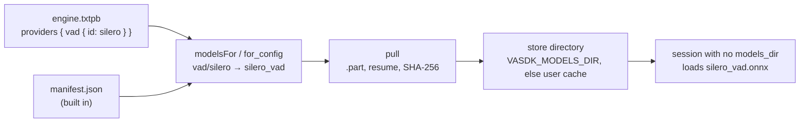

# Models

*The model store: how a program gets the model files local providers load. Header [`VASDK/include/VASDK/ModelStore.h`](../VASDK/include/VASDK/ModelStore.h); manifest [`VASDK_3P_IMPL/models/manifest.json`](../VASDK_3P_IMPL/models/manifest.json), written by [`generate_manifest.py`](../VASDK_3P_IMPL/models/generate_manifest.py); C API in [`vasdk.h`](../VASDK/include/VASDK/c/vasdk.h), "Models".*

Local providers (Silero VAD, Whistle, Pocket TTS, MiniLM...) load model files that no package ships: they weigh 2 MB to 1.5 GB each and come under their own licenses. The model store downloads them when a program needs them, checks each one, and puts it where a session looks.

- **One manifest lists every model:** each file's URL, its pinned upstream revision, its size and SHA-256, the license, and the providers that load it. It is built into the library.
- **A file lands at `<directory>/<path>`,** the path a provider reads under `models_dir` (`silero_vad.onnx`, `pocket_tts/voices.bin`). A session whose config sets no `models_dir` reads the store's directory, so pulling is the only setup.
- **A file is either whole or absent:** it downloads to `<file>.part`, resumes from there, and is renamed into place only once its size and SHA-256 match. A file that doesn't match is deleted.



## Where the models go

| Platform | Default directory |
| --- | --- |
| Windows | `%LOCALAPPDATA%\vasdk\models` |
| macOS | `~/Library/Caches/vasdk/models` |
| Linux | `$XDG_CACHE_HOME/vasdk/models`, else `~/.cache/vasdk/models` |
| Android | None: give the app's files directory |

`VASDK_MODELS_DIR` replaces the default everywhere. A config's `models_dir`, or the one a program passes to a runtime, still wins for the session; the store then needs the same directory.

## The command

`vasdk` is installed with the C library (`bin/vasdk`) and built beside it (`build/cmake/c_library/`).

```bash
vasdk models list                              # every model for this machine: status, size, license, providers
vasdk models pull --config engine.txtpb        # what the config's providers load
vasdk models pull silero_vad pocket_tts        # by id
vasdk models pull phonon_tts --accept-license  # a model whose license needs reading first
vasdk models verify silero_vad                 # hashes the files again
vasdk models remove whispercpp
vasdk models path                              # the directory
```

The options: `--dir <directory>`, `--manifest <file>` (another manifest: a mirror, models of your own), `--offline` and `--json` (for `list`).

## From a program

C:

```c
char* error = NULL;
vasdk_models* models = vasdk_models_create(NULL, &error);          /* or {"directory": "...", "offline": true} */
char* needed = vasdk_models_for_config(models, "engine.txtpb", &error);   /* ["silero_vad", "smart_turn_v3"] */
if (!vasdk_models_pull(models, "silero_vad", 0, on_progress, NULL, &error)) { /* error says why */ }
vasdk_free(needed);
vasdk_models_free(models);
```

C++ ([`vasdk.hpp`](../VASDK/include/VASDK/c/vasdk.hpp)):

```cpp
vasdk::Models models;
for (const auto& id : models.forConfig("engine.txtpb")) models.pull(id);
```

Python:

```python
models = vasdk.Models()
for model_id in models.for_config("engine.txtpb"):
    models.pull(model_id, progress=lambda model, file, done, total: print(f"{model}: {done * 100 // total}%"))
```

Kotlin (call `pull` off the main thread):

```kotlin
Models(directory = context.filesDir.resolve("models").path).use { models ->
    models.pull("silero_vad") { _, _, done, total -> publishProgress(done, total); true }
}
```

| Call | What it does |
| --- | --- |
| `list` | Every model for this machine, with `status`: `present`, `partial` (a stopped download, or some files) or `missing` |
| `for_config` | The models an engine config's providers load: each stage's `id` and its `fallback` ids. A stage that names no provider (the first one built in) adds none |
| `pull` | Downloads what is missing, resuming `.part` files. The progress callback returning false stops it; the next pull resumes |
| `verify` | Hashes every file again |
| `remove` | Deletes the model's files |

## Licenses and gated models

Each model keeps its own license (the [model summary](../THIRD_PARTY_NOTICES.md#model-summary)). The store refuses two kinds of model until the caller says so:

- **`requires_acceptance`:** non-commercial or custom terms: Phonon 40m (CC BY-NC 4.0), Supertonic (OpenRAIL) and LFM2.5 (LFM Open License). `pull` fails with the license and its URL until called with `accept_license` (`--accept-license`).
- **`gated`:** the host wants a Hugging Face token (Phonon 40m). Accept the terms on the model's page, then set `HF_TOKEN`, run `hf auth login`, or pass `token`.

## Offline and air-gapped machines

`offline` (or `VASDK_OFFLINE=1`) never downloads: `pull` succeeds for what is present and fails for what is missing. To prepare a machine without network access:

1. Pull on a connected machine.
2. Copy the directory.
3. Point `VASDK_MODELS_DIR` at it.

To serve the files from your own server, copy the manifest, change the URLs and pass it with `--manifest` or `manifest_path`. The hashes still apply.

## The manifest

```json
{"schema": 1, "models": [
  {"id": "silero_vad", "description": "Silero VAD v6 (ONNX), voice activity detection", "providers": ["vad/silero"],
   "license": "MIT", "license_url": "...", "revision": "v6.2",
   "files": [{"path": "silero_vad.onnx", "url": "https://...", "sha256": "1a153a22...", "size": 2327524}]}]}
```

- **`providers`:** `<stage>/<provider id>`, the stage as named in the engine config (`vad`, `stt`, `tts`, `turn`, `sentence_encoder`, `entity_model`, `speaker_embedding`, `llm`). A provider's first model is its default (`gliner`, not `gliner_multi`).
- **`arch`:** a file with this field is for one CPU only (`x86_64`, `arm64`); MiniLM has one per architecture.
- **`gated`, `requires_acceptance`:** as above.

To change a model, edit [`generate_manifest.py`](../VASDK_3P_IMPL/models/generate_manifest.py) and run it. It asks the Hugging Face API for each file's size and SHA-256 at the pinned revision, so no hash is typed by hand. `--refresh` moves the repositories it follows on `main` to their current commit. A new provider adds its model there ([vasdk-provider](../skills/vasdk-provider/SKILL.md)).

## Tests

| Test | What |
| --- | --- |
| `vasdk_model_store` | `ModelStore` and the C API, offline (`file://` sources): FIPS 180-4 hash vectors, resume, cancel, a wrong hash, the license gate, offline mode, per-CPU files, paths outside the store, configs, the built-in manifest |
| `vasdk_model_store_network` | Silero VAD from its real host, checked against its pin. Skipped (77) without network |
| `vasdk_command` | The `vasdk` command against a manifest of its own |
| `vasdk_python_models`, `vasdk_kotlin` (`ModelsTest`) | The same from Python and Kotlin |
| `vasdk_consumer_install`, `vasdk_consumer_build_tree` | `vasdk.hpp` and the installed `bin/vasdk` from another project |
