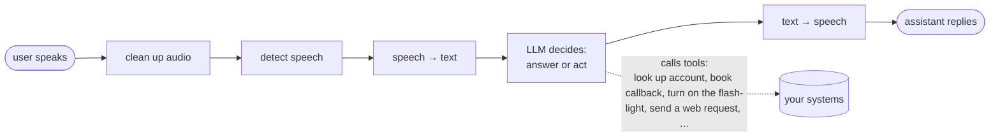

# VASDK in plain language

*This page is for people evaluating or planning around VASDK. No C++ knowledge needed. SWEs should start at the [documentation index](README.md) instead.*

## What it is

VASDK is a software toolkit for building **voice assistants that hold a spoken conversation**: a user talks, the system understands, decides what to do (including taking real actions like looking up an account or scheduling a callback), and talks back. It is written in C++ so it can run on hardware where Python-based frameworks don't fit - car head units, embedded devices, phones - and it can run **entirely offline**, with every component (speech recognition, language model, speech synthesis) executing on the device itself.

Think of it as the plumbing between a microphone and a speaker, with interchangeable "brain/ears/mouth/senses" in the middle.

## What you can build with it

- **In-vehicle voice assistants** - the original motivation. VASDK provides the cross-platform plumbing so you can focus on the user-experience instead.
- **Call center or Goal oriented agents** - the `goal/` layer turns the assistant from a chatbot into a task-completer: it classifies why someone is calling, collects the required information field by field (with validation), confirms before acting, escalates to a human when stuck, and resumes an interrupted call where it left off. The [VASDK_CallCenter app](../VASDK_CALLCENTER_APP/README.md) is a working demonstration.
- **On-device mobile assistants** - the [Android app](../VASDK_ANDROID/README.md) runs the full stack on a phone, including a local language model, and gives the assistant real device capabilities: placing calls, sending texts, reading the calendar, taking photos, with spoken confirmation before anything sensitive.
- **Desktop / kiosk assistants** - the [VASDK_Pipeline app](../VASDK_APP/README.md) is the general-purpose reference: full voice loop with barge-in (you can talk over it), tool calling, and live metrics.

## Key concepts

**Everything is swappable.** Speech recognition, voice detection, turn-detection, the language model, speech synthesis - each is a "provider" behind a common interface. You can start with cloud services and later swap to on-device models (or mix: local speech recognition + cloud language model) without rewriting the application. This is the core hedge against a fast-moving AI vendor landscape.

**Offline is a first-class option, not a fallback.** Every stage has at least one implementation that runs locally on open models. That matters for privacy (audio never leaves the device), for connectivity (works in a tunnel), and for unit economics (no per-minute API fees).

**It's a pipeline.** Audio flows through a chain of stages - noise cleanup, "is someone speaking?", "what did they say?", "what should I answer?", "say it out loud" - each on its own thread, each replaceable. Urgent events (the user interrupting, an error) travel backwards through the same chain and take priority.

**Multiplatform from the get go.** You can build your pipeline and logic once and run it everywhere. Integration and End to End testing can be implemented without having to run on the target hardware.

## What's mature and what's moving

An overview based on [root README](../README.md):

| Area | Status |
| --- | --- |
| Core pipeline (audio → VAD → STT → LLM → TTS) | Stable in daily use across three showcase apps |
| Local/offline providers (Silero, Parakeet, llama.cpp, …) | Working; models and parameters still being tuned. Moonshine, Supertonic, and Whisper.cpp are WIP |
| Cloud providers (Gladia, Soniox, Deepgram, Cartesia, Fish Audio, Gradium, OpenAI, Anthropic) | Working; APIs evolve, pin a commit. Gladia is WIP |
| Goal-oriented call center layer (`goal/`) | Newest, most ambitious, fastest-moving |
| Android app | Growing quickly from wrapper to full assistant |
| Metrics/observability | Solid base for basic visibility; not production-hardened |
| Tagged releases | None yet - the API surface still shifts |

## Licensing in one paragraph

VASDK's own code is **Apache 2.0** - permissive, commercial-friendly. The AI models it downloads and runs each carry their **own** licenses, some of which need review before shipping a product (attribution requirements, responsible-AI clauses, custom commercial terms). [THIRD_PARTY_NOTICES.md](../THIRD_PARTY_NOTICES.md) is the authoritative list of every model and dependency with its license.

## Where to go next

- **SWE starting point** → the [documentation index](README.md), then the root [README quick start](../README.md#quick-start).
- **Call center example with Goal and task completion tracking** → [VASDK_CallCenter guide](../VASDK_CALLCENTER_APP/README.md).
- **Full Android Example** → [Android guide](../VASDK_ANDROID/README.md).
- **Third party notices** → [THIRD_PARTY_NOTICES.md](../THIRD_PARTY_NOTICES.md).
