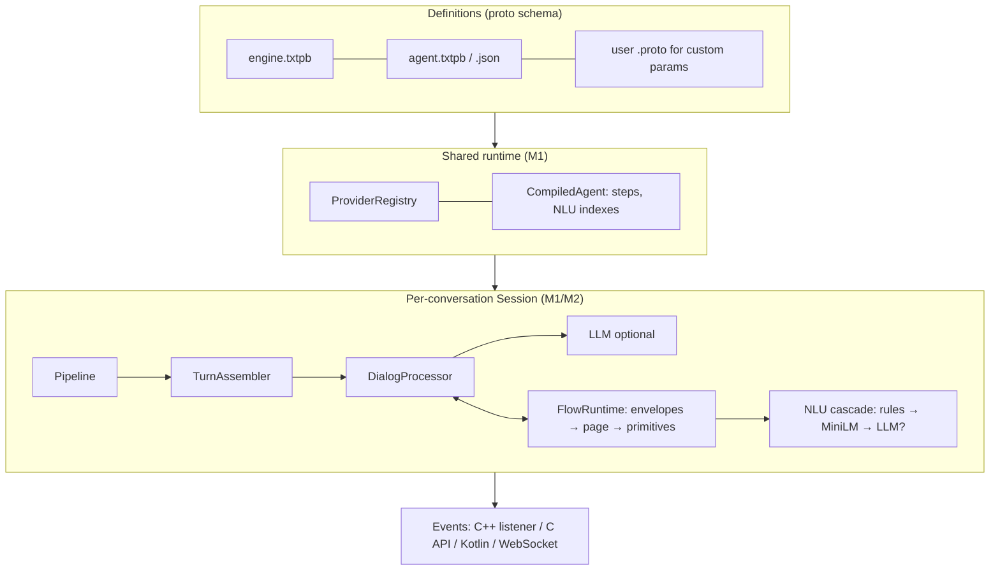
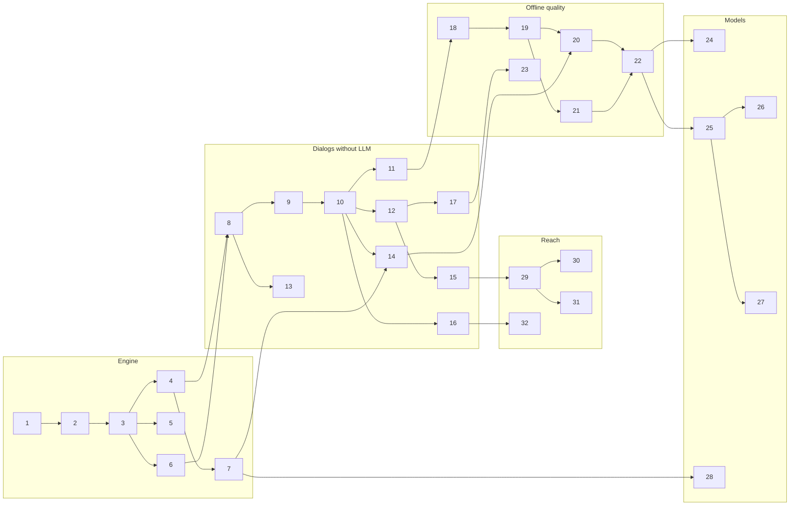
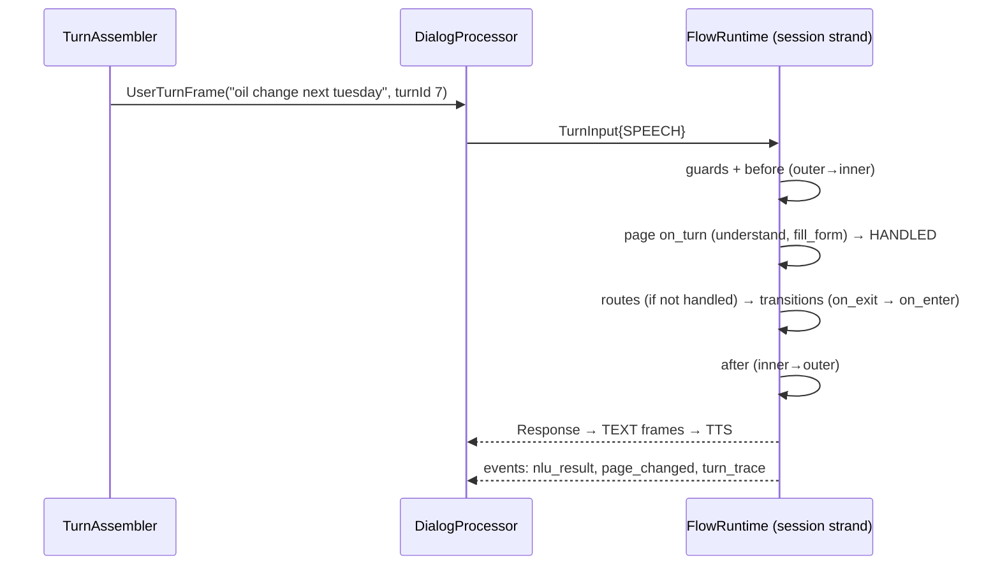

# VASDK control layer: VAEngine + offline-first, user-extensible Flows

> **Status (2026-11-04, branch `feature/control-layer-m0`)**
>
> | Milestones | State |
> |---|---|
> | 0, 1, 2, 3, 4, 6, 7 (Part A) | ✅ committed (`6271f44` … `648a924`) |
> | 8, 9, 10, 11, 12 (Part B) | ✅ committed (`2adbde3` … `a04d4e3`) |
> | 13 Rich replies | ✅ committed (`be01736`) |
> | 14 Expected input | ✅ committed (`bdd2448`, with 15). Not in it: STT hints and end-of-turn by expectation (20), trigger-delivery window (17), the keypad on Android (needs 5) |
> | 15 Extensions | ✅ committed (`bdd2448`). `form` stays the page's `form` field, not a page type |
> | 16 Tools & security | ✅ committed. Tools run synchronously on the conversation's own thread (not resumable steps); masking covers events and the dialog's logs, not every processor's |
> | 5 Android on VAEngine | ✅ committed. Full protobuf (G1), NDK 28; Kotlin builds the engine config as text proto (no generated Kotlin classes). Built for arm64 and x86_64; the app starts on an x86_64 emulator (API 33), and the native suite passes there (`VASDK_ANDROID/run-tests-on-device.sh`: 49 of 52 pass, 3 skip for models not pushed: MOSS, a GGUF, Phonon's tokenizer case). Not run on a phone |
> | 17 Triggers | ✅ committed. IMMEDIATE cuts off a reply that's playing, as the cancel button does, and is said once it stops (`DialogProcessor::setInterrupter`) |
> | 18 Smarter understanding | ✅ committed. Not in it: phonetic (sound-alike) matching (21); the cascade isn't in the engine config yet (24, with its first model stage) |
> | 19 English values from speech | ✅ committed. Lists of values ("tires and an oil change") wait for 21 |
> | 20 Listening tuned to the question | ✅ committed. Hints implemented for Soniox only (other recognizers: no-op); the WER gain on a hint set is not measured (needs recorded audio and a cloud key) |
> | 21 Advanced forms & entities | ✅ committed. Phonetic matching by Double Metaphone (`bc4e4f2`), code-backed entities (`code { extractor }`, `FlowRegistry::addEntityExtractor`), entity packs (`entity_files`; `@country`, `@us_state`, `@currency` in `VASDK/entities`) |
> | 22 Offline release | ✅ on desktop: flow metrics, `vasdk_agentc eval` (+ the garage set in ctest), fuzz targets (libFuzzer with VASDK_BUILD_FUZZERS; a mutation smoke run in ctest), and `vasdk_offline_conversation` (`382a1ee`): a spoken booking with no network (Silero, Whistle, Pocket; the user's lines spoken by Phonon), each line heard exactly, 3–7 s a turn. The same on an x86_64 Android emulator, with Parakeet for STT (Whistle's engine is arm64 only). Not run on a phone |
> | 23 Scheduled & context triggers | ✅ committed. Android: `fireTrigger` through JNI and Kotlin; `TriggerBridge.kt` keeps the triggers' state and sets an AlarmManager alarm for the next one (`Session::nextScheduledTrigger`, `triggerState`, `restoreTriggerState`), notifies when it rings with the engine stopped, and forwards other apps' notifications as the `notification` app event. On the emulator: a posted notification reaches the bridge; the alarm path is built but not exercised there (its receiver isn't exported, so the shell can't fire it) |
> | 24 On-device intent model + FAQ | ✅ committed. MiniLM on ONNX (cascade after rules: 20% → 90% on paraphrases); knowledge entries instead of a `faq` page type; `providers.sentence_encoder_cache` keeps the vectors in a file, written on the first start and read after (instead of a `--embed-cache` command: the encoder lives in 3P); the embedding cache test passes on the Android emulator |
> | 25 LLM assist | ✅ committed. LLM as the last NLU stage, LLM reading of form answers (kept only through the slot's entity), `llm` step, `generative` page type, restricted moves, sensitive answers kept from it; `vasdk_agentc --llm`. Completion clients: OpenAI-compatible, Anthropic (`llm.api: ANTHROPIC`), and llama.cpp in-process (`LlamaCppCompletion`, tested on LFM2.5 1.2B). The LLM is asked on a thread of its own: a `filler` after a second, and a resumed turn gives it up (`193b7ba`) |
> | 26 Network fallback | ✅ committed. `Session::setNetworkAvailable`, STT/TTS swapped to `fallback` providers between turns (loaded on first need, kept with the set), the agent's LLM gated (plus a 30 s rest after a failed request), `provider_switched` events, `fallback_options`; Android watches ConnectivityManager. A reply the failure cut off is said again by the fallback voice (`56b3d9a`). An LLM-only session (no agent) says `llm.offline_replies` while the network is down and its LLM is elsewhere. The fallback test passes on the Android emulator; not run on a phone |
> | 27 Call center on agent files | ✅ committed. `agents/callcenter/` (routing page, schedule and account forms, handoff), CRM tools in C++, agent per DNIS (`--dnis`), suite offline and with a scripted LLM in ctest; a command for a real LLM. Resume on redial (`FlowRuntime::snapshot`/`resume`, `--persist-dir`) and call records (`--call-log`) are back (`10a4953`). The vehicle is a composite entity again (`@vehicle`: make, model, year; `$form.vehicle.value.make`), as the OBJECT slot was. A form slot keeps a composite's struct, and a code entity's spoken form and attributes |
> | 28 Wake word | ⏸ waiting on gate G4 (model licence): openWakeWord's code is Apache-2.0, its pretrained models are non-commercial, and a "hey garage" model needs training or a commercial engine |
> | 29 C API | ✅ committed. `VASDK/c/vasdk.h`: registry (steps, tools, envelopes in C), agents (load/parse), text conversations with JSON replies, `StepOutcome`, test files; `vasdk_c_test.c` in ctest. Spoken sessions too (`vasdk_session`: the app pushes PCM in and gets speech back, events as JSON; `vasdk_providers_add_all` in ProviderCatalog) (`3e9b90a`). Page types and entity extractors in C too (`vasdk_registry_add_page_type`, `vasdk_registry_add_entity_extractor`) |
> | 30 Kotlin extensions | ✅ committed. `registerAgentTool`, `registerAgentStep` (StepOutcome JSON), `setEntityValues` + `ContactsEntity`, `events` as a SharedFlow; the phone agent ("call mom" → confirm → call) as an asset, tested on desktop in ctest. Declared tools may omit `http` (the app provides them). Built for arm64 and x86_64; the app runs on the emulator, the Kotlin extensions not driven there (that needs the setup's models) |
> | 31 Python | ✅ committed. `bindings/python/vasdk` (ctypes over the C API: registry, agents, conversations, test files); the garage suite runs from Python in ctest with its step, envelope and tool in Python; page types and entity extractors too. A wheel: `bundle.py` copies the shared VASDK and its libraries into the package, `pip wheel bindings/python` makes `vasdk-1.0.0-py3-none-<platform>.whl` (installed in a clean venv, it passes). Not on PyPI |
> | 32 Remote control | ✅ committed. Over HTTP rather than WebSocket (core's cpp-httplib has no WebSocket server; libdatachannel's is built off): `GET /events` as Server-Sent Events, `POST /command` (`vasdk.engine.Command`), `GET /` a live trace page; token (header or query), OBSERVE by default, localhost bind; started by Session from `remote_control`. Round trip and auth tested in ctest; the page checked in a browser (Edge) on a live session: the trace replays what happened before it opened, then follows live |
> | Live test: WebRTC + agent + cloud LLM | ✅ committed. Run with `VASDK_Pipeline --config VASDK_APP/config/engine.txtpb --agent VASDK_APP/agents/garage-menu/agent.txtpb --env-file .env.cloud --webrtc-port 8080`. Setup: Whistle STT, Phonon TTS (Pocket as fallback), a DeepSeek model through OpenRouter. Chat, context, tool calls and the voice all worked. Fixes from the session: <ul><li>a keyword in a long sentence no longer takes the turn (`IntentMatch::explains`; an LLM "none" beats a weak rule)</li><li>an LLM chat stays with the LLM until a clear route ("help me out" mid-story no longer opens help)</li><li>envelope answers mid-chat don't ask the page's question again</li><li>a user start held during VAD confirmation becomes an INTERRUPT if the agent started speaking</li><li>barge-in pauses playback and commits after 300 ms</li><li>"what" and "pardon" are interrupt words</li><li>the garage greeting varies</li></ul> |
>
> **Next (where to pick up):**
>
> 1. ~~**Intent check time limit.**~~ Done: `llm.intent_timeout_ms` (default 1500) through `Completion::completeWithin`. Past it, the cascade keeps the rules' guess. A late answer doesn't start the LLM's 30 s rest; a fast failure still does. `vasdk_agentc` waits with no limit. Spoken replies (`llm` steps, generative pages) keep 8 s.
> 2. ~~**Entity routes in a chat.**~~ Done: mid-chat, an entity-only route needs its entity to be the same share of the words intents need (`FlowRuntime::_chatMinShare`).
> 3. **Speaker echo.** Speech over the agent that is mostly its own words is now echo, not an interruption (`backchannel.reject_echo`, default on; `echo_min_share`, `echo_words_wait_ms`). Still to do: try it live with headphones off, and tune `commit_after_ms`, `min_interrupt_confidence` and `echo_words_wait_ms` on what the mic hears.
> 4. **Thresholds: measure on real speech.** They're settings now (engine config `understanding`), `vasdk_agentc eval --sweep` measures them, and `VASDK_Pipeline --record-turns` builds a set from real turns. On the garage set's 6 mid-chat cases, 0.5 missed short commands ("when do you close") and 0.15–0.25 got all, so the default is 0.25. Still to do: a set of recorded turns, to check it and `keyword_words`.
> 5. **Also done (2026-11-04):** Windows builds link and test (proto classes exported from VASDK.dll); a date slot is read back as said ("Tuesday, November 10th"), found by the offline conversation.
> 6. **Also done:** `vasdk_tts_turn`'s timing checks wait for what they test instead of fixed times (40 runs, no failure under load); `google.protobuf.Empty` and the other well-known types are found in static (Android) builds.
> 7. **Still open.** A phone (every "not run on a phone" item, and Whistle on arm64), gate G4 (28), publishing the wheel.


*Uses Google Dialogflow CX as the reference model. Definitions are proto-schema'd and written in text proto.*

## 0. Context

VASDK has strong low and mid-level building blocks: frames and processors, providers, turn-taking, back-channel handling, an LLM tool loop, and goal/slot filling. It has nothing above them.

| Problem | Evidence |
|---|---|
| No facade: every app hand-wires the pipeline | [VAEngine.h](VASDK/include/VASDK/VAEngine.h) is a deprecated stub. The same ~10-processor backbone is wired three times with different settings and order: [main_pipeline.cpp:1115](VASDK_APP/main_pipeline.cpp#L1115), [callcenter_pipeline.cpp:1118](VASDK_CALLCENTER_APP/callcenter_pipeline.cpp#L1118), [vasdk_jni.cpp:534](VASDK_ANDROID/app/src/main/cpp/vasdk_jni.cpp#L534) |
| Provider choice is compile-time code per app | `#if/#elif` chains in the desktop apps; only Android has a runtime factory ([SttProviderFactory.cpp](VASDK_ANDROID/app/src/main/cpp/SttProviderFactory.cpp)) |
| No event API | Apps write processors only to observe events: `VasdkBridgeProcessor`, `STTDebugProcessor`, `BargeInHandler`, `SynthesisObserver` |
| Only one goal at a time; switching loses context | `IntentRouter` + one `GoalManager`; every switch calls `clearHistory()` ([GoalManager.cpp:20](VASDK/src/goal/GoalManager.cpp#L20)) |
| Nothing works without an LLM | The LLM classifies, fills slots, phrases replies and normalises values; the validators ([GoalState.cpp:124](VASDK/src/goal/GoalState.cpp#L124)) accept only ISO dates, digit strings and exact enum values |
| Turn assembly is locked inside LLMProcessor | Accumulating finals, gating on turn end, staged finals and the resume-merge window all live in [LLMProcessor.cpp:486-506](VASDK/src/llm/LLMProcessor.cpp#L486) and [:835-902](VASDK/src/llm/LLMProcessor.cpp#L835) |
| No extension points above the frame level | A new conversation step means writing a FrameProcessor |

**Outcome.** Developers describe *what* the assistant does (an engine config, an agent definition and a few handlers) instead of *how* frames flow.

**Principles:**
1. **Deterministic first, LLM optional.** Every agent runs fully offline (`llm` unset). An LLM (cloud, or local llama.cpp) only adds to it: it is used when configured, reachable, and either needed (understanding falls below the threshold) or requested (generative steps).
2. **Small kernel, user-defined everything else.** VASDK ships:
   - **primitives**,
   - **three envelopes** (turn, response and behaviour),
   - a **turn executor**.

   Users define page types, behaviour envelopes and custom steps.
3. **Schema first.** `.proto` files are the single source of truth for engine configs, agents, envelopes and events. Text proto is how humans write them; JSON (the proto3 JSON mapping) is for tools, LLMs and the C API; binary is the compiled cache.

**Decisions taken:**

| Topic | Decision |
|---|---|
| Dialog model | Hybrid Flow/Page graph; forms are based on `GoalDefinition` |
| Order | M1 engine + events → M2a kernel → M2b offline quality → M3 small-model NLU + LLM assist → M4 reach |
| Offline understanding | English first (locale interface); rules + MiniLM (ONNX); a local LLM is optional, last fallback only |
| Envelopes | Turn, response and behaviour envelopes |
| Authoring | Proto schema; **text proto** as the main format, JSON also accepted, binary cache; C++ (later the C API and Kotlin) for custom logic |
| Conditions | **CX-style string expressions** (`$form.confirmed = true AND $session.tier : ("gold")`) |

### Architecture (target)



---

## Roadmap: simple, self-contained milestones

Each milestone is **one vertical slice**: one capability, finished end to end.

**Every milestone:**
- **Delivers something you can demo or use on its own.** It isn't just a layer that only pays off later.
- **Ships its own tests and docs.** It leaves **all apps working**, and new behaviour stays opt-in until it's finished.
- **Depends only on earlier milestones** in this list. "Needs" names the one it builds on directly.
- **Has a size** for one engineer: **S** ≤ 1 week, **M** 1–2 weeks, **L** 2–3 weeks. These are rough and get re-checked after milestone 1.

The design sections (§2–§8) hold the details. Each card links to them.
The design sections keep their earlier phase names: **M1 = Part A, M2a = Part B, M2b = Part C, M3 = Part D, M4 = Part E**. The old sub-IDs (M1.3, M2a.10, …) are retired; use the numbers below.

### Part A: Engine (an assistant from a config file)

**0. Prerequisite fixes** · S · needs: nothing
- **You get:** safe tool registration while tools are running, goals that can keep history, enforced confirmation, working COMPOSITE sub-slot conditions, and the first goal tests.
- **Done when:** `tool_dispatch_race_test` is clean under TSan, `goal_test` passes, and the call center is unchanged.
- §3

**1. Config files** · M · needs: nothing
- **You get:** pick providers and settings in `engine.txtpb` without recompiling.
- **Includes:**
  - protobuf in the build (desktop + Android)
  - `engine_config.proto`
  - text proto/JSON/binary loading with `${ENV}`
  - `ProviderRegistry` + 3P catalog
  - VASDK_APP reads the config, still wired by hand
- **Done when:** `proto_load_test` and `provider_registry_test` pass, and VASDK_APP switches STT by editing the file.
- **Decides:** **gate G1**, whether full protobuf is acceptable on Android (size report).
- §2, §4.1, §4.2

**2. VAEngine** · M · needs: 1
- **You get:** a working assistant in about 30 lines of app code.
- **Includes:**
  - canonical pipeline assembly
  - `say` / `injectUserText` / `interrupt`
  - extension slots
  - VASDK_APP migrated
- **Done when:** `engine_assembly_test` passes, and the offline profile speaks with Wi-Fi off.
- §4.3

**3. Events** · S · needs: 2
- **You get:** transcripts, replies, state changes and errors through one listener; no custom processors.
- **Includes:** `events.proto`, `EventTapProcessor`, a dispatcher thread; removes VASDK_APP's observer processors.
- **Done when:** `engine_events_test` passes, and VASDK_APP prints a live console.
- §4.5

**4. Turn assembly refactor** · M · needs: 3
- **You get:** no visible change. User turns are assembled in one place that any dialog path can use; this is the base for every non-LLM conversation.
- **Includes:** `TurnAssembler` + `UserTurnFrame` moved out of LLMProcessor; `setFollowUpWindowMs` → `resume_merge_ms`.
- **Done when:** `turn_assembler_test` (ported resume/merge cases) and all existing turn tests are green.
- **Decides:** **gate G2**, an exact behaviour match.
- §4.4

**5. Android on VAEngine** · M · needs: 3
- **You get:** the Android app on the same engine; the 29-arg JNI call is gone.
- **Includes:** Kotlin lite protos, `nativeInit(bytes)`; deletes the provider factories and `VasdkBridgeProcessor`.
- **Done when:** a device run with an unchanged UI, where provider switching still works.
- §4.6

**6. Many conversations at once** · M · needs: 3
- **You get:** one process serving many calls, with models loaded once.
- **Includes:** `Runtime` / `CompiledAgent` / `Session`, `SessionManager` on top, the call center moved over.
- **Done when:** `session_test` (two sessions, isolated) passes, and the call center is unchanged.
- §4.3

**7. Activation & follow-up listening** · M · needs: 4
- **You get:** wake-word, push-to-talk or always-on modes. **The mic stays open after every reply** for a global, configurable window.
- **Includes:**
  - the `activation` config
  - `follow_up.listen_ms` + `setFollowUpListenMs`
  - `listening_window` events
  - `sys.ack` to close the window
  - `pushToTalk`
  - the `WakeWordProvider` interface
- **Done when:** `activation_test` and `follow_up_window_test` pass, and on Android the mic indicator stays on for 8 s after a reply.
- §4.7, §4.7.1

### Part B: Dialogs without an LLM (text first)

**8. Scripted pages** · M · needs: 4, 6
- **You get:** a menu-style assistant from an agent file, with no LLM.
- **Includes:**
  - `agent.proto` subset: pages, routes, `say`, `ask`, `goto`, `end`
  - keyword intents
  - `FlowRuntime` + `DialogProcessor`
  - `FlowTestRunner` v1
  - `vasdk_agentc lint`
- **Done when:** a three-page agent runs by text and from `.txtpb` test cases.
- **Decides:** **gate G3**, the kernel API review.
- §2.1–2.2, §5.1, §5.2, §5.8, §5.10

**9. Conditions & state** · M · needs: 8
- **You get:** pages that branch on what the user said or on stored values.
- **Includes:** the expression language, `set` / `branch` / `switch`, typed `session_params`, `$context.*`.
- **Done when:** `expression_test` passes, and a page branches on `$session.tier`.
- §2.4, §5.5

**10. Forms** · M · needs: 9
- **You get:** collect several values with prompts, validation, reprompts and confirmation.
- **Includes:** `fill_form`, `confirm`, `clear_slot` on `GoalState`; goal `.txtpb`; integer, yes/no and exact-enum extraction.
- **Done when:** a booking is completed by text; `form_primitives_test` passes.
- §5.6(b)

**11. Custom entities** · M · needs: 10
- **You get:** declare your own entities in a few lines and use them by name everywhere.
- **Includes:**
  - list, pattern and derived kinds
  - dynamic session entities
  - attributes
  - every access path (slots, routes, templates, choices, `extract`)
  - resolution rules
  - `vasdk_agentc try`
- **Done when:** `entity_test` passes; garage-booking uses `@service` attributes and a tool-filled `@available_time`.
- §5.13 (v1 parts)

**12. Shared behaviour & navigation** · M · needs: 10
- **You get:** global commands (help, agent, hours), digressions that return to where you were, and handling for no-match and no-input.
- **Includes:** behaviour envelopes, the flow call stack, and the `no-match` / `no-input` / `max-reprompts` events.
- **Done when:** `envelope_layering_test` and `flow_navigation_test` pass, and the "hours" digression returns to the booking.
- §5.4, §5.7

**13. Rich replies** · M · needs: 8
- **You get:** replies with SSML, buttons, UI cards, and segments that can't be interrupted; the flow knows whether the user heard the reply.
- **Includes:** response envelope, `TextFrame` fields, barge-in suppression, `PLAYBACK_RESULT`.
- **Done when:** `response_envelope_test` and `delivery_feedback_test` pass, and the disclaimer can't be interrupted on device.
- §5.3

**14. Expected input** · M · needs: 10, 7
- **You get:** each question declares what answer it expects. That drives the NLU scope, timers, keypad/buttons in the UI, reprompts for partial answers, and **local overrides of the follow-up window**.
- **Includes:** `Expectation`, automatic derivation, the consumers above, `selectChoice`.
- **Done when:** `expectation_test` passes (including follow-up precedence levels 1–6), and a keypad-typed slot works on Android.
- §5.12, §4.7.1

**15. Extensions** · M · needs: 12
- **You get:** your own steps, page types and behaviour wrappers in C++, with typed parameters; built-in `form` / `menu` / `yes_no` / `end`.
- **Includes:** `FlowRegistry`, `Any` params + runtime `.proto` import, text proto and C++ page types.
- **Done when:** `page_type_test` and `primitive_test` pass; garage-booking has a C++ step and envelope.
- §2.3, §5.5, §5.6

**16. Tools & security** · M · needs: 10
- **You get:** call your own code or HTTP services from pages, safely.
- **Includes:**
  - asynchronous `call_tool` with a filler phrase
  - `HttpTool` allow-list
  - secret linting
  - `sensitive` masking
  - `StepOutcome` validation
- **Done when:** `security_test` passes; booking is saved through a tool.
- §5.9

**17. Triggers** · M · needs: 12
- **You get:** the assistant can start a conversation (session start, app event, inactivity) and deliver updates politely mid-conversation.
- **Includes:** `TriggerArbiter` (interrupt modes, priority, expiry, dedupe, cooldown, `ask_first`, quiet hours), proactive speech from idle.
- **Done when:** `trigger_arbiter_test` passes; a "car ready" event waits for the booking to finish, then plays.
- §5.11

### Part C: Offline quality (spoken, no LLM)

**18. Smarter understanding** · M · needs: 11
- **You get:** fewer misunderstandings without an LLM.
- **Includes:** fuzzy synonyms, `@entity` example templates, negation, "did you mean…?", `sys.*` intents, the cascade provider.
- **Done when:** `rule_nlu_test` passes, including STT misspellings.
- §6.1

**19. English values from speech** · L · needs: 18
- **You get:** numbers, phone numbers, dates, times, emails and durations understood from either STT output style, and read back naturally.
- **Includes:** English extractors, the Verbalizer, TTS `normalizesText` / `supportsSsml` flags.
- **Done when:** `entity_extractor_test` (the §6.2 table, fixed clock) passes.
- §6.2

**20. Listening tuned to the question** · M · needs: 14, 19
- **You get:** a phone number spoken with pauses stays one turn, yes/no closes fast, and STT gets hints for the expected words.
- **Includes:** a `TurnDetectionProcessor` config struct, runtime VAD/SmartTurn setters, the STT hints API for 1–2 providers.
- **Done when:** `turn_policy_test` passes, plus a measured WER gain on the hint set.
- §6.3

**21. Advanced forms & entities** · M · needs: 19
- **You get:**
  - "skip" and "I don't know" handling
  - lists ("tires and oil")
  - corrections that clear dependent answers
  - composite entities ("white Toyota from 2019")
  - spelled-out plates
  - name matching that tolerates STT errors
- **Includes:** form edge cases, entities v2 (composite, spelled, phonetic, partial, code-backed, packs).
- **Done when:** `form_edge_cases_test` and `entity_test` v2 pass.
- §6.4, §5.13

**22. Offline release** · M · needs: 20, 21
- **You get:** **the full spoken garage-booking conversation, fully offline, on desktop and Android**, plus analytics.
- **Includes:** flow metrics, `vasdk_nlu_eval`, an audio loopback end-to-end test, fuzz targets.
- **Done when:** the §6.7 conversation works with Wi-Fi off; loopback and fuzz run in CI.
- §6.5–6.7

**23. Scheduled & context triggers** · M · needs: 17
- **You get:** reminders at a time, reactions to device changes (low battery, location), and Android notifications as triggers.
- **Includes:** `Scheduler` (persisted), `context_change`, the Android `AlarmManager` / `WorkManager` / notification bridge.
- **Done when:** `scheduler_test` and `context_trigger_test` pass; a backgrounded reminder plays on Android.
- §5.11

### Part D: Smarter with models (optional LLM)

**24. On-device intent model + FAQ** · M · needs: 22
- **You get:** better intent matching and FAQ answers offline from a small model.
- **Includes:** WordPiece tokenizer, `MiniLmNluProvider`, embedding cache, `knowledge` + `faq` page type.
- **Done when:** the eval shows a gain over rules; FAQ is answered with Wi-Fi off.
- §7.1

**25. LLM assist** · M · needs: 22
- **You get:** when an LLM is configured, it handles what the rules can't, plus generative pages, without ever inventing entity values.
- **Includes:** `LlmNluProvider`, the `llm` step, `generative` pages, restricted `goto_page`, resolution through entities.
- **Done when:** the same suite passes with and without an LLM.
- §7.2

**26. Network fallback** · M · needs: 25
- **You get:** a call keeps going when the network drops, switching to local STT/TTS and dropping the LLM.
- **Includes:** a provider switch at the turn boundary, plus fallback events.
- **Done when:** network pulled mid-call → the conversation continues.
- §7.2

**27. Call center on agent files** · M · needs: 25
- **You get:** the call center defined entirely in agent files, working online and offline.
- **Includes:** routing page, forms, CRM tool, an agent per DNIS.
- **Done when:** the same call-center suite passes in both modes.
- §7.3

**28. Wake word** · M · needs: 7
- **You get:** "Hey garage" works on device.
- **Includes:** 3P `WakeWordProvider` (ONNX); false-accept/false-reject evaluation.
- **Decides:** **gate G4**, model licence clearance before starting.
- **Done when:** the targets are met on the recorded and noise sets.
- §7.4

### Part E: Reach

**29. C API** · M · needs: 15
- **You get:** use VASDK, and write steps, envelopes, tools and entities, from any language.
- **Includes:** runtime/agent/session, the event callback, `StepOutcome`.
- **Done when:** `vasdk_c_test.c` passes.
- §8.1

**30. Kotlin extensions** · S · needs: 29, 5
- **You get:** custom steps, contacts as an entity, and events as a Flow in Kotlin.
- **Done when:** on device, "call mom" resolves the contact.
- §8.2

**31. Python** · S · needs: 29
- **You get:** write and test agents from Python, and in CI.
- **Done when:** the garage-booking suite runs from Python.
- §8.3

**32. Remote control** · M · needs: 3, 16
- **You get:** watch and drive a live session from a browser (traces, page changes), securely.
- **Includes:** the WebSocket command/event protocol, token, observe mode.
- **Done when:** a round-trip + auth test passes; a live trace shows in the browser.
- §8.4

### Order at a glance



**Useful stopping points:**

| After | You have |
|---|---|
| 3 | An offline desktop assistant from a config file, with a clean event API |
| 7 | All apps on one engine, with wake-word / push-to-talk / always-on and follow-up listening |
| 12 | Text-driven forms, custom entities, global commands and digressions, with no LLM |
| 17 | The full kernel: extensions, tools, expected input, triggers |
| 22 | **The spoken, fully offline assistant on desktop and Android** |
| 27 | LLM assist where available, network fallback, the call center migrated |

**Parallel work for 2–3 people:**
- Engine: 1 → 2 → 3 → 5 / 6 / 7
- Dialog: 8 → 9 → 10 → 11 / 12 / 13 / 14 / 16
- Offline: 18 → 19, with 19 starting early: extractors only need `GoalState`

**Gates:**

| Gate | Milestone | Question | If "no" |
|---|---|---|---|
| G1 | 1 | Full protobuf + abseil acceptable on Android? | Android loads `.pb` compiled by `vasdk_agentc` with protobuf-lite |

**G1 measurement (2026-11-02, arm64, MinSizeRel, stripped, protobuf v36.2):**
- **Full protobuf** (text + JSON + binary loading): +2.64 MB .so (+0.92 MB gzipped).
- **Lite** (binary only): +1.33 MB (+0.45 MB gzipped).
- **App today:** native libs total 99 MB; the release APK is 262 MB. So full protobuf is about +2.7% of native code.
- **Blocker:** NDK 26.1 (the app's `ndkVersion`) crashes compiling protobuf v36 (clang exit 139); NDK 28.0 builds it.
- **Lite caveat:** protobuf-lite has no `google.protobuf.Any`, so the lite path would need its own lite `any.proto`.
- **Decision (2026-11-04):** full protobuf on Android and desktop, with the NDK bumped to 28.
| G2 | 4 | TurnAssembler matches today's behaviour exactly? | Fix before 8; no dialog path on raw transcriptions |
| G3 | 8 | Kernel API (turn envelope, step results) right? | Iterate before 15 freezes the extension API |
| G4 | 28 | Wake-word model licence OK? | Train our own model or use a commercial engine |

---

## 1. Dialogflow CX → VASDK mapping

| CX concept | VASDK today | VASDK target | Offline |
|---|---|---|---|
| Agent (a proto resource) | App code | `vasdk.flow.Agent` in `agent.txtpb` + `VAEngine` | ✅ |
| Speech settings | Code per app | `turn_taking` presets; per envelope/page; expectation-aware end-of-turn; per-segment `interruptible` | ✅ |
| Speech adaptation (phrase hints) | — | Per-page STT context hints from entities, intents and expectations | ✅ (where the provider supports it) |
| Flow / Page | One flat goal | `flows`, `pages` with `on_enter/on_turn/on_exit/routes/handlers` | ✅ |
| *(fixed page model)* | — | **User-defined page types** (text proto or C++), with typed params | ✅ |
| Route groups, flow handlers | — | **Behaviour envelopes** | ✅ |
| Conditions (`$page.params.x = "y"`) | JSON predicates | String expressions, same style as CX | ✅ |
| Fulfillment, rich responses | LLM text | Primitives → **response envelope** (segments, SSML, choices, UI, expectation) | ✅ |
| Webhook request/response | — | **Turn envelope** (`vasdk.flow.Turn` proto) | ✅ |
| Intents, training phrases | LLM `classify_intent` | `intents { examples }` → rules → MiniLM → LLM (optional) | ✅ |
| System entities (`@sys.*`) | The LLM normalises | English `EntityExtractor`s | ✅ |
| Custom entity types (map, list, regexp, composite) | Exact `ENUM` match only | **User entities** (§5.13): list with synonyms/spoken form/attributes, pattern (regex + spelled-out input), derived (constraints over another entity), composite, code-backed; fuzzy and phonetic matching | ✅ |
| Session entity types | — | **Dynamic entities**: values set per session from app code, tool results or session data | ✅ |
| Forms, reprompts | LLM | `fill_form` + `confirm` on `GoalState` | ✅ |
| Event handlers | `onEscalate` | `no-match`, `no-input`, `max-reprompts`, `tool-error`, `barge-in`, `escalate`, `clarify`, custom | ✅ |
| Event input to `detectIntent` / session entry | `TriggerFrame` only gates IDLE→LISTENING; `SCHEDULED` unhandled | **Triggers**: wake word, push-to-talk, app event, schedule, context change, notification, session start → start a flow with arbitration rules (§5.11) | ✅ |
| *(no proactive conversations)* | — | Proactive delivery policy (interrupt rules, priority, expiry, quiet hours, cooldown) | ✅ |
| Form parameter + DTMF settings | `TextFrame.isExpecting` (bool) | **Expectation**: one spec of what the user should say next; drives NLU, STT, end-of-turn, mic, UI, timers and validation (§5.12) | ✅ |
| Webhooks | In-process `Tool` | `call_tool`: native + `http` (allow-listed) | native only |
| Session params | Unwired `ContextProvider` | Typed `session_params` declarations, `$session.*`, `$context.*` | ✅ |
| Data stores | — | `knowledge` + `lookup_knowledge` | ✅ |
| Playbooks | System prompt | `llm` primitive, `generative` page type | ❌ needs an LLM |
| Test cases | Tool replay | `FlowTestRunner` (`.txtpb` cases) + `vasdk_nlu_eval` + audio loopback | ✅ |
| Analytics | — | Flow metrics in `MetricsCollector` | ✅ |

**Beyond CX:**
- fully on-device
- user-defined page types, primitives and envelopes with typed params
- streaming barge-in and back-channel handling
- any STT/TTS/LLM provider
- a per-turn cascade from deterministic logic to the LLM

---

## 2. The definition format: proto schema + text proto (foundation, built in M1)

### 2.1 Schema layout

```
VASDK/proto/vasdk/
  engine/engine_config.proto      # EngineConfig, ProviderSpec, TurnTaking, LlmConfig
  engine/events.proto             # Event (oneof transcript, agentReply, pageChanged, nluResult, turnTrace, ...)
  flow/agent.proto                # Agent, Flow, Page, Route, Handler, EnvelopeDef, PageTypeDef, Intent, EntityType
  flow/steps.proto                # Step (oneof say, ask, fill_form, ..., custom: Any)
  flow/turn.proto                 # Turn (turn envelope), TurnInput, Action, Trace
  flow/response.proto             # Response (response envelope), Segment, Choice, Expectation
  flow/test_case.proto            # FlowTestCase
  goal/goal.proto                 # GoalDefinition / GoalSlot as data (maps onto the existing structs)
  nlu/nlu.proto                   # NluResult, EntityMatch
VASDK_3P_IMPL/ProviderCatalog/proto/vasdk/providers/options.proto   # SonioxOptions, ParakeetOptions, ...
```

**Excerpt (`flow/steps.proto`):**
```proto
syntax = "proto3";
package vasdk.flow;
import "google/protobuf/any.proto";

message Step {
  oneof kind {
    Say say = 1;            Ask ask = 2;              PresentChoices present_choices = 3;
    Ui ui = 4;              Understand understand = 5; Extract extract = 6;
    MatchChoice match_choice = 7;  FillForm fill_form = 8;  Confirm confirm = 9;
    ClearSlot clear_slot = 10;     Set set = 11;            Branch branch = 12;
    Switch switch = 13;     Goto goto = 14;           Emit emit = 15;
    RepeatPrompt repeat_prompt = 16; End end = 17;   Escalate escalate = 18;
    Wait wait = 19;         CallTool call_tool = 20;   LookupKnowledge lookup_knowledge = 21;
    Llm llm = 22;           Log log = 23;
    google.protobuf.Any custom = 100;               // user primitive; params type = primitive name
  }
}
message Say    { repeated string text = 1; string ssml = 2; bool interruptible = 3; string id = 4;   // id → translation key
                 optional int32 follow_up_listen_ms = 5; }                                    // per-reply mic window (§4.7.1)
message Branch { string if = 1; repeated Step then = 2; repeated Step else = 3; }
message Goto   { string target = 1; }
```

### 2.2 Formats and loading

| Format | Who writes it | How it is loaded |
|---|---|---|
| `.txtpb` | Humans (comments, no quoting noise) | `google::protobuf::TextFormat::Parser` |
| `.json` | Web tools, LLMs, C API, WebSocket | `google::protobuf::util::JsonStringToMessage` |
| `.pb` | `vasdk_agentc` output; fast load on Android | `ParseFromString` |

**Load pipeline:**
1. Parse into the `Agent` message. The parser itself rejects unknown fields, bad enums and type errors, with line and column.
2. Merge `imports` (other `.txtpb` files).
3. Runtime-import user `.proto` files listed in `proto_imports` (`compiler::Importer` + `DynamicMessageFactory`, so no code generation is needed for config-only users).
4. Semantic lint: targets, reachability, expression references, envelope `extends` cycles.
5. Compile into a `CompiledAgent`: primitive instances, expression ASTs, NLU indexes.

**`vasdk_agentc` CLI:**
- `vasdk_agentc lint agent.txtpb`
- `vasdk_agentc fmt` (wraps `txtpbfmt` conventions)
- `vasdk_agentc compile agent.txtpb -o agent.pb --embed-cache`
- `vasdk_agentc to-json` / `from-json`

**Editor support:** every file starts with a schema header. VS Code's protobuf extensions use it for highlighting; it is documented in `docs/guides/editing-agents.md`.
```textproto
# proto-file: vasdk/flow/agent.proto
# proto-message: vasdk.flow.Agent
```

### 2.3 Custom typed params: `Any` with the expanded syntax

A user primitive or page type declares its params as a proto message. It can be compiled into a C++ app, or runtime-imported for config-only and Kotlin/C users.

```proto
// agents/garage-booking/acme.proto
syntax = "proto3";
package acme;
message LoyaltyPoints { string into = 1; }
message PaymentParams { string amount = 1; string currency = 2; }
```
```textproto
on_enter { custom { [type.googleapis.com/acme.LoyaltyPoints] { into: "$page.points" } } }
```
In JSON:
```json
{ "custom": { "@type": "type.googleapis.com/acme.LoyaltyPoints", "into": "$page.points" } }
```
- A misspelled field (`int: ...`) fails at parse time, with line and column.
- No hand-written `schema()` methods are needed: the descriptor *is* the schema.

### 2.4 Expression language (string conditions and templates)

A CX-style grammar, compiled once at load into a small AST evaluated against the turn envelope.

```
expr     := or
or       := and ("OR" and)*
and      := not ("AND" not)*
not      := "NOT" not | compare
compare  := operand (("=" | "!=" | "<" | "<=" | ">" | ">=" | ":") operand)?     # ":" = membership / contains
operand  := ref | literal | list | func "(" args ")" | "(" expr ")"
ref      := "$" ident ("." ident | "[" int "]")*
literal  := string | number | "true" | "false" | "null"
list     := "(" literal ("," literal)* ")"
func     := exists | empty | len | lower | upper | days_until | now
```

| Example | Meaning |
|---|---|
| `$form.complete AND NOT $session.verified` | Form done but the user is not verified |
| `$session.tier : ("gold", "platinum")` | Membership |
| `days_until($form.date) <= 1` | Booking is for tomorrow or today |
| `exists($page.picked)` | A choice was matched |
| `$nlu.intent = "book" AND $nlu.confidence >= 0.7` | Confident booking intent |

**Templates in `say`:**
- `$form.date` is verbalised ("Tuesday, November 10th"); `${form.date|raw}` is not.
- `$$` is a literal `$`.
- Filters: `|raw`, `|labels`, `|count`, `|plural:"car":"cars"`.

**Missing values:**
- In a condition, a missing value compares as `null`.
- In a template, it renders as "", and debug builds log a warning.

**Reserved roots:** `$input`, `$nlu`, `$form`, `$session`, `$page` (`$page.name` built in; locals under `$page.locals.*`), `$params`, `$context`, `$last`, `$response`.

`ConditionEvaluator` gains `compileExpression(std::string)`. The JSON predicate form stays for backward compatibility with existing goal JSON.

### 2.5 Build

- **CMake:** FetchContent protobuf (with abseil as a module, tests off). Generate code with `protobuf_generate()` into a `vasdk_proto` static library that `VASDK` links PUBLIC.
- **Android:**
  - Protobuf is cross-compiled through the NDK; a host `protoc` is downloaded as a prebuilt release, the same pattern as [FindONNXRuntime.cmake](VASDK_3P_IMPL/cmake/FindONNXRuntime.cmake).
  - Kotlin classes are generated from the same `.proto` files by the protobuf-gradle-plugin (`lite`).
  - JNI passes serialized bytes.
- **M1 spike:** measure the `.so` size added by full protobuf + abseil on arm64. If it is too large, Android loads `vasdk_agentc`-compiled `.pb` with protobuf-lite instead. That loses runtime `.proto` import and text parsing on-device; config-only custom params then need compiling ahead of time.

---

## 3. Phase 0: prerequisite fixes

| # | Fix | Example |
|---|---|---|
| 1 | Lock `_tools` in [ToolDispatchProcessor.cpp](VASDK/src/llm/ToolDispatchProcessor.cpp) (data race with `switch_goal` threads) | `std::shared_lock lock(_toolsMutex);` in `handleToolCall`; `unique_lock` in register/unregister |
| 2 | Goal attach can keep history | `goalManager->attach(transport, dispatcher, {.clearHistory = false});` |
| 3 | Enforce confirmation | `requireConfirmation` → `complete_goal` returns `{"error":"confirm first"}` until confirmed ([GoalManager.cpp:217](VASDK/src/goal/GoalManager.cpp#L217)) |
| 4 | COMPOSITE sub-slot `condition`s are ignored ([GoalState.cpp:50-55](VASDK/src/goal/GoalState.cpp#L50)) | Evaluate `sub.condition` the same way as top-level slots |
| 5 | First goal tests: `VASDK/tests/goal_test.cpp` | `check(state.updateSlot("phone","555 123 4567").valid, "phone");` |

---

## 4. Milestone 1: engine, sessions, turn assembly, events

### 4.1 Provider registry (core) + catalog (3P)

```cpp
// VASDK/include/VASDK/engine/ProviderRegistry.h
struct ProviderSpec { std::string id; const google::protobuf::Any* options; audio::AudioConfiguration audio; };
template<class I> using ProviderCreator = std::function<std::shared_ptr<I>(const ProviderSpec&)>;
class ProviderRegistry {
public:
  template<class I, class Options> void add(std::string id, std::function<std::shared_ptr<I>(const Options&, const audio::AudioConfiguration&)>);
  template<class I> std::shared_ptr<I> create(const ProviderSpec&) const;   // unpacks Any → Options, nullptr if unknown
  template<class I> std::vector<std::string> ids() const;
};
```

**3P registration** (`VASDK_3P_IMPL/ProviderCatalog/ProviderCatalog.cpp`; takes over Android's `makeXxx` functions):
```cpp
#if VASDK_HAS_SONIOX
registry.add<pipeline::GenericTranscriptionProvider, providers::SonioxOptions>("soniox",
  [](const providers::SonioxOptions& options, const audio::AudioConfiguration& audio) {
    auto provider = std::make_shared<SonioxppTranscriptionProvider>(options.api_key());
    provider->setAudioConfiguration(audio);
    return provider;
  });
#endif
```
- Core registers `openai`, `anthropic`, `simple` turn detection, `rules` and `cascade` NLU.
- Android's `SttProviderFactory.*` and `TtsProviderFactory.*` are deleted.

### 4.2 Engine config (`engine.txtpb`)

**Offline profile:**
```textproto
# proto-file: vasdk/engine/engine_config.proto
# proto-message: vasdk.engine.EngineConfig
audio { input_rate: 16000 output_rate: 24000 frame_ms: 125 }

providers {
  vad  { id: "silero"   options { [type.googleapis.com/vasdk.providers.SileroOptions] { model_path: "models/silero_vad.onnx" } } }
  turn { id: "smartturn-v3" on_failure: "simple" }
  stt  { id: "parakeet" options { [type.googleapis.com/vasdk.providers.ParakeetOptions] { model_dir: "models/parakeet" } } }
  tts  { id: "pocket" }
  nlu  { id: "cascade" options { [type.googleapis.com/vasdk.nlu.CascadeOptions] { stages: ["rules", "minilm"] min_confidence: 0.55 } } }
}
# no `llm` block → fully offline
turn_taking { preset: BALANCED backchannel { enabled: true } }
transport { local {} }
```

**Online profile with fallbacks (excerpt):**
```textproto
providers {
  stt { id: "soniox" fallback: ["parakeet"]
        options { [type.googleapis.com/vasdk.providers.SonioxOptions] { api_key: "${SONIOX_API_KEY}" streaming: true } } }
  tts { id: "cartesia" fallback: ["pocket"]
        options { [type.googleapis.com/vasdk.providers.CartesiaOptions] { api_key: "${CARTESIA_API_KEY}" } } }
}
llm {
  transport: "openai" endpoint: "${LLM_ENDPOINT}" model: "${LLM_MODEL}" api_key: "${LLM_API_KEY}"
  temperature: 0.15 max_tokens: 4096 history: 12 fire_policy: FINAL_ONLY stream_speech: true
  speculative { enabled: true min_words: 3 }
}
security { http_allow: ["https://api.acme-garage.example/*"] }
metrics { enabled: true exporters: [PROMETHEUS] }
```

- `${ENV}` substitution applies **only in engine config** (secrets never belong in agent files; the linter rejects key-like literals there).
- **Turn-taking presets:**

| Preset | VAD start / stop / min-speech / min-silence (ms) | Lookback (s) | Origin |
|---|---|---|---|
| `SNAPPY` | 150 / 150 / 200 / 150 | 5.0 | call center |
| `BALANCED` | 250 / 250 / 500 / 250 | 3.0 | desktop |
| `PATIENT` | 250 / 400 / 500 / 600 | 5.0 | new |

### 4.3 Runtime, compiled agent, session (one engine per conversation is not enough)

```cpp
// shared, created once per process
auto runtime = va::engine::Runtime::create(engineConfig, registry);        // providers, model pools, NLU models
auto agent   = runtime->compileAgent("agents/garage-booking/agent.txtpb"); // immutable, shareable across sessions

// per conversation
auto session = runtime->createSession(agent, {.callId = "c-123", .sessionParams = {{"caller", "+15551234567"}}});
session->addListener(listener);
session->start();
```

**Rules:**
- Primitives are **stateless after `configure`**; all per-conversation state lives in the turn envelope and session. Debug builds assert that `run()` is `const`-correct via a `const Primitive&` call path.
- Model pools reuse `ResourcePool` from [SessionManager.h](VASDK/include/VASDK/SessionManager.h); `SessionManager` becomes a thin wrapper over `Runtime::createSession`.

**`VAEngine` = Runtime + one Session**, the single-conversation convenience (desktop, Android):
```cpp
class VASDK_EXPORT VAEngine {
public:
  static std::unique_ptr<VAEngine> create(const std::string& engineConfigPath, engine::ProviderRegistry&, std::string* error = nullptr);
  bool loadAgent(const std::string& agentPath, std::string* error = nullptr);
  bool start(); void stop(); void release();
  void respond(const vasdk::flow::Response&);  void say(std::string text);
  void injectUserText(std::string text);
  void selectChoice(int index);                 // UI button tap → TurnInput{kind: CHOICE}
  void sendEvent(std::string name, const google::protobuf::Struct& payload = {});   // app-raised event
  void setSessionParam(std::string key, const google::protobuf::Value& value);
  void interrupt(); void resetConversation(); void setMuted(bool);
  bool hasLLM() const;
  void registerTool(llm::Tool); void unregisterTool(const std::string&);
  flow::FlowRegistry& registry();
  ListenerHandle addListener(std::shared_ptr<engine::EngineListener>);
  void addProcessor(engine::Slot, std::shared_ptr<pipeline::FrameProcessor>);
  pipeline::Pipeline& pipeline(); llm::LLMTransport* llmTransport();
  std::string describe() const;
};
```

**Session lifecycle:**

| Call | Effect |
|---|---|
| `start()` | Pipeline running; agent `start_flow` entered on the first trigger, or immediately when `turn_taking.always_on` is set (Android) |
| `resetConversation()` | Interrupt; clear LLM history; flow back to `start_flow`; `session_params` reset to declared defaults |
| `END_SESSION` target | Plays the response, emits `sessionEnded`, then always-on apps return to `start_flow` and phone calls hang up |

**Desktop app after migration (~30 lines instead of ~1300):**
```cpp
int main(int argc, char** argv) {
  va::engine::ProviderRegistry registry;
  va::thirdparty::registerAllProviders(registry);
  std::string error;
  auto engine = va::VAEngine::create(argc > 1 ? argv[1] : "config/offline.txtpb", registry, &error);
  if (!engine || !engine->loadAgent("agents/garage-booking/agent.txtpb", &error)) { spdlog::error(error); return 1; }
  engine->addListener(std::make_shared<ConsoleListener>());
  engine->addProcessor(va::engine::Slot::BeforeOutput, makeVizAnim());
  engine->start();
  waitForSigint();
  engine->stop();
}
```

### 4.4 Turn assembly extracted from LLMProcessor (new; blocking for M2)

**Problem.** Accumulating finals, waiting for `TurnStateFrame END`, staged finals and the resume-merge window (`_followUpPrefix`, `keepUnsentTurnAsFollowUp`) live inside [LLMProcessor.cpp](VASDK/src/llm/LLMProcessor.cpp#L486). A deterministic path that reacts to raw final transcriptions would fire mid-sentence and lose the merge behaviour.

**Change.** A `TurnAssemblerProcessor` (core) placed after AgentState emits one frame per completed user turn:
```cpp
class UserTurnFrame : public Frame {          // new FrameType::USER_TURN
public:
  std::string text;          // merged text (includes a resumed follow-up)
  float confidence;          // turn-end confidence
  bool merged;               // true when a resumed utterance was merged into the previous turn
  uint64_t turnId;           // supersedes earlier turnIds (late results are dropped)
};
```
- `LLMProcessor` consumes `UserTurnFrame` instead of doing its own assembly.
- Speculative firing still sees partials: the assembler forwards them, and LLMProcessor keeps its `VAD_STATE` path ([LLMProcessor.cpp:1094](VASDK/src/llm/LLMProcessor.cpp#L1094)).
- Behaviour stays identical, guarded by `backchannel_test`, `vad_turn_end_test` and `llm_stream_speech_test`, plus a new `turn_assembler_test` that ports the resume/merge cases.

**Canonical order:**
```
TransportInput → Trigger → [DSP] → VAD → Turn → Transcription → [SpeakerId] → AgentState
  → TurnAssembler → [DialogProcessor (M2)] → [LLM] → ToolDispatch → EventTap → [TTS] → TransportOutput
```
Android places SpeakerId and AgentState before STT. Settle the order with the existing tests and document it.

### 4.5 Events (`vasdk/engine/events.proto` + C++ listener)

```proto
message Event {
  int64 timestamp_ms = 1; string session_id = 2;
  oneof kind {
    Transcript transcript = 10; AgentReply agent_reply = 11; AgentState agent_state = 12;
    ToolCall tool_call = 13; PlaybackDrained playback_drained = 14; Error error = 15;
    PageChanged page_changed = 20; NluResult nlu_result = 21; TurnTrace turn_trace = 22;
    SessionEnded session_ended = 23; MetricsSnapshot metrics = 30;
  }
}
```

```cpp
struct ConsoleListener : va::engine::EngineListener {
  void onEvent(const vasdk::engine::Event& event) override {
    if (event.has_transcript() && event.transcript().is_final()) fmt::print("you: {}\n", event.transcript().text());
    if (event.has_agent_reply() && event.agent_reply().is_final()) fmt::print("bot: {}\n", event.agent_reply().text());
    if (event.has_page_changed()) fmt::print("[{} → {}]\n", event.page_changed().from(), event.page_changed().to());
  }
};
```
- **Source:** one `EventTapProcessor`, generalised from [VasdkBridgeProcessor.cpp:37](VASDK_ANDROID/app/src/main/cpp/VasdkBridgeProcessor.cpp#L37), plus transport errors, TTS drain and `MetricsReporter`.
- **Threading:** one dispatcher thread with a bounded queue.
- **Sensitive data:** events for `sensitive` slots and pages are masked (§5.9).

### 4.6 App migration, one app at a time

| Order | App | Change |
|---|---|---|
| 1 | VASDK_APP | `engine.txtpb` + CLI overrides; TUI/viz via `addProcessor`; fix the forced `metricsEnabled=false` ([main_pipeline.cpp:1269](VASDK_APP/main_pipeline.cpp#L1269)) |
| 2 | Android | `nativeInit(engineConfigBytes, agentBytes)` (serialized protos built in Kotlin with lite classes); `VasdkSession` holds a `VAEngine`; the Kotlin `Listener` ([VasdkEngine.kt:142](VASDK_ANDROID/app/src/main/kotlin/com/vasdk/android/VasdkEngine.kt#L142)) stays and is fed from `Event` |
| 3 | Call center | `Runtime` + `Session` per call; goal code uses the escape hatches until M3 |

**Android (Kotlin, generated lite classes):**
```kotlin
val config = engineConfig {
    providers = providers {
        stt = providerSpec { id = settings.sttProvider; fallback += "parakeet" }
        tts = providerSpec { id = settings.ttsProvider }
    }
    if (!settings.offline) llm = llmConfig { transport = "openai"; endpoint = settings.endpoint; model = settings.model }
}
nativeInit(config.toByteArray(), assets.open("agents/assistant.pb").readBytes())
```

### 4.7 Activation modes + trigger plumbing (the base for §5.11)

Today `TriggerFrame` only moves AgentState from IDLE to LISTENING ([AgentStateProcessor.cpp:409-450](VASDK/src/AgentStateProcessor.cpp#L409)). `SCHEDULED` is never handled, and Android picks always-on with a bare `setAlwaysOn(true)`. M1 makes activation an explicit setting:

```textproto
activation {
  mode: WAKE_WORD                 # ALWAYS_ON | WAKE_WORD | PUSH_TO_TALK | HYBRID (wake word or button)
  follow_up { listen_ms: 8000 }   # GLOBAL default: mic stays open after EVERY reply (see §4.7.1)
  idle_after_ms: 30000            # whole conversation idle this long → end of conversation context
  wake_word { provider: "openwakeword" phrase: "hey garage" min_confidence: 0.6 }
}
```

| Mode | Mic before the conversation | After **every** reply (including ones that ask nothing) | After the follow-up window closes with no speech |
|---|---|---|---|
| `ALWAYS_ON` | Always listening (today's Android) | Listening | Still listening; emits `follow_up_closed` for UI/analytics |
| `WAKE_WORD` | IDLE until the wake word | **LISTENING for the follow-up window**; no wake word needed | IDLE (wake word needed again) |
| `PUSH_TO_TALK` | Listens only while the button is held or toggled | **LISTENING for the follow-up window** (hands-free reply) | IDLE (button needed again) |
| `HYBRID` | Wake word or button | **LISTENING for the follow-up window** | IDLE |

**Behaviour change.** Today a non-always-on agent goes straight to IDLE after speaking (`transitionTo(_alwaysOn ? LISTENING : IDLE, SYNTHESIS_COMPLETED)`, [AgentStateProcessor.cpp:765](VASDK/src/AgentStateProcessor.cpp#L765)). With this change it goes to LISTENING and starts the follow-up timer.

#### 4.7.1 Follow-up listening window: global value, local overrides

**Definition.** After the assistant **finishes playing** a reply (TTS audio drained, not when the text was sent), the mic stays open for `follow_up.listen_ms`. Speech that starts inside the window is a new user turn without the wake word or button.

**Timing rules:**
- The timer starts at `PLAYBACK_RESULT DELIVERED` (TTS `setOnAudioDrained`). It does not run while the agent speaks or thinks.
- VAD speech start inside the window **cancels** it. The turn proceeds normally, and the next reply opens a new window.
- If the reply **expects input** (§5.12) and that expectation's `no_input_ms` is longer, the mic stays open until the no-input handling finishes. A no-input reprompt is itself a reply, so it opens a new window. In effect the mic stays open for `max(listen_ms, no_input_ms)`.
- An interrupted reply (`PARTIAL`/`CANCELLED`) keeps the mic open: the user is already speaking.
- `listen_ms: 0` closes the mic right away; `listen_ms: -1` keeps it open until `idle_after_ms`.

**Precedence.** The innermost value set wins; unset means inherit:

| Level | Where | Example | Typical use |
|---|---|---|---|
| 1. Global default | Engine config `activation.follow_up.listen_ms` | `follow_up { listen_ms: 8000 }` | Product-wide default |
| 2. Runtime global | `engine->setFollowUpListenMs(ms)` | Settings screen slider "Keep listening after replies" | User preference |
| 3. Agent / flow / page | Behaviour envelope `settings` (outer → inner, inner wins) | `settings { follow_up_listen_ms: 12000 }` on a `help` flow | Longer window in exploratory flows |
| 4. Expectation | `expect.timing.follow_up_listen_ms` (on an `ask`, slot or derived) | `ask { ... expect { timing { follow_up_listen_ms: 15000 } } }` | Questions people think about before answering |
| 5. Single response | `Response.follow_up_listen_ms` (any primitive, the LLM path, a C/Kotlin primitive) | `say { text: "Done." follow_up_listen_ms: 3000 }` | A short window after a final confirmation |
| 6. Trigger delivery | `triggers.delivery.follow_up_listen_ms` | Proactive "Your car is ready" → 10000 | Give time to react to an unprompted message |

**Examples:**
```textproto
# engine.txtpb: global default
activation { mode: WAKE_WORD follow_up { listen_ms: 8000 } }
```
```textproto
# agent.txtpb: override for a whole flow via its envelope, and for one reply
envelope_defs { name: "browsing" extends: "standard" settings { follow_up_listen_ms: 15000 } }
flows { name: "faq" envelopes: ["browsing"] ... }

pages {
  name: "done"
  on_enter { say { text: "You're booked. Anything else?" } }       # inherits: 8000 (global) or the envelope value
  on_turn  { understand {} }
  routes { intent: "sys.no" steps { say { text: "Bye!" follow_up_listen_ms: 0 } } target: "END_SESSION" }   # close immediately
}
```
```cpp
engine->setFollowUpListenMs(settings.keepListeningMs);              // runtime global (level 2)
```

**Events and UI.** These let apps show a live mic indicator, which is a privacy requirement while the mic is open hands-free:
```textproto
listening_window { state: OPENED closes_in_ms: 8000 source: "page:done" }   # level that supplied the value
listening_window { state: EXTENDED reason: "user_speaking" }
listening_window { state: CLOSED reason: "timeout" }
```

**Short acknowledgements.** "Thanks", "ok" or "got it" inside the window match a built-in `sys.ack` intent. The default handler closes the window **without replying**, so the assistant doesn't answer "you're welcome" to every "ok". Agents can override the handler.

**Naming collision.** `LLMProcessor::setFollowUpWindowMs` ([LLMProcessor.h:107](VASDK/include/VASDK/llm/LLMProcessor.h#L107)) is a different feature: it merges an utterance the user resumes into the previous turn. It moves into `TurnAssembler` in milestone 4 and is renamed `resume_merge_ms` (deprecated alias kept), so "follow-up" means only this listening window.

**Implementation:**
- `AgentStateProcessor` gets `setFollowUpListenMs(int)`, a per-reply override read from the TextFrame's `expectBytes`/`followUpListenMs`, a `FOLLOW_UP_WINDOW_CLOSED` transition, and timer handling next to the existing interrupt timer.
- `FlowRuntime` resolves the precedence and stamps the effective value on each response.
- The LLM path uses the page/global value.

**Engine API:**
```cpp
engine->fireTrigger("order_shipped", payload);   // named trigger defined in the agent (§5.11)
engine->pushToTalk(true / false);                // BUTTON_PRESS down/up
```
- `TriggerProcessor::trigger()` stays as the thread-safe entry point. A new `TriggerType::NAMED` carries the trigger name and payload, and `SCHEDULED` gets handled.
- **New provider kind:** `WakeWordProvider` (`processAudio(frame) → optional<Detection{phrase, confidence}>`). It runs in a small `WakeWordProcessor` before VAD and emits `TriggerFrame{WAKE_WORD}`. The 3P implementation comes in M3 (§7.4).

**M1 exit criteria:**
- All three apps behave as before.
- No app-defined observer processors and no `#if VASDK_HAS_*` chains remain in the apps.
- The offline profile speaks with Wi-Fi off.
- The protobuf Android size spike is recorded.

---

## 5. Milestone 2a: Flow kernel (envelopes, primitives, user-defined pages)

### 5.1 Agent layout

```
agents/garage-booking/
  agent.txtpb          # Agent: intents, entities, envelopes, page types, flows, tools
  goals/booking.txtpb  # vasdk.goal.GoalDefinition
  acme.proto           # optional: params for custom primitives / page types
  extensions.cpp       # optional: C++ primitives / envelopes / tools
  tests/*.txtpb        # vasdk.flow.FlowTestCase
```

**`agent.txtpb` skeleton:**
```textproto
# proto-file: vasdk/flow/agent.proto
# proto-message: vasdk.flow.Agent
schema_version: 1
name: "garage-booking"
locale: "en-US"
start_flow: "main"
envelopes: ["standard"]
imports: ["goals/booking.txtpb"]
proto_imports: ["acme.proto"]

session_params { name: "tier"     type: STRING default { string_value: "standard" } }
session_params { name: "verified" type: BOOL   default { bool_value: false } }
session_params { name: "caller"   type: STRING sensitive: true }
```

### 5.2 Turn envelope (`vasdk/flow/turn.proto`)

```proto
message TurnInput {
  enum Kind { SPEECH = 0; TEXT = 1; CHOICE = 2; EVENT = 3; TOOL_RESULT = 4; TIMER = 5; PAGE_ENTER = 6; PLAYBACK_RESULT = 7; }
  Kind kind = 1; string text = 2; float confidence = 3; bool merged = 4; string speaker_id = 5;
  int32 choice_index = 6; string event_name = 7; google.protobuf.Struct payload = 8; uint64 turn_id = 9;
}
message Turn {
  TurnInput input = 1;
  vasdk.nlu.NluResult nlu = 2;
  google.protobuf.Struct session = 3;   google.protobuf.Struct form = 4;
  google.protobuf.Struct page_locals = 5;   google.protobuf.Any params = 6;
  Response response = 7;   repeated Action actions = 8;   Trace trace = 9;
}
```
In C++, `flow::TurnEnvelope` wraps live session objects for speed (`SessionState&`, a `GoalState`-backed `FormState*`). `toProto()` and `applyResult()` cross the C, Kotlin and WebSocket boundaries.

**Example turn (text proto view, mid-booking):**
```textproto
input { kind: SPEECH text: "oil change next tuesday" confidence: 0.93 turn_id: 7 }
nlu {
  intent: "book" confidence: 0.81 stage: "rules"
  entities { slot: "service" raw: "oil change"   value { string_value: "oil_change" } }
  entities { slot: "date"    raw: "next tuesday" value { string_value: "2026-11-10" } }
}
form { fields { key: "service" value { string_value: "oil_change" } }
       fields { key: "date"    value { string_value: "2026-11-10" } } }
response { segments { text: "What's the best number to reach you?" } expect { mode: DIGITS slot: "phone" } }
```

**Result contract for foreign primitives (C, Kotlin, WebSocket).** No free-form JSON patch:
```proto
message StepOutcome {
  enum Result { CONTINUE = 0; HANDLED = 1; YIELD = 2; }
  Result result = 1;
  map<string, google.protobuf.Value> set = 2;   // keys must be $session.* | $page.locals.* | $form.* (validated)
  repeated string unset = 3;
  repeated Segment say = 4;
  repeated Action actions = 5;                  // goto / emit / end / escalate
}
```
Writing `$params.*`, `$input.*` or reserved keys is rejected and logged. Foreign callbacks run on the session strand with a timeout (default 200 ms → `tool-error`).

### 5.3 Response envelope (`vasdk/flow/response.proto`)

```proto
message Segment  { string text = 1; string ssml = 2; string voice = 3; float rate = 4; bool interruptible = 5; }  // default interruptible = true via has_ check
message Choice   { string label = 1; string value = 2; repeated string synonyms = 3; }
message Response { repeated Segment segments = 1; repeated Choice choices = 2; google.protobuf.Struct ui = 3;
                   vasdk.flow.Expectation expect = 4;   // full definition and consumers: §5.12
                   bool end_session = 5;
                   optional int32 follow_up_listen_ms = 6; }   // level 5 override (§4.7.1); resolved value is stamped here
```

**Example: confirmation with a non-interruptible disclaimer, buttons and a card:**
```textproto
segments { text: "So that's an oil change on Tuesday, November 10th, and we'll call 555 123 4467." }
segments { text: "Cancellations within 24 hours are charged." interruptible: false }
segments { text: "Shall I book it?" }
choices { label: "Yes" value: "yes" }
choices { label: "Change something" value: "no" }
ui { fields { key: "card" value { string_value: "booking_summary" } } }
expect { mode: CONFIRMATION timing { no_input_ms: 6000 } }
```

**Pipeline work** (none of it exists today; confirmed by searching core):
- `TextFrame` ([Frame.h:189](VASDK/include/VASDK/Frame.h#L189)) gains `ssml`, `interruptible`, `uiJson` and `expectBytes`.
- TTS uses `ssml` when the provider's `supportsSsml()` is true, and strips tags otherwise.
- `AgentStateProcessor` gains a barge-in-suppressed state for non-interruptible segments.
- The expectation drives the next turn's end-of-turn policy (§6.3).

**Delivery feedback** (resolves review item 10.3). TTS/AgentState report a `PLAYBACK_RESULT` input after each response:

| Result | Flow behaviour |
|---|---|
| `DELIVERED` | Normal |
| `PARTIAL` (barge-in after ≥ 1 segment) | `ask`: the user's barge-in still answers the slot. `confirm`: treated as *not asked*; re-confirms after the user's turn |
| `CANCELLED` (barge-in before any audio) | Like `PARTIAL`, and the prompt is repeated if the user's turn doesn't resolve it |

A pending async tool keeps running. Its result is queued, and dropped if the page changed meanwhile (the same as LLMProcessor's stale tool results).

### 5.4 Behaviour envelopes

```textproto
envelope_defs {
  name: "standard"
  settings { no_input_ms: 8000 max_reprompts: 2 turn_taking: BALANCED }
  before { custom { [type.googleapis.com/vasdk.flow.Redact] { entities: ["card_number"] } } }
  routes { intent: "agent" target: "flow:handoff" }
  routes { intent: "hours"    steps { say { text: "We're open 8 to 6, Monday to Saturday." } } target: "CURRENT_PAGE" }
  routes { intent: "sys.help" steps { say { text: "$page.help" } } target: "CURRENT_PAGE" }
  handlers { event: "no-input"   steps { say { text: ["Are you still there?", "Hello?"] } } end_after: 2 }
  handlers { event: "no-match"   steps { say { text: "Sorry, I didn't catch that." } } steps { repeat_prompt {} } }
  handlers { event: "clarify"    steps { ask { say { text: "Did you mean $nlu.alternatives|labels?" } expect { mode: CHOICE } } } }
  handlers { event: "tool-error" steps { say { text: "I can't reach our system right now." } } target: "flow:callback" }
}
envelope_defs {
  name: "authenticated"
  extends: "standard"
  guard { condition: "$session.verified = true" else_target: "flow:verify" }
}
envelope_defs {
  name: "anything-else"
  after { branch { if: "$response.expect.kind = \"NONE\""
                   then { ask { say { text: "Anything else?" } } } } }
}
```

**Layering** (outer → inner = agent → flow → page):

| Part | Order |
|---|---|
| `guard` | outer → inner; the first failure redirects |
| `before` | outer → inner; may short-circuit (HANDLED) |
| `routes`, `handlers` | inner first; page > flow > agent |
| `after` | inner → outer |
| `settings` | merged; inner wins |

**C++ envelope:**
```cpp
class PiiRedactEnvelope : public va::flow::Envelope {
public:
  StepResult before(TurnEnvelope& turn) override {
    turn.input().set_text(std::regex_replace(turn.input().text(), kCardPattern, "[card]"));
    return StepResult::Continue;
  }
  void after(TurnEnvelope& turn) override { audit_.record(turn.trace()); }
private:
  AuditLog audit_;
};
engine->registry().addEnvelope("pii", [] { return std::make_unique<PiiRedactEnvelope>(); });
```
```textproto
envelopes: ["standard", "pii"]
```

### 5.5 Primitives

**Interface.** The schema comes from the params message, so no `schema()` method is needed:
```cpp
enum class StepResult { Continue, Handled, Yield };
class Primitive {
public:
  virtual ~Primitive() = default;
  virtual void configure(const google::protobuf::Message& params, const BuildContext&) = 0;  // at load
  virtual StepResult run(TurnEnvelope&) const = 0;   // const: stateless across sessions
};
template<class Params> class TypedPrimitive : public Primitive {           // helper for generated types
public:
  void configure(const google::protobuf::Message& message, const BuildContext& context) final {
    params_.CopyFrom(message); onConfigure(context);
  }
protected:
  virtual void onConfigure(const BuildContext&) {}
  Params params_;
};
```

**Built-in library, each with a text proto example:**

| Primitive | Example |
|---|---|
| `say` | `say { text: ["Got it.", "Okay."] }` |
| `ask` | `ask { say { text: "What day works?" } expect { mode: SLOT slot: "date" } }` |
| `present_choices` | `present_choices { from: "$params.options" style: LIST }` |
| `ui` | `ui { card: "map" fields { key: "lat" value: "$session.lat" } }` |
| `understand` | `understand { intents: ["book", "cancel"] }` |
| `extract` | `extract { entity: "@sys.phone" into: "$form.phone" }` |
| `match_choice` | `match_choice { from: "$params.options" into: "$page.locals.picked" }` |
| `fill_form` | `fill_form {}` |
| `confirm` | `confirm { say { text: "So $form.service on $form.date?" } max_attempts: 2 }` |
| `clear_slot` | `clear_slot { slot: "date" }` |
| `set` | `set { key: "$session.tier" value: "\"gold\"" }` (value is an expression) |
| `branch` | `branch { if: "$session.tier : (\"gold\")" then { say { text: "Welcome back!" } } }` |
| `switch` | `switch { on: "$nlu.intent" cases { key: "book" steps { goto { target: "booking" } } } }` |
| `goto` | `goto { target: "flow:handoff" }` |
| `emit` | `emit { event: "vip-detected" }` |
| `repeat_prompt` / `end` / `escalate` | `escalate { reason: "max reprompts" }` |
| `wait` | `wait { ms: 3000 }` → `TIMER` input |
| `call_tool` | `call_tool { name: "create_booking" args: "$form" into: "$session.booking" filler: "One moment…" }` |
| `lookup_knowledge` | `lookup_knowledge { min_confidence: 0.7 }` |
| `llm` | `llm { instructions: "Chat briefly about car care, then offer to book." allowed_targets: ["booking"] }` |
| `log` | `log { message: "picked=$page.locals.picked" }` |

**Custom C++ primitive:**
```cpp
class LoyaltyPoints : public va::flow::TypedPrimitive<acme::LoyaltyPoints> {
public:
  StepResult run(TurnEnvelope& turn) const override {
    turn.set(params_.into(), crm().points(turn.session().getString("customerId")));
    return StepResult::Continue;
  }
};
engine->registry().addPrimitive<acme::LoyaltyPoints>([] { return std::make_unique<LoyaltyPoints>(); });
```
```textproto
on_enter { custom { [type.googleapis.com/acme.LoyaltyPoints] { into: "$page.locals.points" } } }
on_enter { say { text: "You have $page.locals.points points." } }
```

### 5.6 Pages and user-defined page types

**(a) Raw page:**
```textproto
pages {
  name: "welcome"
  on_enter { ask { say { text: "Hi, this is Acme Garage. How can I help?" } } }
  on_turn  { understand {} }
  routes { intent: "book"   target: "booking" }
  routes { intent: "cancel" target: "flow:cancel" }
}
```

**(b) Built-in `form` page type:**
```textproto
pages {
  name: "booking"
  type: "form"
  envelopes: ["standard", "anything-else"]
  help: "I need the service, a day, and a phone number."
  params { [type.googleapis.com/vasdk.flow.FormParams] { goal: "booking" } }
  routes {
    condition: "$form.confirmed = true"
    steps { call_tool { name: "create_booking" args: "$form" into: "$session.booking" } }
    target: "done"
  }
  handlers { event: "max-reprompts" target: "flow:handoff" }
}
```
`goals/booking.txtpb`:
```textproto
# proto-message: vasdk.goal.GoalDefinition
name: "booking"
objective: "Book a garage service."
require_confirmation: true
confirm { text: "So that's $form.service on $form.date, and we'll call $form.phone. Shall I book it?" }
slots { name: "service" type: ENUM entity: "@service"
        prompt { text: "What service do you need?" }
        reprompt { text: "We do oil changes and tires. Which one?" } }
slots { name: "date" type: DATE constraints { must_be_future: true }
        prompt { text: "What day works for you?" }
        reprompt { text: "Which day? For example, next Monday." }
        handlers { event: "no-match" steps { say { text: "Try a day like 'next Monday' or 'the 15th'." } } } }
slots { name: "phone" type: PHONE sensitive: true
        prompt { text: "What's the best number to reach you?" }
        expect { mode: DIGITS constraints { min_digits: 10 max_digits: 11 } } }
slots { name: "notes" type: STRING required: false skippable: true
        prompt { text: "Anything we should know? You can say 'no'." } }
```

**(c) User-defined page type in text proto (`menu`):**
```proto
// acme.proto (or built in as vasdk.flow.MenuParams)
message MenuOption { string label = 1; string value = 2; repeated string synonyms = 3; string target = 4; }
message MenuParams { string prompt = 1; repeated MenuOption options = 2; }
```
```textproto
page_types {
  name: "menu"
  params_type: "acme.MenuParams"
  on_enter { ask { say { text: "$params.prompt" } choices_from: "$params.options" expect { mode: CHOICE } } }
  on_turn  { match_choice { from: "$params.options" into: "$page.locals.picked" } }
  on_turn  { branch { if: "exists($page.locals.picked)"
                      then { goto { target: "$page.locals.picked.target" } }
                      else { say { text: "Please choose: $params.options|labels." } }
                      else { repeat_prompt {} } } }
}
pages {
  name: "main_menu"
  type: "menu"
  params { [type.googleapis.com/acme.MenuParams] {
    prompt: "Would you like to book, cancel, or hear our hours?"
    options { label: "Book"   value: "book"   target: "booking" }
    options { label: "Cancel" value: "cancel" target: "flow:cancel" synonyms: ["call off"] }
    options { label: "Hours"  value: "hours"  target: "hours_info" }
  } }
}
```
Caller: *"the second one"* → `cancel` → `flow:cancel`. A typo like `optons` fails at parse time.

**(d) C++ page type (payment):**
```cpp
class PaymentPage : public va::flow::TypedPageType<acme::PaymentParams> {
public:
  StepResult onEnter(TurnEnvelope& turn) const override {
    turn.say("The total is " + verbalizeMoney(params_.amount(), params_.currency()) + ". Please say your card number.");
    turn.expect(Expect::Digits(16), TurnTakingPreset::PATIENT);
    turn.markSensitive();                      // masked in traces/logs/persistence; excluded from LLM history
    return StepResult::Yield;
  }
  StepResult onTurn(TurnEnvelope& turn) const override {
    auto digits = digitsOf(turn.input().text());
    if (!luhnValid(digits)) { turn.say("That number didn't check out. Please try again."); return StepResult::Yield; }
    turn.callTool("charge_card", {{"card", digits}, {"amount", params_.amount()}}, "$page.locals.charge");   // async → Yield
    return StepResult::Yield;
  }
};
engine->registry().addPageType<acme::PaymentParams>("payment", [] { return std::make_unique<PaymentPage>(); });
```

**Built-in page types** (embedded `.txtpb` in `VASDK/resources/flow/page_types/`; users can override any of them by name): `form`, `menu`, `yes_no`, `faq`, `generative`, `end`.

### 5.7 Flows and navigation (call-stack semantics)

```textproto
flows {
  name: "main"
  start_page: "welcome"
  envelopes: ["standard"]
  pages { ... }
}
flows {
  name: "handoff"
  start_page: "transfer"
  pages { name: "transfer" on_enter { say { text: "Connecting you to a person." } } on_enter { escalate { reason: "user request" } } }
}
```

| Target | Semantics |
|---|---|
| `"page"` | Replace the current page within the flow |
| `"flow:x"` | **Push** a frame: enter flow `x` at its `start_page` |
| `END_FLOW` | **Pop**: return to the calling page and re-run its last prompt |
| `CURRENT_PAGE` | Stay; re-prompt only if the response has no expectation |
| `PREVIOUS_PAGE` | Back one page within the current flow frame |
| `END_SESSION` | Finish (see session lifecycle) |

- The stack depth is capped (default 8), with a linter warning on recursion.
- Digression example: from `booking`, `flow:faq` → `END_FLOW` returns to `booking` and repeats "What's the best number…".

### 5.8 Turn executor + DialogProcessor



- **Limits:** 64 steps and 8 transitions per turn → `runtime-error` event + trace.

**DialogProcessor:**

| Situation | Behaviour |
|---|---|
| Turn handled deterministically | Response → TEXT frames; the `UserTurnFrame` is swallowed and the LLM never fires |
| `llm` step, `understanding: LLM` page, or `AUTO` below threshold with an LLM present | The `UserTurnFrame` goes to LLMProcessor; its reply is parsed into a `Response`; `after` envelopes still apply |
| Below threshold, no LLM | `no-match` (or `clarify` when the top two are within the margin) |
| Partials | Forwarded only on LLM pages (speculative firing) |
| History | Deterministic turns mirrored via `LLMTransport::addMessageToHistory`; `sensitive` turns excluded |
| LLM wants to navigate | A generated `goto_page` tool limited to `llm.allowed_targets` |
| Tool owner | Page-scoped `call_tool` and LLM tools share `ToolDispatchProcessor`; one owner per tool per page (linter) |

### 5.9 Security controls (part of M2a, not optional)

| Risk | Control | Example |
|---|---|---|
| `http` tool SSRF/exfiltration | Allow-list in **engine config** only; HTTPS by default; response size and time caps | `security { http_allow: ["https://api.acme-garage.example/*"] max_response_kb: 256 timeout_ms: 4000 }` |
| Secrets in agent files | `${ENV}` substitution only in engine config; linter rejects key-like literals in agents | `error tools[0].headers.Authorization: literal secret; move to engine config` |
| PII | `sensitive: true` on slots, session params and pages → masked in events, traces, logs, persistence; excluded from LLM history | trace shows `phone: "***-***-4467"` |
| Foreign primitives | `StepOutcome.set` keys validated; timeouts | writing `$params.x` → rejected + `runtime-error` |
| WebSocket control (M4) | Off by default; token; localhost bind by default; read-only observe mode | `remote_control { enabled: true bind: "127.0.0.1:8765" token: "${VASDK_RC_TOKEN}" mode: OBSERVE }` |

### 5.10 Testing (M2a)

**`FlowTestCase` (`tests/digression.txtpb`):**
```textproto
# proto-message: vasdk.flow.FlowTestCase
name: "digression to hours and back"
clock: "2026-11-02T09:00:00"
session { fields { key: "tier" value { string_value: "standard" } } }
turns { user: "I need an oil change next Tuesday"
        expect { page: "booking" form { key: "service" value: "oil_change" } form { key: "date" value: "2026-11-10" } said_contains: "number" } }
turns { user: "what are your hours"
        expect { page: "booking" nlu_stage: "rules" said_contains: "8 to 6" } }
turns { user: "five five five one two three four four six seven"
        expect { form { key: "phone" value: "555-123-4467" } expect_mode: CONFIRMATION } }
turns { user: "yes"
        tool_results { key: "create_booking" value: "{\"id\":\"B-42\"}" }
        expect { page: "done" session { key: "booking.id" value: "B-42" } } }
```
- Cases also run from C++ (`FlowTestRunner`), in CI and without an LLM.
- `runPrimitive(...)` unit-tests a single primitive.
- [GoalConversationSimulator](VASDK/include/VASDK/goal/GoalConversationSimulator.h) becomes a thin wrapper.

### 5.11 Triggers: what starts or interrupts a conversation

A **trigger** is a named rule: when **source** fires and **condition** holds, perform **action**, following the **delivery** policy. Triggers are the agent-level answer to "who speaks first, and when".

**Sources:**

| Source | Fired by | Milestone |
|---|---|---|
| `wake_word` | `WakeWordProcessor` (§4.7) | M1 plumbing, M3 provider |
| `push_to_talk` | `engine->pushToTalk()` / UI | M1 |
| `session_start` | Session created (call connected, app opened); carries ANI/DNIS/deep-link params | M2a |
| `app_event` | `engine->fireTrigger(name, payload)` from app code | M2a |
| `schedule` | Core `Scheduler` (cron, one-shot `at`, `every`), with an injectable clock | M2b |
| `context_change` | An expression over `$context.*` changes value (rising or falling edge), e.g. battery or geofence | M2b |
| `notification` | Android `NotificationListenerService` → `fireTrigger` (app bridge; today's listener only tracks media sessions) | M2b |
| `remote` | WebSocket `Command{fireTrigger}` (§8.4), with auth | M4 |
| `inactivity` | No user turn for N ms while a session is active | M2a |

**Actions:**
- `listen {}`: just open the mic.
- `start_flow { flow, params }`: push a flow; `END_FLOW` returns to whatever was interrupted (§5.7).
- `goto { target }`
- `say { ... }` then idle.
- `emit { event }`: run envelope handlers.
- `set { ... }`

**Delivery policy** (needed for proactive triggers):

| Field | Values | Meaning |
|---|---|---|
| `interrupt` | `NEVER`, `AFTER_TURN` (default), `AFTER_FLOW`, `IMMEDIATE` | What happens if a conversation is active |
| `priority` | `LOW`, `NORMAL`, `HIGH`, `CRITICAL` | Queue order; `CRITICAL` may use `IMMEDIATE` |
| `expires_after_ms` | duration | A queued trigger is dropped if not delivered in time |
| `dedupe_key` | expression | Only one pending trigger per key (e.g. order id) |
| `cooldown_ms` | duration | Rate limit per trigger |
| `ask_first` | `Say` | Opt-in prompt before delivering ("I have an update on your order. Want to hear it?") → yes/no expectation |
| `quiet_hours` | agent-level policy | Proactive triggers are suppressed or queued; `CRITICAL` is exempt |
| `follow_up_listen_ms` | duration | Mic window after the proactive message (level 6, §4.7.1), e.g. 10000 so the user can say "tell me more" |

**Example:**
```textproto
proactive_policy { quiet_hours { start: "22:00" end: "07:00" } max_proactive_per_hour: 4 }

triggers { name: "greet" source { session_start {} } action { start_flow { flow: "main" } } }

triggers {
  name: "booking_reminder"
  source { schedule { at: "${session.booking.date|raw}T08:00" } }       # one-shot, created when a booking is made
  condition: "$session.booking.status = \"confirmed\""
  action { start_flow { flow: "reminder" params { fields { key: "booking" value { string_value: "$session.booking.id" } } } } }
  delivery { interrupt: AFTER_FLOW priority: NORMAL expires_after_ms: 7200000
             ask_first { text: "Quick reminder about tomorrow's appointment. Want the details?" } }
}

triggers {
  name: "car_ready"
  source { app_event { name: "car-ready" } }
  action { start_flow { flow: "pickup" } }
  delivery { interrupt: AFTER_TURN priority: HIGH dedupe_key: "$trigger.payload.booking_id" }
}

triggers {
  name: "low_battery"
  source { context_change { expression: "$context.system.battery.level < 15" edge: RISING } }
  action { say { text: "Heads up, your battery is below 15 percent." } }
  delivery { interrupt: NEVER cooldown_ms: 3600000 }
}
```

**Runtime:**
- The `TriggerArbiter` (per session) decides `STARTED | QUEUED | DROPPED | EXPIRED | SUPPRESSED` and emits `Event{trigger_fired{name, source, decision}}`.
- Queued triggers are checked at every turn boundary and flow end.
- The trigger payload is available as `$trigger.*` in the started flow.
- **Speaking from IDLE:** proactive speech needs AgentState IDLE → SPEAKING without user input (open question 10).
- **Persistence:** a scheduled one-shot (`booking_reminder`) is stored with the session snapshot so it survives restarts. On Android, the app re-registers the next due trigger with `AlarmManager`/`WorkManager`, because the in-process scheduler only runs while the process is alive.

**Testing:**
```textproto
turns { at: "2026-11-09T08:00:00" fire_trigger: "booking_reminder"
        expect { said_contains: "Quick reminder" expect_mode: YES_NO } }
turns { user: "yes" expect { page: "reminder_details" } }
turns { fire_trigger: "car_ready" during_page: "booking"          # arrives mid-conversation
        expect { trigger_decision: QUEUED } }
```

### 5.12 Expected input: one spec for "what the user should say next"

Every `ask`, form slot, `confirm` and choice menu produces an **Expectation**. One spec feeds every component that should behave differently depending on what's expected. Today only `TextFrame.isExpecting` (a bool) exists.

```proto
message Expectation {
  enum Mode { OPEN = 0; NONE = 1; SLOT = 2; YES_NO = 3; CHOICE = 4; DIGITS = 5; FREE_TEXT = 6; CONFIRMATION = 7; }
  enum Modality { SPEECH = 0; TEXT = 1; CHOICE_TAP = 2; KEYPAD = 3; DTMF = 4; }
  enum OnUnexpected { ALLOW_DIGRESSION = 0; NO_MATCH = 1; REPROMPT = 2; }
  Mode mode = 1;
  string slot = 2;                              // SLOT / DIGITS target
  repeated string intents = 3;                  // closed candidate set (empty = page routes)
  bool allow_global = 4;                        // envelope routes (help/agent/cancel) still active (default true)
  repeated Modality modalities = 5;             // default [SPEECH, TEXT, CHOICE_TAP]
  Constraints constraints = 6;                  // min/max digits, pattern, allowed_values, min/max length
  Timing timing = 7;                            // no_input_ms, max_speech_ms, end_of_turn preset, follow_up_listen_ms (level 4, §4.7.1)
  Hints hints = 8;                              // STT phrases + boost
  UiHint ui = 9;                                // keyboard NUMERIC|EMAIL|TEXT|NONE, show_choices, secure_entry
  OnUnexpected on_unexpected = 10;
  BargeIn barge_in = 11;                        // ALLOWED | AFTER_SEGMENT(n) | DISABLED for the prompt itself
  int32 max_attempts = 12;
  Say partial_reprompt = 13;                    // e.g. not enough digits
}
```

**Consumers.** One expectation drives all of these:

| Consumer | What it uses | Example effect |
|---|---|---|
| NLU (§6.1) | `mode`, `intents`, `allow_global`, `slot` | YES_NO → only `sys.yes/no/correct` + globals; the phone extractor runs first for `SLOT(phone)` |
| STT (§6.3) | `hints` (auto-filled from entity synonyms, choice labels, digits) | Better recognition of "tyres", "Wednesday", digit strings |
| TurnAssembler / turn detection (§6.3) | `timing.end_of_turn`, `constraints.min_digits` | DIGITS(10) waits through pauses; YES_NO closes fast |
| AgentState / activation (§4.7.1) | `timing.follow_up_listen_ms`, `no_input_ms`, `barge_in` | The mic stays open after **every** reply for the follow-up window (global value or override); when input is expected, at least until no-input handling ends |
| No-input timer | `timing.no_input_ms` | 10 s for a phone number, 6 s for yes/no |
| App UI (`onAgentReply`) | `ui`, `modalities`, choices | Show a numeric keypad; show Yes/No buttons; secure (non-echoed) entry for card numbers |
| Validation | `constraints`, slot validator | 7 digits → `partial_reprompt` instead of a generic no-match |
| LLM path | Turned into an instruction for the reply prompt | "The user is expected to give a date." Optional `expect` in the LLM's structured reply |
| Analytics (§6.5) | `mode` | No-match rate per expectation type |

**Derived automatically** (authors rarely write it). Precedence: explicit `ask.expect` > slot definition > page type default > envelope `settings` > agent default.

| Context | Derived expectation |
|---|---|
| `fill_form`, next slot `PHONE` | `DIGITS{slot: phone, min 10, max 11}`, modalities SPEECH+TEXT+KEYPAD, `end_of_turn: DIGITS`, keypad UI, digit hints |
| `fill_form`, next slot `ENUM @service` | `SLOT{service}`, hints = synonyms, choices shown if ≤ 5 values |
| `confirm` | `CONFIRMATION`: YES_NO plus `sys.correct` with entities of the form's slots |
| `menu` page type | `CHOICE`, ordinal + label + synonym matching, CHOICE_TAP |
| `say` with no question | `NONE` → activation decides (IDLE or stay listening) |
| LLM reply `isExpecting=false` | `NONE`; `true` → `OPEN` |

**Explicit override example (card number, typed privately):**
```textproto
slots { name: "card" type: STRING sensitive: true validator: "luhn"
  prompt { text: "Please type your card number on the keypad, or say it." }
  expect {
    mode: DIGITS slot: "card"
    constraints { min_digits: 15 max_digits: 16 }
    modalities: [KEYPAD, SPEECH]
    ui { keyboard: NUMERIC secure_entry: true }
    timing { end_of_turn: DIGITS no_input_ms: 20000 }
    barge_in: DISABLED
    on_unexpected: REPROMPT
    partial_reprompt { text: "I got $input.digit_count digits. Card numbers have 16." }
  }
}
```

**Unexpected input:**

| Input vs expectation | Result |
|---|---|
| Matches | Fill or route as normal |
| Matches a global route (help, agent, hours) and `allow_global` | Digression; return and re-ask (`CURRENT_PAGE`) |
| Partial (6 of 10 digits) | `partial_reprompt`; counts as an attempt |
| Different slot of the same form | Accept (over-fill); re-ask the expected slot |
| Nothing usable | `on_unexpected`: `NO_MATCH` handler, or `REPROMPT`; after `max_attempts` → `max-reprompts` |
| User speaks after a reply with `NONE` (announcement) | Inside the follow-up window (every mode): a new open turn. Outside it: `ALWAYS_ON` → new turn; other modes → needs the wake word or button |
| Typed text or a tap via `injectUserText` / `selectChoice` | Validated against the same expectation; `modalities` must allow it |

**Testing:**
```textproto
turns { user: "five five five one two" expect { expect_mode: DIGITS said_contains: "need 5 more" } }
turns { user_text: "4111111111111111" via: KEYPAD expect { form { key: "card" value: "****1111" } } }   # masked in assertions
turns { user: "what are your hours" expect { said_contains: "8 to 6" expect_mode: DIGITS } }          # digression keeps the expectation
```

### 5.13 Custom entities: easy to declare, usable everywhere

**Goal.** A developer can declare a new entity in a few lines and use it by name (`@service`) in:
- slots and intent examples
- routes and conditions
- expectations and choice menus
- prompts and templates
- tool arguments
- the LLM prompt
- tests

They never write extraction code unless they want to.

#### 5.13.1 Declaring entities (`vasdk/nlu/entity.proto`)

```proto
message EntityType {
  string name = 1;                  // referenced as @name
  string description = 2;           // shown to the LLM and in docs ("Service offered by the garage")
  oneof kind {
    ListEntity list = 10;           // fixed set of values with synonyms
    PatternEntity pattern = 11;     // regex (+ spelled-out speech)
    DerivedEntity derived = 12;     // another entity + constraints
    CompositeEntity composite = 13; // built from other entities
    CodeEntity code = 14;           // C++ / C / Kotlin extractor
  }
  Matching matching = 20;           // fuzzy, phonetic, min_similarity, partial
  bool dynamic = 21;                // values can be added or replaced per session
  bool sensitive = 22;              // masked in traces/logs (§5.9)
  string scope = 23;                // "" = agent-wide; or "flow:x" / "page:y" to keep names local
}
message EntityValue { string value = 1; repeated string synonyms = 2; string spoken = 3; google.protobuf.Struct attrs = 4; }
```

**Five kinds, each with an example** (`entities/garage.txtpb`, imported by the agent):

**1. List.** The 90% case. A shorthand is available when values are their own synonyms:
```textproto
entity_types {
  name: "service"
  description: "Service offered by the garage"
  list {
    values { value: "oil_change" spoken: "oil change"  synonyms: ["oil change", "change the oil", "lube"]
             attrs { fields { key: "price"    value { number_value: 49 } }
                     fields { key: "duration" value { number_value: 30 } } } }
    values { value: "tires"      spoken: "tire service" synonyms: ["tires", "tyres", "flat tire", "puncture"]
             attrs { fields { key: "price"    value { number_value: 89 } } } }
  }
  matching { fuzzy: true min_similarity: 0.8 }
}
entity_types { name: "color" list { shorthand: ["red", "blue", "white", "black", "silver", "grey"] } }   # value = synonym = spoken
```

**2. Pattern.** Regex plus normalisation, and it accepts spelled-out speech ("alpha bravo one two three"):
```textproto
entity_types {
  name: "license_plate"
  sensitive: true
  pattern { regex: "[A-Z]{2}[0-9]{3}[A-Z]{2}" normalize: [UPPERCASE, STRIP_SPACES] spelled: true
            spoken_template: "${value|letters}" }          # read back letter by letter
}
```

**3. Derived.** Reuse a system or custom entity, with constraints:
```textproto
entity_types { name: "party_size"   derived { base: "@sys.integer" min: 1 max: 12 } }
entity_types { name: "business_day" derived { base: "@sys.date" condition: "weekday($value) <= 6 AND $value > now()" } }
```

**4. Composite.** Built from other entities with templates; the value is a structure:
```textproto
entity_types {
  name: "car"
  composite { templates: ["@car_make:make @car_model:model", "@car_make:make @car_model:model from @sys.integer:year",
                          "@color:color @car_make:make"] }
}
# "a white Toyota Corolla from 2019" → { make: "toyota", model: "corolla", year: 2019, color: "white" }
```

**5. Code.** For lookups that can't be declared (database, on-device contacts):
```textproto
entity_types { name: "contact" dynamic: true code { extractor: "android_contacts" } matching { phonetic: true } }
```
```cpp
registry.addEntityExtractor("android_contacts", [](const EntityRequest& request) -> std::vector<EntityMatch> { ... });
```

**Dynamic (session) entities.** Any list entity marked `dynamic: true` can have values added or replaced at runtime, per session (CX "session entity types"). Three ways:

| Source | Example |
|---|---|
| App code | `session->entities().set("my_cars", values, Merge::REPLACE);` / Kotlin `engine.setEntityValues("my_cars", cars.map { entityValue { value = it.vin; synonyms += it.nickname } })` |
| Tool result | `call_tool { name: "list_slots" args: "$form.date" into_entity: "available_time" }`: the tool returns `[{value, synonyms, attrs}]` |
| Session data | `entity_types { name: "my_cars" dynamic: true list { from: "$session.account.cars" value_field: "vin" synonyms_field: "nicknames" } }` |

Example: the garage offers only the times still free that day, and "the 3 o'clock" resolves against that list.

#### 5.13.2 One resolved value shape, accessible everywhere

Every entity match resolves to the same structure:
```textproto
# $form.service  (also $nlu.entities.service, $page.locals.x after `extract`, $trigger.payload.* when typed)
value: "oil_change"         # canonical; used in comparisons and tool args
spoken: "oil change"        # used when speaking
raw: "change the oyl"       # what the user said (STT text span)
entity: "service"
confidence: 0.86
attrs { price: 49 duration: 30 }
```

**Storage.** Slots keep only the canonical `value` in `GoalState`, so storage is unchanged. `spoken` and `attrs` are looked up from the entity definition, or the session's dynamic values, when accessed.

**Access paths:**

| Where | Syntax | Example |
|---|---|---|
| Slot | `entity: "@service"` | `slots { name: "service" entity: "@service" }` (type inferred: ENUM for list, STRING for pattern, …) |
| Intent examples | `@service`, `@sys.date` | `"book an @service for @sys.date"` |
| Conditions | Canonical comparison by default | `condition: "$form.service = \"tires\""` |
| Attributes | `.attr` | `condition: "$form.service.price > 50"` |
| Last turn's entities (without a form) | `$nlu.entities.<name>` | `branch { if: "exists($nlu.entities.color)" ... }` |
| Templates | Default = `spoken`; `\|value`, `\|raw`, `\|attr:x` | `"An $form.service costs $form.service.price dollars."` → "An oil change costs 49 dollars." |
| All values of an entity | `@service\|labels`, `@service\|count` | `"We offer @service\|labels."` → "We offer oil change and tire service." |
| **Entity routes** (no intent needed) | `routes { entity: "@service" ... }` | `routes { entity: "@service" condition: "$entity.value = \"tires\"" target: "tire_page" }` |
| Expectation | `expect { mode: SLOT entity: "@service" }` or `mode: ENTITY` | Expect a car without a form: `ask { say { text: "Which car?" } expect { mode: ENTITY entity: "@my_cars" } }` |
| Choice menus | `present_choices { from_entity: "@service" }` | Speaks and shows the entity's values; synonyms and ordinals ("the second one") resolve automatically |
| Extract anywhere | `extract { entity: "@license_plate" into: "$session.plate" }` | In an envelope `before`: capture a plate mentioned at any point |
| Tool args | Canonical values; `\|attrs` to include attributes | `call_tool { name: "create_booking" args: "{service: $form.service, price: $form.service.price}" }` |
| STT hints | Automatic | Synonyms of expected entities are sent as context hints (§6.3) |
| LLM path | Automatic | The entity `description` and values go into the prompt; **values the LLM extracts are resolved through the same resolver**, so it can't invent a service |
| Events / traces | `nlu_result.entities[]` | Each match with entity, value, raw, span, confidence, kind |
| Tests | `entities` assertions | `expect { entity { name: "car" value: "{make: toyota, model: corolla}" } }` |

#### 5.13.3 Resolution rules (when several entities match)

1. **Expected entity first.** The current expectation's entity is tried first, at a lower threshold.
2. **Longest span wins** ("oil change" beats "oil").
3. **Specific kind wins:** pattern > list > derived > composite > code, unless `priority` is set.
4. **Scope:** page > flow > agent, for entities with the same name.
5. **Close calls** (within 0.05) go into `alternatives` and can trigger `clarify` ("Did you mean tires or wheels alignment?").

Matching options:
- `fuzzy` (Damerau–Levenshtein, scaled by length)
- `phonetic` (Double Metaphone, for names that STT misspells)
- `partial` ("the white one" → matches "white Tesla" in `@my_cars`)
- `case_sensitive`
- `min_similarity`

#### 5.13.4 Reuse and tooling

- **Entity packs:** shared files imported by several agents (`imports: ["../shared/entities/cars.txtpb"]`). VASDK ships `@sys.*` plus optional packs such as `@country` and `@currency`.
- **`vasdk_agentc try`:** a quick check without running the assistant.
```
$ vasdk_agentc try agents/garage-booking/agent.txtpb --entity @license_plate "alpha bravo one two three charlie delta"
@license_plate  value=AB123CD  raw="alpha bravo one two three charlie delta"  kind=pattern(spelled)  confidence=1.00
$ vasdk_agentc try agents/garage-booking/agent.txtpb "my white toyota needs new tyres"
intent=book (rules 0.71)  @car={color: white, make: toyota}  @service=tires (fuzzy "tyres")
```
- **Linter:**
  - Errors: duplicate synonyms across values, a synonym that collides with another entity, regex that doesn't compile.
  - Warnings: list entities with no synonyms, `@name` referenced but not declared, a composite referencing an unknown entity.
- **`vasdk_nlu_eval`:** precision/recall per custom entity.

**M2a exit criteria.** The `garage-booking` agent, with its text-level suite passing, uses:
- built-in `form` and `menu` page types
- one text proto page type
- one C++ primitive and one C++ envelope
- typed custom params
- `session_start` and `app_event` triggers with `AFTER_TURN` queueing
- derived expectations, including a DIGITS partial reprompt and a keypad-typed slot
- custom entities:
  - list `@service` with attributes used in a prompt
  - pattern `@license_plate` with spelled-out input
  - a dynamic `@available_time` filled by a tool
  - an entity route

---

## 6. Milestone 2b: offline quality

### 6.1 Rule NLU + cascade (`VASDK/include/VASDK/nlu/`)

```textproto
# entity declarations: see §5.13 (list / pattern / derived / composite / dynamic / code)
imports: ["entities/garage.txtpb"]
intents { name: "book"   examples: ["I'd like to book a service", "can I bring my car in", "book an @service for @sys.date"] }
intents { name: "cancel" examples: ["cancel my appointment", "I can't make it"] negative_examples: ["don't cancel"] }
intents { name: "hours"  examples: ["when are you open", "what are your hours", "are you open on sunday"] }
intents { name: "agent"  examples: ["talk to a person"] patterns: ["\\b(human|agent|operator|representative)\\b"] }
knowledge { questions: ["do you do bodywork", "can you fix dents"] answer: "We don't do bodywork, but we can recommend a partner." }
```

**Rules:**
- **Candidates** = page routes + envelope routes (global intents) + `sys.*`.
- **Negation guard:** "I don't want to book" → `book` suppressed, `sys.no` raised.
- **One intent per turn;** the runner-up goes to `alternatives`.
- **Per-stage thresholds;** a top-two margin < 0.1 raises `clarify`.
- **Built-in intents:** `sys.yes`, `sys.no`, `sys.cancel`, `sys.repeat`, `sys.help`, `sys.correct`, `sys.skip` ("I don't know", "skip").

**Cascade examples** (welcome page):

| Utterance | Stage | Result |
|---|---|---|
| "book an oil change for tomorrow" | rules (template) | `book` 0.95; service, date |
| "i wanna get my tyres looked at" | rules (fuzzy synonym) | `book` 0.62; service=tires |
| "is the shop open saturday" | minilm (M3) | `hours` 0.78 |
| "my car makes a grinding noise" | minilm 0.41 → llm if present | `book` via llm; offline → `no-match` |
| "cancel… no wait, book it" | rules | `sys.correct` → `book` |

### 6.2 Entity extractors + Verbalizer (English)

Extractors accept **both STT output styles** (digits and words), because providers differ.

| Extractor | Input (words / digits) | Value |
|---|---|---|
| number | "twenty three point five" / "23.5" | `23.5` |
| phone | "five five five, one two three, double four, six seven" / "555 123 4467" | `5551234467` → `555-123-4467` |
| date (clock 2026-11-02) | "next Tuesday", "the fifth", "in two weeks" | `2026-11-10`, `2026-11-05`, `2026-11-16` |
| time | "half past three in the afternoon" / "3:30 pm" | `15:30` |
| datetime | "tomorrow at noon" | `2026-11-03T12:00` |
| duration | "an hour and a half" | `PT1H30M` |
| email | "john dot doe at gmail dot com" | `john.doe@gmail.com` |
| boolean | "yeah sure" / "nope" | `true` / `false` |
| `@service` | "change the oyl" | `oil_change` (fuzzy) |
| ordinal | "the second one" | index `1` |
| list (ENUM, `list: true`) | "tires and an oil change" | `["tires","oil_change"]` |

- **Custom entities:** declared in text proto (§5.13). Code-backed ones are registered with `registry.addEntityExtractor("license_plate_db", ...)` and referenced by `code { extractor: ... }`.
- **Verbalizer:** `2026-11-10` → "Tuesday, November 10th"; `555-123-4467` → "five five five, one two three, four four six seven". It is skipped when the TTS provider reports `normalizesText()`, so nothing is spoken twice.

### 6.3 Expectation-aware end-of-turn + STT context hints

- **End of turn:** `Response.expect` drives the next turn's policy in `TurnAssembler`/turn detection.

| Expectation | Policy |
|---|---|
| `DIGITS(n)` | Keep the turn open until `n` digits arrive or `PATIENT` silence |
| `YES_NO` | `SNAPPY` close |
| `SLOT(date)` | `BALANCED` |
| `ANY` | Envelope setting |

  Needs runtime setters on `VADFrameProcessor`/`SmartTurnV3Provider`. `TurnDetectionProcessor` has no config struct today ([TurnDetectionProcessor.h:26](VASDK/include/VASDK/TurnDetectionProcessor.h#L26)); adding one is part of this step.
- **STT hints:** a new optional `GenericTranscriptionProvider::setContextHints(const ContextHints&)` with `{phrases, boost, expected_class}`. The FlowRuntime sends per-page hints (entity synonyms, choice labels, examples). Map it to Whisper `initial_prompt`; check Parakeet/Moonshine and the cloud providers' keyword-boost APIs. No-op where unsupported.

### 6.4 Form edge cases

| Case | Behaviour |
|---|---|
| Over-fill ("oil change next Tuesday") | All expected slots filled |
| Answer to a different slot | Accepted; keep asking for the missing one |
| `sys.skip` on an optional slot | Mark skipped; move on |
| `sys.skip` on a required slot | Reprompt; at `max_reprompts`, the slot's `max-reprompts` handler |
| Correction changes a condition | Dependent slots are cleared and re-asked |
| Confirmation denied twice | `max_attempts` → `handlers{event:"max-confirm"}` (default: handoff) |

### 6.5 Flow metrics (CX-style analytics)

New descriptors in `MetricsCollector`:
- `flow.page_dwell_ms{page}`
- `flow.no_match_total{page}`
- `flow.no_input_total{page}`
- `flow.reprompts_total{slot}`
- `flow.containment` (session ended without escalation)
- `nlu.stage_total{stage}`
- `turn.deterministic_ratio`
- `turn.latency_ms{phase=stt|nlu|executor|first_audio}`

### 6.6 Tests and tools (M2b)

- **`vasdk_nlu_eval`:**
```
agent: garage-booking   utterances: 240   stages: rules
intent accuracy: 78.3%   clarify rate: 4%   no-match: 9%
suggested thresholds: rules 0.58
entity F1: date 0.96 · phone 0.98 · service 0.93
```
- **Audio loopback test:** recorded WAV turns via `FileTransport` → offline STT → flow → TTS. Checks transcripts, pages and barge-in. This catches turn-assembly regressions that text tests can't.
- **Fuzzing** (libFuzzer targets): text proto/JSON loader, expression parser, each entity extractor.

**M2b exit criteria:**
- The §6.7 conversation works **spoken and fully offline** (Parakeet + Pocket + rules, no LLM) on desktop and Android.
- The audio loopback and fuzz targets run in CI.

### 6.7 End-to-end conversation (fully offline)

| # | Speaker | Text | What happens |
|---|---|---|---|
| 1 | Bot | "Hi, this is Acme Garage. How can I help?" | `welcome.on_enter` |
| 2 | User | "I need an oil change next Tuesday" | TurnAssembler → rules `book` → `booking`; over-fill service + date |
| 3 | Bot | "What's the best number to reach you?" | `expect DIGITS(10)` → patient end-of-turn; STT hints = digits |
| 4 | User | "Wait, what are your hours?" | Envelope route `hours` → `CURRENT_PAGE` |
| 5 | Bot | "We're open 8 to 6, Monday to Saturday. What's the best number to reach you?" | Digression + re-prompt |
| 6 | User | "five five five… one two three… four four six seven" (with pauses) | One turn (digits policy); phone filled; masked in traces |
| 7 | Bot | "So that's an oil change on Tuesday, November 10th… *Cancellations within 24 hours are charged.* Shall I book it?" | `confirm`; disclaimer non-interruptible |
| 8 | User | *(barges in during "Shall I…")* "Actually Wednesday" | `PLAYBACK_RESULT PARTIAL`; `sys.correct` + date → `2026-11-11`; re-confirm |
| 9 | User | "Yes" | `$form.confirmed = true` → `call_tool create_booking` (filler "One moment…") → `done` |
| 10 | Bot | "You're booked for Wednesday, November 11th. Anything else?" | `done` + `anything-else` envelope |
| 11 | *(8 s silence)* ×2 | | `no-input` → "Are you still there?" → end session |

---

## 7. Milestone 3: small-model NLU, LLM assist, call-center migration

### 7.1 MiniLM NLU (3P, `VASDK_3P_IMPL/MiniLmNlu/`)

```textproto
nlu { id: "cascade" options { [type.googleapis.com/vasdk.nlu.CascadeOptions] {
  stages: ["rules", "minilm"] min_confidence: 0.55
  minilm { model: "models/minilm-l6-int8.onnx" vocab: "models/minilm-vocab.txt" cache_dir: "cache/nlu" top_k: 5 }
} } }
```
- **Model:** all-MiniLM-L6-v2 class, ONNX int8 (~25 MB), on the ONNX Runtime the repo already uses.
- **Tokenizer:** a C++ WordPiece tokenizer (none exists today).
- **Compile time:** embeddings are computed and cached in `CompiledAgent`; `vasdk_agentc compile --embed-cache` precomputes them for Android.
- **Per turn:** cosine kNN restricted to candidates, calibrated by `vasdk_nlu_eval`. Target ~5–15 ms on a mid-range phone; to be measured.
- **Android:** model files are fetched via the existing `ModelDownloadService`; a size budget is set in the M1 spike report.

### 7.2 LLM assist

- **`LlmNluProvider`** is the last cascade stage (constrained classify + extract).
- **The `llm` primitive and `generative` page type** use the `GoalManager` tool path with history preserved, plus the restricted `goto_page` tool.
```textproto
pages {
  name: "chitchat"
  type: "generative"
  params { [type.googleapis.com/vasdk.flow.GenerativeParams] {
    instructions: "Answer briefly about car maintenance, then offer to book."
    allowed_targets: ["booking", "main_menu"]
  } }
  handlers { event: "no-match"   # offline fallback
             steps { say { text: "I can help you book a service or tell you our hours." } } target: "main_menu" }
}
```
- **Connectivity fallback:** `NetworkContextProvider` + `RecoveryProcessor` errors switch to `fallback` providers at the next turn boundary and drop the LLM stage. Emits `error { severity: WARNING code: "PROVIDER_FALLBACK" message: "stt soniox → parakeet" }`.

### 7.3 Call-center migration

| Before | After |
|---|---|
| `IntentRouter` + `activateGoalForIntent` + `shared_ptr<shared_ptr<GoalManager>>` ([callcenter_pipeline.cpp:603](VASDK_CALLCENTER_APP/callcenter_pipeline.cpp#L603)) | `agent/callcenter.txtpb`: routing page → `form` pages |
| C++ goals ([callcenter_pipeline.cpp:403](VASDK_CALLCENTER_APP/callcenter_pipeline.cpp#L403)) | `goals/*.txtpb` |
| CRM prefill in C++ | `welcome.on_enter { call_tool { name: "lookup_account" args: "$session.caller" into: "$session.account" } }` |
| `goalSetForDNIS` stub | `Runtime::compileAgent` per DNIS, sessions per call |

### 7.4 Wake-word provider (3P)

- **`VASDK_3P_IMPL/WakeWord/`** implements `WakeWordProvider` on ONNX Runtime. Candidate: openWakeWord-style models (a mel-spectrogram front end + a small classifier, a few MB).
- **License check needed:** openWakeWord's code is Apache-2.0, but some of its pretrained models are non-commercial. The plan assumes training or shipping a commercially licensed "hey <name>" model. A proprietary alternative (Porcupine) can plug in behind the same interface.
- **Settings:**
```textproto
activation { mode: HYBRID wake_word { provider: "openwakeword" phrase: "hey garage"
  options { [type.googleapis.com/vasdk.providers.OpenWakeWordOptions] { model: "models/hey_garage.onnx" threshold: 0.6 } } } }
```
- **Measure:** false accepts per hour on a noise set, and false rejects on a recorded set.
- **Android:** runs continuously while the foreground service is active.

**M3 exit criteria:**
- MiniLM beats rules on the eval set.
- The wake word meets its false-accept/false-reject targets on the recorded set.
- The call center passes the same suite online and offline.

---

## 8. Milestone 4: reach

### 8.1 C API (`VASDK/include/VASDK/c/vasdk.h`)

Data crosses as serialized protos (`format = VASDK_PROTO_BINARY | VASDK_PROTO_JSON`).
```c
vasdk_runtime* runtime = vasdk_runtime_create(engine_cfg, len, VASDK_PROTO_JSON, &err);
vasdk_agent*   agent   = vasdk_agent_compile(runtime, "agents/garage-booking/agent.txtpb", &err);
vasdk_session* session = vasdk_session_create(runtime, agent, session_init, len, VASDK_PROTO_JSON, &err);
vasdk_set_event_callback(session, on_event, user);          /* vasdk.engine.Event */

/* custom primitive: params + turn in (vasdk.flow.Turn), StepOutcome out */
size_t loyalty(const uint8_t* turn, size_t turn_len, uint8_t* out, size_t out_cap, void* user);
vasdk_register_primitive(runtime, "acme.LoyaltyPoints", loyalty, user);
vasdk_register_envelope(runtime, "audit", audit_before, audit_after, user);
vasdk_register_tool(runtime, "create_booking", create_booking_cb, user);
vasdk_session_start(session);
```

### 8.2 Kotlin (generated lite classes)

```kotlin
engine.registerPrimitive("acme.ContactsLookup") { turn: Turn ->
    val name = turn.nlu.entitiesList.firstOrNull { it.slot == "person" }?.raw ?: return@registerPrimitive stepOutcome { }
    stepOutcome { set["\$page.locals.phone"] = value { stringValue = contacts.find(name)?.phone.orEmpty() } }
}
engine.events.collect { event ->
    if (event.hasPageChanged()) ui.showStep(event.pageChanged.to)
}
```

### 8.3 Python (pybind11 or plain `protobuf` + C API)

```python
runner = vasdk.FlowTestRunner("agents/garage-booking/agent.txtpb", clock="2026-11-02T09:00")
runner.user("book tires tomorrow").assert_form(service="tires", date="2026-11-03")
```

### 8.4 WebSocket control protocol

Messages are `vasdk.engine.Command` / `vasdk.engine.Event` in proto JSON.
```json
→ { "injectText": { "text": "book an oil change" } }
→ { "selectChoice": { "index": 0 } }
← { "nluResult": { "intent": "book", "confidence": 0.95, "stage": "rules" } }
← { "pageChanged": { "flow": "main", "from": "welcome", "to": "booking", "reason": "route:book" } }
← { "turnTrace": { "steps": ["standard.before.redact", "booking.fill_form", "standard.after"], "ms": 4.2 } }
```
Security as in §5.9. This enables a live debugging console, and later an MCP server.

---

## 9. Out of scope

- Visual designer, versions/environments, DTMF/telephony gateway.
- Languages other than English. The schema is i18n-ready: `say.id` translation keys plus `agent.<locale>.txtpb` overlay files later.
- Fine-tuned NLU training.
- Offline HTTP queueing.
- `AggregatingLLMProcessor`: it drops control frames; it will be documented as incompatible.

## 10. Remaining open questions (need a closer look during the named milestone)

| # | Question | Milestone | How to resolve |
|---|---|---|---|
| 1 | Protobuf + abseil size and build time on Android | M1 spike | Measure arm64 `.so` delta; fall back to lite + precompiled `.pb` if over budget |
| 2 | Exact TurnAssembler boundaries (speculative firing, tool follow-ups `_awaitingToolFollowUp`) | M1 | Trace every `_accumulatedFinalText`/`_followUpPrefix` path; port cases into `turn_assembler_test` first |
| 3 | SpeakerId/AgentState order (Android differs) | M1 | Run the existing tests both ways; pick one and document it |
| 4 | Runtime setters on VAD/SmartTurn for per-turn policies | M2b | Inspect providers; add a `TurnDetectionProcessor` config struct |
| 5 | STT hint support per provider (Parakeet, Moonshine, Soniox, Deepgram…) | M2b | Provider survey; no-op default |
| 6 | Which TTS providers accept SSML or normalise text | M2a | Capability flags per provider |
| 7 | Barge-in suppression vs back-channel handling in `AgentStateProcessor` | M2a | Extend `backchannel_test` with non-interruptible segments |
| 8 | Text-proto ergonomics for non-engineers | M2a | User test with 2–3 people writing the menu page; keep JSON as the alternative |
| 9 | Owners per track, and firm sizes (the roadmap has S/M/L estimates) | after gate G1 | Assign the three tracks; re-estimate milestones 2–17 with the data from milestone 1 |
| 10 | Proactive speech from IDLE: AgentState today only leaves IDLE on a trigger/command; TTS-first turns with no user turn need a defined transition (IDLE → SPEAKING → LISTENING/IDLE) | M2a | Read `AgentStateProcessor` IDLE paths; add a `PROACTIVE` transition; extend `backchannel_test` |
| 11 | Android background limits: a proactive trigger can speak, but Android 14+ restricts starting microphone foreground services from the background | M2b | Prototype `WorkManager` + notification → user tap re-opens the mic; document what's possible headless |
| 12 | Wake-word model licensing and the false-accept target | M3 | Licence review before choosing models; agree the false-accept/false-reject targets |
| 13 | Keypad and DTMF input on telephony transports | M4 | DTMF is out of scope for now, but `Modality.DTMF` is reserved so the call center can add it without schema changes |

## 11. Files (representative)

| Area | Paths |
|---|---|
| Schemas | `VASDK/proto/vasdk/{engine,flow,goal,nlu}/*.proto`, `VASDK_3P_IMPL/ProviderCatalog/proto/vasdk/providers/options.proto` |
| Engine | `engine/{ProviderRegistry,Runtime,Session,EngineConfigLoader,EventTapProcessor}`, rewritten `VAEngine.{h,cpp}`, `TurnAssemblerProcessor` |
| Flow | `flow/{TurnEnvelope,Primitive,PageType,Envelope,FlowRegistry,AgentLoader,AgentLinter,CompiledAgent,FlowRuntime,DialogProcessor,Expression,Expectation,FlowTestRunner}`, `flow/primitives/*`, `resources/flow/page_types/*.txtpb` |
| Triggers + activation | `engine/{Activation,WakeWordProcessor,WakeWordProvider}`, `flow/{TriggerArbiter,Scheduler}`, `proto/vasdk/flow/trigger.proto`, `VASDK_3P_IMPL/WakeWord/`, Android `TriggerBridge.kt` (notifications, `AlarmManager`/`WorkManager`) |
| NLU | `nlu/{NluProvider,RuleNluProvider,CascadeNluProvider,LlmNluProvider}`, `nlu/entities/{EntityExtractor,EntityLocale,Verbalizer,en/*}` |
| Custom entities | `proto/vasdk/nlu/entity.proto`, `nlu/entities/{EntityRegistry,EntityResolver,ListEntity,PatternEntity,DerivedEntity,CompositeEntity,SessionEntityStore,Phonetic}`, `resources/entities/packs/*.txtpb`, `docs/guides/custom-entities.md` |
| Tools | `tools/vasdk_agentc/`, `tools/vasdk_nlu_eval/` |
| Modified core | `Frame.h` (`TextFrame` fields, `USER_TURN`), `LLMProcessor.{h,cpp}` (consume `UserTurnFrame`), `TTSFrameProcessor.cpp`, `AgentStateProcessor.{h,cpp}`, `TurnDetectionProcessor.h`, `GenericTranscriptionProvider.h` (hints), `ToolDispatchProcessor.cpp`, `GoalManager.*`, `GoalState.cpp`, `ConditionEvaluator.*`, `SessionManager.*`, `VASDK/CMakeLists.txt` |
| 3P | `VASDK_3P_IMPL/ProviderCatalog/`, `VASDK_3P_IMPL/MiniLmNlu/` |
| Apps | `VASDK_APP` (+ `config/*.txtpb`, `agents/garage-booking/`), `VASDK_CALLCENTER_APP/agent/`, Android JNI + Kotlin (+ protobuf-gradle-plugin) |
| Docs | `docs/reference/{engine,flows,envelopes,primitives,expressions,nlu}.md`, `docs/guides/{editing-agents,custom-primitive,custom-page-type,custom-envelope,offline-agent}.md`, `docs/concepts/dialogflow-cx-comparison.md`, README mermaid |

## 12. Verification

Tests use the existing plain `main` + `check()` style and are registered in `VASDK/CMakeLists.txt`:
```
cmake -B build -DVASDK_BUILD_TESTS=ON && cmake --build build && ctest --test-dir build --output-on-failure
```

| Milestone | Automated | Manual |
|---|---|---|
| Phase 0 | `goal_test` (incl. COMPOSITE conditions); `tool_dispatch_race_test` (`-fsanitize=thread`) | — |
| M1 | `proto_load_test` (txtpb/json/pb equivalence, unknown-field errors with line/col, `${ENV}` only in engine config); `provider_registry_test`; `engine_assembly_test` (`describe()` with/without LLM); `turn_assembler_test` (ported resume/merge cases); `session_test` (two sessions share one `CompiledAgent`, isolated state); `engine_events_test`; `activation_test` (each mode, push-to-talk, `NAMED`/`SCHEDULED` triggers reach the engine); `follow_up_window_test` (window opens on audio drain, not text; speech cancels it; `max(listen_ms, no_input_ms)`; 0 and -1; interrupted reply keeps the mic open; `sys.ack` closes it silently; `listening_window` events); existing `backchannel_test`, `vad_turn_end_test`, `llm_stream_speech_test`, `tts_turn_test` green | Offline profile speaks with Wi-Fi off; Android build + device run; size spike report |
| M2a | `expression_test` (grammar, null handling, escaping, filters); `envelope_layering_test`; `primitive_test`; `page_type_test` (txtpb, C++, override, typed params errors); `flow_navigation_test` (push/pop, re-prompt, depth cap); `turn_executor_test` (limits, async Yield/resume, stale tool results); `delivery_feedback_test` (partial/cancelled); `response_envelope_test` + barge-in suppression in `backchannel_test`; `security_test` (allow-list, secret lint, masking, `StepOutcome` key validation); `dialog_processor_test`; `trigger_arbiter_test` (interrupt modes, priority, expiry, dedupe, cooldown, quiet hours, `ask_first`, resume after `END_FLOW`); `entity_test` (list/pattern/derived, dynamic replace/merge per session, attrs in templates and conditions, entity routes, `present_choices from_entity`, resolution order, scope shadowing); `expectation_test` (derivation precedence, consumer effects, partial reprompt, modality checks, digression keeps the expectation); garage-booking text suite | — |
| M2b | `entity_extractor_test` (both STT styles, fixed clock); `rule_nlu_test` (fuzzy, negation, clarify); `form_edge_cases_test`; `turn_policy_test` (DIGITS/YES_NO); `flow_metrics_test`; `scheduler_test` (cron/at/every with a fake clock, persistence across restart); `context_trigger_test` (rising/falling edges); audio loopback e2e; fuzz targets | §6.7 spoken offline on desktop + Android; a scheduled reminder delivered on Android while backgrounded |
| M3 | `minilm_nlu_test`; `vasdk_nlu_eval` rules vs rules+minilm; call-center suite online and offline | Device NLU latency; live call |
| M4 | `vasdk_c_test.c` (C primitive via `StepOutcome`); WebSocket round-trip incl. auth; Python runner | Kotlin `registerPrimitive` on device |
