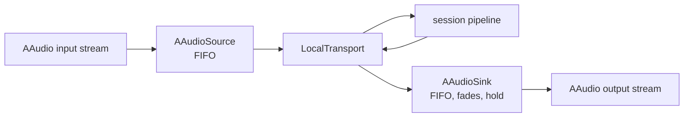

# AAudio

*Audio I/O provider, config id `aaudio` (`providers.audio_input` and `audio_output`), target `vasdk_aaudio`, build flag `-DVASDK_BUILD_AAUDIO=ON` (on for Android). Source: [`VASDK_3P_IMPL/AAudio/`](../../VASDK_3P_IMPL/AAudio/). Interfaces: [`GenericAudioSource.h`](../../VASDK/include/VASDK/GenericAudioSource.h), [`GenericAudioSink.h`](../../VASDK/include/VASDK/GenericAudioSink.h).*

Android's microphone and speaker through [AAudio](https://developer.android.com/ndk/guides/audio/aaudio/aaudio), the NDK's low-latency audio API: `AAudioSource` and `AAudioSink`. The sink fades out on barge-in and holds playback while the agent waits, as MiniAudio's does on desktop. It's what the Android app plays and records through, and what a Kotlin app gets by naming it in its engine config.

## Platforms

| macOS | Linux | Windows | Android |
| --- | --- | --- | --- |
| no | no | no | yes |

AAudio is part of Android only. Elsewhere CMake turns the option off with `AAudio: not supported on <system>: AAudio is Android's audio API; use miniaudio there`, and a config that names `aaudio` fails with `audio_input: aaudio: not built into this binary`. Use [`miniaudio`](miniaudio.md) there.

## Options

None: `AAudioSource` and `AAudioSink` open the device in the session's audio format (`audio { input output }`). The app needs the `RECORD_AUDIO` permission.

## Models and licenses

No model files. AAudio is part of Android; the wrapper is VASDK's (Apache 2.0). Listed in [Providers, sources and licenses](../provider-catalog.md#sources-and-licenses).

## Usage

From an engine config, so the session opens the device itself (the Kotlin binding's sessions too):

```textproto
providers { audio_input { id: "aaudio" } audio_output { id: "aaudio" } }
```

From C++:

```cpp
#include "AAudio/AAudioSink.h"
#include "AAudio/AAudioSource.h"

auto transport = std::make_shared<va::transport::LocalTransport>(std::make_shared<va::thirdparty::audio::AAudioSource>(),
                                                                 std::make_shared<va::thirdparty::audio::AAudioSink>());
```

## How it works



AAudio calls back on its own high-priority thread; each side keeps a FIFO between that thread and the pipeline's.

## Tests

On a device, through the app ([tests on a device](../apps/android.md#tests-on-a-device)). The config seam itself (`audio_input`, `audio_output`) is covered on every platform by `vasdk_config_providers` with fake devices.
