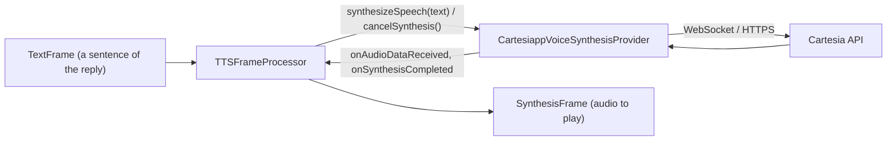

# Cartesia (TTS)

*Text-to-speech provider, config id `cartesia`, target `vasdk_cartesiapp_tts`, build flag `-DVASDK_BUILD_CARTESIAPP_TTS=ON`. Source: [`VASDK_3P_IMPL/CartesiappVoiceSynthesis/`](../../VASDK_3P_IMPL/CartesiappVoiceSynthesis/). Interface: [`GenericVoiceSynthesisProvider.h`](../../VASDK/include/VASDK/GenericVoiceSynthesisProvider.h).*

Cartesia's Sonic speech synthesis over WebSocket, through [CartesiaPP](https://github.com/fatehmtd/CartesiaPP). Voice ids belong to your Cartesia account, so there is no default voice. It needs a network connection and a Cartesia API key.

## Platforms

| macOS | Linux | Windows | Android |
| --- | --- | --- | --- |
| yes | yes | yes | yes |

## Options

In C++, `va::thirdparty::tts::CartesiappVoiceSynthesisOptions` (in [`CartesiappVoiceSynthesisProvider.h`](../../VASDK_3P_IMPL/CartesiappVoiceSynthesis/CartesiappVoiceSynthesisProvider.h)). Every field has a default except the ones marked "required" in its comment.

| Field | Default | Meaning |
| --- | --- | --- |
| `apiKey` | `""` | API key of the service; required (the catalog falls back to the service's *_API_KEY variable). |
| `voiceId` | `""` | Voice to speak with; empty uses the service default. |
| `model` | `cartesiapp::tts::models::SONIC_3_5` | Model to use. |
| `language` | `""` | Language code; empty lets the service detect it or use its default. |
| `caBundlePath` | `""` | PEM file of certificates to trust; empty uses the TLS library's own (Android's mbedTLS can't read the system store). |

In an engine config, the catalog's `CloudOptions` message ([options.proto](../../VASDK_3P_IMPL/ProviderCatalog/proto/vasdk/providers/options.proto)) fills them: a field the config leaves unset falls back to its environment variable, then to the struct's default.

| Config field | Environment variable | Sets |
| --- | --- | --- |
| `api_key` | `CARTESIA_API_KEY` | `apiKey` |
| `voice_id` | `CARTESIA_VOICE_ID` | `voiceId` |
| `ca_bundle_path` | `VASDK_CA_BUNDLE` | `caBundlePath` |

## Models and licenses

Client: [fatehmtd/CartesiaPP](https://github.com/fatehmtd/CartesiaPP), Apache 2.0. Service: [cartesia.ai](https://cartesia.ai), under your Cartesia account's terms.

All of them are listed in [THIRD_PARTY_NOTICES.md](../../THIRD_PARTY_NOTICES.md) and in [Providers, sources and licenses](../provider-catalog.md#sources-and-licenses). An app that ships this provider ships these licenses with it ([vasdk-app](../../skills/vasdk-app/SKILL.md#licenses-ship-with-the-app)).

## Usage

From an engine config:

```textproto
providers {
  tts {
    id: "cartesia"
    options { [type.googleapis.com/vasdk.providers.CloudOptions] { api_key: "${CARTESIA_API_KEY}" } }
    fallback: "pocket"
  }
}
```

From C++:

```cpp
#include "CartesiappVoiceSynthesis/CartesiappVoiceSynthesisProvider.h"

va::thirdparty::tts::CartesiappVoiceSynthesisOptions options;
options.apiKey = "...";
auto provider = std::make_shared<va::thirdparty::tts::CartesiappVoiceSynthesisProvider>(options);
// TTSFrameProcessor(provider); setAudioConfiguration() before the pipeline starts
```

## How it works



## Tests

None of its own yet: it needs an API key and a network. The [provider skill](../../skills/vasdk-provider/SKILL.md#tests) describes the unit and integration tests a provider should have.
