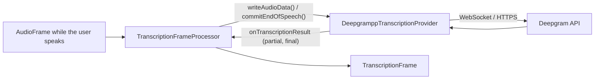

# Deepgram (STT)

*Speech-to-text provider, config id `deepgram`, target `vasdk_deepgrampp_stt`, build flag `-DVASDK_BUILD_DEEPGRAMPP_STT=ON`. Source: [`VASDK_3P_IMPL/DeepgramppTranscription/`](../../VASDK_3P_IMPL/DeepgramppTranscription/). Interface: [`GenericTranscriptionProvider.h`](../../VASDK/include/VASDK/GenericTranscriptionProvider.h).*

Deepgram's streaming speech recognition (Nova-3, multilingual by default), through [deepgrampp](https://github.com/fatehmtd/deepgrampp). It needs a network connection and a Deepgram API key.

## Platforms

| macOS | Linux | Windows | Android |
| --- | --- | --- | --- |
| yes | yes | yes | yes |

## Options

In C++, `va::thirdparty::stt::DeepgramppTranscriptionOptions` (in [`DeepgramppTranscriptionProvider.h`](../../VASDK_3P_IMPL/DeepgramppTranscription/DeepgramppTranscriptionProvider.h)). Every field has a default except the ones marked "required" in its comment.

| Field | Default | Meaning |
| --- | --- | --- |
| `apiKey` | `""` | API key of the service; required (the catalog falls back to the service's *_API_KEY variable). |
| `model` | `deepgram::listen::models::nova_3::GENERAL` | Model to use. |
| `language` | `deepgram::listen::languages::nova_3::MULTILINGUAL` | Language code; empty lets the service detect it or use its default. |
| `caBundlePath` | `""` | PEM file of certificates to trust. Streaming goes through libwebsockets over mbedTLS on every platform, which can't read the system's certificate store: set it for streaming (`VASDK_CA_BUNDLE`, e.g. `/etc/ssl/certs/ca-certificates.crt`). Whole segments go through curl, which uses the system's store when it's empty. |
| `interimResults` | `true` | Streaming: send partial results as the user speaks. |
| `smartFormat` | `true` | Punctuation, numbers and casing in the transcript (streaming and whole segments). |
| `endpointingMs` | `300` | Streaming: silence, in ms, after which the service ends an utterance. |
| `utteranceEndMs` | `1000` | Streaming: gap in words, in ms, after which the service sends UtteranceEnd. |

In an engine config, its own `DeepgramSttOptions` message ([options.proto](../../VASDK_3P_IMPL/ProviderCatalog/proto/vasdk/providers/options.proto)) fills them: a field the config leaves unset falls back to its environment variable, then to the struct's default. The shared `CloudOptions` of configs written before it had its own message is still accepted.

| Config field | Environment variable | Sets |
| --- | --- | --- |
| `api_key` | `DEEPGRAM_API_KEY` | `apiKey` |
| `ca_bundle_path` | `VASDK_CA_BUNDLE` | `caBundlePath` |
| `model` | - | `model` |
| `language` | - | `language` |
| `interim_results` | - | `interimResults` |
| `smart_format` | - | `smartFormat` |
| `endpointing_ms` | - | `endpointingMs` |
| `utterance_end_ms` | - | `utteranceEndMs` |

The engine config sets every field, through `DeepgramSttOptions`.

## Models and licenses

Client: [fatehmtd/deepgrampp](https://github.com/fatehmtd/deepgrampp), Apache 2.0. Service: [deepgram.com](https://deepgram.com), under your Deepgram account's terms.

All of them are listed in [THIRD_PARTY_NOTICES.md](../../THIRD_PARTY_NOTICES.md) and in [Providers, sources and licenses](../provider-catalog.md#sources-and-licenses). An app that ships this provider ships these licenses with it ([vasdk-app](../../skills/vasdk-app/SKILL.md#licenses-ship-with-the-app)).

## Usage

From an engine config:

```textproto
providers {
  stt {
    id: "deepgram"
    options { [type.googleapis.com/vasdk.providers.DeepgramSttOptions] { api_key: "${DEEPGRAM_API_KEY}" } }
    fallback: "whistle"
  }
}
```

From C++:

```cpp
#include "DeepgramppTranscription/DeepgramppTranscriptionProvider.h"

va::thirdparty::stt::DeepgramppTranscriptionOptions options;
options.apiKey = "...";
auto provider = std::make_shared<va::thirdparty::stt::DeepgramppTranscriptionProvider>(options);
// TranscriptionFrameProcessor(provider); setAudioConfiguration() before the pipeline starts
```

## How it works



## Tests

None of its own yet: it needs an API key and a network. The [provider skill](../../skills/vasdk-provider/SKILL.md#tests) describes the unit and integration tests a provider should have.
