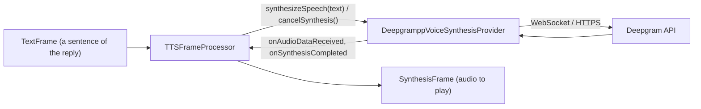

# Deepgram (TTS)

*Text-to-speech provider, config id `deepgram`, target `vasdk_deepgrampp_tts`, build flag `-DVASDK_BUILD_DEEPGRAMPP_TTS=ON`. Source: [`VASDK_3P_IMPL/DeepgramppVoiceSynthesis/`](../../VASDK_3P_IMPL/DeepgramppVoiceSynthesis/). Interface: [`GenericVoiceSynthesisProvider.h`](../../VASDK/include/VASDK/GenericVoiceSynthesisProvider.h).*

Deepgram's Aura-2 speech synthesis, through [deepgrampp](https://github.com/fatehmtd/deepgrampp). The model names the voice (`aura-2-thalia-en` by default). It needs a network connection and a Deepgram API key.

## Platforms

| macOS | Linux | Windows | Android |
| --- | --- | --- | --- |
| yes | yes | yes | yes |

## Options

In C++, `va::thirdparty::tts::DeepgramppVoiceSynthesisOptions` (in [`DeepgramppVoiceSynthesisProvider.h`](../../VASDK_3P_IMPL/DeepgramppVoiceSynthesis/DeepgramppVoiceSynthesisProvider.h)). Every field has a default except the ones marked "required" in its comment.

| Field | Default | Meaning |
| --- | --- | --- |
| `apiKey` | `""` | API key of the service; required (the catalog falls back to the service's *_API_KEY variable). |
| `model` | `deepgram::speak::models::aura_2::en::THALIA` | Model to use. |
| `caBundlePath` | `""` | PEM file of certificates to trust; empty uses the TLS library's own (Android's mbedTLS can't read the system store). |

In an engine config, its own `DeepgramTtsOptions` message ([options.proto](../../VASDK_3P_IMPL/ProviderCatalog/proto/vasdk/providers/options.proto)) fills them: a field the config leaves unset falls back to its environment variable, then to the struct's default. The shared `CloudOptions` of configs written before it had its own message is still accepted.

| Config field | Environment variable | Sets |
| --- | --- | --- |
| `api_key` | `DEEPGRAM_API_KEY` | `apiKey` |
| `model` | `DEEPGRAM_VOICE_ID` | `model` |
| `ca_bundle_path` | `VASDK_CA_BUNDLE` | `caBundlePath` |

In Aura the model is the voice (e.g. `aura-2-orion-en`): the config's `model`, else `DEEPGRAM_VOICE_ID`. An older config's `CloudOptions.voice_id` sets it too.

## Models and licenses

Client: [fatehmtd/deepgrampp](https://github.com/fatehmtd/deepgrampp), Apache 2.0. Service: [deepgram.com](https://deepgram.com), under your Deepgram account's terms.

All of them are listed in [THIRD_PARTY_NOTICES.md](../../THIRD_PARTY_NOTICES.md) and in [Providers, sources and licenses](../provider-catalog.md#sources-and-licenses). An app that ships this provider ships these licenses with it ([vasdk-app](../../skills/vasdk-app/SKILL.md#licenses-ship-with-the-app)).

## Usage

From an engine config:

```textproto
providers {
  tts {
    id: "deepgram"
    options { [type.googleapis.com/vasdk.providers.DeepgramTtsOptions] { api_key: "${DEEPGRAM_API_KEY}" } }
    fallback: "pocket"
  }
}
```

From C++:

```cpp
#include "DeepgramppVoiceSynthesis/DeepgramppVoiceSynthesisProvider.h"

va::thirdparty::tts::DeepgramppVoiceSynthesisOptions options;
options.apiKey = "...";
auto provider = std::make_shared<va::thirdparty::tts::DeepgramppVoiceSynthesisProvider>(options);
// TTSFrameProcessor(provider); setAudioConfiguration() before the pipeline starts
```

## How it works



## Tests

None of its own yet: it needs an API key and a network. The [provider skill](../../skills/vasdk-provider/SKILL.md#tests) describes the unit and integration tests a provider should have.
