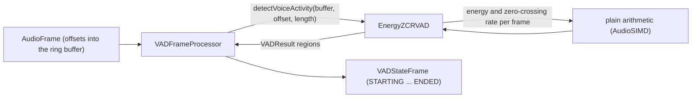

# Energy+ZCR VAD

*VAD provider, not in the provider catalog (construct it in C++), target `vasdk_energy_zcr_vad`, build flag `-DVASDK_BUILD_ENERGY_ZCR_VAD=ON`. Source: [`VASDK_3P_IMPL/EnergyZCRVAD/`](../../VASDK_3P_IMPL/EnergyZCRVAD/). Interface: [`VADProvider.h`](../../VASDK/include/VASDK/VADProvider.h).*

Voice activity from each frame's energy and zero-crossing rate: no model and no dependency, for embedded targets where an ONNX runtime is too much. It is cruder than Silero: loud noise with few zero crossings counts as speech. Not in the provider catalog; construct it in C++.

## Platforms

| macOS | Linux | Windows | Android |
| --- | --- | --- | --- |
| yes | yes | yes | yes |

## Options

In C++, `va::thirdparty::EnergyZCRVADOptions` (in [`EnergyZCRVAD.h`](../../VASDK_3P_IMPL/EnergyZCRVAD/EnergyZCRVAD.h)). Every field has a default except the ones marked "required" in its comment.

| Field | Default | Meaning |
| --- | --- | --- |
| `frameSizeMs` | `20` | Length of one analysed frame. |
| `energyThreshold` | `0.1` | A frame is loud enough for speech when its energy (sum of squared samples in -1..1) exceeds this. 0.1 is about -34 dBFS RMS for a 20 ms frame at 16 kHz. |
| `zeroCrossingRateThreshold` | `0.3` | A loud frame counts as speech only when its zero-crossing rate (0-1) is below this, which rejects hiss and other high-frequency noise. |

## Models and licenses

No model files.

In-repo code, Apache 2.0 (VASDK).

All of them are listed in [THIRD_PARTY_NOTICES.md](../../THIRD_PARTY_NOTICES.md) and in [Providers, sources and licenses](../provider-catalog.md#sources-and-licenses). An app that ships this provider ships these licenses with it ([vasdk-app](../../skills/vasdk-app/SKILL.md#licenses-ship-with-the-app)).

## Usage

```cpp
#include "EnergyZCRVAD/EnergyZCRVAD.h"

va::thirdparty::EnergyZCRVADOptions options;
auto provider = std::make_shared<va::thirdparty::EnergyZCRVAD>(options);
// VADFrameProcessor(provider), after provider->initialize(audioConfig, bufferSize)
```

## How it works



## Tests

| Test | Kind | Needs | Run |
| --- | --- | --- | --- |
| `vasdk_energy_zcr_vad` | unit | nothing | `ctest --test-dir build -R vasdk_energy_zcr_vad` |

A test that needs a model or a key reports "skipped" without it.
