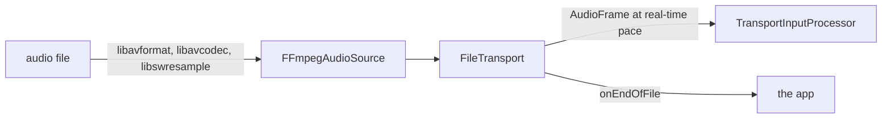

# FFmpeg file audio

*Transport provider, not in the provider catalog (construct it in C++), target `vasdk_ffmpeg_audio`, build flag `-DVASDK_BUILD_FFMPEG_AUDIO=ON`. Source: [`VASDK_3P_IMPL/FFmpegAudio/`](../../VASDK_3P_IMPL/FFmpegAudio/). Interface: [`Transport.h`](../../VASDK/include/VASDK/Transport.h).*

Audio files as input: `FFmpegAudioSource` decodes any container and codec FFmpeg reads and resamples it to the pipeline's format; `FileTransport` feeds it to a pipeline at real-time pace, for batch runs and tests. Off by default; needs FFmpeg 5.1+ installed.

## Platforms

| macOS | Linux | Windows | Android |
| --- | --- | --- | --- |
| yes | yes | yes | no |

## Options

In C++, `va::thirdparty::transport::FileTransportOptions` (in [`FileTransport.h`](../../VASDK_3P_IMPL/FFmpegAudio/FileTransport.h)). Every field has a default except the ones marked "required" in its comment.

| Field | Default | Meaning |
| --- | --- | --- |
| `filePath` | `""` | Audio file in any container and codec FFmpeg reads. |

`FFmpegAudioSource` takes `FFmpegAudioSourceOptions` (`filePath`). Configure turns the provider off with a warning when FFmpeg isn't found, and on Android ("FFmpegAudio: not supported on Android").

## Models and licenses

No model files.

Library: [FFmpeg](https://ffmpeg.org), LGPL or GPL depending on how your system build was configured.

All of them are listed in [THIRD_PARTY_NOTICES.md](../../THIRD_PARTY_NOTICES.md) and in [Providers, sources and licenses](../provider-catalog.md#sources-and-licenses). An app that ships this provider ships these licenses with it ([vasdk-app](../../skills/vasdk-app/SKILL.md#licenses-ship-with-the-app)).

## Usage

```cpp
#include "FFmpegAudio/FileTransport.h"

va::thirdparty::transport::FileTransportOptions options;
options.filePath = "...";
auto provider = std::make_shared<va::thirdparty::transport::FileTransport>(options);
// transport->setAudioConfig(cfg); transport->onEndOfFile = ...; initialize(); start()
```

## How it works



## Tests

None of its own yet: it needs FFmpeg and an audio file. The [provider skill](../../skills/vasdk-provider/SKILL.md#tests) describes the unit and integration tests a provider should have.
