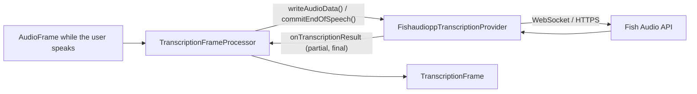

# Fish Audio (STT)

*Speech-to-text provider, config id `fishaudio`, target `vasdk_fishaudiopp_stt`, build flag `-DVASDK_BUILD_FISHAUDIOPP_STT=ON`. Source: [`VASDK_3P_IMPL/FishaudioppTranscription/`](../../VASDK_3P_IMPL/FishaudioppTranscription/). Interface: [`GenericTranscriptionProvider.h`](../../VASDK/include/VASDK/GenericTranscriptionProvider.h).*

Fish Audio's speech recognition over REST, through [fishaudiopp](https://github.com/fatehmtd/fishaudiopp). It transcribes each utterance as a whole, so there are no partial results. It needs a network connection and a Fish Audio API key.

## Platforms

| macOS | Linux | Windows | Android |
| --- | --- | --- | --- |
| yes | yes | yes | yes |

## Options

In C++, `va::thirdparty::stt::FishaudioppTranscriptionOptions` (in [`FishaudioppTranscriptionProvider.h`](../../VASDK_3P_IMPL/FishaudioppTranscription/FishaudioppTranscriptionProvider.h)). Every field has a default except the ones marked "required" in its comment.

| Field | Default | Meaning |
| --- | --- | --- |
| `apiKey` | `""` | API key of the service; required (the catalog falls back to the service's *_API_KEY variable). |
| `language` | `""` | Language code; empty lets the service detect it or use its default. |
| `caBundlePath` | `""` | PEM file of certificates to trust; empty uses the TLS library's own (Android's mbedTLS can't read the system store). |

In an engine config, its own `FishAudioSttOptions` message ([options.proto](../../VASDK_3P_IMPL/ProviderCatalog/proto/vasdk/providers/options.proto)) fills them: a field the config leaves unset falls back to its environment variable, then to the struct's default. The shared `CloudOptions` of configs written before it had its own message is still accepted.

| Config field | Environment variable | Sets |
| --- | --- | --- |
| `api_key` | `FISHAUDIO_API_KEY` | `apiKey` |
| `ca_bundle_path` | `VASDK_CA_BUNDLE` | `caBundlePath` |
| `language` | - | `language` |

The engine config sets every field, through `FishAudioSttOptions`.

## Models and licenses

Client: [fatehmtd/fishaudiopp](https://github.com/fatehmtd/fishaudiopp), Apache 2.0. Service: [fish.audio](https://fish.audio), under your Fish Audio account's terms.

All of them are listed in [THIRD_PARTY_NOTICES.md](../../THIRD_PARTY_NOTICES.md) and in [Providers, sources and licenses](../provider-catalog.md#sources-and-licenses). An app that ships this provider ships these licenses with it ([vasdk-app](../../skills/vasdk-app/SKILL.md#licenses-ship-with-the-app)).

## Usage

From an engine config:

```textproto
providers {
  stt {
    id: "fishaudio"
    options { [type.googleapis.com/vasdk.providers.FishAudioSttOptions] { api_key: "${FISHAUDIO_API_KEY}" } }
    fallback: "whistle"
  }
}
```

From C++:

```cpp
#include "FishaudioppTranscription/FishaudioppTranscriptionProvider.h"

va::thirdparty::stt::FishaudioppTranscriptionOptions options;
options.apiKey = "...";
auto provider = std::make_shared<va::thirdparty::stt::FishaudioppTranscriptionProvider>(options);
// TranscriptionFrameProcessor(provider); setAudioConfiguration() before the pipeline starts
```

## How it works



## Tests

None of its own yet: it needs an API key and a network. The [provider skill](../../skills/vasdk-provider/SKILL.md#tests) describes the unit and integration tests a provider should have.
