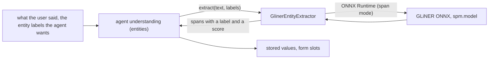

# GLiNER

*Entity model provider, config id `gliner`, target `vasdk_gliner_ner`, build flag `-DVASDK_BUILD_GLINER_NER=ON`. Source: [`VASDK_3P_IMPL/GlinerNer/`](../../VASDK_3P_IMPL/GlinerNer/). Interface: [`EntityExtractor.h`](../../VASDK/include/VASDK/nlu/EntityExtractor.h).*

A zero-shot entity model: told the agent's entity labels ("car repair", "available time"), it finds where each is said, on the device. Off by default (183 MB English, 349 MB multilingual).

## Platforms

| macOS | Linux | Windows | Android |
| --- | --- | --- | --- |
| yes | yes | yes | yes |

## Options

In C++, `va::thirdparty::nlu::GlinerEntityExtractorOptions` (in [`GlinerEntityExtractor.h`](../../VASDK_3P_IMPL/GlinerNer/GlinerEntityExtractor.h)). Every field has a default except the ones marked "required" in its comment.

| Field | Default | Meaning |
| --- | --- | --- |
| `modelDir` | `""` | Folder holding model.onnx, spm.model, added_tokens.json and gliner_config.json (VASDK_3P_IMPL/cmake/DownloadGlinerModel.cmake). |
| `threshold` | `0.5f` | A span's score (0-1) must reach it to be kept. |
| `threads` | `2` | ONNX Runtime threads. |

In an engine config, its own `GlinerOptions` message ([options.proto](../../VASDK_3P_IMPL/ProviderCatalog/proto/vasdk/providers/options.proto)) fills them: a field the config leaves unset falls back to its environment variable, then to the struct's default.

| Config field | Environment variable | Sets |
| --- | --- | --- |
| `model_dir` | - | `modelDir` |
| `threshold` | - | `threshold` |
| `threads` | - | `threads` |

## Models and licenses

| Files | Source | License | Fetched by |
| --- | --- | --- | --- |
| model.onnx, spm.model, added_tokens.json, gliner_config.json | [onnx-community/gliner_small-v2.1](https://huggingface.co/onnx-community/gliner_small-v2.1) or [gliner_multi-v2.1](https://huggingface.co/onnx-community/gliner_multi-v2.1) | Apache 2.0 | `VASDK_3P_IMPL/cmake/DownloadGlinerModel.cmake` (`-DVASDK_GLINER_MODEL=multi`) |

Model: [urchade/GLiNER](https://github.com/urchade/GLiNER), Apache 2.0.

All of them are listed in [THIRD_PARTY_NOTICES.md](../../THIRD_PARTY_NOTICES.md) and in [Providers, sources and licenses](../provider-catalog.md#sources-and-licenses). An app that ships this provider ships these licenses with it ([vasdk-app](../../skills/vasdk-app/SKILL.md#licenses-ship-with-the-app)).

## Usage

From an engine config:

```textproto
providers {
  entity_model {
    id: "gliner"
    options { [type.googleapis.com/vasdk.providers.GlinerOptions] { threshold: 0.4 } }
  }
}
```

From C++:

```cpp
#include "GlinerNer/GlinerEntityExtractor.h"

va::thirdparty::nlu::GlinerEntityExtractorOptions options;
options.modelDir = "...";
auto provider = std::make_shared<va::thirdparty::nlu::GlinerEntityExtractor>(options);
// provider->initialize(), then give it to the agent as its entity model
```

## How it works



## Tests

| Test | Kind | Needs | Run |
| --- | --- | --- | --- |
| `vasdk_gliner_ner` | unit | the model | `ctest --test-dir build -R vasdk_gliner_ner` |

A test that needs a model or a key reports "skipped" without it.
