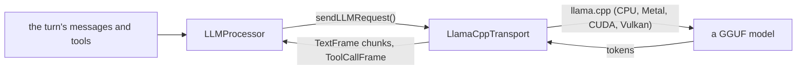

# llama.cpp

*LLM provider, not in the provider catalog (construct it in C++), target `vasdk_llamacpp`, build flag `-DVASDK_BUILD_LLAMACPP=ON`. Source: [`VASDK_3P_IMPL/LlamaCpp/`](../../VASDK_3P_IMPL/LlamaCpp/). Interface: [`LLMTransport.h`](../../VASDK/include/VASDK/llm/LLMTransport.h).*

A local LLM: `LlamaCppTransport` (the conversation) and `LlamaCppCompletion` (one-shot asks) run a GGUF model in-process with [llama.cpp](https://github.com/ggml-org/llama.cpp), no network. Off by default.

## Platforms

| macOS | Linux | Windows | Android |
| --- | --- | --- | --- |
| yes | yes | yes | yes |

## Options

Its options are the core's `va::llm::LLMConfig` (`model` is the GGUF path, plus `temperature`, `maxTokens`, `nCtx`, ...), the struct every LLM seam takes, so it has no struct of its own. Select it from an engine config with `llm { api: ... }` as [engine config files](../reference/engine-config.md) describe, or construct it in C++.

## Models and licenses

| Files | Source | License | Fetched by |
| --- | --- | --- | --- |
| any GGUF chat model | your choice, e.g. Qwen2.5 1.5B Instruct | the model's own | `VASDK_3P_IMPL/cmake/DownloadLlamaCppModel.cmake` (`VASDK_DOWNLOAD_LLAMACPP_MODEL`) |

Library: [ggml-org/llama.cpp](https://github.com/ggml-org/llama.cpp), MIT.

All of them are listed in [THIRD_PARTY_NOTICES.md](../../THIRD_PARTY_NOTICES.md) and in [Providers, sources and licenses](../provider-catalog.md#sources-and-licenses). An app that ships this provider ships these licenses with it ([vasdk-app](../../skills/vasdk-app/SKILL.md#licenses-ship-with-the-app)).

## Usage

```cpp
#include "LlamaCpp/LlamaCppTransport.h"

va::llm::LLMConfig config;
config.model = "/models/qwen2.5-1.5b-instruct-q4_k_m.gguf";
auto transport = std::make_shared<va::thirdparty::LlamaCppTransport>(config);
// LLMProcessor(transport); LlamaCppCompletion(config) for an agent's one-shot asks
```

## How it works



## Tests

| Test | Kind | Needs | Run |
| --- | --- | --- | --- |
| `vasdk_llamacpp_completion` | unit | a GGUF model | `ctest --test-dir build -R vasdk_llamacpp_completion` |

A test that needs a model or a key reports "skipped" without it.
