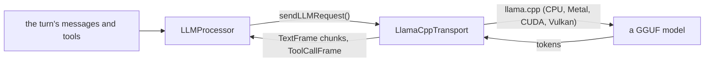

# llama.cpp

*LLM provider, config id `llamacpp` (`providers.llm`), target `vasdk_llamacpp`, build flag `-DVASDK_BUILD_LLAMACPP=ON`. Source: [`VASDK_3P_IMPL/LlamaCpp/`](../../VASDK_3P_IMPL/LlamaCpp/). Interface: [`LLMTransport.h`](../../VASDK/include/VASDK/llm/LLMTransport.h).*

A local LLM: `LlamaCppTransport` (the conversation) and `LlamaCppCompletion` (one-shot asks) run a GGUF model in-process with [llama.cpp](https://github.com/ggml-org/llama.cpp), no network. Off by default.

## Platforms

| macOS | Linux | Windows | Android |
| --- | --- | --- | --- |
| yes | yes | yes | yes |

## Options

From an engine config, `providers { llm { id: "llamacpp" options { [type.googleapis.com/vasdk.providers.LlamaCppOptions] { ... } } } }`: each session gets its own transport, so a C, Python or Kotlin app runs a local LLM with no code of its own. Every field is optional; unset sampling fields keep `va::llm::LLMConfig`'s defaults, the struct every LLM seam takes (so it has no options struct of its own).

| Field | Environment variable | Default | Meaning |
| --- | --- | --- | --- |
| `model_path` | `LLAMACPP_MODEL` | `<models_dir>/LFM2.5-1.2B-Instruct-Q4_K_M.gguf` (what `VASDK_DOWNLOAD_LLAMACPP_MODEL` fetches) | The GGUF file. |
| `chat_format` | `LLAMACPP_CHAT_FORMAT` | the transport's | The GGUF's chat format: `chatml`, `llama3`, `llama2`, `mistral`, `gemma`, `phi3`, `lfm2`, `lfm2.5`. It renders the tools' descriptions and call syntax: a wrong one gives the model tokens it parrots back. |
| `context_tokens`, `max_tokens` | - | `LLMConfig`'s (4096, 1000) | The context window, the longest reply. |
| `temperature`, `top_p`, `top_k`, `min_p`, `repetition_penalty` | - | `LLMConfig`'s | Sampling. |
| `threads`, `gpu_layers` | - | llama.cpp's choice, 99 | CPU threads, layers offloaded to the GPU. |
| `native_library_dir` | - | - | Android: the app's `nativeLibraryDir`, where ggml's backends are. |
| `answer_agent` | - | `false` | Also answer the agent's one-shot asks (understanding, `llm` steps, generative pages) with a `LlamaCppCompletion`. It loads the model a second time: twice the memory. |

The session gives it the system prompt and, at start, the tools' descriptions in its chat format (llama.cpp renders requests with the GGUF's own template). In C++, construct `LlamaCppTransport` and `LlamaCppCompletion` from an `LLMConfig`, as below.

## Models and licenses

| Files | Source | License | Fetched by |
| --- | --- | --- | --- |
| any GGUF chat model | your choice, e.g. Qwen2.5 1.5B Instruct | the model's own | `VASDK_3P_IMPL/cmake/DownloadLlamaCppModel.cmake` (`VASDK_DOWNLOAD_LLAMACPP_MODEL`) |

Library: [ggml-org/llama.cpp](https://github.com/ggml-org/llama.cpp), MIT.

All of them are listed in [THIRD_PARTY_NOTICES.md](../../THIRD_PARTY_NOTICES.md) and in [Providers, sources and licenses](../provider-catalog.md#sources-and-licenses). An app that ships this provider ships these licenses with it ([vasdk-app](../../skills/vasdk-app/SKILL.md#licenses-ship-with-the-app)).

## Usage

```cpp
#include "LlamaCpp/LlamaCppTransport.h"

va::llm::LLMConfig config;
config.model = "/models/qwen2.5-1.5b-instruct-q4_k_m.gguf";
auto transport = std::make_shared<va::thirdparty::llm::LlamaCppTransport>(config);
// LLMProcessor(transport); LlamaCppCompletion(config) for an agent's one-shot asks
```

## How it works



## Tests

| Test | Kind | Needs | Run |
| --- | --- | --- | --- |
| `vasdk_llamacpp_completion` | unit | a GGUF model | `ctest --test-dir build -R vasdk_llamacpp_completion` |

A test that needs a model or a key reports "skipped" without it.
