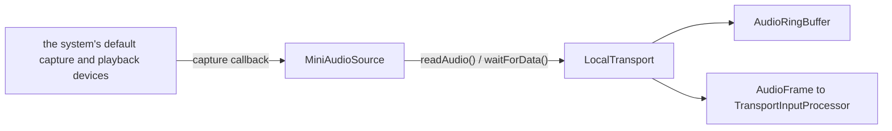

# MiniAudio

*Audio I/O provider, config id `miniaudio` (`providers.audio_input` and `audio_output`), target `vasdk_miniaudio_audio`, build flag `-DVASDK_BUILD_MINIAUDIO=ON`. Source: [`VASDK_3P_IMPL/MiniAudio/`](../../VASDK_3P_IMPL/MiniAudio/). Interface: [`GenericAudioSource.h`](../../VASDK/include/VASDK/GenericAudioSource.h).*

The default microphone and speaker on desktop: `MiniAudioSource` and `MiniAudioSink` over [miniaudio](https://github.com/mackron/miniaudio), a single-header library with no system dependency. The sink fades out on barge-in and holds playback while the agent waits.

## Platforms

| macOS | Linux | Windows | Android |
| --- | --- | --- | --- |
| yes | yes | yes | builds; the Android app uses AAudio instead |

## Options

In C++, `va::thirdparty::audio::MiniAudioSourceOptions` (in [`MiniAudioSource.h`](../../VASDK_3P_IMPL/MiniAudio/MiniAudioSource.h)). Every field has a default except the ones marked "required" in its comment.

| Field | Default | Meaning |
| --- | --- | --- |
| `bufferSeconds` | `30` | Captured audio the source can hold before the oldest is overwritten, in seconds of the configured format. Several seconds absorb a stalled reader. |

`MiniAudioSink` takes no options.

## Models and licenses

No model files.

Library: [mackron/miniaudio](https://github.com/mackron/miniaudio), public domain (Unlicense) or MIT-0.

All of them are listed in [THIRD_PARTY_NOTICES.md](../../THIRD_PARTY_NOTICES.md) and in [Providers, sources and licenses](../provider-catalog.md#sources-and-licenses). An app that ships this provider ships these licenses with it ([vasdk-app](../../skills/vasdk-app/SKILL.md#licenses-ship-with-the-app)).

## Usage

From an engine config, so the session opens the device itself (the C API's, Python's and Kotlin's sessions too):

```textproto
providers { audio_input { id: "miniaudio" } audio_output { id: "miniaudio" } }
```

From C++:

```cpp
#include "MiniAudio/MiniAudioSource.h"

va::thirdparty::audio::MiniAudioSourceOptions options;
auto provider = std::make_shared<va::thirdparty::audio::MiniAudioSource>(options);
// LocalTransport(source, std::make_shared<va::thirdparty::audio::MiniAudioSink>())
```

## How it works



## Tests

None of its own yet: it needs audio hardware. The [provider skill](../../skills/vasdk-provider/SKILL.md#tests) describes the unit and integration tests a provider should have.
