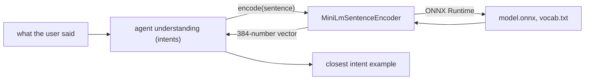

# all-MiniLM-L6-v2

*Sentence encoder provider, config id `minilm`, target `vasdk_minilm_nlu`, build flag `-DVASDK_BUILD_MINILM_NLU=ON`. Source: [`VASDK_3P_IMPL/MiniLmNlu/`](../../VASDK_3P_IMPL/MiniLmNlu/). Interface: [`EmbeddingNluProvider.h`](../../VASDK/include/VASDK/nlu/EmbeddingNluProvider.h).*

The sentence encoder agents use to understand paraphrases: all-MiniLM-L6-v2 (int8 ONNX, about 23 MB) turns a sentence into 384 numbers in a few milliseconds on a phone. It also gives the per-word vectors the `tagger` entity model reads. On by default.

## Platforms

| macOS | Linux | Windows | Android |
| --- | --- | --- | --- |
| yes | yes | yes | yes |

## Options

In C++, `va::thirdparty::nlu::MiniLmSentenceEncoderOptions` (in [`MiniLmSentenceEncoder.h`](../../VASDK_3P_IMPL/MiniLmNlu/MiniLmSentenceEncoder.h)). Every field has a default except the ones marked "required" in its comment.

| Field | Default | Meaning |
| --- | --- | --- |
| `modelDir` | `""` | Folder holding model.onnx and vocab.txt (VASDK_3P_IMPL/cmake/DownloadMiniLmModel.cmake). |
| `threads` | `1` | ONNX Runtime threads. |

In an engine config, its own `MiniLmOptions` message ([options.proto](../../VASDK_3P_IMPL/ProviderCatalog/proto/vasdk/providers/options.proto)) fills them: a field the config leaves unset falls back to its environment variable, then to the struct's default.

| Config field | Environment variable | Sets |
| --- | --- | --- |
| `model_dir` | - | `modelDir` |
| `threads` | - | `threads` |

## Models and licenses

| Files | Source | License | Fetched by |
| --- | --- | --- | --- |
| model.onnx, vocab.txt | [sentence-transformers/all-MiniLM-L6-v2](https://huggingface.co/sentence-transformers/all-MiniLM-L6-v2) | Apache 2.0 | `VASDK_3P_IMPL/cmake/DownloadMiniLmModel.cmake` |

Runtime: [ONNX Runtime](https://github.com/microsoft/onnxruntime), MIT.

All of them are listed in [THIRD_PARTY_NOTICES.md](../../THIRD_PARTY_NOTICES.md) and in [Providers, sources and licenses](../provider-catalog.md#sources-and-licenses). An app that ships this provider ships these licenses with it ([vasdk-app](../../skills/vasdk-app/SKILL.md#licenses-ship-with-the-app)).

## Usage

From an engine config:

```textproto
providers {
  encoder {
    id: "minilm"
    options { [type.googleapis.com/vasdk.providers.MiniLmOptions] { model_dir: "models/minilm" } }
  }
}
```

From C++:

```cpp
#include "MiniLmNlu/MiniLmSentenceEncoder.h"

va::thirdparty::nlu::MiniLmSentenceEncoderOptions options;
options.modelDir = "...";
auto provider = std::make_shared<va::thirdparty::nlu::MiniLmSentenceEncoder>(options);
// provider->initialize(), then give it to the agent's understanding
```

## How it works



## Tests

| Test | Kind | Needs | Run |
| --- | --- | --- | --- |
| `vasdk_minilm_nlu` | unit | the model | `ctest --test-dir build -R vasdk_minilm_nlu` |

A test that needs a model or a key reports "skipped" without it.
