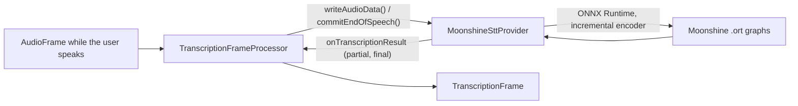

# Moonshine STT

*Speech-to-text provider, config id `moonshine`, target `vasdk_moonshine_stt`, build flag `-DVASDK_BUILD_MOONSHINE_STT=ON`. Source: [`VASDK_3P_IMPL/MoonshineSTT/`](../../VASDK_3P_IMPL/MoonshineSTT/). Interface: [`GenericTranscriptionProvider.h`](../../VASDK/include/VASDK/GenericTranscriptionProvider.h).*

Useful Sensors' Moonshine streaming models (English; tiny, small or medium): audio is encoded as it arrives, so partial results stay cheap on long utterances. Off by default.

## Platforms

| macOS | Linux | Windows | Android |
| --- | --- | --- | --- |
| yes | yes | yes | yes |

## Options

In C++, `va::thirdparty::stt::MoonshineSttOptions` (in [`MoonshineSttProvider.hpp`](../../VASDK_3P_IMPL/MoonshineSTT/MoonshineSttProvider.hpp)). Every field has a default except the ones marked "required" in its comment.

| Field | Default | Meaning |
| --- | --- | --- |
| `modelDir` | `""` | Folder holding the streaming .ort graphs, streaming_config.json and tokenizer.bin (VASDK_3P_IMPL/cmake/DownloadMoonshineModel.cmake). |
| `idleTimeoutMs` | `350` | Silence on the input that finalizes the utterance. |
| `partialIntervalMs` | `160` | Shortest time between two partial decodes. |

In an engine config, its own `MoonshineOptions` message ([options.proto](../../VASDK_3P_IMPL/ProviderCatalog/proto/vasdk/providers/options.proto)) fills them: a field the config leaves unset falls back to its environment variable, then to the struct's default. The shared `LocalSttOptions` of configs written before it had its own message is still accepted.

| Config field | Environment variable | Sets |
| --- | --- | --- |
| `model_dir` | - | `modelDir` |
| `idle_timeout_ms` | - | `idleTimeoutMs` |
| `partial_interval_ms` | - | `partialIntervalMs` |

## Models and licenses

| Files | Source | License | Fetched by |
| --- | --- | --- | --- |
| frontend/encoder/adapter/cross_kv/decoder_kv .ort, tokenizer.bin | [UsefulSensors/moonshine-streaming](https://huggingface.co/UsefulSensors/moonshine-streaming) | MIT | `VASDK_3P_IMPL/cmake/DownloadMoonshineModel.cmake` (`-DMOONSHINE_MODEL_ARCH=tiny|small|medium`) |

Code: [moonshine-ai/moonshine](https://github.com/moonshine-ai/moonshine), MIT.

All of them are listed in [THIRD_PARTY_NOTICES.md](../../THIRD_PARTY_NOTICES.md) and in [Providers, sources and licenses](../provider-catalog.md#sources-and-licenses). An app that ships this provider ships these licenses with it ([vasdk-app](../../skills/vasdk-app/SKILL.md#licenses-ship-with-the-app)).

## Usage

From an engine config:

```textproto
providers {
  stt {
    id: "moonshine"
    options { [type.googleapis.com/vasdk.providers.MoonshineOptions] { idle_timeout_ms: 600 } }
    fallback: "whistle"
  }
}
```

From C++:

```cpp
#include "MoonshineSTT/MoonshineSttProvider.hpp"

va::thirdparty::stt::MoonshineSttOptions options;
options.modelDir = "...";
auto provider = std::make_shared<va::thirdparty::stt::MoonshineSttProvider>(options);
// TranscriptionFrameProcessor(provider); setAudioConfiguration() before the pipeline starts
```

## How it works



## Tests

| Test | Kind | Needs | Run |
| --- | --- | --- | --- |
| `moonshine_stt_stream` | unit | the model and a WAV | `ctest --test-dir build -R moonshine_stt_stream` |

A test that needs a model or a key reports "skipped" without it.
