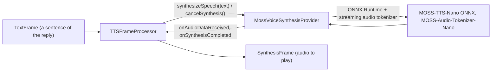

# MOSS-TTS-Nano

*Text-to-speech provider, config id `moss`, target `vasdk_moss_tts`, build flag `-DVASDK_BUILD_MOSS_TTS=ON`. Source: [`VASDK_3P_IMPL/MossTTS/`](../../VASDK_3P_IMPL/MossTTS/). Interface: [`GenericVoiceSynthesisProvider.h`](../../VASDK/include/VASDK/GenericVoiceSynthesisProvider.h).*

OpenMOSS's MOSS-TTS-Nano (about 100M parameters): multilingual (Chinese, English, Japanese, ...) autoregressive speech at 48 kHz on CPU, with 18 built-in voices. Off by default because its files are large (about 710 MB).

## Platforms

| macOS | Linux | Windows | Android |
| --- | --- | --- | --- |
| yes | yes | yes | yes |

## Options

In C++, `va::thirdparty::tts::MossVoiceSynthesisOptions` (in [`MossVoiceSynthesisProvider.hpp`](../../VASDK_3P_IMPL/MossTTS/MossVoiceSynthesisProvider.hpp)). Every field has a default except the ones marked "required" in its comment.

| Field | Default | Meaning |
| --- | --- | --- |
| `modelDir` | `""` | Folder containing MOSS-TTS-Nano-100M-ONNX/ and MOSS-Audio-Tokenizer-Nano-ONNX/, or the TTS folder itself (VASDK_3P_IMPL/cmake/DownloadMossTTSModels.cmake). |
| `voice` | `"Ava"` | Built-in voice, e.g. "Ava", "Bella", "Adam", "Nathan", "Junhao", "Xiaoyu", "Soyo"; unknown falls back to the first voice, with a warning. |
| `threads` | `4` | ONNX Runtime intra-op threads per session. |
| `silenceDurationSeconds` | `0.3f` | Silence after each utterance. |
| `maxNewFrames` | `0` | Cap on generated frames per text chunk, 12.5 frames a second; 0 is the manifest's 375. |
| `maxChunkTokens` | `75` | SentencePiece tokens per synthesis chunk; longer text splits at sentence or clause ends. |
| `textNormalization` | `true` | Spell numbers, dates, times, money, units and abbreviations out before synthesis (English, Chinese or Japanese, by script). Off: only markdown markers are stripped. |
| `prebufferMs` | `250` | Audio made before playback starts, against generation jitter on slow CPUs; 0 streams at once (QueuedVoiceSynthesisProvider::setPreBufferedSamplesMS). |
| `pauseShortSeconds` | `0.40f` | Pause between text chunks after a short phrase (4 words or fewer). |
| `pauseLongSeconds` | `0.24f` | Pause between longer text chunks. |

In an engine config, its own `MossOptions` message ([options.proto](../../VASDK_3P_IMPL/ProviderCatalog/proto/vasdk/providers/options.proto)) fills them: a field the config leaves unset falls back to its environment variable, then to the struct's default. The shared `LocalTtsOptions` of configs written before it had its own message is still accepted.

| Config field | Environment variable | Sets |
| --- | --- | --- |
| `model_dir` | - | `modelDir` |
| `voice` | `MOSS_TTS_VOICE` | `voice` |
| `prebuffer_ms`, else the engine's `audio.tts_prebuffer_ms` | - | `prebufferMs` |
| `threads` | - | `threads` |
| `silence_duration_seconds` | - | `silenceDurationSeconds` |
| `max_new_frames` | - | `maxNewFrames` |
| `max_chunk_tokens` | - | `maxChunkTokens` |
| `text_normalization` | - | `textNormalization` |
| `pause_short_seconds` | - | `pauseShortSeconds` |
| `pause_long_seconds` | - | `pauseLongSeconds` |

`setVoice()` switches voices while running.

## Models and licenses

| Files | Source | License | Fetched by |
| --- | --- | --- | --- |
| MOSS-TTS-Nano-100M-ONNX/ | [Supbatomic/moss-tts-nano-100m-onnx-model](https://huggingface.co/Supbatomic/moss-tts-nano-100m-onnx-model) | Apache 2.0 | `VASDK_3P_IMPL/cmake/DownloadMossTTSModels.cmake` |
| MOSS-Audio-Tokenizer-Nano-ONNX/ | [OpenMOSS-Team/MOSS-Audio-Tokenizer-Nano-ONNX](https://huggingface.co/OpenMOSS-Team/MOSS-Audio-Tokenizer-Nano-ONNX) | Apache 2.0 | same |

Tokenizer: [google/sentencepiece](https://github.com/google/sentencepiece), Apache 2.0.

All of them are listed in [THIRD_PARTY_NOTICES.md](../../THIRD_PARTY_NOTICES.md) and in [Providers, sources and licenses](../provider-catalog.md#sources-and-licenses). An app that ships this provider ships these licenses with it ([vasdk-app](../../skills/vasdk-app/SKILL.md#licenses-ship-with-the-app)).

## Usage

From an engine config:

```textproto
providers {
  tts {
    id: "moss"
    options { [type.googleapis.com/vasdk.providers.MossOptions] { voice: "Bella" } }
    fallback: "pocket"
  }
}
```

From C++:

```cpp
#include "MossTTS/MossVoiceSynthesisProvider.hpp"

va::thirdparty::tts::MossVoiceSynthesisOptions options;
options.modelDir = "...";
auto provider = std::make_shared<va::thirdparty::tts::MossVoiceSynthesisProvider>(options);
// TTSFrameProcessor(provider); setAudioConfiguration() before the pipeline starts
```

## How it works



## Tests

| Test | Kind | Needs | Run |
| --- | --- | --- | --- |
| `moss_normalize` | unit | nothing | `ctest --test-dir build -R moss_normalize` |
| `moss_tts_synth` | unit | the models | `ctest --test-dir build -R moss_tts_synth` |

A test that needs a model or a key reports "skipped" without it.
