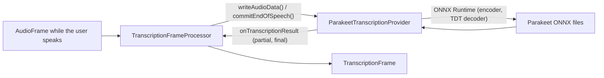

# Parakeet STT

*Speech-to-text provider, config id `parakeet`, target `vasdk_parakeet`, build flag `-DVASDK_BUILD_PARAKEET=ON`. Source: [`VASDK_3P_IMPL/Parakeet/`](../../VASDK_3P_IMPL/Parakeet/). Interface: [`GenericTranscriptionProvider.h`](../../VASDK/include/VASDK/GenericTranscriptionProvider.h).*

NVIDIA's Parakeet TDT 0.6B v3 on ONNX Runtime: accurate, 25 European languages, word timestamps, batch inference over the utterance. Heavier than Whistle (about 600 MB of model).

## Platforms

| macOS | Linux | Windows | Android |
| --- | --- | --- | --- |
| yes | yes | yes | yes |

## Options

In C++, `va::thirdparty::stt::ParakeetTranscriptionOptions` (in [`ParakeetTranscriptionProvider.hpp`](../../VASDK_3P_IMPL/Parakeet/ParakeetTranscriptionProvider.hpp)). Every field has a default except the ones marked "required" in its comment.

| Field | Default | Meaning |
| --- | --- | --- |
| `modelDir` | `""` | Folder holding the Parakeet ONNX files (VASDK_3P_IMPL/cmake/DownloadParakeetModel.cmake). |
| `idleTimeoutMs` | `550` | Silence after the last audio that finalizes the utterance when no end of speech arrives. |
| `partialIntervalMs` | `250` | Shortest time between two partial results. |
| `enableIncrementalPartials` | `false` | Partials re-run only the new audio; off by default for accuracy. |
| `minNewSamplesForPartial` | `8000` | New audio needed before another partial (8000: 500 ms). |
| `minNewSamplesForFinal` | `16000` | The final pass is skipped when the buffer grew by less than this since the last partial (16000: 1 s). |
| `highConfShortcutSamples` | `16000` | When the cached partial's confidence reaches highConfShortcutThreshold and fewer than this many samples arrived after it, it becomes the final result without another inference, which avoids multi-second stalls on Android. 0 disables the shortcut. |
| `highConfShortcutThreshold` | `0.85f` | Confidence (0-1) the cached partial needs for that shortcut. |
| `contextSamples` | `8000` | Tail of the previous utterance prepended to each final pass, for decoder context (8000: 500 ms). |
| `contextBoundaryToleranceMs` | `100` | Words that start within this of the context's end belong to the context and are dropped; must stay below the VAD's maxSpeechEndDurationMs. |
| `maxBufferSeconds` | `90.0f` | Capacity of the preallocated audio buffer. |
| `silencePaddingSeconds` | `1.0f` | Silence appended to each chunk for decoder stability at its end. |
| `overlapBoundaryToleranceMs` | `1000` | Tolerance for words at chunk boundaries; must exceed contextBoundaryToleranceMs. |
| `endPaddingToleranceMs` | `1000` | Tolerance for words at the end of the last chunk, against hallucinations in the silence pad. |

In an engine config, its own `ParakeetOptions` message ([options.proto](../../VASDK_3P_IMPL/ProviderCatalog/proto/vasdk/providers/options.proto)) fills them: a field the config leaves unset falls back to its environment variable, then to the struct's default. The shared `LocalSttOptions` of configs written before it had its own message is still accepted.

| Config field | Environment variable | Sets |
| --- | --- | --- |
| `model_dir` | - | `modelDir` |
| `idle_timeout_ms` | - | `idleTimeoutMs` |
| `partial_interval_ms` | - | `partialIntervalMs` |
| `incremental_partials` | - | `enableIncrementalPartials` |
| `min_new_samples_for_partial` | - | `minNewSamplesForPartial` |
| `min_new_samples_for_final` | - | `minNewSamplesForFinal` |
| `high_confidence_shortcut_samples` | - | `highConfShortcutSamples` |
| `high_confidence_shortcut_threshold` | - | `highConfShortcutThreshold` |
| `context_samples` | - | `contextSamples` |
| `context_boundary_tolerance_ms` | - | `contextBoundaryToleranceMs` |
| `max_buffer_seconds` | - | `maxBufferSeconds` |
| `silence_padding_seconds` | - | `silencePaddingSeconds` |
| `overlap_boundary_tolerance_ms` | - | `overlapBoundaryToleranceMs` |
| `end_padding_tolerance_ms` | - | `endPaddingToleranceMs` |

The catalog derives `minNewSamplesForPartial`, `minNewSamplesForFinal` and `contextSamples` from the pipeline's sample rate.

## Models and licenses

| Files | Source | License | Fetched by |
| --- | --- | --- | --- |
| encoder/decoder ONNX, vocab.txt | [istupakov/parakeet-tdt-0.6b-v3-onnx](https://huggingface.co/istupakov/parakeet-tdt-0.6b-v3-onnx) | CC BY 4.0 | `VASDK_3P_IMPL/cmake/DownloadParakeetModel.cmake` |

Runtime: [ONNX Runtime](https://github.com/microsoft/onnxruntime), MIT.

All of them are listed in [THIRD_PARTY_NOTICES.md](../../THIRD_PARTY_NOTICES.md) and in [Providers, sources and licenses](../provider-catalog.md#sources-and-licenses). An app that ships this provider ships these licenses with it ([vasdk-app](../../skills/vasdk-app/SKILL.md#licenses-ship-with-the-app)).

## Usage

From an engine config:

```textproto
providers {
  stt {
    id: "parakeet"
    options { [type.googleapis.com/vasdk.providers.ParakeetOptions] { idle_timeout_ms: 600 } }
    fallback: "whistle"
  }
}
```

From C++:

```cpp
#include "Parakeet/ParakeetTranscriptionProvider.hpp"

va::thirdparty::stt::ParakeetTranscriptionOptions options;
options.modelDir = "...";
auto provider = std::make_shared<va::thirdparty::stt::ParakeetTranscriptionProvider>(options);
// TranscriptionFrameProcessor(provider); setAudioConfiguration() before the pipeline starts
```

## How it works



## Tests

| Test | Kind | Needs | Run |
| --- | --- | --- | --- |
| `vasdk_offline_conversation` | integration: its `Parakeet` case (and the others, where Whistle isn't built) | the models | `ctest --test-dir build -R "vasdk_offline_conversation.*Parakeet"` |
| `vasdk_eval_stt_parakeet_oneshot`, `vasdk_eval_stt_parakeet_streaming` | evaluation: LibriSpeech and FLEURS speech against what was said ([Evaluation](../evaluation.md)): WER 3.0% English, 7.1% French | the evaluation set (skipped without) | `ctest --test-dir build -L eval` |

A test that needs a model or a key reports "skipped" without it.
