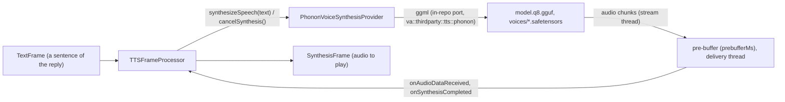

# Phonon TTS

*Text-to-speech provider, config id `phonon`, target `vasdk_phonon_tts`, build flag `-DVASDK_BUILD_PHONON_TTS=ON`. Source: [`VASDK_3P_IMPL/PhononTTS/`](../../VASDK_3P_IMPL/PhononTTS/). Interface: [`GenericVoiceSynthesisProvider.h`](../../VASDK/include/VASDK/GenericVoiceSynthesisProvider.h).*

Gradium's Phonon (flow-matching transformer and Mimi decoder, 24 kHz), run by an in-repo C++ port of its inference on ggml. Multilingual voices, streaming playback, text normalized as Gradium's runtime does. On by default; its default models are non-commercial (CC BY-NC 4.0).

## Platforms

| macOS | Linux | Windows | Android |
| --- | --- | --- | --- |
| yes | yes | yes | yes |

## Options

In C++, `va::thirdparty::tts::PhononVoiceSynthesisOptions` (in [`PhononVoiceSynthesisProvider.hpp`](../../VASDK_3P_IMPL/PhononTTS/PhononVoiceSynthesisProvider.hpp)). Every field has a default except the ones marked "required" in its comment.

| Field | Default | Meaning |
| --- | --- | --- |
| `modelDir` | `""` | Checkpoint folder, laid out like the model's Hugging Face repo (see the class comment; VASDK_3P_IMPL/cmake/DownloadPhononTTSModel.cmake). |
| `voice` | `"Easton"` | Voice to speak in: a file stem under voices/, or "default". Unknown falls back to "default", then the first voice. |
| `language` | `"en"` | Language the text is normalized as before synthesis (numbers, amounts, dates, symbols and addresses spelled out as Gradium's runtime does): en, fr, de, es, pt, or "none" to pass the text as written. The language of the text, not of the voice. |
| `normalizationRules` | `"default"` | Rewrite rules normalization runs: "default" (numbers, currency, dashed digits, emails, urls, abbreviations, elongations), "all" (also phones, times, dates), "none", or a comma-separated list of rule names. |
| `temperature` | `0.3f` | Sampling temperature; 0 is deterministic. |
| `durationDelta` | `0.0f` | Speaking-rate condition of the 40m checkpoints; negative is faster. |
| `streamChunkFrames` | `12` | Largest audio chunk handed over, in 80 ms frames (12: about 1 s). The first chunk is always 6 frames so playback starts early. |
| `maxTokensPerChunk` | `50` | Longer text is spoken as groups of whole sentences of up to this many tokens; a sentence over 200 tokens is cut at a clause. |
| `silenceDurationSeconds` | `0.3f` | Silence after each completed synthesis sequence. |
| `prebufferMs` | `250` | Audio made before playback starts, so a stall at a chunk or sentence start doesn't leave the speaker empty; 0 streams at once (QueuedVoiceSynthesisProvider::setPreBufferedSamplesMS). |

In an engine config, its own `PhononOptions` message ([options.proto](../../VASDK_3P_IMPL/ProviderCatalog/proto/vasdk/providers/options.proto)) fills them: a field the config leaves unset falls back to its environment variable, then to the struct's default. The shared `LocalTtsOptions` of configs written before it had its own message is still accepted.

| Config field | Environment variable | Sets |
| --- | --- | --- |
| `model_dir` | - | `modelDir` |
| `voice` | `PHONON_TTS_VOICE` | `voice` |
| `language` | `PHONON_TTS_LANG` | `language` |
| `prebuffer_ms`, else the engine's `audio.tts_prebuffer_ms` | - | `prebufferMs` |
| `normalization_rules` | `PHONON_TTS_RULES` | `normalizationRules` |
| `temperature` | - | `temperature` |
| `duration_delta` | - | `durationDelta` |
| `stream_chunk_frames` | - | `streamChunkFrames` |
| `max_tokens_per_chunk` | - | `maxTokensPerChunk` |
| `silence_duration_seconds` | - | `silenceDurationSeconds` |

`setVoice()` and `setLanguage()` switch while running. `normalization_rules` falls back to `PHONON_TTS_RULES`.

## Models and licenses

| Files | Source | License | Fetched by |
| --- | --- | --- | --- |
| config.json, tokenizer.model, model.q8.gguf, voices | [gradium/phonon-40m-multilingual](https://huggingface.co/gradium/phonon-40m-multilingual) (gated), or [gradium/phonon-31m-en](https://huggingface.co/gradium/phonon-31m-en) | CC BY-NC 4.0 (40m multilingual) · see the model page (31m-en) | `VASDK_3P_IMPL/cmake/DownloadPhononTTSModel.cmake` (`HF_TOKEN`, `-DPHONON_TTS_MODEL=phonon_tts|phonon_tts_en`) |

Inference: in-repo port of [gradium-ai/xn-ptts](https://github.com/gradium-ai/xn-ptts) on [ggml-org/ggml](https://github.com/ggml-org/ggml) (MIT).

All of them are listed in [THIRD_PARTY_NOTICES.md](../../THIRD_PARTY_NOTICES.md) and in [Providers, sources and licenses](../provider-catalog.md#sources-and-licenses). An app that ships this provider ships these licenses with it ([vasdk-app](../../skills/vasdk-app/SKILL.md#licenses-ship-with-the-app)).

## Usage

From an engine config:

```textproto
providers {
  tts {
    id: "phonon"
    options { [type.googleapis.com/vasdk.providers.PhononOptions] { voice: "Zoey" } }
    fallback: "pocket"
  }
}
```

From C++:

```cpp
#include "PhononTTS/PhononVoiceSynthesisProvider.hpp"

va::thirdparty::tts::PhononVoiceSynthesisOptions options;
options.modelDir = "...";
auto provider = std::make_shared<va::thirdparty::tts::PhononVoiceSynthesisProvider>(options);
// TTSFrameProcessor(provider); setAudioConfiguration() before the pipeline starts
```

## How it works



## Tests

| Test | Kind | Needs | Run |
| --- | --- | --- | --- |
| `phonon_normalize_parity` | unit | nothing | `ctest --test-dir build -R phonon_normalize_parity` |
| `phonon_chunk_unit` | unit | nothing | `ctest --test-dir build -R phonon_chunk_unit` |
| `phonon_chunk_parity` | unit | the tokenizer | `ctest --test-dir build -R phonon_chunk_parity` |
| `vasdk_offline_conversation` | integration | the default models | `ctest --test-dir build -R vasdk_offline_conversation` |

A test that needs a model or a key reports "skipped" without it.
