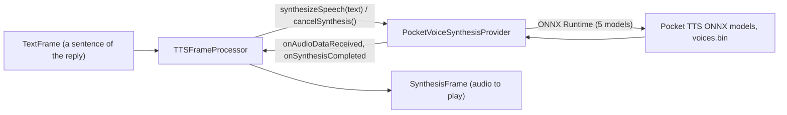

# PocketTTS

*Text-to-speech provider, config id `pocket`, target `vasdk_pocket_tts`, build flag `-DVASDK_BUILD_POCKET_TTS=ON`. Source: [`VASDK_3P_IMPL/PocketTTS/`](../../VASDK_3P_IMPL/PocketTTS/). Interface: [`GenericVoiceSynthesisProvider.h`](../../VASDK/include/VASDK/GenericVoiceSynthesisProvider.h).*

Kyutai's Pocket TTS: autoregressive flow-matching speech at 24 kHz on five ONNX models, English, with pre-computed voices. On by default and light enough for a phone.

## Platforms

| macOS | Linux | Windows | Android |
| --- | --- | --- | --- |
| yes | yes | yes | yes |

## Options

In C++, `va::thirdparty::tts::PocketVoiceSynthesisOptions` (in [`PocketVoiceSynthesisProvider.hpp`](../../VASDK_3P_IMPL/PocketTTS/PocketVoiceSynthesisProvider.hpp)). Every field has a default except the ones marked "required" in its comment.

| Field | Default | Meaning |
| --- | --- | --- |
| `modelDir` | `""` | Folder with the ONNX models, tokenizer.model and voices.bin (VASDK_3P_IMPL/cmake/DownloadPocketTTSModels.cmake). |
| `voice` | `"jean"` | A voice in voices.bin; an unknown name falls back to the first voice, with a warning. |
| `lsdSteps` | `4` | Flow-matching steps per latent frame, 1-10: higher sounds better and costs more per frame. |
| `temperature` | `0.7f` | Sampling temperature; the flow's noise is sqrt(temperature). |
| `silenceDurationSeconds` | `0.3f` | Silence after each utterance. |
| `prebufferMs` | `250` | Audio made before playback starts, against choppy starts on throttled phones (QueuedVoiceSynthesisProvider::setPreBufferedSamplesMS). |

In an engine config, the catalog's `LocalTtsOptions` message ([options.proto](../../VASDK_3P_IMPL/ProviderCatalog/proto/vasdk/providers/options.proto)) fills them: a field the config leaves unset falls back to its environment variable, then to the struct's default.

| Config field | Environment variable | Sets |
| --- | --- | --- |
| `model_dir` | - | `modelDir` |
| `voice` | `POCKET_TTS_VOICE` | `voice` |
| `steps` | - | `lsdSteps` |
| `prebuffer_ms` | - | `prebufferMs` |

`setVoice()` switches voices while running.

## Models and licenses

| Files | Source | License | Fetched by |
| --- | --- | --- | --- |
| *.onnx, tokenizer.model, voices.bin | [kyutai/pocket-tts](https://huggingface.co/kyutai/pocket-tts) | CC BY 4.0 | `VASDK_3P_IMPL/cmake/DownloadPocketTTSModels.cmake` |

Tokenizer: [google/sentencepiece](https://github.com/google/sentencepiece), Apache 2.0.

All of them are listed in [THIRD_PARTY_NOTICES.md](../../THIRD_PARTY_NOTICES.md) and in [Providers, sources and licenses](../provider-catalog.md#sources-and-licenses). An app that ships this provider ships these licenses with it ([vasdk-app](../../skills/vasdk-app/SKILL.md#licenses-ship-with-the-app)).

## Usage

From an engine config:

```textproto
providers {
  tts {
    id: "pocket"
    options { [type.googleapis.com/vasdk.providers.LocalTtsOptions] { voice: "jean" } }
    fallback: "phonon"
  }
}
```

From C++:

```cpp
#include "PocketTTS/PocketVoiceSynthesisProvider.hpp"

va::thirdparty::tts::PocketVoiceSynthesisOptions options;
options.modelDir = "...";
auto provider = std::make_shared<va::thirdparty::tts::PocketVoiceSynthesisProvider>(options);
// TTSFrameProcessor(provider); setAudioConfiguration() before the pipeline starts
```

## How it works



## Tests

| Test | Kind | Needs | Run |
| --- | --- | --- | --- |
| `vasdk_offline_conversation` | integration | the default models | `ctest --test-dir build -R vasdk_offline_conversation` |

A test that needs a model or a key reports "skipped" without it.
