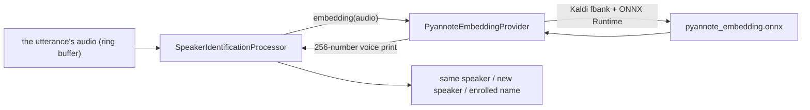

# pyannote speaker embedding

*Speaker embedding provider, not in the provider catalog (construct it in C++), target `vasdk_pyannote_speaker`, build flag `-DVASDK_BUILD_PYANNOTE_SPEAKER=ON`. Source: [`VASDK_3P_IMPL/PyannoteSpeaker/`](../../VASDK_3P_IMPL/PyannoteSpeaker/). Interface: [`SpeakerEmbeddingProvider.h`](../../VASDK/include/VASDK/SpeakerEmbeddingProvider.h).*

The embedding model of pyannote/speaker-diarization-3.1 (WeSpeaker ResNet34-LM, ONNX) on a Kaldi fbank front end: 256-number voice prints for "same speaker or a new one" and enrolled names. On by default; the apps construct it in C++.

## Platforms

| macOS | Linux | Windows | Android |
| --- | --- | --- | --- |
| yes | yes | yes | yes |

## Options

In C++, `va::thirdparty::speaker::PyannoteEmbeddingOptions` (in [`PyannoteEmbeddingProvider.h`](../../VASDK_3P_IMPL/PyannoteSpeaker/PyannoteEmbeddingProvider.h)). Every field has a default except the ones marked "required" in its comment.

| Field | Default | Meaning |
| --- | --- | --- |
| `modelPath` | `""` | The embedding model, ONNX (VASDK_3P_IMPL/cmake/DownloadPyannoteEmbeddingModel.cmake). |

## Models and licenses

| Files | Source | License | Fetched by |
| --- | --- | --- | --- |
| pyannote_embedding.onnx | [wespeaker_en_voxceleb_resnet34_LM.onnx](https://github.com/k2-fsa/sherpa-onnx/releases/tag/speaker-recongition-models) (sherpa-onnx export) | CC BY 4.0 | `VASDK_3P_IMPL/cmake/DownloadPyannoteEmbeddingModel.cmake` |

Pipeline: [pyannote/speaker-diarization-3.1](https://huggingface.co/pyannote/speaker-diarization-3.1), MIT.

All of them are listed in [THIRD_PARTY_NOTICES.md](../../THIRD_PARTY_NOTICES.md) and in [Providers, sources and licenses](../provider-catalog.md#sources-and-licenses). An app that ships this provider ships these licenses with it ([vasdk-app](../../skills/vasdk-app/SKILL.md#licenses-ship-with-the-app)).

## Usage

```cpp
#include "PyannoteSpeaker/PyannoteEmbeddingProvider.h"

va::thirdparty::speaker::PyannoteEmbeddingOptions options;
options.modelPath = "...";
auto provider = std::make_shared<va::thirdparty::speaker::PyannoteEmbeddingProvider>(options);
// provider->initialize(audioConfig); SpeakerIdentificationProcessor(provider)
```

## How it works



## Tests

| Test | Kind | Needs | Run |
| --- | --- | --- | --- |
| `pyannote_fbank_parity` | unit | nothing (goldens in the repo) | `ctest --test-dir build -R pyannote_fbank_parity` |

A test that needs a model or a key reports "skipped" without it.
