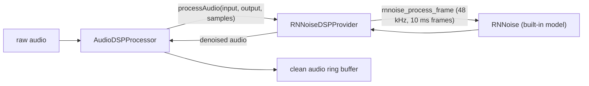

# RNNoise

*Audio DSP provider, not in the provider catalog (construct it in C++), target `vasdk_rnnoise`, build flag `-DVASDK_BUILD_RNNOISE=ON`. Source: [`VASDK_3P_IMPL/RNNoise/`](../../VASDK_3P_IMPL/RNNoise/). Interface: [`GenericAudioDSPProvider.h`](../../VASDK/include/VASDK/GenericAudioDSPProvider.h).*

Xiph's RNNoise noise suppression: a small recurrent network at 48 kHz, with the source audio resampled in and out. Built-in weights; no download needed at run time. On by default on desktop.

## Platforms

| macOS | Linux | Windows | Android |
| --- | --- | --- | --- |
| yes | yes | yes | no |

## Options

In C++, `va::thirdparty::RNNoiseDSPOptions` (in [`RNNoiseDSPProvider.h`](../../VASDK_3P_IMPL/RNNoise/RNNoiseDSPProvider.h)). Every field has a default except the ones marked "required" in its comment.

| Field | Default | Meaning |
| --- | --- | --- |
| `modelPath` | `""` | A custom RNNoise model file (.rnnn); empty uses the model built into the library. |
| `vadThreshold` | `0.0f` | RNNoise voice probability (0-1) under which a frame counts as silence, exposed through getLastVADProbability(); 0 disables it. |
| `normalizeOutput` | `false` | Scale the output so its peak stays under normalizationMultiplier of full scale. |
| `normalizationMultiplier` | `0.8f` | Headroom for normalizeOutput: 0.8 is 80% of full scale. |

On Android, CMake prints "RNNoise: not supported on Android" and turns `VASDK_BUILD_RNNOISE` off: its fetch builds for desktop only.

## Models and licenses

| Files | Source | License | Fetched by |
| --- | --- | --- | --- |
| built into the library | [xiph/rnnoise](https://github.com/xiph/rnnoise) | BSD 3-Clause | `VASDK_3P_IMPL/cmake/FetchRNNoise.cmake` |

All of them are listed in [THIRD_PARTY_NOTICES.md](../../THIRD_PARTY_NOTICES.md) and in [Providers, sources and licenses](../provider-catalog.md#sources-and-licenses). An app that ships this provider ships these licenses with it ([vasdk-app](../../skills/vasdk-app/SKILL.md#licenses-ship-with-the-app)).

## Usage

```cpp
#include "RNNoise/RNNoiseDSPProvider.h"

va::thirdparty::RNNoiseDSPOptions options;
options.modelPath = "...";
auto provider = std::make_shared<va::thirdparty::RNNoiseDSPProvider>(options);
// provider->initialize(audioConfig); AudioDSPProcessor(provider)
```

## How it works



## Tests

| Test | Kind | Needs | Run |
| --- | --- | --- | --- |
| `vasdk_rnnoise` | unit | nothing | `ctest --test-dir build -R vasdk_rnnoise` |

A test that needs a model or a key reports "skipped" without it.
