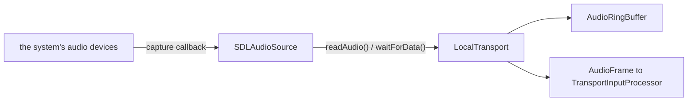

# SDL3 audio

*Audio input provider, not in the provider catalog (construct it in C++), target `vasdk_sdl_audio`, build flag `-DVASDK_BUILD_SDL=ON`. Source: [`VASDK_3P_IMPL/SDL/`](../../VASDK_3P_IMPL/SDL/). Interface: [`GenericAudioSource.h`](../../VASDK/include/VASDK/GenericAudioSource.h).*

Microphone and speaker over [SDL3](https://github.com/libsdl-org/SDL): `SDLAudioSource` and `SDLAudioSink`, an alternative to MiniAudio for apps that already use SDL. Off by default; the apps use it only when MiniAudio is off.

## Platforms

| macOS | Linux | Windows | Android |
| --- | --- | --- | --- |
| yes | yes | yes | untested; the Android app uses AAudio |

## Options

Neither class takes options: the device format comes from `initializeAudioSource(config)`.

## Models and licenses

No model files.

Library: [libsdl-org/SDL](https://github.com/libsdl-org/SDL), zlib.

All of them are listed in [THIRD_PARTY_NOTICES.md](../../THIRD_PARTY_NOTICES.md) and in [Providers, sources and licenses](../provider-catalog.md#sources-and-licenses). An app that ships this provider ships these licenses with it ([vasdk-app](../../skills/vasdk-app/SKILL.md#licenses-ship-with-the-app)).

## Usage

```cpp
#include "SDL/SDLAudioSource.h"

auto provider = std::make_shared<va::thirdparty::audio::SDLAudioSource>();
// LocalTransport(source, std::make_shared<va::thirdparty::audio::SDLAudioSink>())
```

## How it works



## Tests

None of its own yet: it needs audio hardware. The [provider skill](../../skills/vasdk-provider/SKILL.md#tests) describes the unit and integration tests a provider should have.
