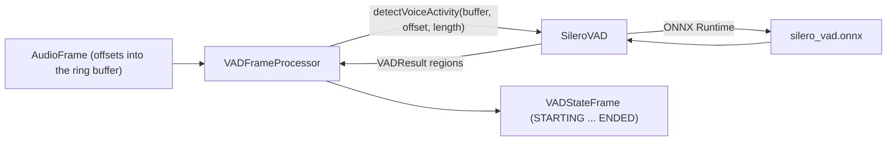

# Silero VAD

*VAD provider, config id `silero`, target `vasdk_silero_vad`, build flag `-DVASDK_BUILD_SILERO_VAD=ON`. Source: [`VASDK_3P_IMPL/SileroVAD/`](../../VASDK_3P_IMPL/SileroVAD/). Interface: [`VADProvider.h`](../../VASDK/include/VASDK/VADProvider.h).*

The default voice activity detector: the Silero VAD ONNX model scores 32 ms windows for speech. Small (about 2 MB), fast on any CPU, and robust to noise. On by default.

## Platforms

| macOS | Linux | Windows | Android |
| --- | --- | --- | --- |
| yes | yes | yes | yes |

## Options

In C++, `va::thirdparty::vad::SileroVADOptions` (in [`SileroVAD.h`](../../VASDK_3P_IMPL/SileroVAD/SileroVAD.h)). Every field has a default except the ones marked "required" in its comment.

| Field | Default | Meaning |
| --- | --- | --- |
| `modelPath` | `""` | silero_vad.onnx (downloaded by VASDK_3P_IMPL/cmake/DownloadSileroVADModel.cmake). |
| `windowFrameSizeMs` | `32` | Window the model scores, in milliseconds: 32 ms is 512 samples at 16 kHz. |
| `threshold` | `0.75f` | Speech probability (0-1) a window needs to count as voice. |
| `minSilenceDurationMs` | `100` | Silence that ends a speech segment inside one buffer. |
| `speechPadMs` | `30` | Padding added before and after each speech segment. |
| `minSpeechDurationMs` | `150` | Shorter segments are dropped as clicks. |

In an engine config, the catalog's `SileroOptions` message ([options.proto](../../VASDK_3P_IMPL/ProviderCatalog/proto/vasdk/providers/options.proto)) fills them: a field the config leaves unset falls back to its environment variable, then to the struct's default.

| Config field | Environment variable | Sets |
| --- | --- | --- |
| `model_path` | - | `modelPath` |
| `threshold` | - | `threshold` |

## Models and licenses

| Files | Source | License | Fetched by |
| --- | --- | --- | --- |
| silero_vad.onnx | [snakers4/silero-vad](https://github.com/snakers4/silero-vad) | MIT | `VASDK_3P_IMPL/cmake/DownloadSileroVADModel.cmake` |

Runtime: [ONNX Runtime](https://github.com/microsoft/onnxruntime), MIT.

All of them are listed in [THIRD_PARTY_NOTICES.md](../../THIRD_PARTY_NOTICES.md) and in [Providers, sources and licenses](../provider-catalog.md#sources-and-licenses). An app that ships this provider ships these licenses with it ([vasdk-app](../../skills/vasdk-app/SKILL.md#licenses-ship-with-the-app)).

## Usage

From an engine config:

```textproto
providers {
  vad {
    id: "silero"
    options { [type.googleapis.com/vasdk.providers.SileroOptions] { threshold: 0.6 } }
  }
}
```

From C++:

```cpp
#include "SileroVAD/SileroVAD.h"

va::thirdparty::vad::SileroVADOptions options;
options.modelPath = "...";
auto provider = std::make_shared<va::thirdparty::vad::SileroVAD>(options);
// VADFrameProcessor(provider), after provider->initialize(audioConfig, bufferSize)
```

## How it works



## Tests

| Test | Kind | Needs | Run |
| --- | --- | --- | --- |
| `vasdk_offline_conversation` | integration | the default models | `ctest --test-dir build -R vasdk_offline_conversation` |

A test that needs a model or a key reports "skipped" without it.
