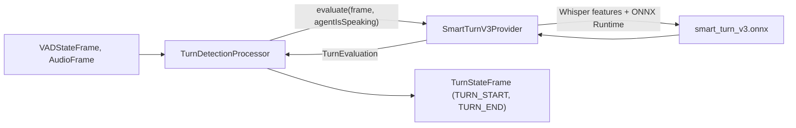

# SmartTurn v3

*Turn detection provider, config id `smartturn-v3`, target `vasdk_smartturn_v3`, build flag `-DVASDK_BUILD_SMART_TURN_V3=ON`. Source: [`VASDK_3P_IMPL/SmartTurnV3/`](../../VASDK_3P_IMPL/SmartTurnV3/). Interface: [`TurnDetectionProvider.h`](../../VASDK/include/VASDK/TurnDetectionProvider.h).*

Pipecat's SmartTurn v3: a Whisper-feature ONNX model that scores whether the user has finished their turn, so a clearly finished turn ends at the pause and an unfinished one waits. On by default.

## Platforms

| macOS | Linux | Windows | Android |
| --- | --- | --- | --- |
| yes | yes | yes | yes |

## Options

In C++, `va::thirdparty::turn::SmartTurnV3Options` (in [`SmartTurnV3Provider.h`](../../VASDK_3P_IMPL/SmartTurnV3/SmartTurnV3Provider.h)). Every field has a default except the ones marked "required" in its comment.

| Field | Default | Meaning |
| --- | --- | --- |
| `modelPath` | `""` | smart_turn_v3.onnx (downloaded by VASDK_3P_IMPL/cmake/DownloadSmartTurnModel.cmake). |
| `threshold` | `0.5f` | End-of-turn probability (0-1) that ends the turn. |
| `maxAudioDurationSeconds` | `8.0f` | Longest stretch of the turn the model looks at, from its end backwards. |
| `postAudioFrames` | `3` | Audio frames after the VAD end the model waits for before its last evaluation. |
| `evaluateOnPause` | `true` | Also evaluate while the user pauses, so a clearly finished turn ends at the pause (TurnDetectionProvider::setEvaluateOnPause). |

In an engine config, the catalog's `SmartTurnOptions` message ([options.proto](../../VASDK_3P_IMPL/ProviderCatalog/proto/vasdk/providers/options.proto)) fills them: a field the config leaves unset falls back to its environment variable, then to the struct's default.

| Config field | Environment variable | Sets |
| --- | --- | --- |
| `model_path` | - | `modelPath` |

## Models and licenses

| Files | Source | License | Fetched by |
| --- | --- | --- | --- |
| smart_turn_v3.onnx | [pipecat-ai/smart-turn-v3](https://huggingface.co/pipecat-ai/smart-turn-v3) | BSD 2-Clause | `VASDK_3P_IMPL/cmake/DownloadSmartTurnModel.cmake` |

FFT: [marton78/pffft](https://github.com/marton78/pffft), NCAR/UCAR license.

All of them are listed in [THIRD_PARTY_NOTICES.md](../../THIRD_PARTY_NOTICES.md) and in [Providers, sources and licenses](../provider-catalog.md#sources-and-licenses). An app that ships this provider ships these licenses with it ([vasdk-app](../../skills/vasdk-app/SKILL.md#licenses-ship-with-the-app)).

## Usage

From an engine config:

```textproto
providers {
  turn {
    id: "smartturn-v3"
    options { [type.googleapis.com/vasdk.providers.SmartTurnOptions] { model_path: "models/smart_turn_v3.onnx" } }
  }
}
```

From C++:

```cpp
#include "SmartTurnV3/SmartTurnV3Provider.h"

va::thirdparty::turn::SmartTurnV3Options options;
options.modelPath = "...";
auto provider = std::make_shared<va::thirdparty::turn::SmartTurnV3Provider>(options);
// TurnDetectionProcessor(provider), after provider->initialize(audioConfig, ringBuffer)
```

## How it works



## Tests

| Test | Kind | Needs | Run |
| --- | --- | --- | --- |
| `smartturn_features_parity` | unit | nothing (goldens in the repo) | `ctest --test-dir build -R smartturn_features_parity` |

A test that needs a model or a key reports "skipped" without it.
