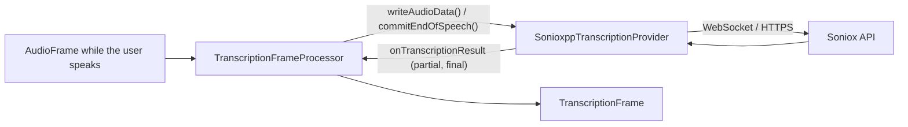

# Soniox (STT)

*Speech-to-text provider, config id `soniox`, target `vasdk_sonioxpp_stt`, build flag `-DVASDK_BUILD_SONIOXPP_STT=ON`. Source: [`VASDK_3P_IMPL/SonioxppTranscription/`](../../VASDK_3P_IMPL/SonioxppTranscription/). Interface: [`GenericTranscriptionProvider.h`](../../VASDK/include/VASDK/GenericTranscriptionProvider.h).*

Soniox's real-time speech recognition over WebSocket, through [SonioxPP](https://github.com/fatehmtd/SonioxPP). It favours the words the agent expects next (`setContextHints`). It needs a network connection and a Soniox API key.

## Platforms

| macOS | Linux | Windows | Android |
| --- | --- | --- | --- |
| yes | yes | yes | yes |

## Options

In C++, `va::thirdparty::stt::SonioxppTranscriptionOptions` (in [`SonioxppTranscriptionProvider.h`](../../VASDK_3P_IMPL/SonioxppTranscription/SonioxppTranscriptionProvider.h)). Every field has a default except the ones marked "required" in its comment.

| Field | Default | Meaning |
| --- | --- | --- |
| `apiKey` | `""` | API key of the service; required (the catalog falls back to the service's *_API_KEY variable). |
| `caBundlePath` | `""` | PEM file of certificates to trust; empty uses the TLS library's own (Android's mbedTLS can't read the system store). |

In an engine config, the catalog's `CloudOptions` message ([options.proto](../../VASDK_3P_IMPL/ProviderCatalog/proto/vasdk/providers/options.proto)) fills them: a field the config leaves unset falls back to its environment variable, then to the struct's default.

| Config field | Environment variable | Sets |
| --- | --- | --- |
| `api_key` | `SONIOX_API_KEY` | `apiKey` |
| `ca_bundle_path` | `VASDK_CA_BUNDLE` | `caBundlePath` |

## Models and licenses

Client: [fatehmtd/SonioxPP](https://github.com/fatehmtd/SonioxPP), Apache 2.0. Service: [soniox.com](https://soniox.com), under your Soniox account's terms.

All of them are listed in [THIRD_PARTY_NOTICES.md](../../THIRD_PARTY_NOTICES.md) and in [Providers, sources and licenses](../provider-catalog.md#sources-and-licenses). An app that ships this provider ships these licenses with it ([vasdk-app](../../skills/vasdk-app/SKILL.md#licenses-ship-with-the-app)).

## Usage

From an engine config:

```textproto
providers {
  stt {
    id: "soniox"
    options { [type.googleapis.com/vasdk.providers.CloudOptions] { api_key: "${SONIOX_API_KEY}" } }
    fallback: "whistle"
  }
}
```

From C++:

```cpp
#include "SonioxppTranscription/SonioxppTranscriptionProvider.h"

va::thirdparty::stt::SonioxppTranscriptionOptions options;
options.apiKey = "...";
auto provider = std::make_shared<va::thirdparty::stt::SonioxppTranscriptionProvider>(options);
// TranscriptionFrameProcessor(provider); setAudioConfiguration() before the pipeline starts
```

## How it works



## Tests

None of its own yet: it needs an API key and a network. The [provider skill](../../skills/vasdk-provider/SKILL.md#tests) describes the unit and integration tests a provider should have.
