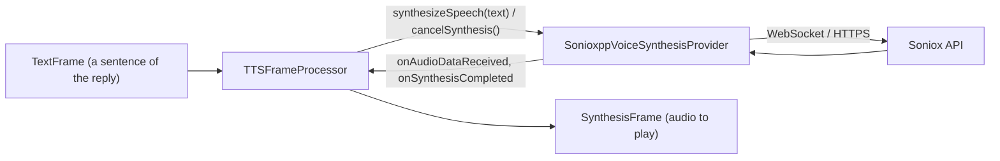

# Soniox (TTS)

*Text-to-speech provider, config id `soniox`, target `vasdk_sonioxpp_tts`, build flag `-DVASDK_BUILD_SONIOXPP_TTS=ON`. Source: [`VASDK_3P_IMPL/SonioxppVoiceSynthesis/`](../../VASDK_3P_IMPL/SonioxppVoiceSynthesis/). Interface: [`GenericVoiceSynthesisProvider.h`](../../VASDK/include/VASDK/GenericVoiceSynthesisProvider.h).*

Soniox's streaming speech synthesis over WebSocket, through [SonioxPP](https://github.com/fatehmtd/SonioxPP). It needs a network connection and a Soniox API key.

## Platforms

| macOS | Linux | Windows | Android |
| --- | --- | --- | --- |
| yes | yes | yes | yes |

## Options

In C++, `va::thirdparty::tts::SonioxppVoiceSynthesisOptions` (in [`SonioxppVoiceSynthesisProvider.h`](../../VASDK_3P_IMPL/SonioxppVoiceSynthesis/SonioxppVoiceSynthesisProvider.h)). Every field has a default except the ones marked "required" in its comment.

| Field | Default | Meaning |
| --- | --- | --- |
| `apiKey` | `""` | API key of the service; required (the catalog falls back to the service's *_API_KEY variable). |
| `language` | `"en"` | Language code; empty lets the service detect it or use its default. |
| `voice` | `"Adrian"` | Voice to speak with. |
| `caBundlePath` | `""` | PEM file of certificates to trust; empty uses the TLS library's own (Android's mbedTLS can't read the system store). |

In an engine config, its own `SonioxTtsOptions` message ([options.proto](../../VASDK_3P_IMPL/ProviderCatalog/proto/vasdk/providers/options.proto)) fills them: a field the config leaves unset falls back to its environment variable, then to the struct's default. The shared `CloudOptions` of configs written before it had its own message is still accepted.

| Config field | Environment variable | Sets |
| --- | --- | --- |
| `api_key` | `SONIOX_API_KEY` | `apiKey` |
| `voice` | `SONIOX_VOICE_ID` | `voice` |
| `ca_bundle_path` | `VASDK_CA_BUNDLE` | `caBundlePath` |
| `language` | - | `language` |

The engine config sets every field, through `SonioxTtsOptions`. Without a key (neither `api_key` nor `SONIOX_API_KEY`) the catalog makes no provider, so the spec's `fallback` starts instead.

## Models and licenses

Client: [fatehmtd/SonioxPP](https://github.com/fatehmtd/SonioxPP), Apache 2.0. Service: [soniox.com](https://soniox.com), under your Soniox account's terms.

All of them are listed in [THIRD_PARTY_NOTICES.md](../../THIRD_PARTY_NOTICES.md) and in [Providers, sources and licenses](../provider-catalog.md#sources-and-licenses). An app that ships this provider ships these licenses with it ([vasdk-app](../../skills/vasdk-app/SKILL.md#licenses-ship-with-the-app)).

## Usage

From an engine config:

```textproto
providers {
  tts {
    id: "soniox"
    options { [type.googleapis.com/vasdk.providers.SonioxTtsOptions] { api_key: "${SONIOX_API_KEY}" } }
    fallback: "pocket"
  }
}
```

From C++:

```cpp
#include "SonioxppVoiceSynthesis/SonioxppVoiceSynthesisProvider.h"

va::thirdparty::tts::SonioxppVoiceSynthesisOptions options;
options.apiKey = "...";
auto provider = std::make_shared<va::thirdparty::tts::SonioxppVoiceSynthesisProvider>(options);
// TTSFrameProcessor(provider); setAudioConfiguration() before the pipeline starts
```

## How it works



## Tests

None of its own yet: it needs an API key and a network. The [provider skill](../../skills/vasdk-provider/SKILL.md#tests) describes the unit and integration tests a provider should have.
