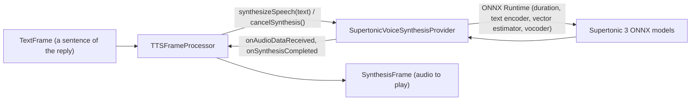

# Supertonic 3

*Text-to-speech provider, config id `supertonic`, target `vasdk_supertonic_tts`, build flag `-DVASDK_BUILD_SUPERTONIC_TTS=ON`. Source: [`VASDK_3P_IMPL/SupertonicTTS/`](../../VASDK_3P_IMPL/SupertonicTTS/). Interface: [`GenericVoiceSynthesisProvider.h`](../../VASDK/include/VASDK/GenericVoiceSynthesisProvider.h).*

Supertone's Supertonic 3: diffusion TTS on ONNX Runtime in 31 languages, with voice styles. Off by default; its weights are OpenRAIL-licensed.

## Platforms

| macOS | Linux | Windows | Android |
| --- | --- | --- | --- |
| yes | yes | yes | not in the Android app (turned off there) |

## Options

In C++, `va::thirdparty::tts::SupertonicVoiceSynthesisOptions` (in [`SupertonicVoiceSynthesisProvider.hpp`](../../VASDK_3P_IMPL/SupertonicTTS/SupertonicVoiceSynthesisProvider.hpp)). Every field has a default except the ones marked "required" in its comment.

| Field | Default | Meaning |
| --- | --- | --- |
| `onnxDir` | `""` | Folder with the ONNX models, tts.json and unicode_indexer.json: <supertonic3>/onnx (VASDK_3P_IMPL/cmake/DownloadSupertonicModels.cmake). |
| `voiceStylePath` | `""` | Voice style JSON, e.g. <supertonic3>/voice_styles/M1.json. |
| `language` | `"en"` | Any of the 31 codes in the upstream helper.cpp AVAILABLE_LANGS, e.g. en, ko, ja, de, fr. |
| `totalSteps` | `10` | Diffusion steps: synthesis time grows about linearly with them. 5 is fast but rougher, 10 is a good balance for a voice assistant, 15+ adds little. |
| `speed` | `1.05f` | Speaking speed: 1.0 is natural, 1.05 is 5% faster. |
| `silenceDurationSeconds` | `0.3f` | Silence after each synthesized chunk; below about 0.1 s chunks join with hard cuts. |
| `trimMargin` | `0.0f` | When above 0, each chunk is cut to sample_rate * predicted duration * (1 + trimMargin), removing the vocoder's silent tail. Off by default: the duration predictor can underestimate and clip the last phoneme. |

In an engine config, the catalog's `LocalTtsOptions` message ([options.proto](../../VASDK_3P_IMPL/ProviderCatalog/proto/vasdk/providers/options.proto)) fills them: a field the config leaves unset falls back to its environment variable, then to the struct's default.

| Config field | Environment variable | Sets |
| --- | --- | --- |
| `model_dir` | - | (onnxDir, voiceStylePath) |
| `voice` | `SUPERTONIC_TTS_VOICE` | `voiceStylePath` |
| `language` | `SUPERTONIC_TTS_LANG` | `language` |
| `steps` | `SUPERTONIC_TTS_STEPS` | `totalSteps` |

In the engine config, `model_dir` is the Supertonic folder: the catalog uses `<model_dir>/onnx` and `<model_dir>/voice_styles/<voice>.json` (voice `M1` by default).

## Models and licenses

| Files | Source | License | Fetched by |
| --- | --- | --- | --- |
| onnx/*, voice_styles/*.json | [Supertone/supertonic-3](https://huggingface.co/Supertone/supertonic-3) | OpenRAIL | `VASDK_3P_IMPL/cmake/DownloadSupertonicModels.cmake` |

Inference code: [supertone-inc/supertonic](https://github.com/supertone-inc/supertonic), MIT.

All of them are listed in [THIRD_PARTY_NOTICES.md](../../THIRD_PARTY_NOTICES.md) and in [Providers, sources and licenses](../provider-catalog.md#sources-and-licenses). An app that ships this provider ships these licenses with it ([vasdk-app](../../skills/vasdk-app/SKILL.md#licenses-ship-with-the-app)).

## Usage

From an engine config:

```textproto
providers {
  tts {
    id: "supertonic"
    options { [type.googleapis.com/vasdk.providers.LocalTtsOptions] { voice: "F1" } }
    fallback: "pocket"
  }
}
```

From C++:

```cpp
#include "SupertonicTTS/SupertonicVoiceSynthesisProvider.hpp"

va::thirdparty::tts::SupertonicVoiceSynthesisOptions options;
options.onnxDir = "...";
auto provider = std::make_shared<va::thirdparty::tts::SupertonicVoiceSynthesisProvider>(options);
// TTSFrameProcessor(provider); setAudioConfiguration() before the pipeline starts
```

## How it works



## Tests

| Test | Kind | Needs | Run |
| --- | --- | --- | --- |
| `supertonic_tts_synth` | unit | the models | `ctest --test-dir build -R supertonic_tts_synth` |

A test that needs a model or a key reports "skipped" without it.
