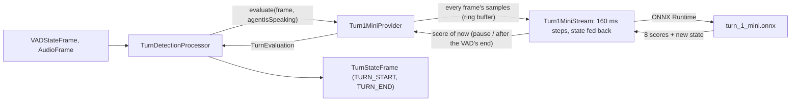

# turn-1-mini

*Turn detection provider, config id `turn-1-mini`, target `vasdk_turn1mini`, build flag `-DVASDK_BUILD_TURN1MINI=ON`. Source: [`VASDK_3P_IMPL/Turn1Mini/`](../../VASDK_3P_IMPL/Turn1Mini/). Interface: [`TurnDetectionProvider.h`](../../VASDK/include/VASDK/TurnDetectionProvider.h).*

p99lab's turn-1-mini: a 5.4M-parameter streaming end-of-turn model that hears the audio only, no transcript. It runs on the CPU, about 1 ms for every 160 ms of audio. It is the preferred turn provider: on the [turn evaluation](#evaluation) it cuts off far fewer unfinished sentences than SmartTurn v3 and ends finished ones almost as fast. It is **English only**; for other languages, name [`smartturn-v3`](smartturn-v3.md). On by default.

## Platforms

| macOS | Linux | Windows | Android |
| --- | --- | --- | --- |
| yes | yes | yes | yes |

It needs only ONNX Runtime. Like SmartTurn, it is built when its switch or the [flavor](../integrating.md#flavors) says so (`default` and `full`, not `core`). Its model downloads only when it is built and `VASDK_DOWNLOAD_MODELS` is on, and it loads only when an engine config asks for it. The Android app bundles it in `res/raw` and extracts it only when **Settings → End of turn** selects it.

## Options

In C++, `va::thirdparty::turn::Turn1MiniOptions` (in [`Turn1MiniProvider.h`](../../VASDK_3P_IMPL/Turn1Mini/Turn1MiniProvider.h)). Every field has a default.

| Field | Default | Meaning |
| --- | --- | --- |
| `modelPath` | `""` (the catalog: `<models_dir>/turn_1_mini.onnx`) | A turn-1-mini step graph: `turn_1_mini.onnx`, or any other `turn-1-mini.step*.onnx` of the model's repository. |
| `threshold` | `0.15f` | End-of-turn score (0-1) that ends the turn after the VAD's end. |
| `postAudioFrames` | `3` | Audio frames after the VAD's end that are still evaluated. |
| `evaluateOnPause` | `true` | Also evaluate while the user pauses, so a clearly finished turn ends at the pause (`TurnDetectionProvider::setEvaluateOnPause`). |
| `pauseThreshold` | `0.15f` | End-of-turn score (0-1) a pause needs to end the turn (`TurnDetectionProvider::setPauseThreshold`). |

The scores are not calibrated probabilities. 0.15 is the best accuracy on the [evaluation](#evaluation). The model card's own thresholds (0.36, and its eot-bench operating points of 0.06 to 0.21) come from other read-outs and other audio. Tune them on your own audio with the environment variables below, which `vasdk_provider_eval` also picks up.

In an engine config, its own `Turn1MiniOptions` message ([options.proto](../../VASDK_3P_IMPL/ProviderCatalog/proto/vasdk/providers/options.proto)) fills them: a field the config leaves unset falls back to its environment variable, then to the struct's default.

| Config field | Environment variable | Sets |
| --- | --- | --- |
| `model_path` | - | `modelPath` |
| `threshold` | `VASDK_TURN1MINI_THRESHOLD` | `threshold` |
| `post_audio_frames` | - | `postAudioFrames` |
| `evaluate_on_pause` | - | `evaluateOnPause` |
| `pause_threshold` | `VASDK_TURN1MINI_PAUSE_THRESHOLD` | `pauseThreshold` |

## Models and licenses

| File | Source | License | Downloaded by |
| --- | --- | --- | --- |
| `turn_1_mini.onnx` (`onnx/turn-1-mini.step.int8dyn.onnx`, 7 MB) | [p99lab/turn-1-mini](https://huggingface.co/p99lab/turn-1-mini) (revision `41e98810`) | Apache-2.0, with a `NOTICE` | manifest id `turn_1_mini`: `DownloadTurn1MiniModel.cmake` (`VASDK_DOWNLOAD_TURN1MINI_MODEL`), `vasdk models pull turn_1_mini` |

The default graph is the int8 one with dynamic quantization: 8-bit weights and integer matrix products, about 1 ms a step. The float32 graph (`turn-1-mini.step.onnx`, 21.8 MB, about 4.5 times slower, the one p99lab benchmarked) and the others load through `model_path` unchanged. p99lab measures the int8 graph changing about 0.2% of decisions against float32.

The model's [`NOTICE`](https://huggingface.co/p99lab/turn-1-mini/blob/main/NOTICE) is reproduced in [THIRD_PARTY_NOTICES.md](../../THIRD_PARTY_NOTICES.md#turn-1-mini-turn_1_minionnx), as Apache-2.0 section 4(d) requires, with the credits of its CC BY 4.0 training data. The model is listed there and in [Providers, sources and licenses](../provider-catalog.md#sources-and-licenses). An app that ships this provider ships these licenses with it ([vasdk-app](../../skills/vasdk-app/SKILL.md#licenses-ship-with-the-app)).

## Usage

From an engine config:

```textproto
providers {
  turn {
    id: "turn-1-mini"
    options { [type.googleapis.com/vasdk.providers.Turn1MiniOptions] { pause_threshold: 0.15 } }
  }
}
```

From C++:

```cpp
#include "Turn1Mini/Turn1MiniProvider.h"

va::thirdparty::turn::Turn1MiniOptions options;
options.modelPath = modelsDir + "/turn_1_mini.onnx";
auto provider = std::make_shared<va::thirdparty::turn::Turn1MiniProvider>(options);
provider->initialize(audioConfig, ringBuffer);   // 16 kHz mono, the ring buffer the audio frames point into
// TurnDetectionProcessor(provider)
```

## How it works

Unlike SmartTurn, which re-reads the turn from the ring buffer when it decides, turn-1-mini **streams**. Every audio frame goes into the model in 160 ms steps (2,560 samples). Seven state tensors carry the last 1.2 s of context from one step to the next, so the model has its context when a pause comes, at a constant cost per step. The 4 kHz low-pass and the log-mel are inside the graph. Between two steps, it scores "now" by running a step on the audio that has arrived, padded with zeros, and throwing that step's state away, as p99lab's README describes.

Its decisions follow SmartTurn's rules:
- `TURN_START` when the VAD starts: `INTERRUPT` while the agent speaks, `NORMAL` otherwise.
- `TURN_END` in a pause when the score reaches `pauseThreshold`, or in the few frames after the VAD's end when it reaches `threshold`.



## Evaluation

The [turn stage](../evaluation.md) on its full tier: 40 FLEURS English clips, 20 finished sentences and 20 stopped mid-phrase, with the VAD's states at their real timings. Both providers ran on an AMD Ryzen AI 9 HX 370 under Windows; SmartTurn v3 ran at its defaults.

| | SmartTurn v3 | turn-1-mini |
| --- | --- | --- |
| accuracy | 62.5% | **87.5%** |
| finished sentences ended at the pause (recall) | **100%** | 85% |
| unfinished sentences cut off (false_end) | 75% | **10%** |
| cut off within 0.5 s (false_end_500ms) | 30% | **5%** |
| precision of an early end | 57% | **89.5%** |
| median end, after the speech | **0.08 s** | 0.10 s |
| time for the 40 clips (model load included) | 7.3 s | **2.3 s** |

On the smoke tier (10 clips), accuracy is 90% against 60%, and false_end 20% against 80%. The pause threshold was swept on the same set:

| `pause_threshold` | 0.06 | 0.10 | 0.12 | **0.15** | 0.18 | 0.25 | 0.36 | 0.45 |
| --- | --- | --- | --- | --- | --- | --- | --- | --- |
| accuracy | 77.5% | 80% | 82.5% | **87.5%** | 80% | 85% | 75% | 62.5% |
| recall | 100% | 90% | 85% | **85%** | 70% | 70% | 50% | 25% |
| false_end | 45% | 30% | 20% | **10%** | 10% | 0% | 0% | 0% |
| median end | 0.08 s | 0.10 s | 0.10 s | **0.10 s** | 0.13 s | 0.29 s | 0.53 s | 0.74 s |

Lower is snappier and cuts off more; 0.25 cuts off nothing but waits about 0.3 s. Bear the caveats in mind: the set is small (one clip moves a score 2.5 points), the threshold was chosen on it, and read speech isn't conversation. p99lab's own results are on its [model card](https://huggingface.co/p99lab/turn-1-mini).

**Cost:** about 1.0 ms per 160 ms step on one thread (median 0.97 ms, slowest 1.06 ms, `turn1mini_test` on the machine above), 1.6 ms on a Pixel 9 Pro XL (median 1.57 ms, slowest 1.76 ms). That is about 0.6% of a core while the session listens, plus one extra step for each frame scored in a pause.

**Limits:** English only. No interruption head: the v2 model's interruption output is PyTorch only, so barge-in comes from the VAD, as with SmartTurn. Pauses inside numbers, spelled-out letters and e-mail addresses are its hardest case.

## Tests

| Test | Kind | Needs | Run |
| --- | --- | --- | --- |
| `turn1mini_stream` | unit. The stream's scores against p99lab's streaming loop (golden by `tests/gen_scores_golden.py`, ONNX Runtime 1.19.2: the same scores on x86-64, within 0.005 on Arm, whose int8 kernels differ); chunking, `reset()`, a "now" score that leaves the state alone, the state's effect; the provider's decisions in a pause, after the VAD's end, and on barge-in; ms per step | the model (skipped without) | `ctest --test-dir build -R turn1mini_stream` |
| `vasdk_turn1mini_options` | unit, through the catalog: every option, none, the environment variables, a missing model, another message refused | the model (skipped without) | `ctest --test-dir build -R vasdk_turn1mini_options` |
| `vasdk_offline_conversation_turn1mini` | integration: a spoken conversation through the C API, with turn-1-mini ending the user's turns | the offline models (skipped without) | `ctest --test-dir build -R offline_conversation_turn1mini` |
| `vasdk_eval_turn_turn_1_mini` | evaluation ([Evaluation](../evaluation.md)), held to its baselines | the evaluation set (skipped without) | `ctest --test-dir build -L eval` |

A test that needs a model reports "skipped" without it.
