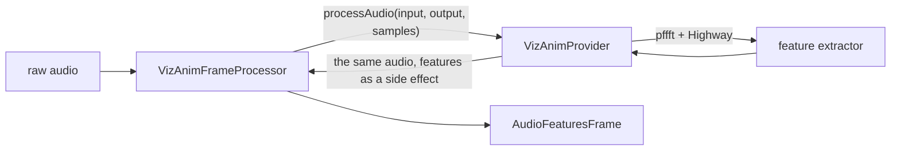

# VizAnim

*Audio DSP provider, not in the provider catalog (construct it in C++), target `vasdk_vizanim`, build flag `-DVASDK_BUILD_VIZANIM=ON`. Source: [`VASDK_3P_IMPL/VizAnim/`](../../VASDK_3P_IMPL/VizAnim/). Interface: [`GenericAudioDSPProvider.h`](../../VASDK/include/VASDK/GenericAudioDSPProvider.h).*

Audio features for live animations (level, bands, spectral centroid, onsets, pitch, chroma), computed with Highway SIMD and pffft. It passes the audio through unchanged. On by default; the desktop TUI and the Android app animate from it.

## Platforms

| macOS | Linux | Windows | Android |
| --- | --- | --- | --- |
| yes | yes | yes | yes |

## Options

In C++, `va::thirdparty::VizAnimOptions` (in [`VizAnimProvider.h`](../../VASDK_3P_IMPL/VizAnim/VizAnimProvider.h)). Every field has a default except the ones marked "required" in its comment.

| Field | Default | Meaning |
| --- | --- | --- |
| `fftSize` | `2048` | FFT length for feature extraction, a power of 2. |

Its frame processors (`VizAnimFrameProcessor` and the input and output variants) live in this folder, not in the core: VizAnim has no core interface yet.

## Models and licenses

No model files.

FFT: [marton78/pffft](https://github.com/marton78/pffft), NCAR/UCAR license. SIMD: [google/highway](https://github.com/google/highway), Apache 2.0.

All of them are listed in [THIRD_PARTY_NOTICES.md](../../THIRD_PARTY_NOTICES.md) and in [Providers, sources and licenses](../provider-catalog.md#sources-and-licenses). An app that ships this provider ships these licenses with it ([vasdk-app](../../skills/vasdk-app/SKILL.md#licenses-ship-with-the-app)).

## Usage

```cpp
#include "VizAnim/VizAnimProvider.h"

va::thirdparty::VizAnimOptions options;
auto provider = std::make_shared<va::thirdparty::VizAnimProvider>(options);
// provider->initialize(audioConfig); provider->computeFeatures(audio, samples)
```

## How it works



## Tests

| Test | Kind | Needs | Run |
| --- | --- | --- | --- |
| `vasdk_vizanim` | unit | nothing | `ctest --test-dir build -R vasdk_vizanim` |

A test that needs a model or a key reports "skipped" without it.
