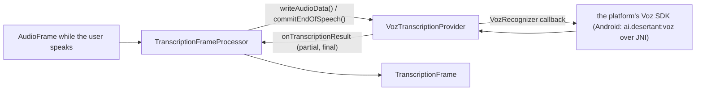

# Voz STT (Android)

*Speech-to-text provider, not in the provider catalog (construct it in C++), target `vasdk_voz_stt`, build flag `-DVASDK_BUILD_VOZ_STT=ON`. Source: [`VASDK_3P_IMPL/VozSTT/`](../../VASDK_3P_IMPL/VozSTT/). Interface: [`GenericTranscriptionProvider.h`](../../VASDK/include/VASDK/GenericTranscriptionProvider.h).*

Desert Ant Labs' Voz (Parakeet TDT 0.6B v3 for on-device runtimes). Its license only covers running it through Desert Ant Labs' SDKs, so this provider buffers each utterance and hands it to a `VozRecognizer` the platform implements on top of the SDK. The Android app registers it as `voz`.

## Platforms

| macOS | Linux | Windows | Android |
| --- | --- | --- | --- |
| no recognizer yet | no recognizer yet | no recognizer yet | yes |

## Options

In C++, `va::thirdparty::stt::VozTranscriptionOptions` (in [`VozTranscriptionProvider.hpp`](../../VASDK_3P_IMPL/VozSTT/VozTranscriptionProvider.hpp)). Every field has a default except the ones marked "required" in its comment.

| Field | Default | Meaning |
| --- | --- | --- |
| `recognizer` | `none` | Calls the Voz SDK of the platform (on Android, through JNI: VASDK_ANDROID/app/src/main/cpp/VozProvider.cpp). |
| `idleTimeoutMs` | `500` | Silence after the last audio that finalizes the utterance when no end of speech arrives. |
| `partialIntervalMs` | `0` | Time between two partial results; 0 disables partials (each one decodes a full 15 s window). |
| `minNewSamplesForPartial` | `8000` | New audio needed before another partial, in samples (8000: 500 ms at 16 kHz). |
| `minNewSamplesForFinal` | `1600` | New audio needed before the final pass re-runs, in samples (1600: 100 ms at 16 kHz). |

The engine config can't select it on desktop: only the Android app registers `voz` (`VASDK_ANDROID/app/src/main/cpp/VozProvider.cpp`). There, its `VozOptions` message ([options.proto](../../VASDK_3P_IMPL/ProviderCatalog/proto/vasdk/providers/options.proto)) sets `idle_timeout_ms`, `partial_interval_ms`, `min_new_samples_for_partial` and `min_new_samples_for_final`; the recognizer is the app's.

## Models and licenses

| Files | Source | License | Fetched by |
| --- | --- | --- | --- |
| downloaded by the SDK | [desert-ant-labs/voz](https://huggingface.co/desert-ant-labs/voz) | Desert Ant Labs Source-Available License 1.0 (free below 100k monthly active devices per platform; attribution required) | the SDK |

All of them are listed in [THIRD_PARTY_NOTICES.md](../../THIRD_PARTY_NOTICES.md) and in [Providers, sources and licenses](../provider-catalog.md#sources-and-licenses). An app that ships this provider ships these licenses with it ([vasdk-app](../../skills/vasdk-app/SKILL.md#licenses-ship-with-the-app)).

## Usage

```cpp
#include "VozSTT/VozTranscriptionProvider.hpp"

va::thirdparty::stt::VozTranscriptionOptions options;
options.recognizer = myPlatformRecognizer;  // calls the Voz SDK
auto provider = std::make_shared<va::thirdparty::stt::VozTranscriptionProvider>(options);
// TranscriptionFrameProcessor(provider); setAudioConfiguration() before the pipeline starts
```

## How it works



## Tests

| Test | Kind | Needs | Run |
| --- | --- | --- | --- |
| `voz_stt_provider` | unit | nothing (a fake recognizer) | `ctest --test-dir build -R voz_stt_provider` |

A test that needs a model or a key reports "skipped" without it.
