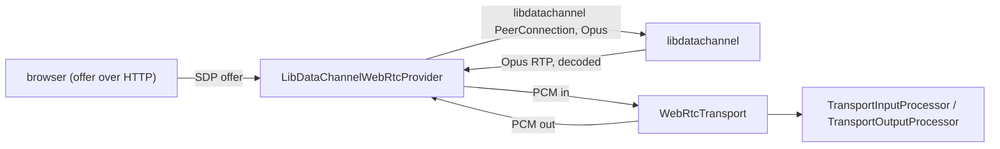

# WebRTC (libdatachannel)

*WebRTC peer provider, catalog id `libdatachannel` (`providers.webrtc` in an engine config), target `vasdk_libdatachannel_webrtc`, build flag `-DVASDK_BUILD_LIBDATACHANNEL_WEBRTC=ON`. Source: [`VASDK_3P_IMPL/LibDataChannelWebRtc/`](../../VASDK_3P_IMPL/LibDataChannelWebRtc/). Interface: [`WebRtcInterface.h`](../../VASDK/include/VASDK/network/WebRtcInterface.h).*

Browser calls: a direct WebRTC peer connection over [libdatachannel](https://github.com/paullouisageneau/libdatachannel) with Opus, behind the core's `WebRtcTransport`. It also serves the page and the offer endpoint. Off by default; needs OpenSSL (or mbedTLS / GnuTLS).

## Platforms

| macOS | Linux | Windows | Android |
| --- | --- | --- | --- |
| yes | yes | yes | yes |

## Options

In C++, `va::thirdparty::transport::LibDataChannelWebRtcOptions` (in [`LibDataChannelWebRtcProvider.h`](../../VASDK_3P_IMPL/LibDataChannelWebRtc/LibDataChannelWebRtcProvider.h)). Every field has a default except the ones marked "required" in its comment.

| Field | Default | Meaning |
| --- | --- | --- |
| `iceServers` | `{"stun:stun.l.google.com:19302"}` | STUN/TURN URLs, e.g. "stun:stun.l.google.com:19302". Empty: host candidates only (same machine or LAN). |
| `signalingPort` | `8080` | where a peer created from an engine config serves its signaling |
| `signalingHost` | `"127.0.0.1"` | the address it listens on; there's no authentication, so keep loopback unless the network is trusted |

In an engine config, `vasdk.providers.LibDataChannelWebRtcOptions`:

| Field | Unset | Meaning |
| --- | --- | --- |
| `ice_servers` | `iceServers`' default | STUN/TURN URLs |
| `port` | `VASDK_WEBRTC_PORT`, then 8080 | the signaling server's port: `POST /offer`, `GET /pipeline` (404 here: the page says so) and the page |
| `host` | 127.0.0.1 | as `signalingHost` |
| `page` | `VASDK_WEBRTC_PAGE`, then VASDK's demo page (`assets/webrtc/index.html`, from the source tree) | the HTML served at `GET /` |

**Not beside SonioxPP.** SonioxPP's libwebsockets runs on mbedTLS with an OpenSSL-compatible wrapper that defines `X509_new`, `SSL_CTX_new` and others. Linked into the same binary as libdatachannel (which uses OpenSSL), those names take over some of libdatachannel's calls, and its DTLS handshake crashes. CMake warns when both are on; build with one or the other.

## Models and licenses

No model files.

Library: [paullouisageneau/libdatachannel](https://github.com/paullouisageneau/libdatachannel), MPL 2.0. Codec: [Opus](https://opus-codec.org), BSD 3-Clause.

All of them are listed in [THIRD_PARTY_NOTICES.md](../../THIRD_PARTY_NOTICES.md) and in [Providers, sources and licenses](../provider-catalog.md#sources-and-licenses). An app that ships this provider ships these licenses with it ([vasdk-app](../../skills/vasdk-app/SKILL.md#licenses-ship-with-the-app)).

## Usage

From an engine config, for any app, the C API and Python included: the session's audio comes and goes over WebRTC instead of the app's ([engine config](../reference/engine-config.md#providers)):

```textproto
providers {
  webrtc { id: "libdatachannel" options { [type.googleapis.com/vasdk.providers.LibDataChannelWebRtcOptions] { port: 8080 } } }
}
```

Or in C++, with your own signaling:

```cpp
#include "LibDataChannelWebRtc/LibDataChannelWebRtcProvider.h"

va::thirdparty::transport::LibDataChannelWebRtcOptions options;
auto provider = std::make_shared<va::thirdparty::transport::LibDataChannelWebRtcProvider>(options);
// WebRtcTransport(provider): see docs/reference/transports.md#webrtctransport
```

## How it works



## Tests

| Test | Kind | Needs | Run |
| --- | --- | --- | --- |
| `vasdk_webrtc_provider` | integration | nothing (a loopback peer connection) | `ctest --test-dir build -R vasdk_webrtc_provider` |
| `vasdk_webrtc_session` | integration | Silero, Whistle and Phonon models | `ctest --test-dir build -R vasdk_webrtc_session`: a C API session over the config's peer, called by a libdatachannel offerer that speaks Opus; `vasdk_webrtc_session_test <models> --call <port> "<words>"` calls a running app |

A test that needs a model or a key reports "skipped" without it.
