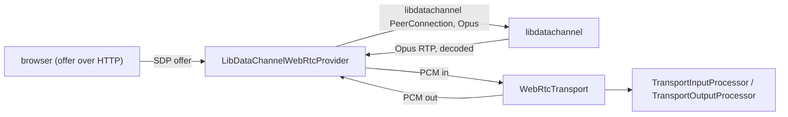

# WebRTC (libdatachannel)

*WebRTC peer provider, not in the provider catalog (construct it in C++), target `vasdk_libdatachannel_webrtc`, build flag `-DVASDK_BUILD_LIBDATACHANNEL_WEBRTC=ON`. Source: [`VASDK_3P_IMPL/LibDataChannelWebRtc/`](../../VASDK_3P_IMPL/LibDataChannelWebRtc/). Interface: [`WebRtcInterface.h`](../../VASDK/include/VASDK/network/WebRtcInterface.h).*

Browser calls: a direct WebRTC peer connection over [libdatachannel](https://github.com/paullouisageneau/libdatachannel) with Opus, behind the core's `WebRtcTransport`. It also serves the page and the offer endpoint. Off by default; needs OpenSSL (or mbedTLS / GnuTLS).

## Platforms

| macOS | Linux | Windows | Android |
| --- | --- | --- | --- |
| yes | yes | yes | yes |

## Options

In C++, `va::thirdparty::LibDataChannelWebRtcOptions` (in [`LibDataChannelWebRtcProvider.h`](../../VASDK_3P_IMPL/LibDataChannelWebRtc/LibDataChannelWebRtcProvider.h)). Every field has a default except the ones marked "required" in its comment.

| Field | Default | Meaning |
| --- | --- | --- |
| `iceServers` | `{"stun:stun.l.google.com:19302"}` | STUN/TURN URLs, e.g. "stun:stun.l.google.com:19302". Empty: host candidates only (same machine or LAN). |

## Models and licenses

No model files.

Library: [paullouisageneau/libdatachannel](https://github.com/paullouisageneau/libdatachannel), MPL 2.0. Codec: [Opus](https://opus-codec.org), BSD 3-Clause.

All of them are listed in [THIRD_PARTY_NOTICES.md](../../THIRD_PARTY_NOTICES.md) and in [Providers, sources and licenses](../provider-catalog.md#sources-and-licenses). An app that ships this provider ships these licenses with it ([vasdk-app](../../skills/vasdk-app/SKILL.md#licenses-ship-with-the-app)).

## Usage

```cpp
#include "LibDataChannelWebRtc/LibDataChannelWebRtcProvider.h"

va::thirdparty::LibDataChannelWebRtcOptions options;
auto provider = std::make_shared<va::thirdparty::LibDataChannelWebRtcProvider>(options);
// WebRtcTransport(provider): see docs/reference/transports.md#webrtctransport
```

## How it works



## Tests

| Test | Kind | Needs | Run |
| --- | --- | --- | --- |
| `vasdk_webrtc_provider` | integration | nothing (a loopback peer connection) | `ctest --test-dir build -R vasdk_webrtc_provider` |

A test that needs a model or a key reports "skipped" without it.
