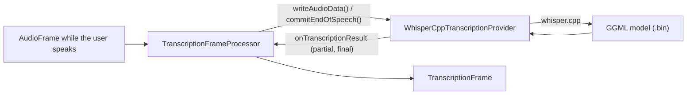

# Whisper.cpp STT (WIP)

*Speech-to-text provider, not in the provider catalog (construct it in C++), target `vasdk_whispercpp`, build flag `-DVASDK_BUILD_WHISPERCPP=ON`. Source: [`VASDK_3P_IMPL/WhisperCpp/`](../../VASDK_3P_IMPL/WhisperCpp/). Interface: [`GenericTranscriptionProvider.h`](../../VASDK/include/VASDK/GenericTranscriptionProvider.h).*

OpenAI's Whisper on [whisper.cpp](https://github.com/ggml-org/whisper.cpp) (GGML models, CPU or GPU). Work in progress, and not in the provider catalog yet: construct it in C++.

## Platforms

| macOS | Linux | Windows | Android |
| --- | --- | --- | --- |
| yes | yes | yes | yes |

## Options

In C++, `va::thirdparty::stt::WhisperCppTranscriptionOptions` (in [`WhisperCppTranscriptionProvider.hpp`](../../VASDK_3P_IMPL/WhisperCpp/WhisperCppTranscriptionProvider.hpp)). Every field has a default except the ones marked "required" in its comment.

| Field | Default | Meaning |
| --- | --- | --- |
| `modelPath` | `""` | A whisper.cpp GGML model file, .bin (VASDK_3P_IMPL/cmake/DownloadWhisperCppModel.cmake). |
| `idleTimeoutMs` | `100` | Silence after the last audio that finalizes the utterance when no end of speech arrives. |
| `partialIntervalMs` | `500` | Shortest time between two partial results. |
| `minNewSamplesForPartial` | `8000` | New audio needed before another partial, in samples (8000: 500 ms at 16 kHz). |
| `minNewSamplesForFinal` | `2000` | New audio needed before the final pass re-runs, in samples (2000: 125 ms at 16 kHz). |
| `threads` | `4` | CPU threads for inference. |
| `translateToEnglish` | `false` | Translate the speech to English instead of transcribing it. |
| `language` | `"auto"` | Language code, or "auto" to detect it. |
| `noSpeechThreshold` | `0.3f` | Below whisper.cpp's 0.6 so short VAD-gated clips aren't dropped as "no speech". |
| `noContext` | `true` | Every clip stands alone, so stale context from earlier segments can't leak into the prompt. |

whisper.cpp is pinned at v1.9.5, which builds against the ggml that Phonon and llama.cpp bring, so it builds beside them (v1.7.4 didn't: `GGML_KQ_MASK_PAD`, `ggml_backend_sched_new`).

## Models and licenses

| Files | Source | License | Fetched by |
| --- | --- | --- | --- |
| ggml-*.bin | [ggerganov/whisper.cpp](https://huggingface.co/ggerganov/whisper.cpp) | MIT | `VASDK_3P_IMPL/cmake/DownloadWhisperCppModel.cmake` |

Library: [ggml-org/whisper.cpp](https://github.com/ggml-org/whisper.cpp), MIT.

All of them are listed in [THIRD_PARTY_NOTICES.md](../../THIRD_PARTY_NOTICES.md) and in [Providers, sources and licenses](../provider-catalog.md#sources-and-licenses). An app that ships this provider ships these licenses with it ([vasdk-app](../../skills/vasdk-app/SKILL.md#licenses-ship-with-the-app)).

## Usage

```cpp
#include "WhisperCpp/WhisperCppTranscriptionProvider.hpp"

va::thirdparty::stt::WhisperCppTranscriptionOptions options;
options.modelPath = "...";
auto provider = std::make_shared<va::thirdparty::stt::WhisperCppTranscriptionProvider>(options);
// TranscriptionFrameProcessor(provider); setAudioConfiguration() before the pipeline starts
```

## How it works



## Tests

None of its own yet: it needs a model. The [provider skill](../../skills/vasdk-provider/SKILL.md#tests) describes the unit and integration tests a provider should have.
