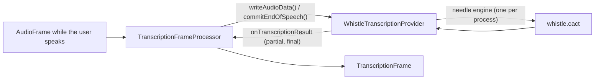

# Whistle STT

*Speech-to-text provider, config id `whistle`, target `vasdk_whistle_stt`, build flag `-DVASDK_BUILD_WHISTLE_STT=ON`. Source: [`VASDK_3P_IMPL/WhistleSTT/`](../../VASDK_3P_IMPL/WhistleSTT/). Interface: [`GenericTranscriptionProvider.h`](../../VASDK/include/VASDK/GenericTranscriptionProvider.h).*

Cactus Compute's Whistle, a small CPU model (about 17 MB) for English, German, French, Spanish, Italian, Dutch and Polish, with word timestamps and keyword biasing. It favours the words the agent expects next. On by default. It runs on Cactus's prebuilt, closed-source needle engine.

## Platforms

| macOS | Linux | Windows | Android |
| --- | --- | --- | --- |
| yes | yes | yes | arm64 and armv7 only |

## Options

In C++, `va::thirdparty::WhistleTranscriptionOptions` (in [`WhistleTranscriptionProvider.hpp`](../../VASDK_3P_IMPL/WhistleSTT/WhistleTranscriptionProvider.hpp)). Every field has a default except the ones marked "required" in its comment.

| Field | Default | Meaning |
| --- | --- | --- |
| `modelPath` | `""` | Directory holding whistle.cact, or the path of a .cact file (e.g. a fine-tuned build from `needle whistle build`). DownloadWhistleSTT.cmake fills the directory. |
| `enginePath` | `""` | Explicit path of the engine library (desktop only). Empty: next to the model, then the system search path. |
| `idleTimeoutMs` | `550` | Silence after the last audio that ends the utterance when no end of speech arrives. |
| `partialIntervalMs` | `250` | Time between two partial results. |
| `minNewSamplesForPartial` | `4000` | New audio needed before another partial, in samples (4000: 250 ms at 16 kHz). |
| `minNewSamplesForFinal` | `1600` | New audio needed before the final pass re-runs, in samples (1600: 100 ms at 16 kHz). |
| `language` | `""` | "en", "de", "fr", "es", "it", "nl" or "pl"; empty or "auto" detects per utterance. |
| `keywords` | `{}` | Names, product words and jargon to favour (keyword biasing). |
| `wordTimestamps` | `true` | Word timings and probabilities; also what the result confidence is averaged from. |

In an engine config, the catalog's `LocalSttOptions` message ([options.proto](../../VASDK_3P_IMPL/ProviderCatalog/proto/vasdk/providers/options.proto)) fills them: a field the config leaves unset falls back to its environment variable, then to the struct's default.

| Config field | Environment variable | Sets |
| --- | --- | --- |
| `model_dir` | - | `modelPath` |
| `idle_timeout_ms` | - | `idleTimeoutMs` |
| `partial_interval_ms` | - | `partialIntervalMs` |
| `language` | `WHISTLE_LANGUAGE` | `language` |

The engine holds one speech model per process and isn't thread-safe, so every instance shares one `NeedleEngine` and their calls are serialised: the one process-wide object in `VASDK_3P_IMPL/` (see `VASDK_3P_IMPL/check_rules.py`). Configure warns where no prebuilt engine exists, and stops on 32-bit Windows. The catalog derives `minNewSamplesForPartial` (a quarter second) and `minNewSamplesForFinal` (one pipeline frame) from the pipeline's audio format.

## Models and licenses

| Files | Source | License | Fetched by |
| --- | --- | --- | --- |
| whistle.cact | [Cactus-Compute/whistle](https://huggingface.co/Cactus-Compute/whistle) | Apache 2.0 | `VASDK_3P_IMPL/cmake/DownloadWhistleSTT.cmake` |
| libneedle3 (engine) | [Cactus-Compute/needle3](https://huggingface.co/Cactus-Compute/needle3), prebuilt, no source | Apache 2.0 | same |

All of them are listed in [THIRD_PARTY_NOTICES.md](../../THIRD_PARTY_NOTICES.md) and in [Providers, sources and licenses](../provider-catalog.md#sources-and-licenses). An app that ships this provider ships these licenses with it ([vasdk-app](../../skills/vasdk-app/SKILL.md#licenses-ship-with-the-app)).

## Usage

From an engine config:

```textproto
providers {
  stt {
    id: "whistle"
    options { [type.googleapis.com/vasdk.providers.LocalSttOptions] { idle_timeout_ms: 600 } }
    fallback: "parakeet"
  }
}
```

From C++:

```cpp
#include "WhistleSTT/WhistleTranscriptionProvider.hpp"

va::thirdparty::WhistleTranscriptionOptions options;
options.modelPath = "...";
auto provider = std::make_shared<va::thirdparty::WhistleTranscriptionProvider>(options);
// TranscriptionFrameProcessor(provider); setAudioConfiguration() before the pipeline starts
```

## How it works



## Tests

| Test | Kind | Needs | Run |
| --- | --- | --- | --- |
| `vasdk_offline_conversation` | integration | the default models | `ctest --test-dir build -R vasdk_offline_conversation` |

A test that needs a model or a key reports "skipped" without it.
