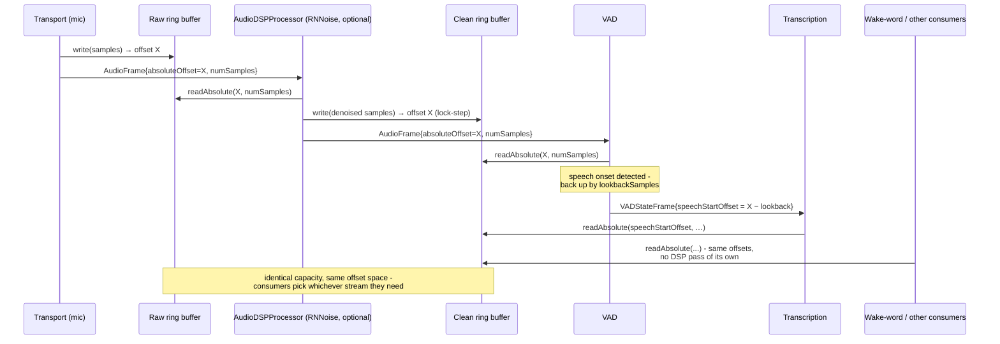

# Frames

*Reference for `va::transport::Frame` and every concrete frame type. Header: [`Frame.h`](../../VASDK/include/VASDK/Frame.h) - the source of truth if this page and the code ever disagree.*

Frames are the only thing that moves through a VASDK pipeline. Every stage communicates by producing and consuming frames; no processor calls another processor's methods directly. If you understand the frame taxonomy, you can read any pipeline.

## The base class

```cpp
class Frame {
    virtual FrameType getType() const = 0;                 // which kind of frame this is
    virtual FramePriority getPriority() const;             // queue ordering (see below)
    virtual std::shared_ptr<Frame> clone() const = 0;      // deep copy

    uint64_t    timestamp;            // creation time, microseconds since epoch
    uint64_t    sequenceId;           // ordering within a stream
    std::string frameId;              // unique ID for debugging
    std::string sourceId;             // which component created it
    uint64_t    processingDuration;   // perf monitoring
    uint64_t    acquisitionDuration;  // time spent waiting (e.g. for audio)
};
```

Two contracts every new frame type must honor:

1. **`getType()` returns a stable `FrameType`** - processors filter on it in `shouldProcess()`.
2. **`clone()` is a deep copy** - including all base-class metadata. Every existing frame type copies `timestamp`, `sequenceId`, `frameId`, and `sourceId` explicitly; follow that pattern.

## Priorities

Processors use a priority queue: higher-priority frames jump ahead of normal traffic, FIFO order is preserved within the same priority. Defaults:

| Frame | Priority |
| --- | --- |
| `SYSTEM`, `ERROR` types (base-class default) | `CRITICAL` |
| `ControlFrame` with `INTERRUPT` | `CRITICAL` |
| `ControlFrame` (any other command) | `HIGH` |
| `ErrorFrame` with `FATAL` severity | `CRITICAL` |
| `ErrorFrame` (other severities) | `HIGH` |
| `AudioSourceEndControlFrame` | `LOW` (end-of-file marker shouldn't overtake audio) |
| Everything else | `NORMAL` |

Override `getPriority()` in a custom frame only when it genuinely must preempt audio processing - an over-prioritized chatty frame type starves the media path.

## Flow directions

Frames travel `DOWNSTREAM` (input → output: audio, transcriptions, LLM text, synthesis) or `UPSTREAM` (output → input: errors, interrupts, TTS lifecycle events). The direction is a property of *how a frame is pushed*, not of the frame itself - the same `ControlFrame` type can go either way.

## Frame catalog

Every `FrameType`, its concrete class, and what carries it:

| `FrameType` | Class | Payload | Typical producer → consumer |
| --- | --- | --- | --- |
| `AUDIO` | `AudioFrame` | **No samples** - `absoluteOffset` + `numSamples` + format metadata referencing a shared [`AudioRingBuffer`](../../VASDK/include/VASDK/AudioRingBuffer.h) | `LocalTransport` → DSP, VAD |
| `VAD_STATE` | `VADStateFrame` | `VADState` + speech start/end offsets + confidence | `VADFrameProcessor` → turn detection, transcription |
| `TURN_STATE` | `TurnStateFrame` | actor (`USER`/`SYSTEM`/`OTHER`), state (`START`/`END`), type (`NORMAL`/`INTERRUPT`/`OVERLAP`), confidence | `TurnDetectionProcessor` → `AgentStateProcessor`; also **upstream** to `VADFrameProcessor` (user `END` = close the speech segment now) |
| `TRANSCRIPTION` | `TranscriptionFrame` | full `TranscriptionResult` (text, confidence, word timings, language tags, alternatives) + `isFinal`; `isBackchannel` marks a dismissed back-channel forwarded for history (`BackchannelHistoryMode::AppendToHistory`); `isFollowUp` marks the merged text `LLMProcessor` sent for a [follow-up](llm.md#follow-ups), pushed downstream so UIs can show what the LLM received | `TranscriptionFrameProcessor` → agent state, LLM |
| `AGENT_STATE` | `AgentStateFrame` | current/previous `AgentState`, the `AgentStateTransition` that caused it, trigger confidence. `BARGE_IN_PENDING` and `BACKCHANNEL` are SPEAKING → SPEAKING transitions: speech over the agent is being classified, then was only a back-channel ([processors.md](processors.md#back-channels-speech-over-the-agent-that-isnt-an-interruption)) | `AgentStateProcessor` → LLM, TTS, transports |
| `TEXT` | `TextFrame` | text, language (an agent's reply: its locale's code; empty when unknown), `isFinal` (mid-stream vs last chunk), `isExpecting` (LLM awaits a spoken reply), UI `choices` | `LLMProcessor` → TTS, UI transports |
| `TOOL_CALL` | `ToolCallFrame` | tool name + JSON args (as a string, to keep nlohmann/json out of `Frame.h`) | `LLMProcessor` → `ToolDispatchProcessor` |
| `TOOL_RESULT` | `ToolResultFrame` | tool name + JSON result string | `ToolDispatchProcessor` → back to LLM |
| `SYNTHESIS` | `SynthesisFrame` | **actual audio bytes** (`audioData`) + source text + voice ID | `TTSFrameProcessor` → output transport |
| `SYNTHESIS_STATE` | `SynthesisStateFrame` | `STARTED` / `COMPLETED` / `INTERRUPTED` / `ERROR` - flows **upstream** | `TTSFrameProcessor` → agent state, turn detection |
| `TRIGGER` | `TriggerFrame` | `WAKE_WORD` / `BUTTON_PRESS` / `APP_COMMAND` / `SCHEDULED` + data + confidence | `TriggerProcessor` → `AgentStateProcessor` |
| `CONTROL` | `ControlFrame` | `START` / `STOP` / `PAUSE` / `RESUME` / `RESET` / `INTERRUPT` + optional `targetId` | any → any |
| `METADATA` | `MetadataFrame` | key/value string pair | app-specific |
| `ERROR` | `ErrorFrame` | severity (`WARNING`/`ERROR`/`FATAL`) + code + message - flows **upstream** | any failing stage → `RecoveryProcessor`, app |
| `SYSTEM` | *(reserved)* | high-priority control category | - |
| `AUDIO_FEATURES` | *(VizAnim provider)* | extracted feature vector for UI visualization | VizAnim processors → TUI, `WebRtcTransport` (as `audio_features` events) |
| `SPEAKER_ENROLLMENT` | `SpeakerEnrollmentFrame` | speaker id + `REQUESTED` / `ENROLLED` / `FAILED` + error message | app/tool → `SpeakerIdentificationProcessor` (`REQUESTED`), which answers downstream |
| `SPEAKER_IDENTIFICATION` | `SpeakerIdentificationFrame` | best-matching enrolled speaker id (empty = unknown) + cosine similarity, new-vs-same flag, similarity to the tracked voice | `SpeakerIdentificationProcessor` → app, `WebRtcTransport` (as `speaker` events) |

Note the asymmetry that trips people up: **`AudioFrame` (mic side) carries no audio; `SynthesisFrame` (TTS side) does.** Mic audio is a continuous firehose shared by several consumers, so it lives once in a ring buffer and frames carry offsets. Synthesized audio is bursty and single-consumer, so it rides in the frame. [The audio ring buffer](#the-audio-ring-buffer) below explains the design in depth.

## The audio ring buffer

The single biggest reason `AudioFrame` doesn't carry samples is `AudioRingBuffer` (`AudioRingBuffer.h`): a fixed-capacity circular buffer, shared via `shared_ptr` across the transport and every processor that touches raw mic-side audio. Instead of pushing PCM through a chain of stage-to-stage copies, only two integers move downstream: `absoluteOffset` and `numSamples`. Whoever actually needs the bytes calls `readAbsolute()` against the shared buffer, however many frames behind the write cursor they've fallen.

That shared-buffer design pays for itself in three concrete ways, beyond just "fewer memcpys":

- **Raw and clean streams, kept separate.** `LocalTransport` writes mic audio into one ring buffer and never touches it again - the raw signal stays raw. `AudioDSPProcessor` reads from that raw buffer, runs it through a `GenericAudioDSPProvider` (e.g. RNNoise), and writes the result into a second, identically-sized "clean" ring buffer, advanced in lock-step so the same `AudioFrame::ringbufferOffset` addresses the same instant in both. VAD and STT are pointed at whichever buffer they need - the clean one when denoising is enabled, the raw one directly when it isn't - and neither buffer is ever mutated in place. That clean stream is just as available to anything else that wants processed audio without paying for its own DSP pass: a wake-word detector, a voice-cloning reference recorder for TTS, a debug logger, or whatever gets added next - they all read the same offsets, no extra plumbing required. (`AudioRingBuffer` does expose a lower-level `overwrite()` for in-place mutation of a single buffer, but the shipped `AudioDSPProcessor` doesn't use it; keeping raw and clean as two buffers means nothing downstream ever loses access to the untouched signal.)
- **Free lookback.** `VADFrameProcessor` doesn't keep its own pre-roll window to avoid clipping the start of an utterance. When it detects speech onset, it computes an earlier `absoluteOffset` (`lookbackMultiplier` samples before the detected boundary) and emits *that* offset in the `VADStateFrame`. `TranscriptionProcessor` reads from it directly - the "extra" audio was already sitting in the ring buffer the whole time, so pre-roll costs nothing extra to capture.
- **No backpressure stalls.** Nothing blocks waiting for a slow reader, so a burst of audio never backs up the capture thread. The trade-off is explicit rather than hidden: each buffer has to be sized generously enough (in samples/duration) that the slowest consumer reading from it can't fall behind by more than its capacity before the write cursor wraps and overwrites data that hasn't been read yet. There's no locking and no queueing of raw audio - only bounded staleness, and that bound is a constructor argument you control per buffer.

This only covers the inbound, near-continuous mic path. Outbound audio doesn't need it: `SynthesisFrame` (TTS output) carries its `audioData` directly, since synthesized speech is bursty and short-lived rather than a firehose the whole pipeline needs to share cheaply.



If DSP is disabled at runtime, there's no processor sitting between `Transport` and `Clean` in that diagram - VAD/STT are simply pointed at the raw buffer directly instead, so the "clean" concept costs nothing when you don't need it.

## The two state machines encoded in frames

Two enums deserve special attention because processors key their behavior off them:

**`VADState`** (acoustic, emitted by `VADFrameProcessor`): `QUIET → STARTING → ONGOING → PAUSED ⇄ RESUMING → ENDING → ENDED`. Distinguishes a hesitation (`PAUSED`) from the end of an utterance (`ENDED`).

**`AgentState`** (conversational, emitted by `AgentStateProcessor`): `IDLE → LISTENING → THINKING → SPEAKING → INTERRUPTED`. See [processors.md](processors.md#agentstateprocessor---the-conversation-state-machine) for the full transition diagram.

## Adding a new frame type

The enum and catalog above will grow. To add a frame type without breaking existing pipelines:

1. Add the value to `FrameType` **and** to the `toString(FrameType)` switch in `Frame.h`.
2. Subclass `Frame`; implement `getType()`, a deep `clone()`, and (only if justified) `getPriority()`.
3. Keep heavy dependencies out of the header - serialize complex payloads to strings (see `ToolCallFrame::argsJson` for the precedent).
4. Existing processors ignore unknown types by default (`shouldProcess()` filters), so a new frame type is backward-compatible as long as you don't repurpose an existing one.
