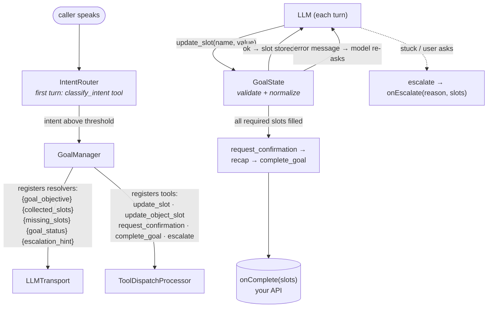

# The goal layer

*Reference for everything under `va::goal`, plus `SessionManager`. Headers in [`VASDK/include/VASDK/goal/`](../../VASDK/include/VASDK/goal/) are the source of truth if this page and the code ever disagree.*

The goal layer turns a conversational assistant into a **task completer**: instead of chatting open-endedly, the agent works toward a defined objective - collect these five pieces of information, validate them, confirm, then fire an action against your systems. It's the layer behind the [call center showcase](../../VASDK_CALLCENTER_APP/README.md), and the newest, fastest-moving part of the SDK.

The mechanism is worth understanding before the classes: **the goal layer doesn't process frames at all.** It plugs into the LLM stack from the side - live prompt variables tell the model what's still missing, and registered tools let the model submit values, which are validated in C++ and rejected back to the model to re-ask. Deterministic validation, probabilistic conversation.

## GoalSlot - one piece of information

([`GoalSlot.h`](../../VASDK/include/VASDK/goal/GoalSlot.h)) A slot is a name, a description (shown to the LLM), a type, and constraints:

| `SlotType` | Validation / normalization |
| --- | --- |
| `STRING` | passed through |
| `PHONE` | normalized to `NXX-NXX-XXXX` (US) or `NXX-XXXX` |
| `EMAIL` | basic format check |
| `DATE` / `TIME` / `DATETIME` | ISO 8601 / `HH:MM`; `constraints.mustBeFuture` supported - the LLM resolves "next Tuesday" before calling |
| `NUMBER` / `INTEGER` | optional `constraints.min`/`max` |
| `BOOLEAN` | accepts yes/no/true/false/1/0 |
| `ENUM` | must match `constraints.allowedValues` (case-insensitive); the allowed list is shown in the prompt |
| `OBJECT` | whole JSON object at once, validated against `constraints.objectSchema` (a list of `ObjectField{name, description, jsonType, required}`) |
| `COMPOSITE` | named `subSlots` filled one at a time via dot-path (`"vehicle.year"`) |

Two escape hatches keep the built-ins from ever boxing you in: `condition` (a `bool(const GoalState&)` - the slot is only required when it returns true, evaluated against live state every turn) and `validator` (replaces built-in validation entirely; return a `SlotValidationResult{valid, normalizedValue, errorMessage}` - the error message goes to the model so it can re-prompt intelligently).

## GoalDefinition

([`GoalDefinition.h`](../../VASDK/include/VASDK/goal/GoalDefinition.h)) `{name, objective, slots, onComplete}`. The `onComplete` callback receives all collected values as one JSON object and returns `bool` - `false` tells the model the external action failed. Build definitions in C++, or load from JSON:

- **`GoalDefinitionLoader`** ([`GoalDefinitionLoader.h`](../../VASDK/include/VASDK/goal/GoalDefinitionLoader.h)) - `fromJson`/`fromFile`/`fromDirectory`. Callbacks and custom validators can't be serialized; attach them after loading.
- **`compileCondition`** ([`ConditionEvaluator.h`](../../VASDK/include/VASDK/goal/ConditionEvaluator.h)) - compiles a JSON predicate DSL into a condition lambda, so JSON-defined goals get conditional slots too. Operators: `eq`, `neq`, `in`, `nin`, `exists`, `gte`, `lte`, and combinators `and` / `or` / `not`. Throws `std::invalid_argument` on malformed expressions.

Worked example: [goal-definitions.md](../examples/goal-definitions.md).

## GoalState - the live call

([`GoalState.h`](../../VASDK/include/VASDK/goal/GoalState.h)) A mutable copy of the definition's slots plus conversation-progress counters. Everything is thread-safe (tool handlers and prompt resolvers hit it from different threads):

- `updateSlot(dotPath, rawValue)` - validate + normalize a spoken value; `updateObjectSlot(name, json)` for OBJECT slots; `prefillSlot(dotPath, json)` bypasses validation (CRM prefill before the call starts).
- `isComplete()` - all *currently required* slots collected (conditions re-evaluated live).
- `missingSlotsSummary()` / `collectedSlotsSummary()` - the strings behind the `{missing_slots}` / `{collected_slots}` prompt variables, lazily cached and invalidated on any change.
- Confirmation and reprompt counters: `isAwaitingConfirmation`, `confirmationAttempts`, `repromptCount`.
- `toJson()` - flat object of collected values (what `onComplete` receives).

## GoalManager - the wiring hub

([`GoalManager.h`](../../VASDK/include/VASDK/goal/GoalManager.h)) Owns a `GoalState` and connects it to the LLM stack. `GoalManager(def, maxReprompts = 2)` - after `maxReprompts` failed collection attempts the model is instructed to escalate instead of asking again.

`attach(transport, dispatcher)` (or the two `attachTo…` methods separately) does everything:

- **On the transport** - registers the five live template variables: `{goal_objective}`, `{collected_slots}`, `{missing_slots}`, `{goal_status}`, `{escalation_hint}`. Your `PromptTemplate` must reference them; they re-resolve on every request. Call order matters: attach the goal manager *before* registering your own `{tool_descriptions}` resolver.
- **On the dispatcher** - registers five tools: `update_slot`, `update_object_slot`, `request_confirmation`, `complete_goal`, `escalate`.

Callbacks: `setOnComplete(fn)` (after `complete_goal` fires the external action successfully - typically `pipeline->stop()`), `setOnEscalate(fn)` (receives `EscalationContext{reason, collectedSlots}` - route to a human/fallback). Other members: `prefillSlot()`, `state()`, `isComplete()`, `reset(newGoal)` for mid-call goal switches, `setMetrics()` for per-slot `CallMetrics` tracking.

## IntentRouter - which goal is this call about?

([`IntentRouter.h`](../../VASDK/include/VASDK/goal/IntentRouter.h)) For multi-purpose lines. Constructed with a list of `IntentOption{name, description, goal}` and a confidence threshold (default 0.6). `attachToLLMTransport` installs an intent-detection prompt (customize the opening line with `setRoleDescription`) and `attachToToolDispatcher` registers a `classify_intent` tool. When the model classifies above threshold, your `setOnIntent` callback receives the name and `GoalDefinition` - build a `GoalManager`, attach it, and the system prompt swaps mid-session with no pipeline restart. `registerSwitchGoalTool()` additionally lets the model change goals mid-call; `reclassify(name)` does it programmatically.

## Persistence - resume a dropped call

([`GoalStatePersistence.h`](../../VASDK/include/VASDK/goal/GoalStatePersistence.h)) Three methods: `save(sessionKey, json)`, `load(sessionKey) → optional`, `clear(sessionKey)`. `serializeGoalState()` / `deserializeGoalState()` convert to/from JSON - only runtime values are persisted; the app must supply the `GoalDefinition` (lambdas don't serialize) when restoring.

`FileGoalStatePersistence` (one JSON file per session key under a base directory) is the shipped implementation - explicitly dev/test-grade. A Redis or database version is those same three methods; it just doesn't exist here yet.

## GoalConversationSimulator - testing without an LLM

([`GoalConversationSimulator.h`](../../VASDK/include/VASDK/goal/GoalConversationSimulator.h)) Scripts a conversation as `SimTurn`s (user utterance + the tool calls the "LLM" makes in response) and runs them against real `GoalManager`/`GoalState` validation logic - no model, no audio, fully deterministic. `SimulationResult` reports success, final slots, completion, and escalation. This is how slot-filling and escalation logic get regression-tested in CI.

## SessionManager - many calls at once

([`SessionManager.h`](../../VASDK/include/VASDK/SessionManager.h)) Multi-session orchestration for server deployments:

- **`ResourcePool<T>`** - a thread-safe pool of pre-initialized provider instances. `acquire(timeout)` blocks (default 5 s) and returns `nullptr` on exhaustion; `release()` returns the instance. Loading an STT model takes seconds; pooling means a new call grabs a warm one.
- **`SessionManagerConfig`** - `maxConcurrentSessions` (default 10), `maxCallDuration` (default 30 min), a `persistence` backend, `goalSetForDNIS` (different dialed numbers offer different goal sets), and `pipelineFactory` (your function that builds a fully-wired pipeline given the call metadata and the session's pooled STT/TTS).
- **`SessionManager`** - `createSession(CallMetadata{callId, callerANI, calledDNIS})` acquires providers and builds the pipeline (`nullptr` when limits are hit - busy-signal the call); `destroySession(callId)` stops the pipeline and returns providers to the pool. VAD is shared across sessions (it's cheap and stateless per the provider contract); STT/TTS are per-session.

## Maturity note

This layer moves fastest and its API surface is the least settled - the phase-4 features (goal branching, `switch_goal`, `reclassify`) are newer than the rest. Pin a commit, treat the headers as authoritative, and expect the tool set and template variables to grow.
