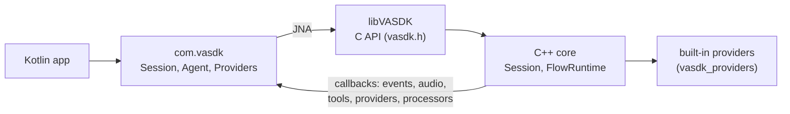

# Kotlin

*Reference for the Kotlin binding. Sources: [`bindings/kotlin/src/main/kotlin/com/vasdk/`](../../bindings/kotlin/src/main/kotlin/com/vasdk/), over the [C API](c-api.md) ([`vasdk.h`](../../VASDK/include/VASDK/c/vasdk.h), the source of truth). Every call is listed against its C++ in the [binding parity manifest](../../skills/vasdk-binding-parity/parity.md).*

The Kotlin binding gives a JVM app (macOS, Linux, Windows) or an Android app what C++ apps have: agents and their text conversations, spoken sessions with every control, many sessions over one runtime, and steps, tools, envelopes, page types, entity extractors, processors and providers (VAD, STT, TTS, turn, wake word, sentence encoder, entity model, LLM) written in Kotlin. It calls the C API through [JNA](https://github.com/java-native-access/jna), so there is no JNI code to write; messages are VASDK's `.proto` files as protobuf lite classes (`vasdk.engine.Events.Event`, `vasdk.flow.Conversation.ConversationReply`, ...).



## Building

It's optional: `-DVASDK_BUILD_KOTLIN_BINDING=ON` (off by default) registers `vasdk_kotlin_jar` and the `vasdk_kotlin` test, which Gradle runs against the build's VASDK. It needs Gradle and a JDK 17 or newer; without them CMake warns and registers neither. By hand:

```bash
cd bindings/kotlin
VASDK_LIBRARY=$PWD/../../build/VASDK/libVASDK.dylib gradle test     # .so on Linux, VASDK.dll on Windows
gradle jar                                                          # build/libs/vasdk-1.0.0.jar
```

On Android it's the `:vasdk` AAR ([Android](../apps/android.md#the-kotlin-binding-as-an-aar)). The library is found through `VASDK_LIBRARY` (a path), the `vasdk.library` system property, or `VASDK` on the library path (Android: `libVASDK.so` in the AAR). The built-in providers come from `VASDK_PROVIDERS_LIBRARY`, the build tree beside VASDK, `vasdk_providers` on the library path, or VASDK itself.

## Agents and conversations

```kotlin
import com.vasdk.*

val registry = Registry()
registry.tool("save_booking", "Keeps a confirmed booking") { args -> jsonOf(mapOf("status" to "confirmed")) }
registry.envelope("thanks", before = { turn -> if (turn.text == "thanks") { turn.say("You're welcome."); true } else false })
val agent = Agent.load("VASDK_APP/agents/garage-menu/agent.txtpb", registry)
agent.conversation().use { conversation ->
    println(conversation.start().text)
    val reply = conversation.say("book a tire repair on tuesday")   // a vasdk.flow.Conversation.ConversationReply
    println("${reply.text} (page ${reply.page})")
}
val (passed, report) = Vasdk.runTestFile(agent, "VASDK_APP/agents/garage-menu/tests/book_service.txtpb")
```

| | |
| --- | --- |
| `Registry` | `step` (params as their bytes) and `stepJson` (as JSON, for a type only the agent's own `.proto` declares), `tool`, `envelope`, `pageType` / `pageTypeJson`, `entityExtractor`, `addLanguage`. |
| `Turn` | `text`, `lookup`, `say`, `ask`, `goTo`, `setText`, `render`, `replyText`, `flow`, `page`, `apply(StepOutcome)`. |
| `Agent` | `load(path)`, `parse(text)`, `protoFiles()`, `conversation()`. |
| `Conversation` | `start`, `say`, `noInput`, `selectChoice`, `fireTrigger`, `checkTriggers`, `deliverQueued`, `send(ConversationInput)`, `setParam`, `lookup`, `snapshot` / `resume`, `setEntityValues`, `setContext`, `replyInterrupted`, `noInputMs`, `nextScheduledTrigger`, `triggerState` / `restoreTriggerState`. |
| `Vasdk` | `version`, `setLogLevel`, `builtinLanguage`, `runTestFile`, `runTest(FlowTestCase)`. |

Values cross as [kotlinx.serialization](https://github.com/Kotlin/kotlinx.serialization) JSON: tool arguments and results, `lookup`'s values, the context. `jsonOf(value)` turns Kotlin values (maps, lists, strings, numbers) into it.

## Spoken sessions

```kotlin
val providers = Providers()                     // every provider built into vasdk_providers
val options = vasdk.engine.Session.SessionOptions.newBuilder().setId("kitchen")
    .setSystemPrompt("You're a kitchen assistant. The kitchen: {context}").build()
Session("engine.txtpb", providers, agent, options).use { session ->
    session.onEvent { event -> if (event.hasAgentReply() && event.agentReply.isFinal) println(event.agentReply.text) }
    session.onAudio { pcm -> speaker.write(pcm) }                       // 16-bit mono, at session.outputRate
    session.tool(ToolDeclaration.newBuilder().setName("set_timer").build()) { args -> jsonOf(mapOf("started" to true)) }
    session.onContext { JsonObject(mapOf("timers" to jsonOf(timers))) }
    session.start()
    session.pushAudio(pcm)                                              // the user's audio, at session.inputRate
    session.injectText("set a timer for five minutes")
}
```

`session.events` is a `SharedFlow<Event>` of the same events, for coroutines. Callbacks run on VASDK's threads: keep them quick, and hop to your own dispatcher before touching UI.

| | |
| --- | --- |
| Before `start()` | `onEvent`, `onAudio`, `tool`, `onContext`, `addProcessor` (`Slot.AFTER_INPUT`, `BEFORE_OUTPUT`: audio) and `addTextProcessor` (`AFTER_TRANSCRIPTION`, `BEFORE_SYNTHESIS`: text). |
| Commands | `injectText`, `say`, `selectChoice`, `interrupt`, `setParam`, `fireTrigger`, `resetConversation`, `pushToTalk`, `setFollowUpListenMs`, `setEntityValues`, `setBackchannel`, or any `send(Command)`. |
| State | `setContext`, `setNetworkAvailable`, `snapshot` and `start(resume)`, `describe`, `usingFallbacks`, `nextScheduledTrigger` (an alarm to set), `triggerState` / `restoreTriggerState`. |
| `Runtime(config, providers, maxSessions = 4)` | `session(agent, options)` per conversation over one set of loaded providers; `activeSessions`, `idleProviderSets`. |

With `providers { audio_input { id: "miniaudio" } audio_output { id: "miniaudio" } }` (`aaudio` on Android) the session opens the microphone and speaker itself, and `pushAudio` / `onAudio` go unused. With `providers { llm { id: "llamacpp" } }` it runs a local LLM.

## Providers written in Kotlin

```kotlin
val providers = Providers(builtIn = false)
providers.vad("loudness") { _, _ ->
    object : VadProvider { override fun detect(pcm: ShortArray) = if (pcm.maxOf { abs(it.toInt()) } > 1000) 0.9f else 0f }
}
providers.tts("tone") { sink, sampleRate ->
    object : TtsProvider {
        override fun synthesize(text: String): Boolean { sink.audio(ShortArray(sampleRate / 10)); sink.done(); return true }
    }
}
providers.llm("mine") { _, _ -> object : LlmProvider { override fun complete(messages: List<LlmMessage>) = "Sure." } }
// engine.txtpb: providers { vad { id: "loudness" } tts { id: "tone" } llm { id: "mine" } ... }
```

Each session makes its own instance from the factory, with its `Sink` (transcripts, speech, errors) and sample rate; `close()` ends it. `VadProvider`, `SttProvider`, `TtsProvider`, `TurnProvider`, `WakeWordProvider`, `SentenceEncoderProvider` and `EntityModelProvider` (one instance for every session of a runtime), `LlmProvider`. An STT with `streaming_transcription` off (the default) gets a whole utterance in `write()`, and gives its final with `sink.text()` before `endOfSpeech()` returns.

## Tests

`vasdk_kotlin` ([`bindings/kotlin/src/test/kotlin/com/vasdk/`](../../bindings/kotlin/src/test/kotlin/com/vasdk/)): the garage agent's whole suite through its step, tool and envelope written in Kotlin; a spoken session on providers and processors written in Kotlin, with no models; a runtime with a Kotlin sentence encoder and entity model; a text conversation's controls, a page type's turn, an entity extractor, a language and a test case from memory. On Android the same tests run with `:vasdk:connectedAndroidTest`.
